# Lógica de Programação e Algoritmos (937564)
## Aula 1 — Introdução à Lógica e Algoritmos

> Texto integral da apostila oficial da Uninter (sem resumo). PDF original: [Aula_01.pdf](../_apostilas_pdf/01_Logica_Programacao/Aula_01.pdf)

LÓGICA DE PROGRAMAÇÃO E ALGORITMOS AULA 1

Prof. Vinicius Pozzobon Borin

### CONVERSA INICIAL

O objetivo desta abordagem é introduzir os principais conceitos inerentes à lógica de programação e algoritmos . Vamos iniciá-la compreendendo o que significam as palavras -chave do nosso estudo: lógica e algoritmos. Investigaremos um pouco do raciocínio lógico necessário para o desenvolvimento de programas computacionais, bem como iremos definir , em um contexto até mesmo fora da computação, o que são algoritmos. Após essas definições, iremos tratar dos recursos necessários para que um sistema computacional execute algoritmos . Portanto, veremos a arquitetura computacional-base para a execução de programas, o hardware. Investigaremos, também, as maneiras distintas de representarmos um algoritmo. Para tal, estudaremos a nomenclatura de pseudocódigo e de fluxogramas. Esses conceitos nos acompanharão ao longo de todo o nosso estudo.

Por fim, encerraremos esta abordagem  compreendendo o que são linguagens de programação e como um sistema computacional entende- as. Focaremos no entendimento da linguagem Python, a qual adotaremos para o nosso estudo.  Ao longo deste estudo,  serão apresentados exemplos de algoritmos escritos tanto em pseudocódigo, quanto em fluxogramas e também em linguagem de programação Python, que será conceituada e abordada no decorrer do nosso estudo. Todos os conceitos trabalhados nesta abordagem continuarão aparecendo de forma recorrente ao longo do nosso estudo.

### TEMA 1 – INTRODUÇÃO À LÓGICA E AOS ALGORITMOS

Nossa área de estudo é chamada de Lógica de Programação e Algoritmos. Portanto, nada melhor do que iniciarmos esta abordagem conceituando esse nome. Afinal, o que é lógica? E o que são algoritmos? E como tudo isso se conecta,  na área da computação e da programação? Vamos compreender isso no decorrer desta abordagem.

1.1 Introdução à lógica Você já parou para pensar na maneira com que você racionaliza para realizar suas tarefas cotidianas? Por exemplo, ao acordar você segue, mesmo que de maneira não intencionalmente, uma ordem para suas atividades. Quando acorda, você veste- se, escova seus dentes, toma café, dentre outras tarefas.

Cada pessoa segue sua rotina como prefere, mas todos temos uma sequência de passos , a serem realizado s, que mais nos agrada. Tudo que fazemos e seguimos em nossas rotinas tem um motivo, o qual é baseado em nosso raciocínio lógico, desenvolvido ao longo da vida. Por  que nos vestimos ao acordar? Bom, porque sair de pijama na rua está fora da convenção social. Por que tomamos café ao acordar? Porque precisamos de energia para o longo dia de trabalho que virá. E, assim, podemos questionar o porquê do que fazemos e veremos que temos para tanto uma resposta racional, mesmo que ela faça sentido somente para nós mesmos.

O raciocínio lógico adotado para estabelecer nossas tarefas é um pensamento que adotamos des de os nossos tempos primitivos. E que rege a maneira como conduzimos nosso dia a dia. Esse tipo de raciocínio provém da ciência da lógica. A lógica foi pela primeira vez conceituada na Grécia Antiga, por Aristóteles (384- 322 a.C.). A palavra lógica  é de origem grega ( logos) e significa linguagem racional . De acordo com o D icionário Michaelis , lógica é “Parte da filosofia que se ocupa das formas do pensamento e das operações intelectuais” (Lógica, 2015) . Levando o conceito de lógica para a área da computação e informática, novamente de acordo com o D icionário Michaelis, o termo lógica, quando associado a essa área, é entendido como a “Maneira pela qual instruções, assertivas e pressupostos são organizados num algoritmo para viabilizar a implantação de um programa” (Lógica, 2015).

Certo, o conceito do dicionário nos legou uma nova palavra: algoritmo. Ainda não definimos o que um algoritmo é! Faremos isso na próxima subseção. O que é relevante, neste momento inicial, é que compreendamos que o uso de lógica é a base para o desenvolvimento de softwares  computacionais. E é esse tipo de raciocínio lógico que iremos desenv olver e trabalhar ao longo deste estudo.

1.2 Introdução aos algoritmos Vimos que a lógica está intimamente conectada com o conceito de algoritmos, na área da computação. Mas , afinal, o que são algoritmos? Assim como a lógica, o conceito de algoritmo não é especificamente atrelado ao universo da informática e também precede, em alguns séculos, o do surgimento da era digital. Já no século XVII, filósofos e matemáticos como o alemão Gottfried Wihelm Leibniz já discutiam seu conceito. Nessa época, linguagens matemáticas

simbólicas e máquinas universais de cálculo eram muito empregadas para auxiliar em cálculos complexos, como diferenciais e integrais. Utilizar dispositivos como a calculadora de Leibniz1 requerem uma sequência correta de passos para se atingir o resultado. Na matemática, resolver problema é seguir as etapas previstas, na ordem correta.

Assim, o conceito de algoritmo surge: um algoritmo é dado como uma sequência de passos a serem realizados para que uma determinada tarefa seja concluída ou um objetivo , atingido. A ideia do uso de algoritmos , antes da era da informatização,  foi fundamental na matemática, uma vez que naturalmente empregamos uma sequência de passos fixa e imutável para resolver equações algébricas. Por exemplo, qual seria a sequência de passos para resolvermos a equação [(a + b) ∗ c + d]? Considerando a, b, c e d como números inteiros e positivos, você deve:

• Realizar o cálculo dentro dos parênteses a + b.

• Multiplicar o resultado de dentro dos parênteses por c.

• Por fim, somá-lo com d.

Observe que qualquer outra ordem de execução desses passos resultaria em um valor incorreto, uma vez que, na matemática, devemos respeitar a ordem de precedência dos operadores, ou seja, primeiro calculamos o que está dentro dos parênteses; e, por fim, fazemos o cálculo da multiplicação antes da adição, sempre.

Vejamos outros exemplos de algoritmos, mas agora mais do nosso cotidiano. Um exemplo clássico de algoritmo é uma receita de bolo. Qualquer receita de bolo é uma sequência exata de passos que, caso não forem seguidos corretamente, resultarão em um bolo, no mínimo, imperfeito.  Outro exemplo prático: você está em sua casa e abre a geladeira. Como faz tempo que você não vai ao mercado, só encontra,  dentro dela,  manteiga, queijo e presunto fatiados. Você também lembra que tem algumas fatias de pão de forma no armário e pensa: Vou fazer um sanduíche!

Para construir seu sanduíche, mesmo que involuntariamente, você faz um algoritmo! Está duvidando? Quer ver só? Tente imaginar (ou anote no seu caderno) a sequência de passos que você utiliza para montar o seu lanche.

1 Sugestão: faça uma busca on-line pelas palavras Leibniz calculator ou calculadora de Leibniz. E você verá a máquina manual construída por ele, no séc. XVII.

Depois, volte aqui e compare com as etapas a seguir. Observe que você deve utilizar somente os ingredientes que citamos nesse exemplo (i.e., pão de forma, queijo fatiado, presunto fatiado e manteiga).

Assim sendo:

a. Pegue uma fatia de pão de forma.

b. Com a ponta da faca, raspe duas vezes na manteiga, dentro do pote. c. Com a mesma faca, espalhe uniformemente a manteiga em um dos lados do pão de forma.

d. No mesmo lado que você espalhou a manteiga, coloque uma fatia de queijo e uma de presunto, esta última em cima da de queijo.

e. Em cima das fatias, coloque o outro pão de forma e pronto, seu sanduíche está finalizado!

Ficou parecido com o seu? É claro que cada um tem suas preferências culinárias, como colocar ainda mais manteiga. Ou,  quem sabe, mais fatias de queijo? De todo modo, a ideia será bastante semelhante com a que foi apresentada. Note, também, o nível de detalhes do algoritmo. Se pensarmos que um computador deverá executar es se algoritmo, quanto mais se carecer de detalhes, menos a máquina saberá como proceder, podendo resultar em um sanduíche errado. Quer ver um exemplo de erro? Na etapa 2 do algoritmo, se não fosse especificado que a ponta da faca deveria ser passada na manteiga, qualquer parte dela poderia ser usada, inclusive o cabo. E, caso você não tenha dito para usar uma faca, bom, aí seria possível usar até mesmo sua própria mão para espalhar. Portanto, é necessário informar da maneira mais minuciosa como construir o sanduíche.

Exercício de revisão: escreva uma sequência de passos (um algoritmo) para resolver a equação do delta (Δ), na fórmula de Bhaskara (Δ = b2 − 4ac). Resposta: disponível em Puga e Risseti (2016, p. 10).

Exercício de fixação: um cliente deseja fazer a consulta do saldo de sua conta-corrente no computador , pela internet. Suponha que o computador já esteja ligado e conectado à internet. A seguir estão os passos que poderiam ser utilizados, porém dispostos fora de ordem. Organize-os na ordem correta (Puga; Risseti, 2016, p. 16).

a. Inserir a senha.

b. Clicar no botão OK, de acesso.

c. Selecionar a opção de saldo.

d. Encerrar a sessão.

e. Abrir o navegador.

f. Preencher dados (os números de agência e conta).

g. Confirmar ou digitar o nome do usuário.

h. Fechar o navegador.

i. Confirmar o endereço do site do banco.

### TEMA 2 – SISTEMAS DE COMPUTAÇÃO

Vimos que algoritmos são a essência para o desenvolvimento de programas de computadores, denominados de softwares . Embora este estudo seja totalmente destinado às práticas de desenvolvimento de programas computacionais, nenhum software , por si só , tem utilidade caso não exista um hardware para executar o programa que foi desenvolvido. Portanto, é necessário que vejamos a base de um sistema computacional necessári a para executar programas.

O hardware é todo o aparato físico responsável por compreender o algoritmo desenvolvido e executá- lo. Vamos, portanto, compreender um pouco da história dos primeiros computadores digitais.  O grande estímulo para o surgimento do conceito do primeiro computador eletrônico do mundo veio com a Segunda Guerra Mundial. Nessa época, cálculos matemáticos complexos eram necessários para diferentes objetivos. Um deles era para o cálculo de rotas e trajetórias de mísseis de guerra. Uma outra necessidade interessante era a codificação de mensagens contendo ordens, informações de combate, movimentações do inimigo etc ., para as tropas. Mensagens como es sas eram transmitidas via ar, ou mesmo água, e podiam ser interceptadas. Assim, era essencial que essas mensagens fossem enviadas em códigos. Des se modo, a necessidade de codificar mensagens que fossem extremamente difíceis de serem decodificadas pelo inimigo era fundamental, e cálculos de alta complexidade eram exigidos para isso.

O interesse pela decodificação vinha de ambos os lados. A própria nação que enviou a mensagem precisava ser rápida em decodificar sua mensagem, pois ordens de guerra precisam ser atendidas com urgência. Porém, o inimigo também t inha grande interesse em interceptar e decodificar a mensagem, obtendo informações de guerra cruciais do adversário. Sendo assim, uma corrida

por máquinas capazes de realizar codificações e decodificações cada vez mais complexas e mais rapidamente havia se iniciado.

No início da guerra, tínhamos computadores construídos com milhares de válvulas e relés, pesando toneladas e consumindo montantes gigantes cos de energia elétrica. Uma das mais famosas e proeminentes des sa época foi o electronic numerical integrator and compute (Eniac). A Figura 1 contém uma imagem desse imenso computador.

Figura 1 – Eniac

Crédito: Everett Historical/Shutterstock.

O Eniac começou a ser construído em 1943 e continha 18 mil válvulas, 1,5 mil relés, pesava 30 toneladas e consumia 140 kW de potência. Tudo isso para ser capaz de manipular 20 unidades de memória (registradores), cada uma com um tamanho, em base decimal de 10 dígitos. O E niac só ficou pronto em 1946, após o término da guerra, e acabou nem sendo útil para tal propósito. O Eniac continha, ainda,  6 mil interruptores , que precisavam ser manualmente configurados para programar o computador (Tanenbaum, 2013).

Nesta época, começou a ficar evidente que máquinas como o E niac podiam não ser a melhor solução para o meio da computação, devido à falta de

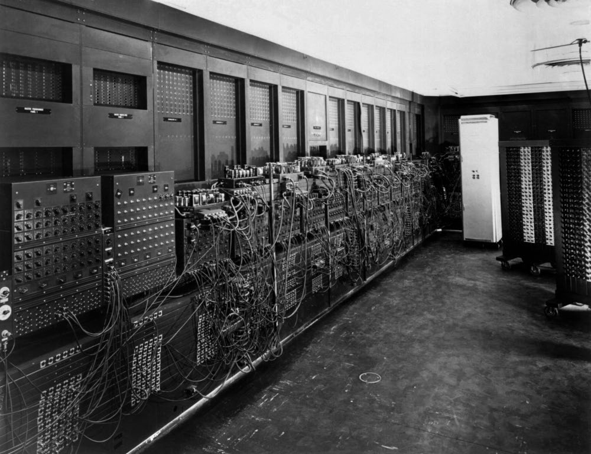

praticidade no seu uso, e pesquisadores ao redor do mundo começaram a estudar novas maneiras de projetar e construir computadores.  Em 1946, o matemático húngaro John von Neumann, apoiando- se em trabalhos anteriores de pesquisadores como Alan Tuning, propôs o que viria a ser de fato o primeiro computador digital. E não só isso, mas o húngaro criou a arquitetura computacional basilar empregada em todos os computadores modernos até os dias atuais.

Logo de início, von Neumann percebeu que programar computadores com imensas quantidades de interruptores é uma tarefa lenta, cara e manual demais, requerendo muit a mão de obra só para acionar os seus interruptores. Ele também percebeu que fazer computadores trabalharem com aritmética decimal (a mesma com a qual nós humanos estamos habitualmente familiarizados) não fazia sentido, uma vez que,  para representar um dígito,  eram necessárias dez válvulas (uma acesa e nove apagadas). Substituí-la por uma aritmética binária seria um caminho de mais fácil manipulação pelos computadores, caminho este adotado até hoje. O projeto, que ficou posteriormente conhecido como máquina de von Neumann, foi então o primeiro computador de programa armazenado criado.

1.3 A máquina de von Neumann Vamos dedicar , agora,  um tempo a entendermos melhor o que von Neumann propôs ; afinal, es sa é a arquitetura- base de qualquer sistema computacional do séc. XXI.

Figura 2 – Diagrama da máquina de von Neumann

A máquina de von Neumann contém cinco elementos elementares, conforme ilustrado na Figura 2:

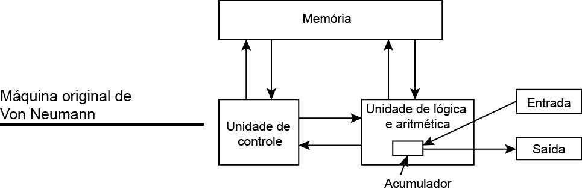

1. Memória – armazena o programa (algoritmo) em execução pela máquina, sendo capaz de armazenar dados usado s pelo programa e também instruções de controle. Tudo é armazenado em codificação binária. A memória que mantem os programas em execução é a r andom acess memory (RAM).

2. Unidade lógica e aritmética (ULA)  – essa unidade é responsável por todos os cálculos aritméticos e lógicos do computador. Todas as operações são realizadas nela. Uma máquina computacional é capaz de realizar somente cálculos aritméticos e lógicos dos mais simples possíveis, como somas, subtrações e operações relacionais (como de maior ou menor). Dentro des sa unidade temos um registrador especialmente denominado de acumulador. O acumulador é responsável por armazenar temporariamente os resultados das operações, dentro da ULA.

3. Unidade de controle (UC) – gerencia o fluxo de execução dos programas dentro do computador. Define qual será a próxima instrução a ser a executada e onde ela se encontra na memória.

4. Dispositivos de entrada – são as maneiras físicas pelas quais inserimos informações em nossos programas. Um dispositivo de entrada comum é um teclado, onde digitamos e as informações são transferidas ao programa.

5. Dispositivos de saída – são maneiras pelas quais o resultado final de uma ação do programa informa o usuário. Podemos citar como dispositivos de saída uma tela/monitor ou mesmo lâmpadas indicativas , acesas.

A ULA e a UC formam o que é chamado de processador, ou seja, a central process unit (CPU) de um computador, e elas são sempre construídas juntas , dentro de um único chip . Portanto, nos dias atuais, quando você compra um processador, está adquirindo,  basicamente, esses dois módulos.  Inicialmente, quando von Neumann propôs sua arquitetura, a memória não fazia parte do chip da CPU. Hoje, nas máquinas modernas, temos memórias de altíssimas velocidades inseridas dentro desse chip, também, com o objetivo de melhorar o desempenho de processamento. Es sas memórias inclusas no chip  são chamadas de memória cache.

Em suma, a arquitetura de von Neumann, hoje considerada clássica,  por conta dos computadores modernos, é tida como o hardware mínimo necessário para um computador digital funcionar. Qualquer software  de computador que iremos aprender a desenvolver ao longo deste estudo requer uma máquina de von Neumann.

Porém, desde a proposta de computador digital feita por von Neumann, em meados de 1945, as tecnologias para construção de  computadores evoluíram abruptamente. Na década de 1950 deu- se início à  era da miniaturização dos computadores, com o surgimento dos primeiros dispositivos construídos a base de transistores e não mais valvulados. A evolução para máquinas transistorizadas foi um firmamento,  para a aritmética binária. Transistores são componentes eletrônicos que, quando parametrizados corretamente, podem operar no que chamamos de região de saturação, funcionando como uma chave que liga e desliga milhares de vezes por segundo. Em 1960, evoluímos para projetos com circuitos integrados, reduzindo ainda mais o tamanho dos computadores e chegando a máquinas com tamanhos e custos compatíveis para vendas residenciais. Toda a história e evolução dos computadores pode ser lida em detalhes no livro Organização estruturada de computadores (Tanenbaum, 2013a).

De todo modo, o que todas es sas gerações tem em comum é que a arquitetura que serviu como base está contida dentro de todas as nossas máquinas digitais e não só em computadores e laptops , mas também em smartphones e até mesmo em dispositivos eletrônicos embarcados, como forno de micro- ondas, lâmpadas inteligentes etc. Tudo isso tem a máquina de von Neumann como seu ponto de partida.

1.4 O bit, o byte e a palavra Sabemos que um computador digital contém uma memória que manipula e armazena dados de maneira binária. Mas o que isso realmente significa? Aprendemos, desde os primeiros anos de escola,  a realizar operações aritméticas na denominada base decimal . Decimal vem do numeral 10, o que nos indica que, para representarmos qualquer número na base decimal, precisaremos de 10 símbolos diferentes  – nesse caso, os números de 0 até 9. Podemos realizar qualquer combinação de dígitos de 0- 9 para representarmos o número que quisermos, em base decimal.

O termo bit é originário de binary digit (dígito binário), no que se escolheu pegar as duas primeiras letras da palavra b inary (bi) e a última letra da palavra digit (t) para formar a palavra bit  (bi + t). Um bit nos indica que, diferentemente da base decimal, na base binária podemos representar números utilizando somente dois (bi) símbolos. Nesse caso, 0 ou 1, que também são chamados de nível lógico baixo (0) e nível lógico alto (1) ou então de falso (0) e verdadeiro (1). Qualquer número que antes podíamos representar em base decimal podemos também representar em base binária,  com base em  combinações de zeros e uns, somente.

Um computador digital armazena, calcula e manipula dados com esse tipo de aritmética devido à  facilidade que é para ele realizar operações nes sa base (graças aos transistores!). Em aspectos físicos, um valor 0,  em uma memória , poderá ser a ausência de um sinal elétrico (ou carga elétrica) naquele ponto, e o valor 1 poderá representar a existência de sinal elétrico (ou carga elétrica). Se pudéssemos enxergar a olho nu as informações armazenadas em uma memória, veríamos quantidades quase que infinitas de sequê ncias de sinais (ou cargas elétricas) dentro dela2.

Se o computador trabalha com aritmética binária, talvez você esteja se perguntando: como é que, para nós, usuários, as informações aparecem na tela em base decimal? Bom, o fato é que é possível convertermos números de uma base para a outra. Embora aritmética binária e cálculos de conversão de base não sejam objeto do nosso estudo, caso tenha interesse em compreender como convertemos números de base decimal para binári a, e vice-versa, recomendamos a leitura dos capítulos 1 e 2 do livro Sistemas digitais: princípios e aplicações (Tocci et al., 2007).

O que precisa ficar compreendido é que todo e qualquer computador projetado com base na máquina de von Neumann é binário e, portanto, só compreende dígitos 0 e 1, o bit, e nada além disso. O bit é a menor unidade de armazenamento. Porém, é mais comum mensurarmos a memória em unidades maiores, para facilitar nossa compreensão. Sendo assim, adotamos convenções de que um octeto, ou seja, 8 bits, é denominado byte. Assim como 1.024 bytes correspondem a 1 kilobyte (Tabela 1).

2 O nível e o tipo de sinal usado para representar o bit dependerão da tecnologia de memória empregada no armazenamento. Por exemplo, memórias RAM convencionais trabalham com capacitores, em que um capacitor carregado representaria nível lógico alto.

Tabela 1 – Nomenclatura do bit Equivale a Abreviação 8 bits 1 byte B 1.024 bytes 1 kilobyte KB 1.024 KB 1 megabyte MB 1.024 MB 1 gigabyte GB 1.024 GB 1 terabyte TB 1.024 TB 1 petabyte PB Note ainda que, apresar de o bit ser a menor unidade de armazenamento da máquina, um computador nunca manipula um bit individualmente, dentro da CPU. Todas as operações da CPU são realizadas em blocos maiores de bits, que vão normalmente de 1 a 8 bytes , dependendo da tecnologia adotada.  Um processador atual, que você tenha no computador da sua casa, opera com 64 bits (8 bytes). Isso significa que qualquer operação nele é sempre realizada com blocos de 64 bits, mesmo que se deseje alterar somente um bit, em um dado. A CPU irá carregar sempre para trabalhar com o bloco inteiro de 64 bits . Essa é, portanto, a menor unidade útil de manipulação da CPU, a qual chamamos de palavra (word).

Ao longo deste estudo, e de outras vindouras na área de computação, estaremos sempre observando nossos dados armazenados na memória do computador, em alguma das unidades apresentadas, conforme mencionado. 1.5 O sistema operacional Consideremos a seguinte situação: imagine que você precise desenvolver um player de música para rodar em um computador de mesa ou um  laptop. O player tem como característica acessar músicas salvas em uma memória da máquina e reproduzi-las em uma saída de áudio do computador. Observe que o universo de configurações de hardware dos computadores tende ao infinito, pois temos centenas de marcas, de modelos, com hardwares , tecnologias de fabricantes, capacidades de memória e processamento completamente distintos, sem falarmos nas possibilidades de saídas de som que podemos ter para a aplicação do player (fone de ouvido, subwoofer, home theater). Sendo assim, se um programador precisar se preocupar com o hardware disponível em cada máquina, será inviável desenvolver qualquer programa de computador, nos dias de hoje: ou o programador teria, para isso, que considerar todos os hardwares existentes no mundo, algo impossível ; ou, então,

desenvolver o programa para uma única plataforma e configuração, tornando o software limitado e comercialmente inviável. E, acredite: até meados da década de 1970 era assim que se desenvolviam programas computacionais exclusivos para um determinado hardware! Porém, é importante ressaltarmos que tínhamos bem menos hardwares e tecnologias disponíveis, naquela época. O surgimento do conceito de sistema operacional fez com  que a vida do desenvolvedor melhorasse bastante. Um sistema operacional é também um software, mas bastante complexo e capaz de gerenciar a execução de outros programas executando em concorrência,  em uma mesma máquina. O sistema operacional, dentre suas principais características, tem como objetivo permitir, ou não, a execução de um software , gerenciar o uso da memória e do processador por cada um dos programas e, por fim, abstrair por completo o hardware da máquina, tanto para o usuário quanto para o programador. Des se modo, ao desenvolver o seu player  de música, você não irá desenvolvê- lo para um hardware específico, mas sim para um sistema operacional específico, o que facilita enormemente o processo de desenvolvimento3.

Talvez você esteja se perguntando se já utilizou algum sistema operacional, ao longo da sua vida de usuário de computadores. A resposta é: com toda a certeza! Quer ver alguns exemplos?

• Em computadores ( desktops e laptops) os mais conhecidos são os da Microsoft, que iniciou com o MS -DOS, ao que se seguiu o Windows. Em contrapartida, temos os baseados em U nix/Linux e suas diferentes distribuições (Ubuntu, Mint, Fedora etc.). Citemos também o sistema da Apple, o macOS. Dentre outros menos conhecidos, temos o FreeBSD e o Solaris.

• No meio dos dispositivos móveis, temos sistemas operacionais desenvolvidos exclusivamente para eles e que se preocupam mais com atender a necessidades desse tipo de mercado, como otimização máxima dos recursos de energia. Dentre os largamente adotados  nesse sentido, citamos o Android, do Google, e o iOS, da Apple.

• Diversos outros sistemas computacionais também contêm um sistema operacional. Videogames são um exemplo disso: no Playstation 4  da

3 O assunto de sistemas operacionais é bastante complexo e requer um material inteiro para ele. Caso tenha interesse em aprofundar -se no assunto, recomendamos a leitura complementar do livro Sistemas operacionais modernos (Tanenbaum, 2013b).

Sony, temos uma variação do FreeBSD chamada de Orbis OS. No ramo de dispositivos embarcados inteligentes, cada vez mais comuns hoje em dia, sistemas operacionais também são empregados. O mais difundido deles é o FreeRTOS.

### TEMA 3 – REPRESENTAÇÕES DOS ALGORITMOS

Algoritmos são sequê ncias de passos a serem seguidos para que uma tarefa seja executada com sucesso. Es ses passos, os quais podemos chamar também de instruções , apresentam maneiras distintas de representação, especialmente na área da computação, em que já buscamos f azer uma aproximação com a linguagem computacional.

Neste tópico vamos, portanto, aprender três diferentes tipos de representações de algoritmos. Es sas representações acompanharão você ao longo deste estudo, bem como da vida de programador(a). São elas: a descrição narrativa, o pseudocódigo e o fluxograma.

3.1 Descrição narrativa A maneira mais simples e intuitiva de construirmos nossos algoritmos é com base em uma linguagem natural. Descrever as instruções utilizando esse tipo de linguagem significa representar , em modo texto, por meio de frases, os passos como se estivéssemos simplesmente tendo uma conversa informal com alguém. É por isso que a descrição narrativa apresenta pouco formalismo e é bastante flexível, não contendo regras. O problema disso é que abre margem para ambiguidades e dupla interpretação, o que faz com que ela acabe não sendo empregada na construção de algoritmos computacionais.

Você se lembra do nosso algoritmo do sanduíche, lá na Seção 1.2? Pois bem, ele está escrito na forma de descrição narrativa. Note que muitas das frases lá construídas, por mais detalhadas que estejam, são bastante dúbias, e o que a instrução nos diz para fazer nem sempre fica claro.

Vejamos, então, outro exemplo de descrição narrativa. A  seguir, temos um algoritmo que recebe dois valores numéricos ( x e y), verifica se eles são iguais, ou não, e informa,  por meio de uma mensagem , o resultado des sa validação. Passo a passo:

a. Ler dois valores (x e y).

b. Verificar se x e y são iguais.

c. Se x for igual a y, mostrar a mensagem Valores iguais!.

d. Se x for diferente de y, mostrar a mensagem Valores diferentes!. e. Fim!

Observe a falta de formalismo d esse exemplo. Na etapa b, por exemplo, é dito para se verificar se os valores são iguais ; mas, como essa verificação é feita? Não temos a informação disso, porque na descrição narrativa estamos preocupados somente com a ideia geral da instrução e não com a implementação disso em um código computacional.  É por esse motivo que não iremos trabalhar com es sa representação,  ao longo do nosso estudo. Mas é interessante que se tenha conhecimento dela, uma vez que pode ser útil para formular ideias antes de você sentar na frente do computador e também para explicar um algoritmo seu para pessoas que não necessariamente são da sua área.

3.2 Pseudocódigo O pseudocódigo é a representação de um algoritmo mais próxima que podemos ter de um programa computacional, mas sem nos preocuparmos com qual linguagem de programação irá ser adotada. Pseudocódigo, que significa falso código, é uma linguagem estruturada4, com regras e padrões bem definidos e fixos. Também conhecido como português estruturado,  é uma maneira de escrever algoritmos sem necessitarmos de um software de programação ou de um computador – você pode trabalhar em seu próprio caderno, por exemplo!  A grande vantagem de se aprender pseudocódigo é que ele corresponde a uma linguagem genérica e, uma vez entendida  a lógica por trás do pseudocódigo, bastará aplicá-lo a qualquer linguagem de programação existente. Vejamos o mesmo exemplo apresentado em descrição narrativa, mas agora nos atentando às regras impostas pela representação em pseudocódigo: a. Algoritmo de exemplo b. Var c. x, y: inteiro d. Início

4 Programação estruturada é um paradigma de programação, um  conceito que foi criado na década de 1950. Linguagens que trabalham de maneira estrutura se utilizam de recursos como estruturas de sequência, de tomadas de decisão e de repetição.

e. Ler (x, y) f. Se (x = y), então...

g. Mostrar (Valores iguais!) h. Se não...

i. Mostrar (Valores diferentes!) j. Fim!

Não vamos nos ater ainda à s nuanças e regras de construção do pseudocódigo. Porém, consegue perceber como temos um conjunto de regras formais bem definidas? Por exemplo, um algoritmo em pseudocódigo deve, sempre, iniciar com a palavra Algoritmo seguida de um nome dado ao seu código (linha 1); assim como sempre finalizar  com a palavra Fim (linha 11). Qualquer outra nomenclatura ali utilizada quebra o formalismo do pseudocódigo, resultando em um erro. Outras palavras como Ler, Mostrar, Se, então etc. estão ali empregadas propositalmente e t êm um significado específico que ser á trabalhado no decorrer deste estudo.

3.3 Fluxograma A última maneira para representar algoritmos com que vamos trabalhar é o fluxograma. Esse tipo de representação serve para escrever um algoritmo de maneira gráfica e empregando símbolos.  Embora fluxogramas não sejam interpretados literalmente por nenhum software  de programação,  o uso de fluxogramas é fundamental para representar a ideia de um  código e serve para organizar o raciocínio lógico. Fluxogramas também são muito utilizados para mostrar algoritmos em trabalhos científicos, em apresentações acadêmicas e profissionais, uma vez que mostrar códigos completos em exposições orais tende a não render uma boa prática didática. Sendo assim, é fundamental que você conheça como construir fluxogramas de seus algoritmos, pois em algum momento irá precisar trabalhar com es se recurso, seja no estudo, seja  no mercado de trabalho.

Existe mais de uma nomenclatura de símbolos distint os, para fluxogramas. A nomenclatura adotada neste estudo é a padronizada e documentada na norma ISO 5807:1985,  de Puga e Risseti (2016). A  Figura 3 apresenta a simbologia completa da ISO (1985).

Figura 3 – Simbologia para fluxogramas com base na ISO 5807:1985

Fonte: Elaborado com base em ISO, 1985; Puga; Risseti, 2016, cap. 2. O mesmo algoritmo proposto na descrição narrativa e no pseudocódigo, agora representado em um fluxograma,  pode ser visto na Figura 4. Trabalharemos mais fluxogramas, em detalhes, no decorrer deste estudo.

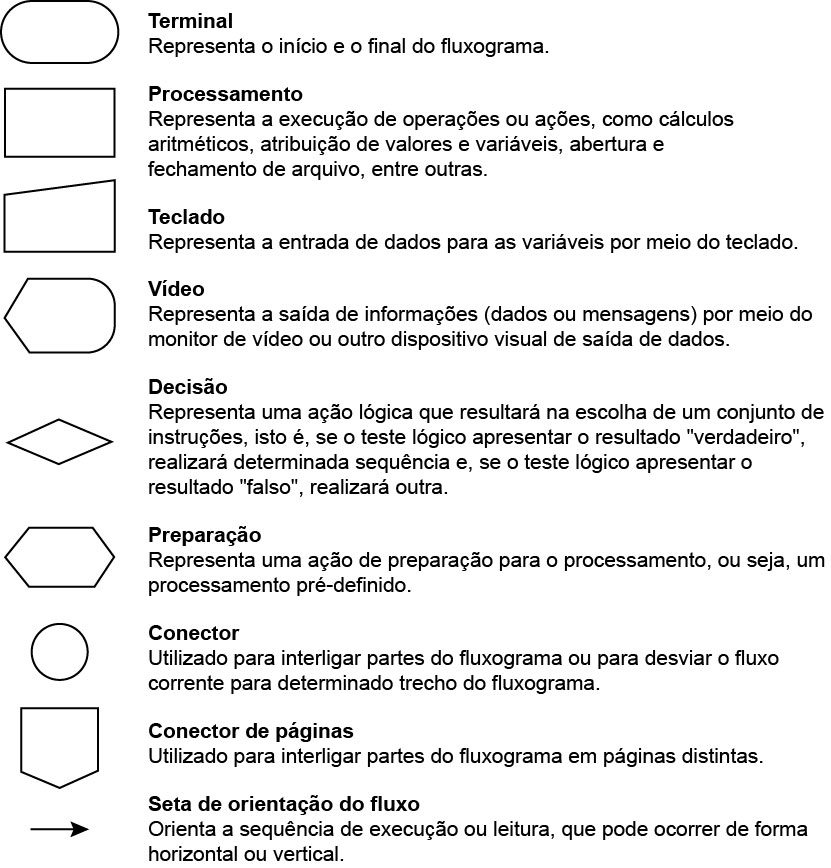

Figura 4 – Exemplo de um fluxograma

Exercício de fixação : quem nunca tentou encontrar o caminho correto em jogos de labirinto? Dependendo da complexidade do desenho, isso pode tomar um tempo considerável ... A não ser que exista um roteiro a ser seguido, tal como este (Puga; Risseti, 2016, p. 16-17):

a. Tente elaborar um roteiro do caminho a ser seguido no labirinto, iniciando na seta, na Figura 5 (a). Utilize descrição narrativa para construir sua rota. b. Tente indicar o caminho no labirinto da Figura 5 (b), agora usando a marcação feita para as linhas e colunas. O que é possível notar no seu algoritmo, de diferente, ao usar essas marcações? Ficou mais preciso? Figura 5 – Labirintos do exercício, em que (a): sem marcações ; (b) com marcações

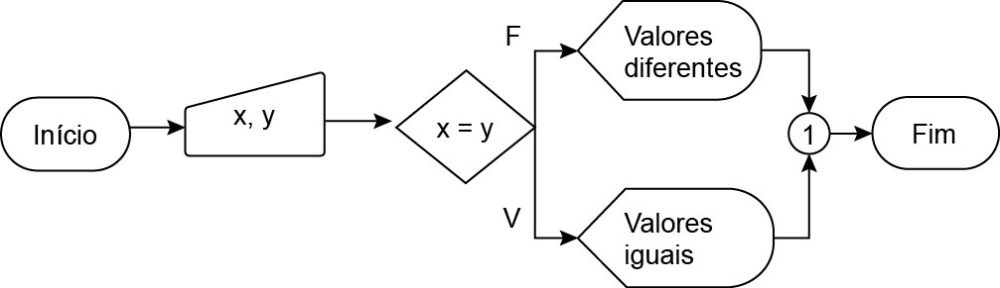

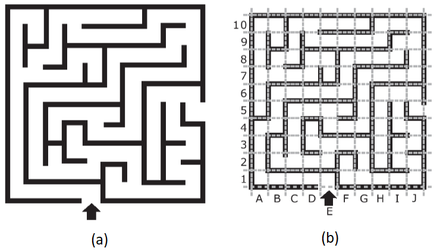

### TEMA 4 – LINGUAGENS DE PROGRAMAÇÃO E COMPILADORES

Aprendemos que pseudocódigo é uma maneira genérica de representar algoritmos em linguagem computacional, sendo o mais próximo que temos de uma linguagem de programação sem necessitar de um software para programar. Mas, afinal, o que é uma linguagem de programação?

4.1 Linguagem de programação Conforme já aprendemos nesta abordagem, um computador trabalha com codificação binária e, portanto, não compreende mais nada além de bits. Agora, tente imagina um cenário em que você, programador(a), senta na frente do seu computador e começa a escrever seu programa utilizando a linguagem que o computador compreende. O seu algoritmo iria se assemelhar ao ilustrado na Figura 6, ou seja, seria uma sequência quase infinita de zeros e uns.  Você consegue se imaginar escrevendo um código des sa maneira? Não? Pois bem, nem nós! Isso porque escrever em binário, embora não impossível, requer um esforço enorme, aumentando demasiadamente o tempo de desenvolvimento de um software.

Figura 6 – Exemplo de código em binário

Crédito: Iunewind/Shutterstock.

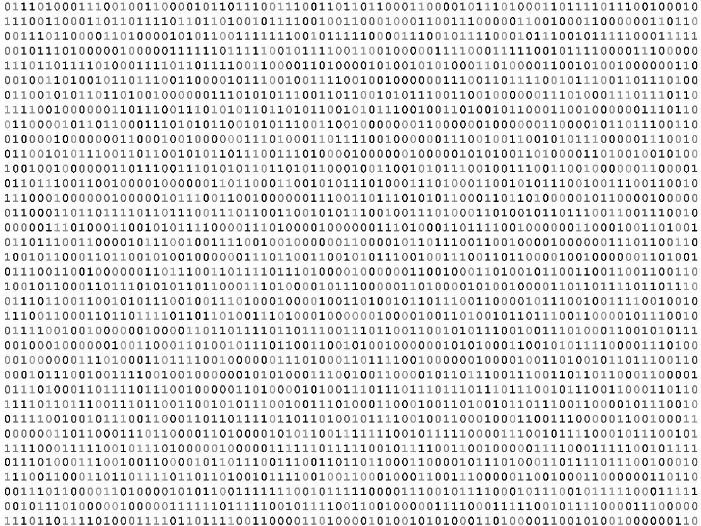

Saiba que, no passado, já construímos códigos assim, em binário, mas nessa época desenvolvíamos programas bem mais simples e com pouquíssimos recursos. Um exemplo de máquina programada diretamente bit  a bit foi o Altair 8800, criado em 1975 e que funcionava com uma CPU Intel 8080. Todos os interruptores no painel frontal serviam para programar o computador. Figura 7 – Painel frontal do Altair 8800

Crédito: Jefferson Schnaider.

O surgimento das linguagens de programação mudou para sempre a maneira como programamos. Com elas, passamos a escrever algoritmos de maneira muito mais simples e próxima d a forma como nos comunicamos. Boas linguagens são pensadas para serem de fácil entendimento por um ser humano. Não obstante, linguagens de programação apresentam outras facilidades, como a de se escrever códigos que não deem  margens para erros de interpretação pelo computador, graças a criação de conjuntos bem rígidos e específicos de regras que, se forem seguidos pelo programador, não irão resultar em instruções ilegíveis pela máquina.

Uma linguagem de programação é, portanto, esse conjunto de regras com palavras-chaves, verbos, símbolos e sequências específicas. Chamamos todo esse conjunto de sintaxe da linguagem . A gama de linguagens que temos hoje no mercado é realmente grande e,  em breve, comentaremos um pouco mais sobre algumas das mais importantes  delas. Mas, vamos primeiro a um breve histórico das linguagens.

4.2 Histórico das linguagens de programação Você se lembra do Eniac, a grande máquina que só ficou pronta após o término da Segunda  Guerra? O E niac, quando se tornou operacional , em meados de 1946, contratou seis pessoas – todas elas mulheres – para trabalhar como sua s programador as5. Nessa época, as programadoras começaram a desenvolver as primeiras técnicas de linguagem de programação, com o objetivo de facilitar em seu próprio trabalho. Simultaneamente, um outro grupo de programadores trabalhava, em Harvard, no computador Harvard Mark I.  Nesse grupo, outra mulher ganhou destaque, Grace Hopper. Os esforços conjuntos de Hopper e das programadoras do E niac posteriormente deram origem à linguagem de programação Cobol, em 1959, utilizada até os dias de hoje. Outra linguagem de programação primitiva, surgida em 1954, foi o Fortran. Inventado pela IBM, foi a primeira linguagem de programação de propósito geral amplamente usada no mundo. A linguagem Fortran ficou bastante conhecida por ser uma linguagem bastante eficiente em desempenho, tornando-se muito empregada em supercomputadores da época. Nos dias de hoje, a linguagem é ainda utilizada, especialmente no meio acadêmico, em pesquisas que requerem alta complexidade matemática.  Nas décadas que se sucederam (1960 e 1970), com o Cobol e o Fortran se consolidando, os maiores paradigmas de linguagem  de programação foram inventados. Nes sa época temos o surgimento da linguagem C, desenvolvida na Bell Labs. A linguagem C foi responsável por tornar popular o conceito de biblioteca de funções. Lembra quando falamos que programar especificamente para um determinado hardware não é viável? Bom, as bibliotecas de funções continham centenas de códigos prontos para serem utilizados por programadores da linguagem C. Dentro des sas bibliotecas, era possível encontrar desde códigos para interfaceamento com hardware até códigos prontos para resolver problemas bastante comuns, por exemplo implementações de funções matemáticas não triviais. Assim, o programador passou a se preocupar menos com pequenos detalhes, como hardware, e pôde focar mais no seu algoritmo e nos recursos dele. O conceito de biblioteca é amplamente empregado até hoje

5 As programadoras do E niac eram : Jean Jennings Bartik, Betty Holberton, Marlyn Wescoff, Kathleen McNulty, Ruth Teitelbaum, e Frances Spence. Existe um documentário sobre a história dessas mulheres, chamado The invisible computers: the untold story of the Eniac programmers.

e todas as linguagens de programação mais usadas no mercado cont êm uma variedade bastante grande de bibliotecas pré-disponíveis.

Na década de 1980, tivemos a consolidação das linguagens imperativas, ou seja, das linguagens de programação fortemente segmentadas, e o conceito de programação orientada a objetos  estava então formalizado. Neste estudo, não iremos trabalhar com es ses paradigmas por se tratarem de conceitos mais avançados de programação6. E, por fim, com o boom da internet, em meados de 1990, tivemos o surgimento de uma gama bastante grande de linguagens para esse propósito, assim como o surgimento do conceito de linguagens funcionais, cujo foco é a produtividade do desenvolvedor, abstraindo cada mais aspectos técnicos e detalhes e agilizando o tempo de desenvolvimento. 4.3 Software de compilação Descobrimos, ao longo deste material , que um computador trabalha e compreende somente a linguagem binária, também chamada de linguagem de máquina (vide Figura 6). Acabamos de conhecer também  que nós programadores escrevemos algoritmos computacionais não em binário, mas sim em uma linguagem de programação. Mas, se o computador compreende uma linguagem e você trabalha em outra diferente e ilegível para ele, como então que o computador entende o código que você faz?

Para resolver esse problema foram criados os softwares  de compilação. Um compilador é capaz de receber um código escrito em uma linguagem e realizar um processo chamado de compilação. A compilação é um processo bastante detalhado e complexo, o qual não será abordado neste estudo7. Porém, tudo que o software faz é transformar o código que você escreveu (também chamado de código de alto nível) em uma linguagem de máquina (linguagem de baixo nível) compreendida pelo hardware. O resultado final do processo de compilação normalmente é um arquivo do tipo binário ( binary file) , que, em sistemas operacionais como o Windows, é executável (o famoso .exe). A Figura 8 ilustra esse processo.

6 Sobre paradigmas de programação orientada a objetos, recomendam os o livro Java: como programar (Deitel; Deitel, 2017).

7 Sobre compiladores e seu processo de desenvolvimento e compilação, recomendamos o livro Compiladores: princípios, técnicas e ferramentas (Aho et al., 2013).

Figura 8 – Processo de compilação

Cada linguagem de programação apresenta seus respectivos softwares de compilação, capazes de compreendê-la. O software de compilação é também desenvolvido e é dependente de um sistema operacional, ou seja, você acaba desenvolvendo programas específicos para uma só plataforma. Caso deseje trabalhar com mais plataformas , precisa realizar o processo de compilação novamente para cada plataforma, embora o código de alto nível praticamente não sofra alterações.

Por fim, é interessante ressaltar a diferença entre compilador e interpretador. O compilador , conforme já comentado, gera um arquivo binário legível para a máquina. Após o processo de compilação, não é mais possível reaver o código alto nível de maneira nenhuma (ao menos que você seja o desenvolver e tenha o código-fonte). Um interpretador, por sua vez, mantém o código-fonte presente nos arquivos finais. O código não é convertido de uma só vez, mas sim executado, instrução por instrução, à medida que o programa vai o requisitando.

Essas características de compilador para interpretador t êm seus prós e contras. Embora o assunto seja vasto, vejamos algumas breves diferenças entre ambos. Uma linguagem compilada, pelo fato de gerar um arquivo binário executável, ao final, tende a executar o programa mais rapidamente do que linguagens interpretadas. Em contrapartida, sempre que precisarmos trocar a plataforma ou arquitetura do projeto, precisaremos recompilá-lo. Uma linguagem com características interpretadas, por outro lado, tem a facilid ade de ter um código-fonte mais universal, podendo se executar o programa em qualquer plataforma ou arquitetura. A sua principal desvantagem é seu desempenho, que é inferior ao desempenho da compilação.

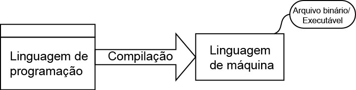

4.4 Linguagens de programação mais populares A gama de linguagens de programação é bastante grande e ultrapassa a casa da centena. Já comentamos que o C obol e o Fortran foram duas das primeiras linguagens e que acabam por serem utilizadas até os dias de hoje, em aplicações específicas. É fato que não existe nenhuma linguagem ideal para todos os cenários de desenvolvimento. Cada uma contém suas peculiaridades e características que as tornam boas e populares em certos ambientes.

O Stack Overflow , anualmente, lança sua pesquisa de mercado internacional de linguagens de programação mais usadas, procuradas e usadas no mercado de trabalho. Es se ranking é criado com base nas respostas a um questionário. Em 2023, o survey  contou com mais de 87 mil respondentes do mundo inteiro. Para o ano de 2023, o ranking pode ser visto na Figura 9. Figura 9 – Ranking de linguagens de programação mais utilizadas no ano de 2023, segundo a Stack Overflow

Fonte: 2023 Developer, 2023.

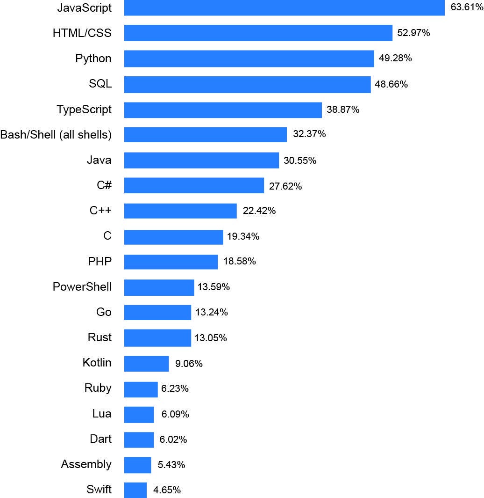

Rankings como es se são ótimos termômetros para sabermos em qual linguagem de programação devemos investir tempo estudando, uma vez que a chance de nos depararmos com ela no mercado de trabalho será grande. Vamos comentar algumas das linguagens mais populares, a seguir.

• Linguagem JavaScript  – uma das linguagens mais populares dos últimos anos, é interpretada e está no topo da lista pois é hoje a linguagem mais usada para desenvolvimento web, que é o maior mercado desenvolvedor atualmente e a base de muitas tecnologias de desenvolvimento mobile.

• Linguagem Python – é a linguagem mais popular dos últimos anos se considerados todos os segmentos de desenvolvimento de software. É por esse motivo que adotaremos essa linguagem, neste material. Falaremos em detalhes sobre o Python na próxima seção.

• Linguagem Java – a linguagem da Oracle teve o seu auge em meados de 2010 e hoje perdeu um pouco de espaço para linguagens como JavaScript, Python ou mesmo linguagens específicas de mobile . O Java popularizou-se muito devido à inovadora forma de programar que ela se propunha a utilizar. Foi uma das primeiras linguagens em que era possível se usar o mesmo código para compilar para qualquer plataforma, graças à proposta de virtualização de qualquer programa em Java por meio de uma máquina virtual pré-instalada. É orientada a objetos, no seu cerne. • Linguagem C – talvez a mais antiga dessa lista e que continua entre as mais utilizadas. A linguagem C, embora surgida na década de 1970, é muito usada até hoje e sofreu inúmeras atualizações , com o passar do tempo. Considerada por muitos especialistas como linguagem de médio nível, devido a sua grande quantidade de detalhes, é ainda uma linguagem essencial , especialmente para desenvolvedores na área de engenharia e que trabalham com programação de hardwares e dispositivos embarcados.

• Linguagem C++  – é uma linguagem derivada do  próprio C. Porém, diferentemente dela, trabalha também com paradigmas de programação orientada a objetos. É hoje bastante usada no desenvolvimento de aplicações de altíssimo desempenho, principalmente na construção de sistemas operacionais, compiladores e outros softwares de base.

• Linguagem C# (C Sharp) – é uma linguagem desenvolvida pela Microsoft como parte da plataforma .NET e também deriva da linguagem C. É orientada a objetos e ganhou muito espaço devido à s suas ótimas integrações com serviços Windows e às suas bibliotecas de funções de fácil uso e versáteis. É também muito usada no desenvolvimento de jogos com a Unity Engine.

• Linguagem PHP  – é uma linguagem interpretada desenvolvida exclusivamente para desenvolvimento web. Já foi a mais usada no desenvolvimento web, mas perdeu espaço para o JavaScript, nos últimos anos.

A seguir, citamos algumas linguagens que aparecem na lista, mas não são linguagens de programação:

• Linguagem HTML/CSS – não é uma linguagem de programação, mas sim de marcação, e é o padrão utilizado na construção de páginas web. Não é uma linguagem compilada, mas s im interpretada, e todos os navegadores são capazes de compreendê- la. O HTML/CSS evoluiu e modernizou-se bastante desde seu surgimento, em 1991. Na versão mais recente, o HTML5, recursos foram implementados com o objetivo de eliminar plugins que antes eram necessários de se instalar em navegadores, como Flash (Adobe) e Silverlight  (Microsoft). Para termos uma página funcional hoje, precisamos trabalhar o HTML/CSS junto do JavaScript ou PHP.

• Linguagem SQL – não é uma linguagem de programação, mas sim de escrita de consultas ( queries) para banco de dados. Todo e qualquer banco de dados pode ser manipulado por intermédio de códigos em SQL.

### TEMA 5 – LINGUAGEM DE PROGRAMAÇÃO PYTHON

A linguage m escolhida para trabalharmos ao longo deste estudo é o Python. Conforme vimos anteriormente, o Python é uma das linguagens mais empregadas em quase todas as áreas de desenvolvimento, sendo fundamental que um programador, nos dias de hoje, tenha seu conhecimento. Porém, o que torna o Python tão popular, amado e utilizado? Vejamos suas principais características.

Primeiramente, é válido ressaltar que o Python é uma linguagem de propósito geral, ou seja, que não foi criada se pensando em um só setor de desenvolvimento. O PHP,  por exemplo, só é aplicável a programação web  e nada além disso. O Python pode ser empregado em qualquer área e em qualquer plataforma. O que torna o Python tão versátil é a gama enorme de bibliotecas que existem para ele. Você quer desenvolver jogos com Python? Sem problemas, ele dá conta!  Basta, para isso,  instalar as bibliotecas do pygame  e aprender a usá-las. Desenvolvimento para web, interfaces, até mesmo recursos de inteligência artificial e ciência de dados são facilmente localizados , para uso no Python.

A linguagem caiu no gosto dos desenvolvedores por ser  simples, fácil e intuitiva. Programadores iniciantes tendem a se dar muito bem com Python, por exemplo. A linguagem, devido às suas características de linguagem interpretada, é multiplataforma, ou seja, não é necessário adaptar seu código para rodar em sistemas diferentes. Um mesmo código deve ser capaz de funcionar tanto em ambientes Windows, Linux ou mesmo até em dispositivos móveis, desde que compilado para cada plataforma, é claro.

A linguagem Python é orientada a objetos. Porém, não iremos nos ater aos paradigmas de programação imperativa neste estudo, uma vez que o Python consegue trabalhar de maneira estruturada,  também. O Python passa por atualizações constantes na linguagem , tanto para cor rigir bugs e falhas de segurança, quanto também para incluir novos recursos e funcionalidades. Atualmente, a linguagem Python está na versão 3. Ao entrar no site  oficial da linguagem você encontrará todas as versões para download para diferentes plataformas: <https://www.python.org/downloads/> (Downloads, 2023). Acerca da licença que rege a linguagem Python, conforme o site oficial, a linguagem Python é o pen source. O Python contém uma licença própria,  mas compatível com a GPL8.

Por fim, como curiosidade, a linguagem Python contém inclusive uma espécie de filosofia da linguagem, chamada de Z en do Python. Esse mantra foi criado por um de seus programadores, Tim Peters  (2004), e é composta de 20 frases que, segundo Tim, todo programador deveria saber e segui r para tornar- se um programador melhor. O Zen é encontrado também no site oficial da

8 A licença do Python 3 pode ser obtida em : <https://docs.python.org/3/license.html> (History, [20--]).

linguagem, em: < https://www.python.org/dev/peps/pep-0020/> (PETERS, 2004a). A seguir,  disponibilizamos, em tradução livre feita pela Python Brasil (disponível em: <https://wiki.python.org.br/TheZenOfPython>), o que Tim Peters (2004b, grifo do original) escreveu:

O Zen do Python, por Tim Peters • Bonito é melhor que feio.

• Explícito é melhor que implícito.

• Complexo é melhor que complicado.

• Plano é melhor que aglomerado.

• Esparso é melhor que denso.

• Legibilidade faz diferença.

• Casos especiais não são especiais o bastante para quebrar as regras.

• Embora a praticidade vença a pureza.

• Erros nunca devem passar silenciosamente.

• A menos que sejam explicitamente silenciados.

• Diante da ambiguidade, recuse a tentação de adivinhar.

• Deve haver um – e preferencialmente só um –  modo óbvio para fazer algo.

• Embora esse modo possa não ser óbvio à primeira vista a menos que você seja holandês.

• Agora é melhor que nunca.

• Embora nunca frequentemente seja melhor que exatamente agora. • Se a implementação é difícil de explicar, é uma má ideia.

• Se a implementação é fácil de explicar, pode ser uma boa ideia. • Namespaces são uma grande ideia – vamos fazer mais dessas! 5.1 História da linguagem Python Em 1982, em Amsterdã , no Centrum Wiskunde & Informatica (CWI), um programador de nome Guido van Rossum  trabalhava no desenvolvimento de uma linguagem de programação chamada de ABC. Essa linguagem, embora não tenha se popularizado, até por carecer de muitos recursos e funcionalidades, era bastante simples e intuitiva. A ABC tornou- se uma inspiração para que von Rossum viesse a criar o conceito da linguagem Python, nos anos subsequentes. Nessa época, a linguagem C dominava o mercado de desenvolvimento e, embora excelente, não é uma linguagem de fácil uso, especialmente para programadores iniciantes. O Python surgiu, assim, como um contraponto ao C, por ser simples e intuitivo.

O nome da linguagem, Python, não foi dado em homenagem à s cobras popularmente conhecidas como pítones , aqui no Brasil, como muitas pessoas pensam. O nome Python foi dado por von Rossum para homenagear o programa de TV britânico chamado Monty Python Flying Circus , transmitido entre 1969 e

1974 e que até hoje arranca bastante risada do público,  ao redor do mundo (Figura 10).

Figura 10 – DVD do filme Monty Python and the Holy Grail , no Brasil traduzido como Monty Python em busca do cálice sagrado

Crédito: Peter Gudella/Shutterstock.

Apesar de tudo, ficou difícil desassociar o nome da linguagem com o da cobra, uma vez que, em inglês, se escrevem ambas da mesma maneira. Sendo assim, quando os livros técnicos da área começaram a ser lançados, eles estampavam, muitas vezes , uma cobra na capa. Com o passar do tempo , a cobra acabou sendo adotada como mascote da linguagem, e até o logotipo dela hoje são duas cobras conectadas, uma azul e outra amarela (Figura 11). Figura 11 – Logotipo da linguagem Python

Crédito: Cash1994/Shutterstock.

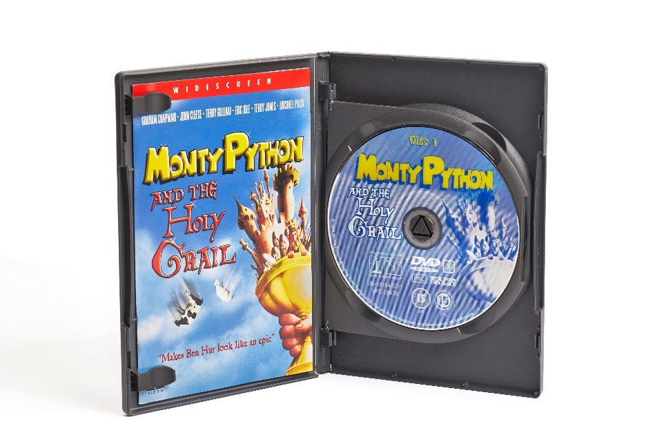

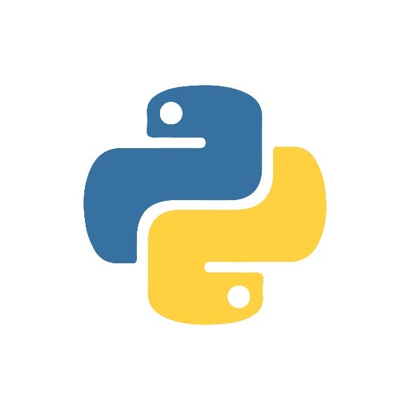

Por fim, é importante ressaltar que,  com o crescimento da linguagem Python ao redor do mundo, foi criada,  em 2001, a Python Software Foundation. Essa fundação sem fins lucrativos é responsável por manter a linguagem Python e torná- la tão importante no mercado,  nos dias atuais, pois está sempre em contato com os programadores, ouvindo-os e gerando melhorias para as novas versões da linguagem. Empresas como Microsoft  e Google são apenas alguns dos exemplos de grandes nomes que fazem parte dessa fundação, mostrando o impacto que a linguagem Python tem no mundo da tecnologia.

5.2 Aplicações do Python O Python é conhecido como uma linguagem realmente bastante versátil e aplicável em diferentes campos da computação. Vejamos alguns exemplos de em que o Python vem sendo utilizado. A maioria dos sistemas operacionais nos dias atuais vem com suporte a desenvolvimento em Python,  pré-instalado. Não só isso, mas parte des ses sistemas operacionais também foram desenvolvido s em linguagem Python. Todas as distribuições  Linux e o macOS o contêm . Infelizmente, o Windows não tem o Python por padrão no sistema, mas é bastante simples instalá-lo nele, conforme veremos no decorrer deste estudo. Talvez você já tenha ouvido falar do minicomputador mais famoso do mundo, o RaspBerry Pi ( Figura 12). Esse hardware tem nas suas entranhas o suporte ao Python, e ele normalmente é a linguagem adotada para se desenvolver para esse dispositivo.

Figura 12 – Foto de uma RaspBerry Pi 3 Model B+

Crédito: Goodcat/Shutterstock.

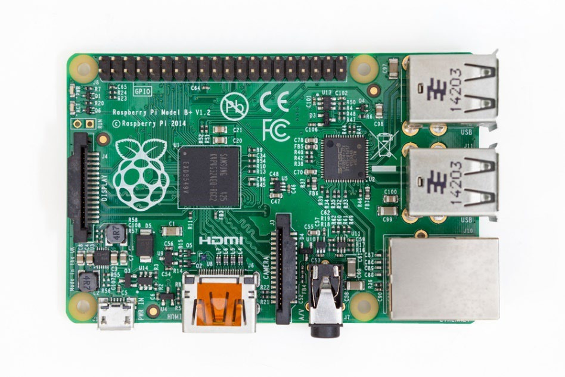

Mas talvez as áreas em que o Python se mostre  mais popular sejam as de análise de dados, inteligência artificial e machine learning. O Python tem uma enormidade de bibliotecas e recursos para se trabalhar com isso, como: • Pandas, que permite a manipulação de grandes volumes de dados. • TensorFlow, para aprendizagem de máquina profunda, desenvolvido pelo Google.

• Pytorch, que propicia avançado processamento matemático e cálculos de tensores em unidades de processamento gráfico (GPUs).

Serviços web são muito desenvolvidos em Python. O Google tem muitas de suas aplicações desenvolvidas nes sa linguagem. O YouT ube e o próprio buscador do Google são dois exemplos de peso. Para se desenvolver web com Python, é necessário integrar ao Python o HTML/CSS e também algum framework web de Python, como Django ou Flask.  No ramo do entretenimento, um ótimo exemplo de uso de Python está na Industrial Light and Magical (ILM) , empresa do cineasta George Lucas e responsável pelos efeitos visuais de filmes como Star Wars, Jurassic Park e Terminator 2. A linguagem Python está por trás de todos os seus softwares de renderização, animação etc.9 Por fim, jogos são também desenvolvidos, parcial ou totalmente,  em Python. Dois exemplos implementados completamente em Python são Sid Meier’s Civilization IV (Firaxis Games; Take Two Interactive, 2005) e Battlefield 2 (Digital Illusions CE; EA Games, 2005). Para se desenvolver jogos, somente a linguagem de programação não basta:  é também necessário um game engine (motor de jogo). Aliás, existe um motor de jogo construído todo em Python, o Godot.

### FINALIZANDO

Nesta abordagem, aprendemos os alicerces do nosso estudo. Vimos o que é lógica de programação e algoritmos, e que ambas as definições são a base para construirmos programas computacionais.  Compreendemos a arquitetura de hardware necessária para desenvolvermos e executarmos softwares e que computadores modernos são construídos com base na máquina de von Neumann.

9 Um pouco mais sobre a história da ILM com o Python pode ser consultada em : <https://www.python.org/about/success/ilm/> (Python, [S.d.]).

A definição de linguagem de programação e como um computador, que trabalha em linguagem de máquina, consegue compreender o que escrevemos em programas foram  apresentados nesta abordagem . Por fim, conhecemos diferentes linguagens de programação do mercado e nos atentamos mais detalhadamente à linguagem Python, a qual será adotada e utilizada ao longo deste estudo.

É importante que você tenha em mente que todos os conceitos teóricos desta abordagem devem ser bem consolidados para que você possa começar a praticá-los a partir do próximo conteúdo. Ressaltando uma das frases de Tim Peters (2004b) no Zen do Python: “A gora é melhor que nunca”. Comece a estudar hoje e não deixe isso para depois. Programação é prática, e prática leva ao aprendizado!

### REFERÊNCIAS

2023 DEVELOPER Survey. Stack Overflow , 2023. Disponível em: <https://survey.stackoverflow.co/2023/#technology>. Acesso em: 28 nov. 2023. AHO, A. V. et al. Compiladores: princípios, técnicas e ferramentas . 2. ed. São Paulo: Pearson, 2013.

DEITEL, P.; DEITEL, H. Java: como programar.  10. ed. São Paulo: Pearson, 2017.

DOWNLOADS. Python, 2023. Disponível em:

<https://www.python.org/downloads/>. Acesso em: 28 nov. 2023. HISTORY and license. Python Docs, [20 --]. Disponível em:

<https://www.python.org/downloads/>. Acesso em: 28 nov. 2023. ISO – Organização Internacional de Normalização. ISO 5807:1985: Information processing – Documentation symbols and conventions for data, program and system flowcharts, program network charts and system resources charts . Genebra, fev. 1985.

LÓGICA. In: MICHAELIS: dicionário brasileiro da língua portuguesa. São Paulo: Melhoramentos, 2015. Disponível em: < https://michaelis.uol.com.br/moderno- portugues/busca/portugues-brasileiro/logica/>. Acesso em: 28 nov. 2023. PETERS, T. PEP 20: The Zen of Python. Python Peps, 19 ago. 2004a. Disponível em: <https://peps.python.org/pep-0020/>. Acesso em: 28 nov. 2023. _____. The Zen of Python. Python Brasil , 2004b. Disponível em: <https://wiki.python.org.br/TheZenOfPython>. Acesso em: 28 nov. 2023. PUGA, S.; RISSETI, G. Lógica de programação e estrutura de dados. 3. ed. São Paulo: Pearson, 2016.

PYTHON Success Stories. Python, [S.d.]. Disponível em:

<https://www.python.org/about/success/ilm/>. Acesso em: 28 nov. 2023. TANENBAUM, A. Organização estruturada de computadores. 5 . ed. São Paulo: Pearson, 2013a.

_____. Sistemas operacionais modernos. 3. ed. São Paulo: Pearson, 2013b. TOCCI, R. J. et al. Sistemas digitais: princípios e aplicações. 10. ed. São Paulo: Pearson, 2007.
