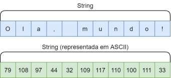
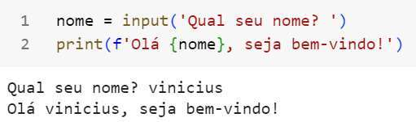
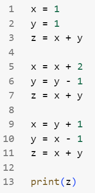
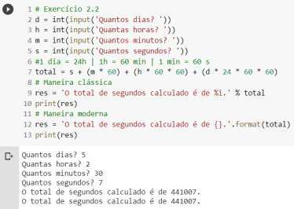
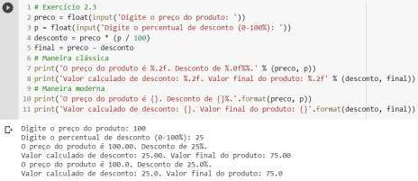
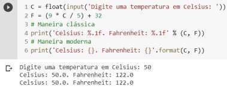

# Lógica de Programação e Algoritmos (937564)
## Aula 2 — Algoritmos sequenciais. Dados, Variáveis e Comandos de Entrada e Saída

> Texto integral da apostila oficial da Uninter (sem resumo). PDF original: [Aula_02.pdf](../_apostilas_pdf/01_Logica_Programacao/Aula_02.pdf)

LÓGICA DE PROGRAMAÇÃO E ALGORITMOS AULA 2

Prof. Vinicius Pozzobon Borin

### CONVERSA INICIAL

O objetivo desta abordagem é darmos nossos primeiros passos com a linguagem Python. Iremos colocar os dedos no teclado e começar a desenvolver nossos próprios algoritmos, enquanto aprendemos, de maneira dinâmica, os primeiros recursos dessa poderosa linguagem de programação. Você irá aprender como é o processo de execução de um algoritmo computacional; a gerar entrada e saída de dados no programa; bem como a manipular dados e variáveis ao longo do processamento do algoritmo pelo computador. Todos os exemplos apresentados neste material poderão ser praticados concomitantemente em um Jupyter Notebook, como o Google Colab (mais detalhes a seguir), e não requerem a instalação de nenhum software de interpretação para a linguagem Python, em sua máquina. Ao final desta abordagem você encontrará alguns exercícios resolvidos. Esses exercícios estão em linguagem Python e também em fluxograma.

### TEMA 1 – AMBIENTES DE DESENVOLVIMENTO

Você já conheceu a linguagem Python, a sua história e as características que a tornaram bastante popular. Vamos, agora, no primeiro tópico desta abordagem, aprender sobre as ferramentas de desenvolvimento para Python. A linguagem Python acompanha, por padrão, um interpretador denominado de IDLE. O interpretador é um software que aceita comandos escritos em Python. Diferentemente de um compilador, ele executa esses comandos linha por linha, sem gerar um código de máquina de todo o programa. O IDLE é um ambiente de desenvolvimento integrado e que existe para todos os sistemas operacionais. Atualmente, o Python encontra-se na versão 3 (a release irá depender de quando esse material estiver sendo lido). Precisamos do interpretador da linguagem para essa versão. Em ambientes Windows, o Python não vem instalado por padrão, no sistema operacional, sendo necessário fazer seu download e seguir os passos de instalação no link: <https://www.python.org/downloads/> (Download, 2023).

O processo de instalação do Python em Windows não será elaborado neste documento, uma vez que ele poderá sofrer modificações com o decorrer do tempo. Neste estudo você encontrará um tutorial adicional, no ambiente virtual de aprendizagem (AVA), que contará esse processo de instalação para

Windows. Ele será atualizado sempre que o Python também sofrer alteração na sua instalação. Caso esteja trabalhando em Linux, praticamente todas as distribuições já vêm com o Python e o IDLE instalados, salvo algumas exceções. Figura 1 – IDLE Python Shell 3.11, em ambiente Windows

Fonte: Vinicius Pozzobon Borin, 2023.

A linguagem Python, assim como qualquer outra linguagem, também contém ambientes de desenvolvimento integrados com interfaces gráficas (integrated development environment – IDE). Um dos mais conhecidos é o PyCharm, aberto para a comunidade e desenvolvido pela empresa tcheca JetBeans, disponível em: <https://www.jetbrains.com/pt-br/pycharm/ (PyCharm, [20--]). Nesse tipo de ferramenta, conseguimos desenvolver códigos em linguagem Python. Essas ferramentas são mais empregadas no âmbito profissional (ao invés do IDLE), pois realizam testes mais completos, que envolvem depuração e execução, passo a passo, do seu código. A ferramenta PyCharm será mais bem apresentada na abordagem prática deste estudo. Por fim, temos hoje uma nova maneira de desenvolver em Python, o Projeto Jupyter (Jupyter Project). Essa é uma plataforma criada com fins não lucrativos e feita para o desenvolvimento de softwares open-sources. O Projeto Jupyter é uma plataforma capaz de executar, na nuvem, códigos em linguagem Python. Desse modo, você não necessita instalar nada na sua máquina, bastando acessar a plataforma e criar um Notebook Jupyter1. Ao fazer isso, você ganha um espaço de memória, bem como uma capacidade de processamento, em um servidor, para executar seus programas em Python. Desse modo, todo o processamento é feito em um servidor, e sua máquina só precisa ter uma conexão estável com a internet. Os Notebooks Jupyter são também ótimas ferramentas didáticas, pois podem misturar textos e códigos interativos dentro

1 O termo notebook, do inglês, refere-se, nesse caso, ao que em português denominamos de bloco de anotações e não a um computador portátil que, no Brasil, chamamos de notebook ou laptop.

de um mesmo bloco de anotações. Sendo assim, iremos adotar essa ferramenta para realizarmos nossos estudos em Python, ao longo dos conteúdos. Existem diferentes plataformas que dão suporte ao desenvolvimento em Notebooks Jupyter. Dentre as mais populares, estão:

• Microsoft Azure Notebook – ver: <https://notebooks.azure.com/> (Saiba, [S.d.]) • Google Colab – ver: <https://colab.research.google.com/> (Conheça, [S.d.]) Iremos adotar a plataforma do Google, pela facilidade de integração com as ferramentas do Google. Porém, caso tenha interesse em utilizar outro Notebooks Jupyter, saiba que é possível abrir o mesmo documento em diferentes ferramentas, pois elas são compatíveis entre si. Mais explicações de uso do Google Colab serão apresentadas em vídeo.

### TEMA 2 – O CICLO DE PROCESSAMENTO DE DADOS

Estamos praticamente prontos para iniciarmos nossos primeiros programas em linguagem Python! Conforme vimos anteriormente, um algoritmo é um conjunto bem definido de instruções executadas sequencialmente. Todo e qualquer programa computacional é um algoritmo e contempla os três blocos apresentados a seguir.

1. Entrada – maneira como as informações são inseridas no programa. Lembra do nosso exemplo do sanduíche, no início do nosso estudo? Os ingredientes são nossos dados de entrada, os quais serão usados nas manipulações, futuramente. A entrada padrão adotada em programas computacionais é a inserção de dados via teclado. Porém, é possível que os dados cheguem ao programa de outra maneira, como conexão de rede, ou de outro programa executando na própria máquina.

2. Processamento – representa a execução das instruções e envolve cálculos aritméticos, lógicos, alterações de dados etc.; em suma, tudo que é executado de alguma maneira pela unidade central de processamento (CPU) e gravado ou buscado na memória.

3. Saída – após o processamento das instruções, é necessário que o resultado do nosso programa seja disponibilizado ao usuário de alguma maneira. No exemplo utilizado anteriormente, o sanduíche montado no

final seria nossa saída, pronto para ser degustado. A saída padrão adotada em um programa computacional é uma tela/display onde as informações podem ser exibidas. Porém, é possível que nossa saída seja o envio de dados via conexão de rede ou a impressão de um documento numa impressora. Se estivéssemos desenvolvendo um algoritmo para uma RaspBerry Pi ou um Arduino (ambos apresentados em conteúdos anteriores), a saída poderia ser uma luz acendendo ou piscando, por exemplo.

O fluxo de execução de um algoritmo sempre se dá conforme a Figura 2, da esquerda para a direita. Primeiramente, obtemos os dados de entrada do programa, dados esses usados ao longo de toda a execução do algoritmo. Em seguida, com os dados obtidos, os processamos no hardware da máquina gerando uma saída, normalmente em um monitor/tela.

Figura 2 – Ciclo de processamento de dados

Fonte: Vinicius Pozzobon Borin, 2023.

Vejamos um exemplo prático de ciclo de processamento para um programa que soma dois valores e apresenta na tela o resultado dessa soma. No bloco de entrada, temos a leitura desses valores via teclado, por exemplo, e os chamamos de x e y. Em seguida, o processamento da máquina se encarrega de calcular isso, buscando os dados na memória e operando-os dentro da CPU. O resultado final é gravado novamente na memória do programa, podendo ser impresso na tela (bloco de saída).

Figura 3 – Exemplo de uma soma de dois valores: ciclo de processamento de dados

Fonte: Vinicius Pozzobon Borin, 2023.

2.1 O primeiro programa!

Chegou o grande momento! Agora que você sabe o ciclo de funcionamento de todo algoritmo computacional, você irá desenvolver seu

primeiro programa em Python! Existe uma tradição, na área da computação, que diz que sempre devemos iniciar nosso primeiro programa computacional, imprimindo na tela uma mensagem que diz: Olá, Mundo! Se você mantiver a tradição, conta a lenda que você será um(a) ótimo(a) programador(a). Então, você não pode quebrar essa tradição, não é mesmo? Logo, vamos fazer desse jeito! Vale ressaltar que você pode testar os códigos em uma IDE de sua preferência; porém, recomendamos que, para fins didáticos, neste momento você trabalhe no Google Colab, onde todos os exemplos do nosso material foram testados.

Logo, digite o seguinte comando na ferramenta:

print('Olá, Mundo!') Veja que, do lado da instrução que você digitou, existe o ícone de uma seta para a direita, Executar célula. Ao apertar nesse ícone, você verá que, após alguns segundos, seu comando será executado e que irá aparecer uma nova linha abaixo da que você digitou, com o resultado do seu comando. Veja: print('Olá, Mundo!') Saída:

Olá, Mundo!

O resultado apresentado é a saída do programa, gerada com base na instrução que você digitou. Essa instrução serve para mostrar na tela do computador uma mensagem (mais detalhes sobre ela em seguida). É o que, literalmente, aparecerá na tela para um usuário. Assim, caso esse usuário esteja executando seu programa, ele receberá na tela a mensagem Olá, Mundo!. Agora que você já manteve a tradição e executou seu primeiro programa, seguem mais algumas dicas e regrinhas básicas:

• Sempre verifique (duas, três, cinco, dez vezes!) se você digitou corretamente cada letra, número ou caractere especial! Caso contrário, erros poderão aparecer na tela.

• Atenção! Letras maiúsculas e minúsculas são compreendidas de maneiras completamente diferentes pelo Python. Por exemplo, escrever print e escrever Print são coisas bem distintas. Nesse caso, se você utilizar a letra maiúscula P, caso tentemos executar o programa no Google Colab, uma mensagem de erro aparecerá informando que Print não foi encontrado/definido: NameError: name 'Print' is not defined. Print('Olá, Mundo!')

Saída:

---------------------------------------------------------------- NameError Traceback (most recent call last) <ipython-input-2-4d5722eb2ce7> in <module>() ----> 1 Print('Olá, Mundo!')

NameError: name 'Print' is not defined • Sempre que você abrir aspas, lembre-se de fechá-las. Se existe uma aspa, existirá uma segunda para funcionar como delimitadora. O mesmo vale para parênteses.

• Atenção aos espaços! O Python usa espaços em branco para uma série de operações, as quais iremos trabalhar no futuro. Sendo assim, sempre digite seus programas usando o mesmo alinhamento apresentado neste material ou nos livros didáticos de Python que estiver estudando. 2.2 Função de saída Vamos analisar nosso primeiro programa de uma maneira mais detalhada. O print pode ser chamado de comando ou instrução. Porém, o termo mais adequado seria função. De todo modo, entenda, por ora, que uma função é um código previamente desenvolvido dentro da linguagem e responsável por executar uma determinada ação. Nesse caso, a ação tomada pelo print é a de exibir na tela do computador a mensagem que estiver dentro dos parênteses. Sempre que possível, iremos aprender o equivalente, em pseudocódigo da função, ou recurso, o que acabarmos de abordar. O equivalente ao print, em pseudocódigo, é o comando Escrever, lembrando que, conforme visto anteriormente, o português estruturado é uma representação que independe de uma linguagem.

Figura 4 – Função de saída em pseudocódigo e em linguagem Python

Fonte: Vinicius Pozzobon Borin, 2023.

Podemos usar o print para mostrar uma mensagem de texto, como fizemos em nosso primeiro programa. Para que possamos mostrar um texto

literal na tela, precisamos delimitá-lo por aspas. Observe essa estrutura completa na Figura 5.

Figura 5 – Detalhando a função print para escrita de mensagens de texto

Fonte: Vinicius Pozzobon Borin, 2023.

Embora a comunidade adote amplamente as aspas simples, a linguagem Python também aceita o uso de aspas duplas. Veja:

print("Olá, Mundo!") Saída:

Olá, Mundo!

Sua vez de praticar!

• Experimente, agora, executar a função print para escrever uma mensagem qualquer na tela, mas sem usar nenhum tipo de aspas. O que aconteceu? Por quê?

O print também pode ser utilizado em operações aritméticas. Nesse caso, iremos trabalhar sem o uso das aspas para realizar a operação 2 + 3. O resultado esperado dessa adição é 5. Vejamos:

print(2 + 3) Saída:

Observe que, ao removermos as aspas, o próprio Google Colab alterou a cor do que está dentro dos parênteses para verde. Isso significa que não temos mais um texto ali dentro, mas sim uma operação aritmética que deve ser resolvida.

Figura 6 – Detalhando a função print para escrita de operações aritméticas

Fonte: Vinicius Pozzobon Borin, 2023.

Vamos, então, experimentar alguns testes diferentes. O que acontecerá se executarmos 2 + 3 entre aspas? Lembre-se: o uso das aspas indica um texto, literalmente, sendo colocado na tela. Portanto, tudo dentro das aspas aparecerá como mensagem. Assim, a mensagem 2 + 3 é colocada na tela:

print('2 + 3') Saída:

2 + 3 Continuando nossos testes, é possível colocarmos somente os números entre aspas, deixando o operador de adição fora delas. O resultado disso será a junção (concatenação) de suas mensagens. Nesse caso, as mensagens são dois números, de modo que o número 2 será colocado seguido pelo número 3 na tela, ficando 23:

print('2' + '3') Saída:

Podemos escrever também nossa mesma frase anterior (Olá, Mundo!), mas agora concatenando duas mensagens, e o resultado será o mesmo, na tela: print('Olá,' + 'Mundo!') Saída:

Olá, Mundo!

Ao invés de se usar o sinal de adição, a concatenação pode ser feita utilizando uma vírgula. Mas, atenção! Não confunda a vírgula da concatenação com a vírgula colocada dentro da mensagem:

print('Olá,' , 'Mundo!') Saída:

Olá, Mundo!

Por fim, podemos misturar, no mesmo print, uma mensagem concatenada com uma operação aritmética. Nesse caso, se faz necessário fazer a

concatenação com vírgula, obrigatoriamente. Perceba que o que fica entre aspas é colocado literalmente na tela; já o que está fora das aspas é calculado: print('O resultado da soma de 2 + 3 é: ', 2 + 3) Saída:

O resultado da soma de 2 + 3 é: 5 2.3 Operadores e operações matemáticas Vimos que podemos realizar operações aritméticas utilizando a função print. Desse modo, quais operadores aritméticos básicos temos na linguagem Python? O Quadro 1 apresenta a lista desses operadores.

Quadro 1 – Lista de operadores matemáticos em Python e em pseudocódigo Python Operação + Adição - Subtração * Multiplicação / Divisão (com casas decimais) // Divisão (somente a parte inteira) % Módulo/resto da divisão ** Exponenciação ou potenciação Fonte: Vinicius Pozzobon Borin, 2023.

Os cálculos de expressões aritméticas funcionam da mesma maneira que na matemática tradicional. Ou seja, a ordem de precedência dos operadores deve ser respeitada da mesma maneira que você a respeita ao fazer um cálculo na ponta do lápis.

Vejamos a equação a seguir:

10 × (5 + 7 4 ) Na matemática, multiplicação e divisão acontecem antes de uma adição. Porém, os cálculos dentro dos parênteses têm uma prioridade ainda maior. Sendo assim, a multiplicação acontecerá no final. A mesma equação matemática está construída em Python, logo a seguir. Observe que temos um parêntese que envolve o 5 e o 7, indicando que primeiro a adição acontecerá, para depois haver a multiplicação e, por fim, a divisão.

print(10*(5+7)/4) Saída:

30.0

Sua vez de praticar!

• Experimente agora trocar o símbolo da divisão da equação por duas barras: //. O que aconteceu com o resultado? Por quê?

Observe que, se colocarmos os parênteses envolvendo também o número 4, o resultado ficará diferente e incorreto, pois não condirá mais com a expressão aritmética inicial.

print(10*(5+7/4)) Saída:

67.5 A expressão que corresponde ao código anterior é a colocada a seguir. Percebeu a diferença que isso dá no resultado?

10 × (5 + 7 4) Exercícios de fixação • Escreva as seguintes expressões matemáticas em linguagem Python: a. 2 + 3 x 3 b. 4² ÷ 3 c. (9² + 2) x 6 - 1

### TEMA 3 – VARIÁVEIS, DADOS E SEUS TIPOS

Aprendemos, anteriormente, que um computador contém uma memória de acesso aleatório (RAM). Desse modo, todo e qualquer programa computacional, quando em execução, recebe do sistema operacional um espaço, na memória, destinado à sua execução e armazena seus dados nessa região. Porém, o que são os dados?

Sandra Puga e Gerson Risseti (2016, p. 18) definem um dado como sendo uma sequência de símbolos quantificados ou quantificáveis. Dados são valores fornecidos pela entrada do programa e que podem ser obtidos via usuário, ou processamento, e que são manipulados ao longo de toda a execução do algoritmo. Dados devem ser armazenados em variáveis.

Vamos imaginar a memória do computador como uma grande estante cheia de gavetas. Cada gaveta é representada por um nome de identificação, o qual chamamos de variável. Uma variável é, portanto, um nome dado a uma região da memória do programa. Sempre que você evocar o nome de uma

variável, seu respectivo bloco de memória será automaticamente carregado da RAM e manipulado pela CPU.

Utilizamos variáveis em todos os nossos algoritmos, com o objetivo de armazenar os dados em processamento, ao longo de nosso programa. As variáveis apresentam tipos, e cada tipo exibe características distintas de operação e manipulação. Iremos investigar um pouco mais esses tipos ao longo deste tópico. De acordo com nossa bibliografia, citamos três tipos de variáveis denominados de tipos primitivos de dados2:

1. Numérico – é um tipo que serve para representar qualquer número, seja de valor inteiro, seja de valor com casas decimais (também chamado de ponto flutuante). Uma variável deve ser declarada como numérica quando operações aritméticas precisarem ser realizadas com ela.

2. Caractere – é um tipo que serve para representar letras, caracteres especiais, acentuações e até mesmo números, quando esses números não servirem para operações aritméticas, por exemplo.

3. Literal/booleano – é um tipo que serve para representar somente dois estados lógicos: verdadeiro ou falso (1 ou 0).

Antes de entrarmos nos detalhes, vamos praticar um pouco. No código a seguir, estamos criando duas variáveis (não vamos tratar do tipo, ainda). A primeira tem nome disciplina. A outra se chama nota e armazena uma nota tirada por alguém que cursa a disciplina.

disciplina = 'Lógica de Programação e Algoritmos' nota = 8.5 print(disciplina) print(nota) Saída:

Lógica de Programação e Algoritmos 8.5 Observe que o sinal de igual é o que indica que o conteúdo colocado à direita será armazenado na variável à esquerda. Em programação, o sinal de igual significa atribuição, ou seja, que o valor é atribuído à variável. Se pudéssemos tirar uma foto da memória do nosso programa, dentro do

2 Algumas bibliografias trabalham com quatro tipos primitivos, pois dividem o tipo numérico em inteiro e real. O livro de Sandra Puga e Gerson Risseti (2016), Lógica de programação e estrutura de dados, é um exemplo de bibliografia que trabalha assim.

computador, veríamos esses dados colocados lá dentro, porém representados de maneira binária.

Podemos apresentar, na tela, ambas as variáveis em um mesmo print e ainda intercalá-las com textos já prontos. Para isso, separamos cada parte por vírgula:

print('Disciplina: ', disciplina,'. Nota:', nota) Saída:

Disciplina: Lógica de Programação e Algoritmos . Nota: 8.5 3.1 Regras para nomes de variáveis Em Python, e na maioria das linguagens de programação, algumas regrinhas devem ser consideradas ao escolhermos os nomes para nossas variáveis, pois alguns símbolos e combinações não são aceitos. Uma das regras mais comuns é a de que nomes de variáveis nunca podem iniciar com um número e sim com o nome de uma variável com uma letra ou caractere especial de sublinha (_). Números, letras e sublinhas podem ser empregados à vontade, no meio do nome. A partir da versão do Python 3.0, caracteres com acentuação são permitidos, também. O Quadro 2 fornece alguns exemplos de nomes de variáveis válidos e inválidos.

Quadro 2 – Exemplos de nomes de variáveis válidos e inválidos Nome Permitido? Explicação idade Sim Nome formado somente por letras/caracteres não especiais. v3 Sim Números são permitidos desde que não no início da palavra. 3v Não Não podemos iniciar uma variável com um número.

Maior_nota Sim Podemos usar caracteres maiúsculas e sublinha, sem problemas. Maior nota Não O uso de espaços não é permitido em nomes de variáveis. _maior_ Sim Podemos usar a sublinha em qualquer parte da variável, inclusive no início. #maior Não Caracteres especiais não são permitidos em nenhuma parte do nome da variável. adicao Sim Nome formado somente por letras/caracteres não especiais. Adição Parcialmente Somente o Python 3 permite caracteres com acentuação. Recomendamos fortemente que se evite essa prática, pois quase nenhuma linguagem a admite. Fonte: Vinicius Pozzobon Borin, 2023.

3.2 Variáveis numéricas Uma variável é numérica quando armazena um número inteiro ou de ponto flutuante. Um número inteiro é aquele que pertence ao conjunto de números naturais e inteiros, na matemática. Dentre os inteiros, citamos: 100, - 10, 0, 1569, -5629, 39999. Já números de ponto flutuante armazenam casas decimais. O termo ponto flutuante (float) é oriundo da vírgula (na programação e

na língua inglesa, usamos ponto), que é capaz de deslocar-se pelo número (flutuando) e alterando o expoente do dado numérico. A quantidade de casas decimais armazenadas depende do tamanho da variável e, quanto mais decimais, mais memória é necessário. Dados de ponto flutuante podem ser: 100.02, -10.7, 0.00, 1569.999, -5629.312, 39999.12345.

Atenção! Um número de ponto flutuante que contenha casas decimais com valores todos zeros ainda continua sendo um valor de ponto flutuante, pois as casas decimais continuam existindo e ocupando memória. Por exemplo: 0.00 ou 123.0.

Sua vez de praticar!

• Douglas Adams nos ensinou que a resposta para o sentido da vida, do Universo e tudo mais é 42. Armazene, então, em uma variável, o sentido da vida. Crie uma mensagem que imprima na tela essa variável, junto de uma frase dizendo que ela é o sentido da vida.

3.3 Variáveis lógicas Uma variável do tipo lógico, também conhecido como booleana, realiza operações lógicas empregando a álgebra proposta por George Boole3. Uma variável lógica armazena somente dois estados: verdadeiro (true, em inglês) e falso (false, em inglês). Na memória do programa, ambos os estados podem ser representados por um único bit. E essa é a grande vantagem desse tipo de variável, pois seu uso de memória no programa é ínfimo. O bit de valor 1 irá representar verdadeiro, e o bit de valor 0 representará falso. Com uma variável booleana, podemos realizar operações lógicas. O Quadro 3 apresenta os operadores relacionais na linguagem Python, bem como o seu equivalente em pseudocódigo.

Quadro 3 – Lista de operadores relacionais em Python Python Operação == Igual a > Maior que < Menor que >= Maior ou igual que <= Menor ou igual que != Diferente de

3 Matemático britânico que viveu no século XIV e criou a álgebra boolena, fundamental para a eletrônica digital e para o funcionamento e o projeto de computadores.

Fonte: Vinicius Pozzobon Borin, 2023.

A resposta para um cálculo lógico realizado com um dos operadores do Quadro 3 será sempre um valor booleano. Vejamos o exemplo em que a variável a contém o valor 1 e a variável b, o valor 5.

a = 1 #a recebe 1 b = 5 #b recebe 5 Podemos realizar operações lógicas entre essas variáveis. A seguir temos uma terceira variável, chamada de resposta, que recebe o resultado da comparação lógica de igualdade entre a e b. O que o computador faz é perguntar se a é igual a b. Como a = 1 e b = 5, elas não são iguais. Portanto, a resposta será falsa (false) e é apresentada como resultado e salva na variável de saída. #resposta recebe o resultado da comparação lógica de igualdade resposta = a == b print(resposta) Saída:

False Atenção! Veja que, quando utilizamos um único sinal de igualdade, isso significa atribuição. Já o emprego de dois iguais serve para comparação lógica de igualdade. Não confunda!

A seguir, temos a comparação lógica de diferenciação. Nesse caso, a é diferente de b? Sim, porque o valor 1 é diferente de 5, resultando em verdadeiro. #resposta recebe o resultado da comparação lógica de diferente resposta = a != b print(resposta) Saída:

True Sua vez de praticar!

• Crie uma variável que receba uma nota de um aluno. Crie outra variável que receba o resultado de uma comparação lógica entre a nota escolhida e o valor 7, que é a média para aprovação. Caso a nota seja maior ou igual a 7, o resultado deve ser verdadeiro. Imprima o resultado da comparação na tela.

3.4 Variáveis de cadeia de caracteres (strings) É muito comum necessitarmos armazenar conjuntos de símbolos, como frases inteiras, em uma única variável. Muitas vezes, ainda precisamos envolver acentuação, pontuação, números e tabulação, tudo isso em uma só variável. Podemos representar e guardar tudo isso em uma variável denominada de cadeia de caracteres ou string. Antes de iniciarmos a manipular a variável do tipo string, vamos compreender um pouco como o computador sabe o significado de cada símbolo.

Cada símbolo que conhecemos é codificado e representado, dentro do computador, por uma sequência de bits que segue um padrão internacional. O primeiro padrão foi criado na década de 1960 e é denominado de tabela da American Standard Code for Information Interchange (ASCII4). Esse padrão define a codificação para 128 símbolos (7 bits), dentre eles números, letras maiúsculas e minúsculas, mais alguns caracteres empregados em todas as línguas de maneira universal, como ponto de interrogação, assim como alguns símbolos de tabulação, como o recuo de parágrafo ou o espaço simples. Existe também uma versão da ASCII, chamada de estendida, com 8 bits. Porém, rapidamente o padrão ASCII tornou-se obsoleto, uma vez que muitos caracteres ficaram de fora e não podiam ser representados, já que 7 (ou 8) bits não era suficiente. Assim, criou-se uma extensão dele, chamada de Unicode5. Esse padrão, hoje, é capaz de suportar mais de 4 bilhões de símbolos (32 bits). O Unicode é capaz de representar todos os caracteres orientais, acentuações de todas as línguas, e até mesmo emojis têm codificação conforme esse padrão.

Bom, vamos voltar às variáveis do tipo cadeia de caracteres. Veja, o Python armazena cada caractere em um espaço de memória próprio, que pode ser acessado individualmente (veremos isso em breve). Porém, todo o espaço da variável é um bloco alocado sequencialmente na memória destinada ao programa. Se pudéssemos tirar uma foto interna da memória do nosso programa, veríamos uma sequência de dados como a da Figura 7. Não obstante, eles estariam codificados em um padrão, como ASCII ou Unicode. Observe que até mesmo o símbolo de espaço apresenta uma codificação em ASCII. Veja

4 A tabela ASCII pode ser encontrada em: <http://www.asciitable.com/> (ASCII, [S.d.]). 5 O padrão Unicode pode ser encontrado em: <https://home.unicode.org/> (Unicode, [S.d.]).

também que a letra a está sem acento, pois o padrão ASCII não conhece acentuação.

Figura 7 – Representação de uma string com a frase: Olá, mundo! e seu equivalente em ASCII

Fonte: Vinicius Pozzobon Borin, 2023.

A linguagem Python manipula essa cadeia de uma maneira bastante simplificada para o desenvolvedor. Ademais, o Python oferta recursos poderosos para manipulação e uso de strings, algo que grande parte das linguagens não é capaz de fazer nativamente. Vamos explorar mais esses recursos no tópico 4 e em conteúdos subsequentes.

Podemos armazenar uma string em uma só variável no Python:

frase = 'Olá, mundo!' print(frase) Saída:

Olá, mundo!

Na maioria das linguagens de programação, e no Python não é diferente, podemos acessar partes específicas do texto da string. Isso é possível porque cada caractere é também tratado como um dado individual na memória. Podemos acessá-los por meio do que chamamos de índice da string. O índice é um número que indica a posição do caractere na cadeia. O primeiro índice é sempre o valor zero. Portanto, se quisermos acessar o primeiro dado da string frase, fazemos assim:

print(frase[0]) Saída:

O Acessamos o índice zero chamando o nome da variável e abrindo colchetes. Dentro dos colchetes inserimos o índice, que é um valor inteiro. O retorno disso faz com que somente a letra O, maiúscula, apareça. Mas, e se

quiséssemos o terceiro caractere? Bom, para acessarmos o terceiro caractere, indicamos o índice 2. Observe que o índice é sempre um número a menos do que a posição desejada, uma vez que nossos índices iniciam a contagem em zero:

print(frase[2]) Saída:

á Na Figura 8, temos um exemplo de string juntamente de seus respectivos índices de acesso. Observe que temos 11 caracteres nessa frase; portanto, os índices vão de 0 a 10, sempre um a menos que o tamanho.

Figura 8 – Representação de uma string com seus índices

Fonte: Vinicius Pozzobon Borin, 2023.

### TEMA 4 – MANIPULAÇÕES AVANÇADAS COM STRINGS

Você aprendeu quais são os tipos primitivos com que o Python trabalha, no tópico 3. Porém, strings apresentam um potencial bastante vasto a ser explorado na linguagem, pois podemos realizar operações como concatenação, composição e fatiamento de strings, tudo isso de maneira nativa, com o Python. Vamos explorar um pouco mais o que significam esses recursos na linguagem de programação que estamos estudando e como podemos trabalhar com eles. 4.1 Concatenação Concatenar strings significa juntá-las ou somá-las. Já fizemos concatenação de strings anteriormente, no tópico 2, quando concatenamos frases dentro do print. Agora, vamos dar um passo além e trabalhar também com variáveis concatenadas, cuja concatenação é realizada com emprego do operador de adição (+).

Vejamos o exemplo a seguir, em que criamos uma variável chamada de s1. Inicialmente, ela recebe parte do nome da disciplina. Em seguida,

concatenamos o que já temos em s1 com o resto da palavra e imprimimos assim na tela:

s1 = 'Lógica de Programação' s1 = s1 + ' e Algoritmos' print(s1) Saída:

Lógica de Programação e Algoritmos Podemos repetir uma mesma string várias vezes, na concatenação, utilizando o símbolo de multiplicação (*). No exemplo a seguir, multiplicou-se o caractere do tracejado dez vezes, facilitando sua escrita.

s1 = 'A' + '-' * 10 + 'B' print(s1) Saída:

A----------B Da mesma forma, podemos repetir espaços em branco. Neste exemplo, multiplicou-se o caractere do espaço dez vezes:

s1 = 'A' + ' ' * 10 + 'B' print(s1) Saída:

A----------B Atenção! Não é possível realizar concatenação quando estivermos tentando juntar strings e variáveis numéricas, pois ocorre erro de compilação. Para isso, utilize a composição.

Sua vez de praticar!

• Imprima, na tela, uma variável do tipo string que escreva a seguinte frase: Linguagens de programação:

Python ----- C ----- Java ----- PHP • Para dar uma quebra de linha (enter), utilize \n. Para fazer uma tabulação (tab), use \t. Não se esqueça de usar também o multiplicador de strings. 4.2 Composição com marcadores de posição Já vimos, anteriormente, que podemos criar uma mensagem que misture texto e dados numéricos, em um print. Vamos, agora, ver mais detalhadamente o que existe, no Python, para nos auxiliar nesse processo. Podemos, por

exemplo, colocar o valor de uma variável dentro de uma outra variável que seja do tipo string. Para isso, existem três maneiras distintas de fazermos composição. Iremos começar com a primeira, chamada de composição por marcador de posição.

Utilizamos, para isso, um símbolo de percentual (%), que vamos chamar de marcador de posição. Esse símbolo será colocado dentro de nosso texto, no local exato onde o valor de uma variável deve aparecer. Assim, ele irá marcar a posição da variável que irá substituir o símbolo de percentual, durante a execução do programa, pelo valor da variável. Confuso? Vejamos um exemplo: nota = 8.5 s1 = 'Você tirou %f na disciplina de Algoritmos' % nota print(s1) Saída:

Você tirou 8.500000 na disciplina de Algoritmos Note que temos uma variável de string s1, a qual imprime, na tela, uma nota, portanto um dado numérico. Em um ponto específico da frase, existe o símbolo %, seguido pela letra f. Esse percentual será substituído pelo valor da variável nota. A variável está posicionada após o término da frase, onde existe um símbolo de percentual e o respectivo nome. Isso significa que a variável nota terá seu valor inserido no lugar de %f, dentro do texto. A letra após o símbolo de percentual indica o tipo de dado que será colocado ali. Veja o Quadro 4, com as devidas representações disso.

Quadro 4 – Lista de marcadores de posição Marcadores Tipo %d ou %i Números inteiros %f Números de ponto flutuante %s Strings Fonte: Vinicius Pozzobon Borin, 2023.

Se estivermos trabalhando com números de ponto flutuante, podemos delimitar quantas casas decimais queremos colocar na tela. Para isso, inserimos, entre o símbolo de percentual e a letra do tipo da variável, um ponto e um número. O número indica quantas casas decimais teremos. Se usarmos .2, teremos duas casas decimais aparecendo.

nota = 8.5 s1 = 'Você tirou %.2f na disciplina de Algoritmos' % nota print(s1) Saída:

Você tirou 8.50 na disciplina de Algoritmos Podemos colocar, na frase, quantas variáveis quisermos, basta pormos todos os símbolos de percentual em seus respectivos locais e apresentar o nome de todas as variáveis, agora, dentro de parênteses. Observe o exemplo, a seguir com duas variáveis, uma do tipo ponto flutuante e outra do tipo string: nota = 8.5 disciplina = 'Algoritmos' s1 = 'Você tirou %d na disciplina de %s' % (nota, disciplina) print(s1) Saída:

Você tirou 8 na disciplina de Algoritmos A maneira de composição apresentada até então é uma herança da linguagem de programação C, linguagem que surgiu algumas décadas antes do Python e que influenciou a nossa linguagem, em diversos aspectos. 4.3 Composição moderna A linguagem C é um pouco mais complexa de se trabalhar, pois é estritamente tipada e requer atenção maior aos detalhes. Desse modo, uma há segunda nomenclatura, alternativa, de composição, mais simples e menos dependente de o desenvolvedor preocupar-se com o tipo da variável que está sendo impressa. Nela, ao invés de % dentro do texto, usamos chaves; ao invés do percentual fora do texto, usamos .format. Não trabalhamos com tipos, nesse formato. E, caso necessário, as casas decimais podem ser informadas dentro das chaves. Veja o exemplo a seguir.

nota = 8.5 disciplina = 'Algoritmos' s1 = 'Você tirou {} na disciplina de {}'.format(nota,disciplina) print(s1) Saída:

Você tirou 8.5 na disciplina de Algoritmos

4.4 Composição com f-string A formatação de strings, no Python, usando o método f-string, foi introduzida na versão 3.6 do Python e se tratou de uma adição significativa à linguagem, para facilitar a criação de strings formatadas de uma maneira mais concisa e legível. As f-strings permitem que você insira expressões diretamente em literais de strings precedidas do caractere f. Dentro da string, você pode colocar expressões, entre chaves {} que serão avaliadas e substituídas pelos valores correspondentes, durante a execução do programa.

nota = 8.5 disciplina = 'Algoritmos' s1 = f'Você tirou {nota} na disciplina de {disciplina}' print(s1) Saída:

Você tirou 8.5 na disciplina de Algoritmos Sua vez de praticar!

• Crie três variáveis distintas: uma contendo o nome da sua comida favorita; outra contendo o seu ano de nascimento; e a terceira contendo o resultado da divisão do seu ano de nascimento pela sua idade. • Armazene, em uma quarta variável, do tipo string, uma mensagem que contenha todas as informações das variáveis anteriores.

• Resolva o exercício pela maneira clássica de composição e também pela maneira moderna e com f-string.

4.5 Fatiamento Já aprendemos como acessar um índice, dentro da string. Porém, podemos fazer mais do que isso. É possível manipularmos uma parte específica da cadeira de caracteres informando um intervalo de índices a ser lido, fatiando a string. Esse intervalo é informado ao chamarmos o nome da string e indicarmos os índices de início e de fim, separados por dois-pontos (:). No exemplo a seguir, fatiamos o texto Lógica de Programação e Algoritmos, mostrando na tela somente a palavra Lógica.

s1 = 'Lógica de Programação e Algoritmos' print(s1[0:6])

Observe que a palavra Lógica está contida nos índices de zero até o cinco. Então, por que delimitamos o intervalo de zero até seis? O motivo para isso é que o índice final não é incluído no fatiamento; portanto, ao colocarmos [0:6], estamos incluindo os índices de 0 a 5.

Vejamos outro exemplo. A palavra Algoritmos está colocada nos índices 24 até 33, na string a seguir. Porém, ao criarmos o fatiamento, escrevemos do 24 até o 34, caso contrário o último caractere não seria impresso. s1 = 'Lógica de Programação e Algoritmos' print(s1[24:34]) É possível omitir o número da esquerda (início) ou o da direita (final) para representar tudo a partir do início, ou tudo até o final, respectivamente. O primeiro exemplo, para imprimir somente a palavra Lógica, poderia ser reescrito simplesmente como [:6], pois assim incluiríamos tudo, desde o início, até o índice 5. Do mesmo modo, para a palavra Algoritmos, poderíamos colocar somente [24:], que contemplaria tudo a partir do índice 24.

s1 = 'Lógica de Programação e Algoritmos' print(s1[:6]) Finalizando, é também possível colocar somente [:], sem início, nem final. Dessa maneira, estaríamos escrevendo a string, por completo, na tela, somente. Também podemos escrevê-la da direita para a esquerda, bastando usarmos valores negativos para os índices. O valor -1 seria o último caractere, -2 o penúltimo e assim por diante.

4.6 Tamanho (len) Podemos descobrir quantos caracteres temos, em uma string qualquer, utilizando a função len, que é uma abreviação de length, que em inglês significa tamanho. Saber o tamanho de uma string pode ser bastante útil em diversas aplicações, especialmente quando precisamos validar dados.

No exemplo a seguir, criamos uma variável denominada tamanho, que recebe o resultado da função len de uma string s1. O resultado é que a string contém 34 caracteres. Atente-se ao fato de que caracteres como espaços também entram nessa contagem, afinal, também são codificados. s1 = 'Lógica de Programação e Algoritmos' tamanho = len(s1) print(tamanho)

Sua vez de praticar!

• Crie uma variável de string que receba o seu nome completo. Crie uma segunda variável, agora do tipo booleana. Essa variável deverá receber o resultado da comparação lógica que verifica se o tamanho do seu nome é menor ou igual ao valor 15. Imprima a variável booleana na tela.

### TEMA 5 – FUNÇÃO DE ENTRADA E FLUXO DE EXECUÇÃO DO PROGRAMA

Você aprendeu, no tópico 2, como utilizar funções de saída. Em seguida, aprendeu a manipular as variáveis e os dados em um programa. Agora, falta aprendermos a colocarmos dados de entrada, via teclado, em nosso programa. Assim, teremos um dinamismo maior em nossos exercícios. Neste último tópico, vamos juntar os conhecimentos adquiridos até então e criarmos algoritmos um pouco mais elaborados e com mais aplicações práticas. Portanto, prepare-se para colocar os dedos no teclado e programar!

5.1 Função de entrada Todos os nossos exemplos até o momento sempre trabalharam com dados previamente conhecidos pelo nosso programa. Ou seja, todos os dados já estavam inseridos nas variáveis desde o início da execução do nosso algoritmo. Vamos, agora, inserir mais um elemento em nossos algoritmos: o de permitir a inserção de dados através de um dispositivo de entrada, nesse caso, o teclado.

O comando de entrada de dados em pseudocódigo é chamado de Ler. Lembramos que, conforme visto anteriormente, o português estruturado é uma representação que independe de uma linguagem e é empregado para estruturar ideias. Em linguagem Python, a função que provê esse recurso é chamada de input, conforme a Figura 9.

Figura 9 – Função de saída em pseudocódigo e em linguagem Python

Fonte: Vinicius Pozzobon Borin, 2023.

Sua construção é muito semelhante à função de saída print. Utilizamos parênteses para delimitar uma mensagem que aparecerá na tela ao usuário, bem como usamos aspas simples para escrever a mensagem, conforme a Figura 10. Figura 10 – Detalhando a função input para leitura de dados via teclado

Fonte: Vinicius Pozzobon Borin, 2023.

A função input irá, portanto, colocar na tela a mensagem de texto que você escolheu e em seguida abrirá um campo para digitação. Nesse campo, o que for digitado será armazenado em uma variável definida na atribuição. Vejamos um exemplo em que queremos perguntar ao usuário do programa qual é a sua idade. Para isso, colocamos no campo de mensagem a pergunta. Depois, criamos uma variável que irá receber o que foi digitado e, assim, armazenamos o dado para posterior uso.

Note que o cursor está esperando que digitemos a idade, para avançarmos. Nesse caso, o programa fica travado na linha de código do input e só iremos avançar com ele para a linha do print caso digitemos alguma coisa e apertemos enter. Veja:

Em um segundo exemplo, perguntamos um nome e, em seguida, usando composição de strings, escrevemos uma mensagem de boas-vindas ao usuário, na tela. A mensagem será personalizada e mudará conforme cada nome digitado.

5.2 Convertendo dados de entrada (casting) Temos um pequeno problema, que precisa ser resolvido: a função input sempre retorna, para o programa, um dado do tipo string. Isso significa que, caso precisemos de um dado numérico para ser utilizado posteriormente em algum cálculo, não iremos tê-lo, pois será uma string. Para solucionar esse problema, precisamos converter o resultado de input em um valor inteiro ou ponto flutuante. Para tal, basta colocarmos a função int ou a função float, respectivamente, antes do input.

No exemplo a seguir perguntamos a nota em determinada disciplina. Como a nota pode apresentar casas decimais, ela precisa ser ponto flutuante (float). Pronto! Dessa maneira, temos um dado numérico salvo em nosso programa e pronto para ser manipulado como tal.

nota = float(input('Qual nota você recebeu na disciplina? ')) print(f'Você tirou nota {nota}.') Saída:

Qual nota você recebeu na disciplina? 8.9 Você tirou nota 8.9.

Chamamos de casting de variáveis, em programação, quando existe a conversão de uma variável de um tipo de dado em outro. Em muitas linguagens de programação, é possível converter uma variável de um tipo em outro, desde que essa conversão seja lógica e faça sentido, no contexto do programa.

5.3 Fluxo de execução do programa Quando vimos a função de input, poucos parágrafos antes, você deve ter observado que, pela primeira vez, nosso programa ficou parado em uma linha específica do código, aguardando algo acontecer para prosseguir. Como essa é a primeira vez que algo assim acontece, é interessante analisarmos um pouquinho como se dá a ordem de execução das coisas, em um programa Python.

Nessa linguagem, cada linha indica uma instrução. Entenda por instrução qualquer comando que vimos até agora (entrada, saída e atribuição). Somente após uma linha ser executada por completo é que a próxima linha será executada. O fluxo de execução em Python, assim como em todas as linguagens de programação tradicionais, se dá de cima para baixo. Ou seja, a instrução mais acima escrita será executada primeiro e, ao finalizar essa execução, o programa descerá para a linha de baixo.

Vamos compreender melhor o fluxo de execução do algoritmo, pelo exemplo a seguir. Mas, não se assuste! Ele parece bastante complexo no início, mas tudo ficará claro. Foram inseridas numerações, nas linhas, para que possamos falar delas mais especificamente.

Nosso programa inicia sua execução de cima para baixo, ou seja, na linha 1, e vai descendo, uma a uma, até executar a linha 10, em que imprime o valor de z, na tela. A cada linha executada, as variáveis x, y e z vão alterando seus valores, nesse exemplo.

No Quadro 5, mostramos o que acontece com cada variável após executar cada linha. Note que somente uma variável sofreu mudanças em cada uma das linhas, pois é assim que o programa foi construído.

Quadro 5 – Valores das variáveis do programa linha após linha executada (NC = não criada ainda pelo programa; em vermelho trata-se da variável que sofreu alteração na respectiva linha indicada) Linha x y z 1 1 NC NC 2 1 1 NC 3 1 1 2 4 - - - 5 3 1 2 6 3 0 2 7 3 0 3 8 - - - 9 1 0 3 10 1 0 3 11 1 0 1 12 - - - 13 1 0 1 Fonte: Vinicius Pozzobon Borin, 2023.

Existem IDEs de compilação capazes de realizar o que chamamos de depuração do código, ou seja, a sua execução passo a passo, linha após linha, permitindo que o desenvolvedor enxergue as variáveis do seu programa durante todo esse processo. No conteúdo prático, você verá como fazer isso em uma IDE de desenvolvimento.

Tenha em mente, nesse momento, que compreender a ordem de execução do programa serve para que você consiga saber como ele funciona, assim como auxilia você a desenvolver sua lógica e a encontrar possíveis problemas que estejam ocasionando mau funcionamento do seu algoritmo. Você pode, sempre que quiser, realizar um teste manual de execução do seu programa, chamado de teste de mesa, e acompanhar suas variáveis de maneira semelhante ao que foi feito no Quadro 5, mas sem a necessidade de um software.

5.4 Resolvendo exercícios Vamos, agora, combinar o que aprendemos até então para a construção de algoritmos em alguns exercícios bem aplicáveis. Todos os exercícios estarão resolvidos e será apresentado seu código em linguagem Python, assim como seu equivalente em pseudocódigo e seu respectivo fluxograma. A simbologia

adotada para os fluxogramas está apresentada por Puga e Risseti (2016, p. 14- 15).

Na resolução dos exercícios em Python, em alguns momentos você encontrará textos antecedidos por um símbolo de #. Sempre que isso aparecer, trata-se de comentários. Comentários são textos que você, ao desenvolver o programa, pode inserir nele para auxiliar no seu entendimento, seja porque você trabalha em equipe e precisa que seus colegas vejam o que você fez, seja somente para que você se lembre depois do que fez. De todo modo, comentários são completamente ignorados pelos compiladores e, portanto, podem ser utilizados à vontade, sem impacto nenhum no desempenho do programa. Exercício 2.1: desenvolva um algoritmo que solicite ao usuário dois números inteiros. Imprima a soma desses dois números na tela. Em Python:

# Exercício 2.1 x = int(input('Digite um número inteiro: ')) y = int(input('Digite outro número inteiro: ')) # Maneira Moderna res = 'O resultado da soma de {} com {} é {}.'.format(x, y, x + y) print(res) # Maneira com f-string res = f'O resultado da soma de {x} com {y} é {x + y}.' print(res) Em fluxograma:

Exercício 2.2: desenvolva um algoritmo que solicite ao usuário uma quantidade de dias, de horas, de minutos e de segundos. Calcule o total de segundos resultante e imprima-o na tela, para o usuário.

Em Python:

Em fluxograma:

Exercício 2.3: desenvolva um algoritmo que solicite ao usuário o preço de um produto e um percentual de desconto a ser aplicado a ele. Calcule-o e exiba o valor do desconto e o preço final do produto.

Em Python:

Em fluxograma:

Exercício 2.4: desenvolva um algoritmo que converta uma temperatura de Celsius (C) em Fahrenheit (F). A equação de conversão é:

𝐹 = 9 × 𝐶 5 + 32 Em Python:

Em pseudocódigo:

Algoritmo Exercicio 2.4 Var C, F: real Inicio Escrever("Digite uma temperatura em Celsius: ") Ler(C) F = (9 * C / 5) + 32 Escrever("Celsius: ", C, "Fahrenheit: ", F) Fim Em fluxograma:

### FINALIZANDO

Nesta abordagem, aprendemos a base que utilizaremos em qualquer programa em linguagem Python. Vimos o ciclo de processamento de um algoritmo e aprendemos a construir cada etapa dele. Começamos de trás para frente, com a saída do programa e a função print. Depois, aprendemos a processar os dados, armazenando-os em variáveis e realizando operações aritméticas. Vimos também os tipos básicos de dados e trabalhamos com diferentes funções de manipulação de strings. Para finalizar, aprendemos a dar

entrada de dados via teclado, com a função input. E resolvemos exercícios que envolvem todo o conhecimento adquirido nesta abordagem.

Reforçamos que tudo o que foi visto nesta abordagem continuará a ser usado de maneira extensiva, ao longo dos próximos conteúdos. Portanto, pratique e resolva todos os exercícios do seu material!

### REFERÊNCIAS

ASCII TABLE. [S.l., s.d.]. Disponível em: <https://www.asciitable.com/>. Acesso em: 12 dez. 2023.

CONHEÇA o Colab. Google Colab, [S.d.]. Disponível em:

<https://colab.research.google.com/>. Acesso em: 11 dez. 2023. DOWNLOAD the latest version for Windows. Python, 2023. Disponível em: <https://www.python.org/downloads/>. Acesso em: 11 dez. 2023. PUGA, S.; RISSETI, G. Lógica de programação e estrutura de dados. 3. ed. São Paulo: Pearson, 2016.

SAIBA mais sobre todas as experiências de notebooks da Microsoft e GitHub. Microsoft Visual Studio, [S.d.]. Disponível em:

<https://visualstudio.microsoft.com/pt-br/vs/features/notebooks-at-microsoft/>. Acesso em: 11 dez. 2023.

UNICODE. [S.l., s.d.]. Disponível em: <https://home.unicode.org/>. Acesso em: 12 dez. 2023.
