# Lógica de Programação e Algoritmos (937564)
## Aula 3 — Algoritmos sequenciais. Estruturas de seleção ou decisão

> Texto integral da apostila oficial da Uninter (sem resumo). PDF original: [Aula_03.pdf](../_apostilas_pdf/01_Logica_Programacao/Aula_03.pdf)

Prof. Vinicius Pozzobon Borin, Me.

LÓGICA DE PROGRAMAÇÃO E ALGORITMOS AULA 3

Prof. Vinicius Pozzobon Borin

### CONVERSA INICIAL

Algoritmos sequenciais – Estruturas de seleção ou decisão O objetivo desta abordagem é darmos cotinuidade aos nossos estudos de programação com linguagem Python.

Ao longo deste conteúdo,  você aprender á a criar códigos que tomam decisões. Ou seja, dependendo de uma condição existente n ele, as instruções executadas poderão ser distintas.

Investigaremos todos os tipos de condicionais existentes: a condicional simples, a composta, a aninhada e a de múltipla escolha. Estas condicionais são existentes em todas as principais linguagens de programação modernas e podem ser adaptadas para fora do Python seguindo o mesmo raciocinio lógico aqui apresentado.

Assim como em conteúdos  anteriores, todos os exemplos apresentados neste material poderão ser praticados concomitantemente  em um Jupyter Notebook, como o Google Colab , e não requer em a instalação de nenhum software de interpretação para a linguagem Python em sua máquina. Ao longo do material você encontrará alguns exercícios resolvidos. Estes exercícios estão colocados em linguagem Python com seus respectivos fluxogramas.

### TEMA 1 - ALGORITMOS SEQUENCIAIS

Todos os algoritmos que você desenvolveu até aqui  são chamados de algoritmos sequenciais. Ser sequencial significa que todas as instruções são executadas na sequência1. Vamos relembrar um algoritmo sequencial com o exemplo lúdico a seguir.

Um lenhador está junto de sua fogueira e precisa ir até a floresta cortar mais lenha antes que seu fogo se esmaeça. O lenhador tem dois caminhos a seguir, e que levam até as toras de madeiras a serem cortadas.

1 Não esqueça que o fluxo de execução das instruções, apresentado em conteúdos anteriores, é válido e deve ser respeitado.

O lenhador optou pelo caminho da esquerda. Neste caminho, ele precisou seguir até a floresta, cortar a lenha e voltar tranquilamente para seu acampamento. A Figura 1 ilustra seus passos.

Figura 1 - Exemplo lúdico de um algoritmo

Créditos: Macrovector/ Shutterstock; ivector/ Shutterstock; Incomible/ Shutterstock. Podemos escrever o algoritmo do lenhador da Figura 1 usando uma descrição narrativa. Ficaria:

_______________________________________________ Início 1. Seguir até a entrada da floresta.

2. Seguir até as toras de madeira.

3. Cortar uma lenha.

4. Retornar ao seu acampamento.

Fim

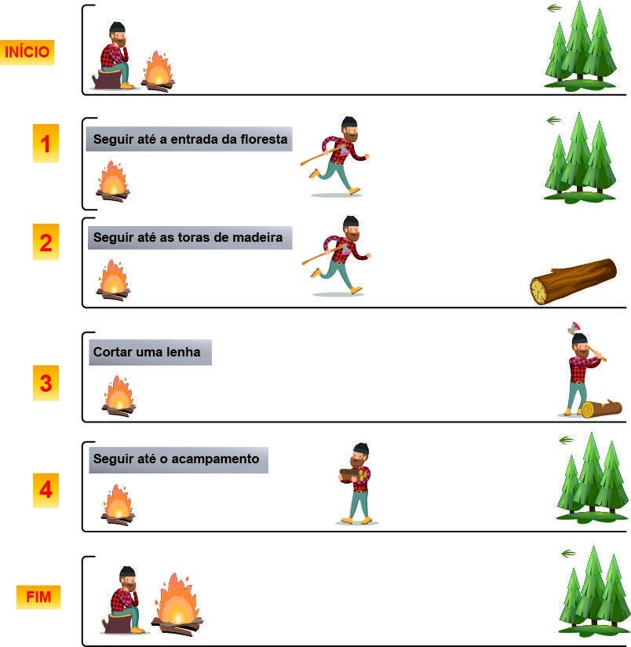

Todos os passos neste algoritmo são realizados, um após o outro, sem exceção.

1.1 Quebrando o fluxo de execução Agora, vamos imaginar que existam dois caminhos a serem tomados na entrada da floresta: esquerda e direita. Imagine que o lenhador precisa tomar o caminho da esquerda, ilustrado na Figura 2.

Figura 2 - Exemplo lúdico de um algoritmo. Caminho da esquerda

Créditos: Macrovector/ Shutterstock; ivector/ Shutterstock; Incomible/ Shutterstock; FARBAI/ Shutterstock; ennadii H/ Shutterstock.

Neste caminho, nosso lenhador acabou se deparando com algo inesperado. Um lobo apareceu para atacá- lo! Deste modo, é necessário que nosso personagem disperse o lobo antes de conseguir cortar lenha, gerando um passo a mais em nosso algoritmo.

_______________________________________________ Início 1. Seguir até a entrada da floresta.

2. Tomar o caminho da ESQUERDA.

3. Enfrentar o lobo.

4. Seguir até as toras de madeira.

5. Cortar uma lenha.

6. Retornar ao seu acampamento.

Fim Observe agora que, caso o lenhador tivesse escolhido o caminho da direita, não existiria um lobo para enfrentar, ficando assim: Figura 3 - Exemplo lúdico de um algoritmo. Caminho da direita

Créditos: Macrovector/ Shutterstock; ivector/ Shutterstock; Incomible/ Shutterstock; FARBAI/ Shutterstock.

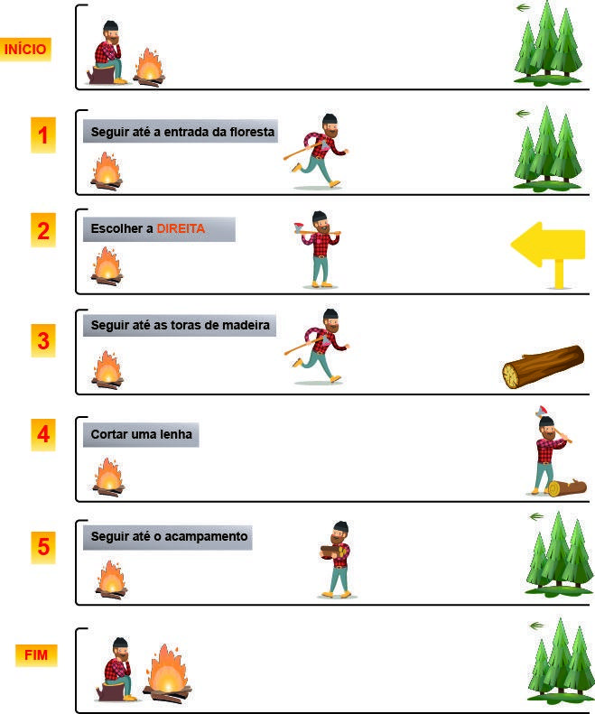

Note que, dependendo do caminho tomado, a execução das ações do lenhador poderá ser diferente. Para a esquerda, ele e ncontra um lobo. Para a direita, nenhuma ameaça. Dependendo de uma condição existente, neste caso, a decisão de qual caminho tomar, as ações resultantes poderão ser diferentes. Vejamos a Tabela 1. Nela, comparamos o que acontece em cada um dos caminhos tomados.

Tabela 1 - Comparativo de ações de ambos os caminhos a serem tomados Ações Esquerda Direta 1 Tomar o caminho da ESQUERDA.

Seguir até a entrada da floresta.

2 Enfrentar o lobo. Tomar o caminho da DIREITA.

3 Seguir até as toras de madeira.

- 4 Cortar uma lenha. Seguir até as toras de madeira.

5 Tomar o caminho da ESQUERDA.

Cortar uma lenha.

6 Retornar ao seu acampamento.

Retornar ao seu acampamento.

Percebeste que a ação/decisão da linha 2 na tabela é o que fará tomarmos ações distintas em seguida?

Neste caso, podemos reorganizar nossas ações de uma maneira com que a ação 2 defina o que acontece em seguida. Para tal , utilizamos uma estrutura de decisão, que em pseudocódigo nós chamamos de estrutura condicional se . Ou seja, se o caminho for o da esquerda, faça as instruções correspondentes à esquerda, senão (o caminho será obrigatoriamente da direita), faça estas outras instruções.

Em nosso exemplo , podemos reorganizar as ações conforme o pseudocódigo a seguir, portanto. Observe que existe uma decisão a ser tomada. Se o caminho for o da esquerda, execute todas as linhas dentro do item 1. Senão, execute todas as instruções dentro do item 2.

Inicio 1. se (caminho = esquerda) a. Seguir até a entrada da floresta b. Enfrentar o lobo c. Seguir até as toras de madeira d. Cortar uma lenha e. Retornar ao seu acampamento 2. senão a. Seguir até a entrada da floresta b. Seguir até as toras de madeira c. Cortar uma lenha d. Retornar ao seu acampamento 3. fim-se Fim Você conseguiu notar que dentre todas as ações tomadas, muitas delas se repetem em ambos os caminhos tomados? Ademais, a única ação diferente é a de enfrentar o lobo.

Em programação, não é uma boa prática repetir a mesma instrução diversas vezes. Sempre que for possível evitar isso, faça. Neste caso, podemos otimizar nosso algoritmo para que todas as instruções iguais sejam colocada s fora da condicional. Puxamos uma ação para antes da condição, e as outras três para após a condicional. Veja como podemos reescrever o pseudocódigo, portanto.

Inicio 1. Seguir até a entrada da floresta 2. se (caminho =  esquerda) a. Enfrentar o lobo 3. fimse 4. Seguir até as toras de madeira 5. Cortar uma lenha 6. Retornar ao seu acampamento Fim Como o lobo só aparece no caminho da esquerda, note que o algoritmo reescrito não executa nenhuma instrução quando o caminho for o da direita.

### TEMA 2 - CONDICIONAL SIMPLES E COMPOSTA

Aprendemos e compreendemos o que são estruturas condicionais e como são usadas em um exemplo fora da computação. Agora, vamos formalizar  os tipos de condicionais existentes e aprender como aplic á-los em linguagem Python.

Todas as condicionais apresentadas ao longo deste documento existem de alguma maneira em toda e qualquer linguagem de programação, portanto, todos os conceitos podem ser facilmente adaptáveis para outras linguagens, alterando somente a sua sintaxe.

2.1 Condicional simples A estrutura condicional simples existe para quando precisamos decidir se um conjunto de instruções precisa ser executado ou não.

Caso um teste lógico realizado resulte em um valor verdadeiro, significa que as instruções dentro da condição deverão ser executadas. Caso contrário, ou seja, caso o teste lógico resulte em falso, o fluxo de execução ignora as linhas de código dentro da estrutura.

Na Figura 3 temos o fluxograma de decisão de uma estrutura condicional simples. Lembrando que o padrão adotado para construção de fluxogramas está apresentado no livro da Sangra Puga, Lógica de programação e estrutura de dados, p. 14-15.

A forma geométrica do losango representa uma decisão. A partir dela, dois caminhos distintos podem ser tomados. Um caminho representa o resultado verdadeiro (V), e o outro o falso (F). Observe na Figura 4  que temos um bloco de instruções que será executado para o cenário verdadeiro. Para o falso, a condição pula por completo o bloco de instruções e segue o fluxo do algoritmo. Figura 4 - Fluxograma de uma estrutura de seleção simples

Fonte: Borin, 2023.

E como escrevemos a condicional simples em linguagem Python? A Figura 4 ilustra isso. Note que em Python a estrutura condicional é representada pela palavra if, que significa se , em inglês, portanto,  é bastante intuitivo de se compreender seu significado.

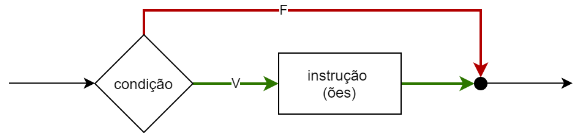

Após o if, abrimos parênteses (é opcional) e colocamos a condição lógica, que deve ser satisfeita para que o bloco de instruções seja executado . Após a condição devemos, obrigatoriamente, colocar dois pontos, nunca se esqueça dele!

Figura 5 - Construção da estrutura condicional em Python

Fonte: Borin, 2023.

Vejamos a implementação em Python:

if (condição):

# Instrução (ões) O símbolo de #  representa comentários em Python (vimos isso anteriormente). Veja que todas as instruções devem estar indentadas para serem reconhecidas como pertencentes ao bloco condicional. Ademais, a linguagem Python não tem um delimitador de final de estrutura. Muitas outras linguagens, como Java e C/C++, contêm um delimitador. O C/C++ é delimitado por chaves {}. O Python trabalha com a i ndentação para identificar o que pertence ao seu bloco, portanto não requer um finalizador para ele. Estamos falando bastante sobre como construir o código em Python, mas até o momento não praticamos nada,  e, também, não vimos como criar a tão comentada condição da estrutura. Vejamos um exemplo prático e executável . Lembrando que você pode inserir este código em qualquer software de interpretação Python que desejar.

O exercício a seguir lê dois valores numéricos inteiros e compara se o primeiro é maior do que o segundo, utilizando uma condicional simples. Caso seja (resultado verdadeiro), ele imprime na tela a mensagem informando que o primeiro valor digitado é maior do que o segundo.

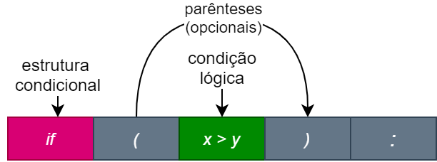

#Lê dois valores inteiros e compara ambos x = int(input('Digite um valor inteiro: ')) y = int(input('Digite um segundo valor inteiro: ')) if (x > y):

print('O primeiro valor é maior que o segundo!') No exemplo, a condição imposta era de que x fosse maior do que y. Vejamos o fluxograma para este mesmo exercício na Figura 6.

Figura 6 - Fluxograma de uma estrutura de seleção simples. Exemplo do maior e menor

Fonte: Borin, 2023.

Expandindo este exercício, podemos colocar duas condicionais simples. Uma realizando o teste para verificar se o primeiro valor é maior do que o segundo. E outro para verificar se o segundo é maior do que o primeiro. Veja como ficaria a seguir. Realize testes para diferentes valores de x e y. #Lê dois valores inteiros e compara ambos x = int(input('Digite um valor inteiro: ')) y = int(input('Digite um segundo valor inteiro: ')) if (x > y):

print('O primeiro valor é maior que o segundo!') if (x < y):

print('O segundo valor é maior que o segundo!') Sua vez de praticar!

O que acontece caso ambos os valores (x e y) sejam iguais no exercício acima? O que irá aparecer na tela para o usuário? Explique.

2.2 Indentação Gostaria de pausar aqui um pouco nosso estudo sobre condicionais para frisar a importância da indentação do código.

Indentar o código significa deix á-lo visualmente organizado e tabulado . Observe com atenção os exemplos que acabamos de resolver. Notou que a

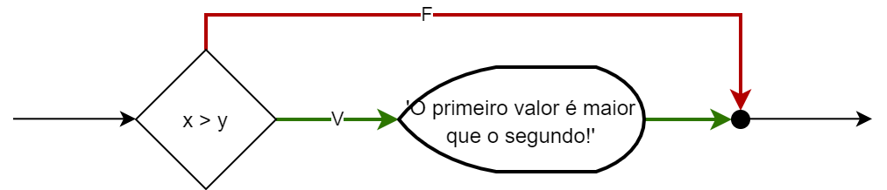

instrução que será, ou não, dentro do teste condicional, está com um recuo para a direita? Isso é proposital. Todo o código inserido em uma estrutura condicional deve ser deslocado para a direita a fim de garantir a compreensão de que aquelas instruções fazem parte da respectiva estrutura.

Na maioria das linguagens de programação, a indentação é um aspecto que não tem impacto no funcionamento do programa. Apesar disso, indentar um código é considerado uma boa prática de programação2, e deve ser adotada por todo e qualquer bom programador. Isso porque indentar o código o deixa mais legível, não só para o próprio desenvolver, mas também para outras pessoas que, porventura, venham a se deparar com seu algoritmo.

Em linguagem Python , o indentação assume um papel ainda mais importante. Isso porque a linguagem Python é uma das poucas  que utiliza a própria indentação para delimitar seu s blocos, como foi o caso da nossa condicional. Sendo assim, nunca deixe de indentar seus códigos  em Python, caso contrário, seu algoritmo poderá nem mesmo executar!

2.3 Condicional composta A estrutura condicional composta existe para quando precisamos decidir se um conjunto de instruções A precisa ser executado, ou se será outro conjunto de instruções B a ser executado.

Na Figura 7 temos o fluxograma da estrutura condicional composta. Se a condição a ser testada result ar em um valor lógico verdadeiro, observe na representação que executamos um conjunto A de instruções. Senão, o fluxo de execução segue por outro caminho, e outras instruções B são executadas. Note que nunca acontecerá de ambos os conjuntos de instruções serem executados em um mesmo fluxo de execução do algoritmo. Será sempre um, ou outro. Nunca ambos.

Não obstante, o conjunto A e o conjunto B pode m conter instruções completamente distintas entre si. Podendo inclusive apresentar uma quantidade de instruções bastante diferentes também. Não existem restrições quanto a isso.

2 Assim como realizar comentários no seu código também é!

Figura 7 - Fluxograma de uma estrutura de seleção composta

Fonte: Borin, 2023.

A escrita da condicional composta se dá da mesma maneira que a simples, em Python. A única diferença é que agora iremos acrescentar a palavra else (senão, em inglês), que irá representar o conjunto B de instruções a ser executado. Observe a comparação a seguir com o pseudocódigo. if (condição):

# Instrução (ões) A else:

# Instrução (ões) B Lembra o exemplo com duas condicionais simples? É bem verdade que aquele tipo de implementação feita anteriormente não é uma boa abordagem. Em programação, quando empregamos diversas condicionais simples para testar um mesmo proposito, certamente a podemos substituir por lima composta. Veja a implementação adequada:

#Lê dois valores inteiros e compara ambos x = int(input('Digite um valor inteiro: ')) y = int(input('Digite um segundo valor inteiro: ')) if (x > y):

print('O primeiro valor é maior que o segundo!') else:

print('O segundo valor é maior que o segundo!') O exe mplo que vamos resolver agora descobre se um número inteiro digitado é par ou é ímpar. Para resolvermos este exercício, devemos pensar em que teste lógico deve ser feito para descobrirmos se um número é par ou ímpar.

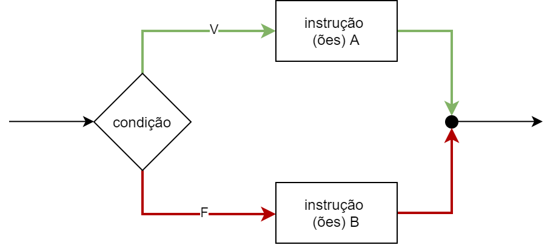

Se pegarmos qualquer valor numérico e inteiro e dividirmos por 2, que é par, e esta divisão resultar em resto  zero, sabemos que o número digitado é divisível por 2 e , portanto, é par 3. Caso o resto desta divisão não dê zero, significa que o número não é divisível por 2 e, portanto, é ímpar. Na linguagem Python, podemos obter o resto de uma divisão diretamente utilizando o símbolo de percentual. Deste modo, podemos escrever a expressão lógica 𝑥𝑥 % 2 == 0. Ou seja, obtemos o resto da divisão por 2 e, em seguida, pela comparação lógica de igualdade verificamos se é igual a zero. Ademais, a ordem de precedência dos operadores também deve ser respeitada aqui. Primeiro, o cálculo aritmético é realizado e por último o teste lógico. Ficamos com o algoritmo a seguir.

# par ou ímpar x = int(input('Digite um valor inteiro: ')) if (x % 2 == 0):

print('O número é par!') else:

print('O número é ímpar!') Sendo assim, a cada execução deste programa, ou linha de código 4, ou a linha 6 será executada. Nunca ambas.  O fluxograma destes exercícios está colocado na Figura 8.

Figura 8 - Fluxograma de uma estrutura de seleção composta. Exemplo do par ou ímpar

Fonte: Borin, 2023.

3 Para fins de simplificação, vamos assumir que o número 0 também é par.

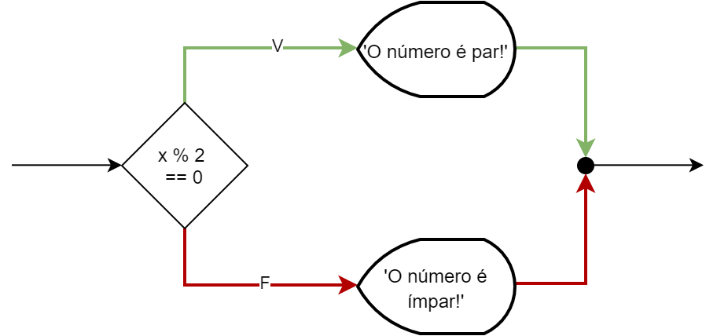

2.4 Comparando desempenho Acabamos de resolver o algoritmo do par ou ímpar utilizando uma condicional composta. E funcionou perfeitamente! Porém, e se resolvêssemos escrever o mesmo problema, mas agora empregando somente condicionais simples, é possível? A resposta é sim. Vejamos o resultado a seguir. # par ou ímpar x = int(input('Digite um valor inteiro: ')) if (x % 2 == 0):

print('O número é par!') if (x % 2 == 1):

print('O número é ímpar!') Na linha 5, acabamos por substituir o else da condição composta por outro teste simples. Neste novo teste, agora estamos testando se o resto da divisão por 2 resulta no valor 1, caso resulte, será ímpar. Sendo assim, se substituirmos a condicional composta por duas condicionais simples, o algoritmo também funcionará corretamente.

Você pode estar se perguntando agora, ambas as maneiras estão corretas? Posso utilizar qualquer uma? Bom, de fato ambas funcionam, porém a solução que acabamos de ver não é recomendável para este exercício. E existe um motivo muito importante para que não se utilize duas condicionais simples  neste caso : o desempenho do algoritmo, ou seja, a velocidade com que ele executa.

Para compreender melhor isso, precisamos entender o que o computador faz para executar uma instrução como a da linha, ou linha 5. Neste caso, a CPU realizará dois cálculos: primeiro, a divisão, e em seguida , o teste de igualdade lógico. Portanto, são duas operações a cada teste condicional realizado. Caso estivermos com nosso algoritmo realizando o teste lógico em uma estrutura composta, o teste será feito uma única vez e, dependendo do seu resultado (V ou F), irá saltar para uma determinada parte do código e executar. A estrutura do else não tem nenhum teste para ser feito, portanto não gera custo computacional dentro da CPU.

Agora, caso nosso algoritmo for construído com duas condicionais simples, faremos o mesmo teste (divisão e igualdade) duas vezes. O dobro!

Imagine uma situação em que o número digitado é par. No algoritmo com condicional composta, a condição dará verdadeira e a linha 4 aparece na tela, encerrando o programa.

Já no algoritmo com condicionais simples, independentemente de o nosso número já ter sido identificado como par, por exemplo, o teste para ímpar ainda será desenvolvido (e dará falso), o que irá gerar o dobro de custo de execução dentro da CPU. E isso deve ser evitado a todo o custo.

Em resumo, sempre que for possível substitui r 2 testes simples por um composto, faça -o! Certo, mas como identificar se é possível fazer esta substituição? Não existe uma receita pronta para isso. Porém, a  dica aqui é: sempre verifique se os seus 2 testes simples servem para o mesmo propósito dentro do seu programa.

No nosso exercício, ambos os testes serviam para verificar se o número é par ou í mpar, portanto, têm o mesmo objetivo e podem ser trocados por um único teste composto.

Expandindo o exercício. Se quiséssemos, além de verificar se o n úmero é par ou ímpar, encontrarmos se o número é múltiplo de 7. Podemos agora criar duas condicionais compostas e separadas. Isso porque o teste para o múltiplo de 7 distingue por completo da verificação de um número ser, ou não, par. A seguir temos o algoritmo  com duas condicionais compostas . Para a verificação do múltiplo de 7, podemos novamente fazer o teste por meio do resto da divisão, pois um múltiplo de 7 deve, obrigatoriamente, ser divisível por 7 (resto zero).

# par ou ímpar e múltiplo de 7 x = int(input('Digite um valor inteiro: ')) if (x % 2 == 0):

print('O número é par!') else:

print('O número é ímpar!') if (x % 7 == 0):

print('Múltiplo de 7!') else:

print('Não é múltiplo de 7!') 2.5 Exercícios Vamos praticar alguns exercícios de condicional simples e composta.

Exercício 2.5.1 Desenvolva um algoritmo que solicite o seu ano de nascimento e o ano atual. Calcule a sua idade e apresente na tela.

Para fins de simplificação, despreze o dia e o mês do ano. Após o cálculo, verifique se a idade é maior ou igual a 18 anos e apresente na tela uma mensagem informando que já é possível tirar a carteira de motorista caso seja de maior.

Python ano_nasc = int(input('Qual seu ano de nascimento?')) ano_atual = int(input('Em que anos estamos?')) idade = ano_atual - ano_nasc print(f'Você tem {idade} anos de idade.') if (idade >= 18):

print('Você é de maior. Já pode tirar a carteira de motorista!') Fluxograma

Exercício 2.5.2 (Adaptado de Sandra Puga, p. 44) Uma empresa concedeu um bônus de 20% para todos seus funcionários com mais de cinco  anos de empresa. Todos os outros que não se enquadram nesta categoria receberam uma bonificação de 10%, somente. Escreva um algoritmo que leia o salário do funcionário e seu tempo de empresa, e apresente a bonificação de cada funcionário na tela. Python salario = float(input('Qual seu salário?')) ano_admissao = int(input('Qual seu ano de admissão na empresa?')) ano_atual = int(input('Em que ano estamos?'))

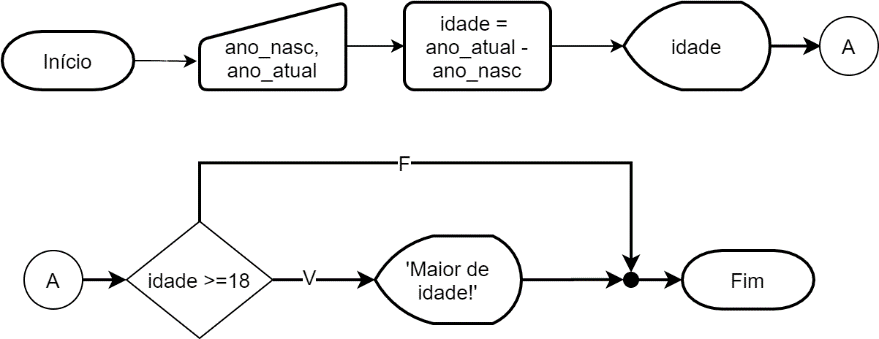

tempo = ano_atual - ano_admissao if (tempo > 5):

bonus = salario * 0.2 else:

bonus = salario * 0.1 print(f'Você tem {tempo} anos dentro desta empresa.') print(f'Seu Salário é de {salario}.') print(f'E sua bonificação é de {bonus}.') print(f'Salário final {bonus + salario}.') Fluxograma

### TEMA 3 - EXPRESSÕES LÓGICAS E ÁLGEBRA BOOLEANA

No tópico anterior aprendemos a construir algoritmos com estruturas condicionais simples e compostas . Você deve ter percebido que a condição utilizada dentro da estrutura if é fundamental para que o algoritmo funcione como deveria.

Deste modo, vamos dedicar um tópico inteiro, nesta abordagem, para estudarmos mais a fundo as expressões lógicas que podemos criar, bem como estudaremos a álgebra booleana, essencial para a construção de expressões lógicas mais complexas.

3.1 Operadores lógicos/booleanos Aprendemos, em conteúdos anteriores, os principais operadores aritméticos, e , também, os operadores relacionais. Todos estes operadores

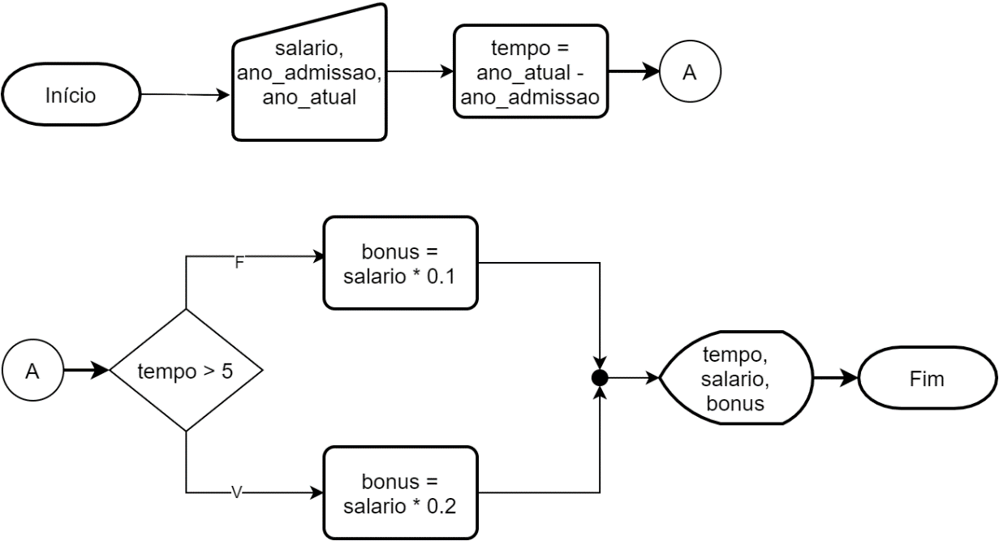

podem ser combinados em expressões lógicas, que veremos em breve. Porém, nos restou ainda aprender um terceiro tipo de operador, que será investigado agora, o operador lógico (ou operador booleano).

Estes operadores servem para agrupar operações e expressões lógicas, e têm comportamentos distintos. O Python, por padrão, suporta três operadores lógicos, embora existam outros  na álgebra de Boole : o operador de conjunção (and), de disjunção (or) e o de negação (not). Em linguagem Python, escrevemos estes operadores exatamente como se falamos em inglês, portanto: Tabela 2 - Lista de operadores lógicos em Python e em pseudocódigo Python Pseudocódigo Operação not não negação and e conjunção or ou disjunção Cada operador contém um conjunto de regras, e são expressos pelo que chamamos de tabela verdade do operador. A tabela verdade demonstra o resultado de uma operação com um ou dois valores lógicos. O operador de negação é um operador unitário, enquanto os de conjunção e disjunção são binários, ou seja, requem dois operadores.

Operador not Vamos iniciar pelo mais simples deles. O operador de negação not serve para negar um resultado lógico ou o resultado de uma expressão booleana. Na prática, isso significa que o resultado de uma expressão será invertido. A tabela verdade do not é apresentado na Tabela 3 . Em que a coluna V representa um valor booleano.

Como em Python um valor booleano verdadeiro é representado pelo seu termo em inglês True, e o falso é False. Vamos adotar esta nomenclatura a partir daqui.

Tabela 3 - Tabela verdade do operador not (não) V not V True False False True Façamos um teste bastante simples no Python. Crie duas variáveis quaisquer e atribua a elas ambos os valores lógicos existentes 4. Em seguida, faça um print da variável negada. Veja que sempre o resultado na tela será o inverso:

# not x = True y = False print(not x) print(not y) Saída:

False True Operador and O operador binário and utiliza dois valores, que chamaremos de valores de entrada, e irá gerar um valor como resultado de saída. Este operador irá prover um resultado verdadeiro se, e somente se, ambas entradas forem verdadeiras. A tabela verdade do and é apresentada na Tabela 4. Em que as colunas V1 e V2 representam um valor booleano. Todas as combinações binárias possíveis estão apresentadas na tabela.

Tabela 4 - Tabela verdade do operador and (e) V1 V2 V1 and V2 False False False False True False

4 Atenção! Lembre-se que a linguagem Python compreende os valores lógicos escritos sempre com a primeira letra da palavra em maiúscula. Portanto, true e false não irão funcionar.

True False False True True True Realize os testes a seguir para todas as combinações possíveis da tabela verdade e veja se os resultados coincidem com ela.

# and x = True y = False print(x and y) Saída:

False Operador or O operador binário or utiliza dois valores, que chamaremos de valores de entrada, e irá gerar um valor como resultado de saída. Este operador irá prover um resultado verdadeiro, caso ao menos uma das entradas forem verdadeiras. A tabela verdade do or é apresentada a seguir. Em que as colunas V 1 e V2 representam um valor booleano. Todas as combinações binárias possíveis estão apresentadas na Tabela 5.

Tabela 5 - Tabela verdade do operador or (ou) V1 V2 V1 or V2 False False False False True True True False True True True True Realize os testes a seguir para todas as combinações possíveis da tabela verdade e veja se os resultados coincidem com ela.

# or x = True y = False print(x or y) Saída:

True 3.2 Expressões lógicas/booleanas Agora que vimos os operadores lógicos , vamos então aprender a combiná-los em expressões lógicas. Podemos faremos  isso inclusive inserindo operadores relacionais e aritméticos também.

Porém, primeiramente precisamos deixar bem clar a a ordem de precedência na execução de cada operação pela linguagem de programação. No Python, assim como todas as linguagens de programação usuais, existe uma ordem com que cada operação é realizada pelo programa.

De modo geral, para operações aritméticas, a ordem de execução segue o que já aprendemos na matemática básica da escola. Por exemplo, divisão e multiplicação sempre se executa antes da adição e subtração. Mas aqui temos também os operadores relacionais e os lógicos. Portanto, a ordem com que cada um é executada está colocada a seguir:

1. Parênteses; 2. Operadores aritméticos de potenciação ou raiz; 3. Operadores aritméticos de multiplicação, divisão e módulo; 4. Operadores aritméticos de adição e subtração; 5. Operadores relacionais; 6. Operadores lógicos not; 7. Operadores lógicos and; 8. Operadores lógicos or; 9. Atribuições.

Todas as operações de mesmo grau de importância são executadas sempre da esquerda para a direita pelo programa. Por exemplo, se tivermos duas adições numa mesma expressão, primeiro a mais à esquerda ocorre antes. Vejamos uma série de exemplos para colocar em prática tudo isso. No primeiro exemplo, temos duas variáveis inteiras com um teste relacional, e, após, uma negação.

x = 10 y = 1 res = not x > y print(res)

Saída:

False Seguindo a precedência apresentada, primeiro é realizado o operador relacional, fazendo o teste 10 > 1, que irá resultar em True. Após, ele é negado, invertendo e ficando False.

No próximo exemplo temos três  variáveis numéricas. Na expressão lógica, temos duas operações relacionais, que acontecerão primeiro. E, por fim, temos o operador and.

x = 10 y = 1 z = 5.5 res = (x > y) and (z == y) print(res) Saída:

False Temos duas operações de mesmo nível de importância na mesma expressão (operadores relacionais). Iniciamos pelo resultado de x > y, que será True. Enquanto z == y  será False. Em seguida, teremos a operação de conjunção True and False, que irá resultar em False, pois, lembrando, uma and só fornece uma saída True caso ambas entradas também sejam True. Temos uma expressão bastante semelhante a seguir. Porém , agora, trocamos uma and por uma or. Assim, teremos a disjunção True or False, que irá resultar em True, pois a or fornece uma saída True caso ao menos uma das entradas também sejam True.

x = 10 y = 1 z = 5.5 res = (x > y) or (z == y) print(res) Saída:

True

No quarto exemplo temos uma expressão bastante longa e aparentemente complexa. Porém, se seguirmos a precedência dos operadores veremos como não é complexo compreendermos seu resultado.

x = 10 y = 1 z = 5.5 res = x > y or not z == y and y != y + z / x print(res) Saída:

True A seguir é apresentado a sequência de passos que levam até o resultado True apresentado como saída:

1) Operação aritmética de divisão: 5.5 / 10 = 0.55; 2) Operação aritmética de adição y + 0.55: 1 + 0.55 = 1.55; 3) Operações lógicas relacionais. Como temos três delas, ficam: a. x > y → 10 > 1 = True; b. z == y → 5.5 == 1 = False; c. y != 1.55 → 1 != 1.55 = True; 4) Operação lógica not False = True; 5) Operação lógica and: True and True = True; 6) Operação lógica or: True or True = True

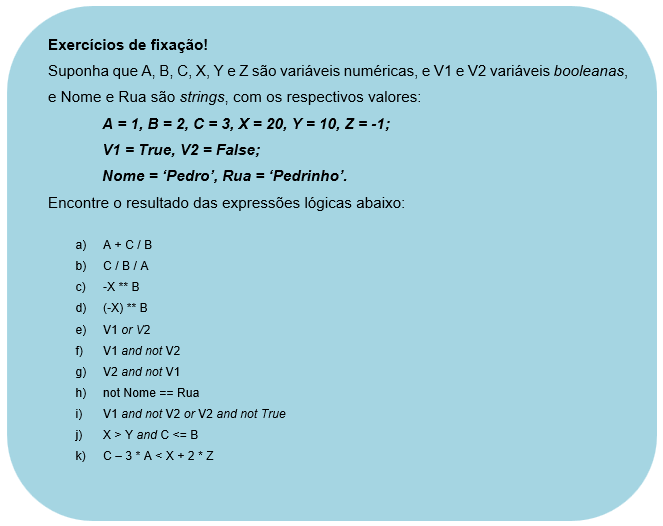

3.3 Exercícios Agora vamos juntar nossos conhecimentos resolvendo alguns exercícios de condicionais simples e compostas , em que o uso de expressões lógicas na condição de decisão é fundamental.

Exercício 3.3.1 (Adaptado de Menezes , p. 60) Um aluno, para passar de ano, precisa estar aprovado em todas as matérias que ele está cursando.

Assuma que a média para aprovação é a partir de 7, e que o aluno cursa 3 matérias, somente. Escreva um algoritmo que leia a nota final do aluno em cada matérias, e informe na tela se ele passou de ano, ou não. Python # Exercício 3.3.1 m1 = float(input('Digite a nota da 1ª matéria:')) m2 = float(input('Digite a nota da 2ª matéria:')) m3 = float(input('Digite a nota da 3ª matéria:')) if m1 >= 7 and m2 >= 7 and m3 >= 7:

print('O aluno está aprovado de ano!'); else:

print('O aluno não passou de ano!'); Exercício 3.3.2 Escreva um algoritmo que lê um valor inteiro qualquer. Após, verifique se este valor está contido dentro dos seguintes intervalos: -100 x < -1 e 1 < x < 100. Imprima na tela uma mensagem caso ele esteja em um dos intervalos. Python x = int(input('Digite um valor qualquer inteiro: ')) if x >= 1 and x<=100 or x >= -100 and x <= -1:

print('Um dos critérios foi atingido.')

### TEMA 4 - CONDICIONAIS ANINHADAS

Muitos dos programas computacionais envolvem uma complexidade maior do que somente empregar uma única estrutura condicional simples , ou mesmo uma composta. É bastante comum que venhamos a utilizar duas, ou mais, condicionais aninhadas em um mesmo algoritmo, ou seja, uma condicional dentro da outra.

Na Figura 9 vemos duas estruturas condicionais aninhadas representadas em um fluxograma. Entenda que podemos aninhar quando condicionais quisermos, e não somente duas. Para fins didáticas fiaremos na representação de duas, somente.

Figura 9 - Fluxograma de uma estrutura de seleção com dois níveis de aninhamento

Fonte: Borin, 2023.

No fluxograma, ambas condicionais são compostas. Perceba que, caso a condição 1 resulte em verdadeiro, caímos diretamente na segunda estrutura de decisão. Caso a segunda também resulte em verdadeiro, executamos um conjunto de instruções A. Caso a segunda condição resulte em falso, executamos B. Agora, caso na primeira condição tivéssemos obtido um resultado falso imediatamente, nem iriamos para o segundo teste e executaríamos as instruções C.

Agora, vamos resolver um exemplo para que você compreenda melhor como aninhar estruturas de decisão.  Vamos retomar o Exercício 2.5.2, em que uma empresa concedeu um bônus de 20% para todos seus funcionários com mais de 5 anos de empresa. E todos os outros receberam uma bonificação de 10%.

Vamos inserir mais uma camada de restrição neste exercício. Agora, além dos critérios acima, funcionários com mais de 10 anos de empresa têm direito a uma bonificação de 30%.

Neste caso, temos agora 3 possíveis resultados de bonificação: 30%, 20% e 10%. No algoritmo em Python, podemos inserir uma primeira condicional

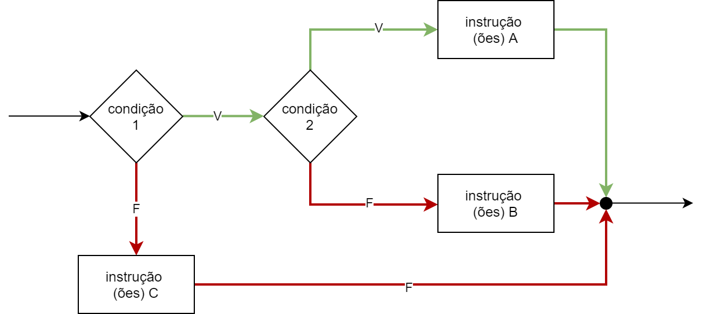

composta que verifica se o funcionário tem mais do que 10 anos de empresa. Caso a condição não seja satisfeita, caímos no else  e, dentro dele, temos um segundo teste condicional que verifica o tempo de 5 anos. Por fim, caso nem esta condição seja satisfeita, caímos no segundo else, que corresponde à bonificação de 10%. O código em linguagem Python está colocado a seguir. salario = float(input('Qual seu salário?')) ano_admissao = int(input('Qual seu ano de admissão na empresa?')) ano_atual = int(input('Em que ano estamos?')) tempo = ano_atual - ano_admissao if (tempo > 10):

bonus = salario * 0.3 else:

if (tempo > 5):

bonus = salario * 0.2 else:

bonus = salario * 0.1 print(f'Você tem {tempo} anos dentro desta empresa.') print(f'Seu salário é de {salario}.') print(f'E sua bonificação é de {bonus}.') print(f'Salário final: {bonus + salario}.') Percebeste a condicional dentro da outra? Então n unca se esqueça da indentação! Observe que tudo colocado dentro do primeiro teste deve estar recuado para a direita. Portanto, toda a segunda condicional, inserida na primeira, deve estar recuada . Assim como tudo que estiver dentro da segunda condição deve estar recuado novamente.

Sua vez de praticar!

Puxe na memória o que você estudou na seção 2.4 Comparando desempenho.

No algoritmo que acabamos de resolver, se ao invés de duas condicionais aninhadas, usássemos elas de maneira separada, testando individualmente cada necessidade do exercício, o algoritmo teria um desempenho igual ou inferior ao resolvido acima? Por quê?

Exercícios Vamos praticar alguns exercícios de condicionais aninhadas.

Exercício 4.1.1

Escreva um algoritmo em Python em que o usuário escolhe se ele quer comprar maçãs, laranjas ou bananas. Deverá ser apresentado na tela um menu com a opção 1 para maçã, 2 para laranja e 3 para banana.

Após escolhida a fruta, deve-se digitar quantas unidades se quer comprar. O algoritmo deve calcular o preço total a pagar do produto escolhido e mostrá-lo na tela.

Considere que uma maç ã custa R$ 2,30, uma laranja R$ 3 ,60 e uma banana 1,85.

Python # Exercício 4.1.1 print('Escolha o que deseja comprar:') print('1 - Maça') print('2 - Laranja') print('3 - Banana') produto = int(input('Qual sua escolha?')) qtd = int(input('Quantas unidades?')) if (produto == 1):

pagar = qtd * 2.3 print(f'Você comprou {qtd} maças. Total à pagar: {pagar}') else:

if (produto == 2):

pagar = qtd * 3.6 print(f'Você comprou {qtd} laranjas. Total a pagar: {pagar}') else:

if (produto == 3):

pagar = qtd * 1.85 print(f'Você comprou {qtd} bananas. Total a pagar: {pagar}') else:

print('Produto inexistente!')

Fluxograma

Exercício 4.1.2 (Adaptado de Sandra Puga, p. 48) Faça um algoritmo que receba três valores, representando os lados de um triângulo fornecidos pelo usuário. Verifique se os valores formam um triângulo e classifique como: a) Equilátero (três lados iguais); b) Isósceles (dois lados iguais); c) Escaleno (três lados diferentes).

Lembre-se de que, para formar um triângulo, nenhum dos lados pode ser igual a zero e um lado não pode ser maior do que a soma dos outros dois. Python A = int(input('Digite o 1º lado do triângulo:')) B = int(input('Digite o 2º lado do triângulo:'))

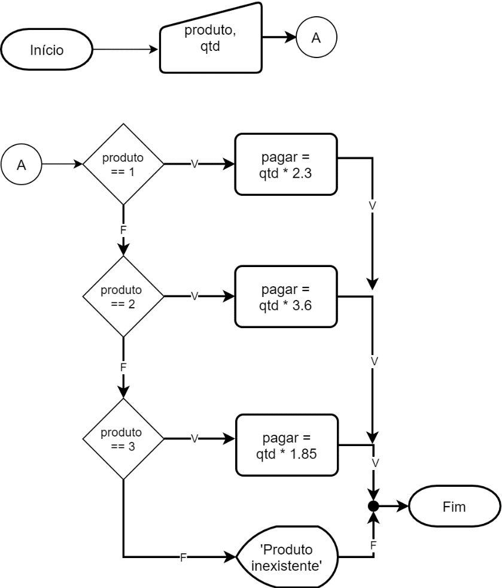

C = int(input('Digite o 3º lado do triângulo:'))

if A > 0 and B > 0 and C > 0:

if A + B > C and A + C > B and B + C > A:

#Se chegou até aqui, é porque o triângulo é válido if A != B and A != C and B != C:

print('Triângulo escaleno.') else:

if A == B and A == C and B == C:

print('Triângulo equilátero.') else:

print('Triângulo isósceles.') else:

print('Ao menos um dos valores indicados não servem para formar um triângulo.') else:

print('Ao menos um dos valores indicados não servem para formar um triângulo.') Fluxograma

### TEMA 5 - CONDICIONAIS DE MÚLTIPLA ESCOLHA (elif)

Durante os programas que desenvolveu utilizando condicionais aninhadas, deve ter percebido que, quanto mais aninhamentos você fazia, mais complexo de organizar o código ia  ficando, pois era necessário ficar bastante atento aos recuos.

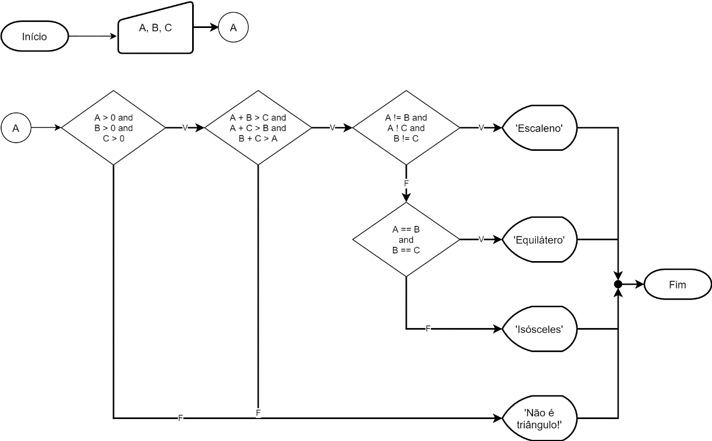

Existe uma maneira de deixar a implementação com múltiplos aninhamentos mais atrativa e legível para o desenvolvedor, a qual chamamos de condicional de múltipla escolha. Esta solução não será sempre implementável para substituir qualquer aninhamento, mas pode ajudar em algumas situações. A condicional múltipla existe em todas as linguagens de programação, no pseudocódigo chamamos ela de condicional escolha . Ela tem como objetivo facilitar e organizar melhor um código com múltiplos if,   quando todos os if precisam realizar testes com um a mesma variável. Este tipo de condicional é ótimo para criar menu de opções, por exemplo, ou gerenciar catálogo de produtos e cadastros.

Em linguagem Python, escrevemos a múltipla escolha utilizando uma cláusula chamada de elif . A palavra elif  é uma junção da palavra else  com a palavra if, e irá substituir um else  e um i f aninhados por ela. Veja o exemplo a seguir.

Note que lemos primeiro um nome e uma idade. Aí, caso o nome seja Vinicius. Uma mensagem aparece na tela. Agora, caso você digite qualquer outra palavra ao invés de Vinicius. O programa irá cair em um dos dois no elif . E irá executar ou a linha 6 ou a linha 8, dependendo da idade que você digitou. nome = input('Qual seu nome?') idade = int(input('Qual sua idade?')) if nome == 'Vinicius':

print('Olá, Vinicius!') elif idade < 18:

print('Você não é o Vinicius! E é menor de idade!') elif idade > 100:

print('Diferente de você, o Vinicius não é imortal!') Vejamos outro exemplo. Vamos praticar esta estrutura retomando o exercício da compra de frutas, o Exercício 4.1.1. Nele havíamos aninhado três estruturas condicionais compostas com o objetivo de, para cada uma delas, calcular um dos produtos. Vamos reescrever este exercício, mas agora com a estrutura elif.

print('Escolha o que deseja comprar:') print('1 - Maça') print('2 - Laranja') print('3 - Banana') produto = int(input('Qual sua escolha?')) qtd = int(input('Quantas unidades?'))

if (produto == 1):

pagar = qtd * 2.3 print(f'Você comprou {qtd} maças. Total a pagar: {pagar}') elif (produto == 2):

pagar = qtd * 3.6 print(f'Você comprou {qtd} laranjas. Total a pagar: {pagar}') elif (produto == 3):

pagar = qtd * 1.85 print(f'Você comprou {qtd} bananas. Total a pagar: {pagar}') else:

print('Produto inexistente!') Na nova solução para este problema, observe que as palavras else e if fundiram-se em uma só (elif). Após a palavra elif, sempre existirá uma condição também.

Neste exercício, note que após todos os elif existe um else. Este else  é opcional, e existe para que caso nenhuma das opções da múltipla escolha seja satisfeita, o else acontecerá.

A implementação usando a múltipla escolha não tem impacto no desempenho do algoritmo em relação à solução aninhada. Ou seja, algoritmo não tende a executar mais rápido, ou mais lento, devido a ela. O que difere o elif de estruturas aninhadas é que nosso código se torna mais simples de se compreender, pois trabalhamos com menos recuos. Imagine que você deseja adicionar mais frutas para vender no algoritmo acima. Utilizar o elif facilita este processo também, pois basta que insira mais cláusulas destas. 5.1 Exercícios Vamos praticar alguns exercícios de condicional de múltipla escolha. A condição de fluxogramas com elif  se dá da mesma maneira que com aninhamentos. Portanto, não serão apresentados os fluxogramas dos exercícios a seguir.

Exercício 5.1.1 (Adaptado de Menezes, p. 83) Escreva um algoritmo que leia dois valores numéricos e que pergunte ao usuário qual operação ele deseja realizar: adição (+), subtração ( -), multiplicação (*) ou divisão (/). Exiba na tela o resultado da operação desejada.

Python

print('CALCULADORA') print('+ Adição') print('- Subtração') print('* Multiplicação') print('/ Divisão') print('Digite outra tecla para sair.')

op = input('Qual operação deseja realizar?') x = int(input('Digite o primeiro valor: ')) y = int(input('Digite o segundo valor: '))

if (op == '+'):

res = x + y print(f'Resultado: {x} + {y} = {res}') elif (op == '-'):

res = x - y print(f'Resultado: {x} - {y} = {res}') elif (op == '*'):

res = x * y print(f'Resultado: {x} * {y} = {res}') elif (op == '/'):

res = x / y print(f'Resultado: {x} / {y} = {res}') else:

print('Operação Inválida!') Exercício 5.1.2 Uma loja de departamentos está oferecendo diferentes formas de pagamento, conforme opções listadas a seguir. Faça um algoritmo que leia o valor total de uma compra e calcule o valor do pagamento final de acordo com a opção escolhida.

Se a escolha for por pagamento parcelado, calcule também o valor de cada parcela. Ao final, apresente o valor total da compra e o valor das parcelas: • Pagamento à vista – conceder desconto de 5%; • Pagamento em 3x – o valor não sofre alterações; • Pagamento em 5x – acréscimo de 2%; • Pagamento em 10x – acréscimo 8%.

Python print('PAGAMENTO') print('1 - à vista') print('2 - parcelamento em 3x') print('3 - parcelamento em 5x') print('4 - parcelamento em 10x')

print('pressione outra tecla para sair...')

op = int(input('Qual forma de pagamento deseja fazer?')) valor = float(input('Qual o preço do produto?'))

if   (op == 1):

valor_final = valor * 0.95 print(f'Produto comprado à vista. Total a pagar:

{valor_final}') elif (op == 2):

valor_final = valor parcela = valor_final / 3 print(f'Produto parcelado em 3x. Total a pagar: {valor_final}. Valor da parcela: {parcela:.2f}.') elif (op == 3):

valor_final = valor * 1.02 parcela = valor_final / 5 print(f'Produto parcelado em 5x. Total a pagar: {valor_final}. Valor da parcela: {parcela:.2f}.') elif (op == 4):

valor_final = valor * 1.08 parcela = valor_final / 10 print(f'Produto parcelado em 10x. Total a pagar: {valor_final}. Valor da parcela: {parcela:.2f}.') else:

print('Opção inválida.')

### FINALIZANDO

Nesta abordagem, aprendemos todos os tipos de estruturas condicionais existentes na literatura e sua aplicação em linguagem Python. Aprendemos sobre estruturas condicionais simples, compostas, aninhada s e de múltipla escolha (elif).

Reforçamos que, tudo o que foi visto neste conteúdo continuará a ser utilizado de maneira extensiva ao longo das próximas, portanto , pratique e resolva todos os exercícios do seu material.

### REFERÊNCIAS

FORBELLONE, A. L. V. et al . Lógica de programação: a construção de algoritmos e estruturas de dados. 3. ed. São Paulo: Pearson, 2005. MATTHES, E. Curso intensivo de Python: uma introdução prática baseada em projetos à programação. 1. ed. São Paulo: Novatec, 2015.

MENEZES, N. N. C. Introdução à programação Python: algoritmos e lógica de programação para iniciantes. 3. ed. São Paulo: Novatec, 2019. PERKOVIC, L . Introdução à computação usando Python -  um foco no desenvolvimento de aplicações. Rio de Janeiro: LTC, 2016.

PUGA, S.; RISSETI, G. Lógica de programação e estrutura de dados . 3. ed. São Paulo: Pearson, 2016.
