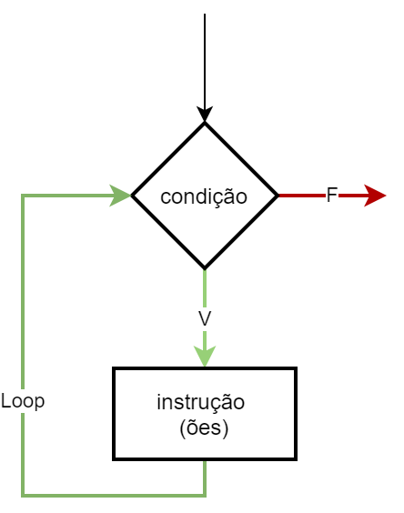
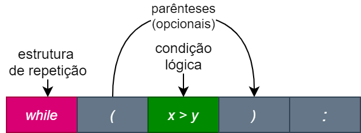
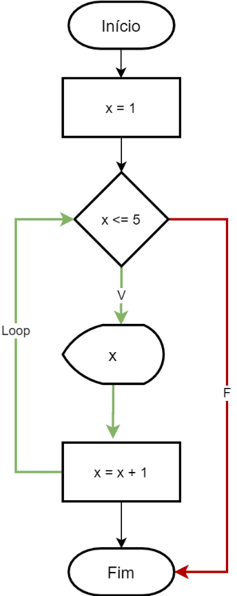
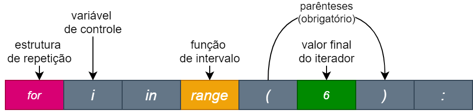
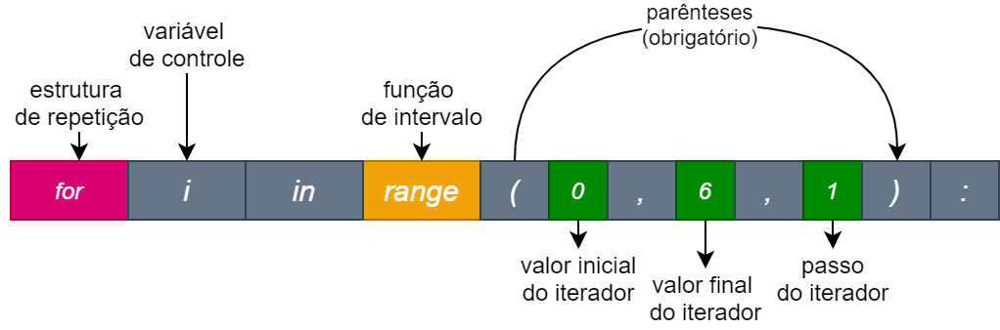
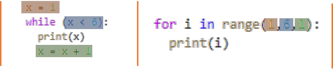

# Lógica de Programação e Algoritmos (937564)
## Aula 4 — Algoritmos iterativos. Estruturas de repetição

> Texto integral da apostila oficial da Uninter (sem resumo). PDF original: [Aula_04.pdf](../_apostilas_pdf/01_Logica_Programacao/Aula_04.pdf)

Prof. Vinicius Pozzobon Borin, Me.

LÓGICA DE PROGRAMAÇÃO E ALGORITMOS AULA 4

Prof. Vinicius Pozzobon Borin

### CONVERSA INICIAL

Ao longo desta etapa você irá aprender a criar códigos com repetição de instruções, também chamado de códigos iterativos. Ou seja, algumas partes dos nossos algoritmos poderão ser repetidas diversas vezes, até que uma determinada condição seja satisfeita e finalize o bloco de repetição. Iremos investigar todos os tipos de repetições existentes em linguagem Python: a estrutura de repetição while (enquanto em português) e a estrutura de repetição for (para em português). Essas estruturas de repetição são existentes em todas as principais linguagens de programação modernas e podem ser transpostas para fora do Python seguindo o mesmo raciocinio lógico aqui apresentado.

Assim como nas etapas anteriores, todos os exemplos apresentados neste material poderão ser praticados concomitantemente  em um Jupyter Notebook, como o Google Colab, e não requer a instalação de nenhum software de interpretação para a linguagem Python em sua máquina.

Ao longo do material você encontrará alguns exercícios resolvidos. Estes exercícios estão colocados em linguagem Python com seus respectivos fluxogramas.

### TEMA 1 – ESTRUTURA DE REPETIÇÃO

Vamos voltar ao nosso mascote, o Lenhadorzinho. Nesta etapa, ele precisa chegar até a tora de madeira para cortá-la, mas agora temos uma movimentação atrelada ao personagem, onde cada quadradinho é um espaço de movimentação para o nosso amigo. Observe na Figura 1 como o lenhador está dentro de um quadradinho, e a tora de madeira está posicionada cinco espaços depois.

Figura 1 – Exemplo lúdico de movimentação do lenhador

Crédito: Ivector/Shutterstock; Incomible/Shutterstock.

Imagine que, para cada quadradinho de movimentação do desenho, precisamos dar um comando ao lenhador. Sendo assim, para que ele chegue até a madeira, serão necessárias cinco instruções de movimento. Observe na Figura 2 todos os movimentos realizados.

Figura 2 – Exemplo lúdico de movimentação do lenhador

Crédito: Ivector/Shutterstock; Incomible/Shutterstock.

Podemos escrever o algoritmo de movimentação do lenhador da Figura 1 e Figura 2 como sendo:

_______________________________________________ Início 1. Mover 2. Mover.

3. Mover.

4. Mover.

5. Mover.

Fim Crédito: Vinicius Pozzobon Borin.

Note que a instrução de movimentação se repetiu cinco vezes no algoritmo. Repetir instruções em um programa é bastante comum. Aliás, repetir a instrução de movimento algumas poucas vezes não nos parece algo trabalhoso de se fazer, certo?

Agora, imagine que, em vez de movimentar cinco espaços até a madeira, o personagem precisaria andar 100 quadradinhos. Repetir o movimento 100

vezes no algoritmo seria bastante trabalho (nem vamos ousar em construir isso aqui neste material). Agora imagine mil vezes, ou um milhão! Você iria escrever o mesmo comando todas estas vezes? Certamente não iria, pois além de demandar bastante trabalho, tornaria o seu programa de difícil compreensão e extenso demais.

Para resolver problemas como este é que linguagens de programação contém estruturas de repetição. Ou seja, podemos criar uma estrutura no programa em que todas as instruções contidas nela se repetem de maneira indefinida, até que uma condição seja satisfeita, encerrando o que chamamos de loop (ou laço) de repetição.

Vejamos um segundo exemplo, agora em linguagem Python, que demonstra a necessita de uso de um laço de repetição. Suponha que precisamos imprimir na tela uma sequência de 5 números, em ordem crescente, iniciando do 1 até o 5. Podemos realizar isso com um simples print de 1 até 5. Veja:

print(1) print(2) print(3) print(4) print(5)

É também possível reescrevermos o mesmo problema, mas agora utilizando uma variável x que altera seu valor a cada print. Observe:

x = 1 print(x) x = 2 print(x) x = 3 print(x) x = 4 print(x) x = 5 print(x)

Se utilizarmos qualquer uma das duas soluções acima, teremos que alterar o valor da variável (ou do print) a cada novo valor a ser impresso. Imagine se quiséssemos fazer o print até o valor 100, ou 1000, seria bastante extenso criarmos o código que faz isso manualmente.

Podemos melhorar um pouco tudo isso alterando o código para o colocado a seguir. Iniciamos o valor de x em um, e depois só vamos somando (realizando um incremento). Assim, não precisamos alterar o valor de x manualmente para cada novo print.

x = 1 print(x) x = x + 1 print(x) x = x + 1 print(x) x = x + 1 print(x) x = x + 1 print(x)

A solução acima é a melhor que podemos atingir para resolver o problema proposto sem utilizarmos uma estrutura de repetição, uma vez que temos somente duas linhas de código que precisamos repetir uma quantidade n de vezes.

Já que temos algumas instruções que se repetem n vezes, podemos transformar este código para o emprego de uma estrutura de repetição. A partir da próxima seção, você irá aprender a resolver esse problema (e diversos outros!) de uma maneira muito mais simples empregado estruturas iterativas.

### TEMA 2 – ESTRUTURA DE REPETIÇÃO WHILE (ENQUANTO)

Vamos iniciar nossos estudos de laços de repetição pela estrutura denominada de enquanto, em português/pseudocódigo e que em linguagem Python é chamada de while. Esta estrutura repete um bloco de instruções enquanto uma determinada condição se manter verdadeira. Caso contrário, ocorre o desvio para a primeira linha de código após este bloco de repetição. Temos na Figura 3 a representação do while por meio de um fluxograma.

Figura 3 – Fluxograma da estrutura de repetição while/enquanto

Fonte: Borin, 2024.

Note que temos um bloco de condicional no fluxograma apresentado na Figura 3, da mesma maneira que tínhamos nas estruturas condicionais vistas em etapa anterior. A diferença agora é que caso a condição se mantenha verdadeira, nosso programa se mantém preso dentro do que chamamos de loop, ou laço. E como escrevemos o while em linguagem Python? A Figura 4 ilustra isso. Note que em Python a estrutura de repetição é representada pela palavra while, que significa enquanto, em inglês, portanto é bastante intuitivo de se compreender seu significado.

Após o while, abrimos parênteses (é opcional) e colocamos a condição lógica que deve ser satisfeita para que o bloco de instruções seja executado em loop. Após a condição devemos, obrigatoriamente, colocar dois pontos, nunca esqueça dele!

Figura 4 – Construção da estrutura de repetição while/enquanto

Fonte: Borin, 2024.

Vamos comparar o código em Python com o pseudocódigo. A seguir você encontra, do lado esquerdo, como fazemos em pseudocódigo. O equivalente em Python está na direita.

while (condição):

# Instrução (ões)

O símbolo de # representa comentários em Python (vimos isso em etapa anterior). Veja que todas as instruções devem estar indentadas para serem reconhecidas como pertencentes ao bloco iterativo. Ademais, a linguagem Python não tem um delimitador de final de estrutura. Muitas outras linguagens, como Java e C/C++, contém um delimitador. O Python trabalha com a indentação para identificar o que pertence ao seu bloco, portanto não requer um finalizador para ele.

Estamos falando bastante sobre como construir o código em Python, mas até o momento ainda não praticamos e também não vimos como criar a tão comentada condição da estrutura. Então vejamos um exemplo prático e executável em nossa ferramenta online. Lembrando que você pode inserir este código em qualquer software de interpretação Python que desejar. Vamos voltar ao exercício inicial, apresentado na seção 1 desta etapa. Queríamos escrever na tela os números crescentes de 1 até o 5. Podemos fazer isso portanto, empregando o laço de repetição while. Veja como ficaria:

x = 1 while (x <= 5):

print(x) x = x + 1 Saída:

Nesse código, inicializamos a variável x com o valor 1. Depois iniciamos um laço de repetição (linha 2) onde a condição de parada da repetição será x <= 5. Isso significa que, as instruções dentro do laço (linha 3 e linha 4) continuarão sendo repetidas até que x ultrapasse o valor 5.

Dentro do laço, primeiro fazemos o print de x na tela (linha 3), e depois realizamos o incremento da variável em uma unidade (linha 4). O incremento da variável é importante, pois servirá para limitar o número de vezes que o laço é executado. Esse tipo de variável chamamos de variável de controle do loop. Na Figura 5 temos o fluxograma do exemplo que acabamos de resolver. Figura 5 – Fluxograma da estrutura de repetição while/enquanto para o exercício de exemplo

Fonte: Borin, 2024.

### Saiba mais

O problema do loop infinito:

Retomando o exercício da impressão dos números crescentes usando while. O que aconteceria caso removêssemos a linha 4 do nosso código (a linha do incremento)?

O programa continuaria funcionando?

Continuemos adaptando o nosso exemplo. Agora, vamos supor que queremos escrever na tela para o usuário, os números iniciando em 0 e indo até o valor 99. Podemos adaptar nosso algoritmo para que a primeira linha, da

variável de controle, seja x = 0. Depois a condição do laço poderá ser x <= 99. Veja:

x = 0 while (x <= 99):

print(x) x = x + 1

Uma maneira alternativa de escrevermos a condição deste exercício é colocarmos ao invés de x <= 99, inserirmos x < 100. Se executar o programa com ambas as condições verá que o resultado será o mesmo.

x = 0 while (x < 100):

print(x) x = x + 1

Mas por que ambas as condições produzem o mesmo resultado? Veja que tanto para x <= 99 quanto para  x < 100, quando x atingir o valor 99, ambos testes lógicos retornarão verdade. Quando ele x atingir 100, ambos retornarão falso. Portanto, ambas expressões apresentam o mesmo resultado ao final da execução.

### Saiba mais

Sua vez de praticar!

a. Modifique este mesmo programa para exibir na tela número de 10 a 1000.

b. Modifique este mesmo programa para exibir na tela uma contagem regressiva do lançamento de um foguete, iniciando em 10 até 0, e escrevendo após o 0, a palavra: Fogo!

2.1 Contadores A estrutura de repetição em linguagem Python é bastante versátil e poderosa. Vamos realizar mais alguns exercícios para compreendermos o que pode ser feito com ela.

Vamos assumir que agora queremos imprimir uma sequência de números na tela, mas será o usuário quem irá escolher o intervalo de número a ser

impresso. Ou seja, queremos que seja inserido na tela qual valor o contador deve começar, e em qual ele deve parar.

Para resolver este problema, vamos criar um algoritmo em quem o usuário digite um valor inicial e um valor final, armazenando os resultados em variáveis distintas. Assim, poderemos utilizar a variável finalizadora em nosso teste condicional do loop. Vejamos a seguir o algoritmo, juntamente da saída do programa.

inicial = int(input('Qual valor deseja iniciar a contagem?')) final =   int(input('Qual valor deseja encerrar a contagem?')) x = inicial while (x <= final):

print(x) x = x + 1

SAÍDA:

Qual valor deseja iniciar a contagem?5 Qual valor deseja encerrar a contagem?10

Note que a variável lida na linha 1, é atribuída para ser o valor inicial do contador x, na linha 3. Na linha 4, temos a condição do laço, em que verificamos se o contador x atingiu o valor da variável denominada de final. A variável final terá um valor definido pelo usuário do programa. No exemplo executado, o valor de parada é 10, portanto a condição de encerrando do bloco iterativo é x <= 10. Vamos a um segundo exemplo. Agora, queremos imprimir na tela somente valores dentro de um intervalo especificado pelo usuário e que sejam número pares. Aprendemos, em etapa anterior, a verificarmos se um número é par ou ímpar. O que pode ser feito para resolver este algoritmo é inserirmos dentro do laço de repetição um teste condicional simples, verificando se o número é par e, caso verdadeiro, fazemos a impressão na tela. Vejamos como ficaria a solução para este problema:

inicial = int(input('Qual valor deseja iniciar a contagem?'))

final =   int(input('Qual valor deseja encerrar a contagem?')) x = inicial while (x <= final):

#Verifica se o número é par if (x % 2 == 0):

print(x) x = x + 1

SAÍDA:

Qual valor deseja iniciar a contagem?5 Qual valor deseja encerrar a contagem?10

Vamos analisar com calma o algoritmo que acabamos de criar. Note que dentro do laço de repetição aninhamos um if. Observe ainda que a linha 7, referente ao print, está inserida dentro do if (note o recuo do código). Isso significa que a linha 7 só será executada caso a linha 6 resulte em verdadeiro, que por sua vez depende da linha 4 retornar verdadeiro também. Ademais, a linha 8, do incremento, não está colocada dentro da condicional simples (novamente, observe a indentação!), pois essa instrução precisa acontecer todas as vezes que o laço ocorrer, caso contrário nosso algoritmo não funcionará corretamente. Faça o teste você mesmo: coloque a linha 8 dentro da condicional simples e veja o que acontece com a execução do seu algoritmo.

### Saiba mais

Sua vez de praticar!

Existe uma maneira alternativa de resolvermos o exercício do par ou ímpar.

A solução consiste em remover o teste condicional simples e fazer com que o incremento aconteça em duas unidades por vez.

Tente resolver este algoritmo alternativo você mesmo!

Atenção! Esta solução funciona, porém, deve-se tomar cuidado para que o valor inicial da contagem seja um número par, caso contrário não funcionará.

Exercícios de fixação!

1. Reescreva o programa dos números pares, mas agora ao invés de obter números pares, escreva na tela os 10 primeiros valores múltiplos de 3. 2. Crie um programa que calcule a tabuada de um número escolhido pelo usuário. Imprima na tela a tabuada deste número de 1 a 10. Ao realizar a impressão na tela, mostre os valores formatados conforme a seguir. Exemplo com a tabuada do 5: 1x5=5, 2x5=10, 3x5=15...

2.2 Acumuladores Muitas vezes necessitamos de variáveis capazes de acumular totais, como por exemplo realizar o somatório de um conjunto de dados. O que difere um contador de um acumulador é que o primeiro acrescenta valores constantes, enquanto que o segundo, valores variáveis distintos (Menezes, 2019, p. 89). Em problemas que envolvem acumuladores, normalmente necessitamos de um contador também, para que sirva de variável de controle do laço de repetição.

Vamos construir um exemplo que calcule a soma de 5 valores inteiros. Cada valor a ser somado será digitado pelo usuário. Aqui, vamos criar uma variável acumuladora chamada de soma¸ para justamente receber o somatório desejado, e uma variável contadora cont, que irá de 1 até 5 para que possamos saber que já foram digitados 5 valores. Vejamos:

soma = 0 cont = 1 while (cont <= 5):

x = float(input(f'Digite a {cont}ª nota:')) soma = soma + x cont = cont + 1 print(f'Somatório: {soma}')

SAÍDA:

Digite a 1ª nota:4 Digite a 2ª nota:5 Digite a 3ª nota:6 Digite a 4ª nota:7 Digite a 5ª nota:8 Somatório: 30.0

No algoritmo que criamos, observe que, para deixarmos a interface ao usuário mais amigável, durante cada leitura de um dado de entrada a partir do input, estamos escrevendo na tela a variável cont. é interessante de se fazer isso porque cont varia de 1 até 5. Se fizermos a impressão dela na tela a cada iteração, estaremos informando ao usuário quantos valores ele já digitou.

### Saiba mais

Inicializando a variável Na execução do algoritmo, note um detalhe muito importante!

A variável de soma deve ser sempre inicializada com zero. Caso contrário, nosso programa não saberá em qual valor deve iniciar a contagem. Faça o teste você mesmo! Remova do nosso programa anterior a linha em que inicializamos a variável de soma (soma = 0).

O que aconteceu com o resultado final do somatório? Funcionou? Vamos expandir o algoritmo da soma para calcular também a média final dos valores digitados pelo usuário. Vamos supor que você deseja calcular a sua média de notas na disciplina de Lógica de Programação e Algoritmos. Vamos assumir que a média final é dada pela média aritmética de 5 notas digitadas. Sendo assim, precisamos ler do teclado as 5 notas, e em seguida somá- las. Com o somatório calculado, podemos encontrar a média. Uma média aritmética simples nada mais é do que o somatório de todos os valores, dividido pela quantidade total de dados, neste caso 5. Vejamos o algoritmo a seguir.

soma = 0 cont = 1 while (cont <= 5):

x = float(input(f'Digite a {cont}ª nota:')) soma = soma + x cont = cont + 1 media = soma / 5 print(f'Média final: {media}')

SAÍDA:

Digite a 1ª nota:4 Digite a 2ª nota:5 Digite a 3ª nota:6 Digite a 4ª nota:7 Digite a 5ª nota:8 Média final: 6.0

2.3 Exercícios Agora vamos consolidar nossos conhecimentos resolvendo alguns exercícios que envolvem laços de repetição while.

Exercício 1 (adaptado de Menezes, 2019, p. 88) Escreva um algoritmo que leia dois valores e imprima na tela o resultado da multiplicação de ambos. Porém, para calcular a multiplicação, utilize somente operações de soma e subtração. Lembrando que uma multiplicação pode ser considerada como um somatório sucessivo. Utilize esta lógica para construir seu algoritmo. Python x = int(input('Digite um valor:')) y = int(input('Digite outro valor:')) cont = 1 multi = 0 while (cont <= x):

multi = multi + y cont = cont + 1 print(f'Resultado da multiplicação: {x}x{y}={multi}')

Exercício 2 (adaptado de Puga; Risseti, 2016, p. 70) Escreva um algoritmo que obtenha do usuário um valor inicial e um valor final. Para este intervalo especificado pelo usuário, calcule e mostre na tela:

a. A quantidade de números inteiros e positivos; b. A quantidade de números pares; c. A quantidade de números impares; d. A respectiva média de cada um dos itens anteriores; Será necessário criar uma variável distinta para cada somatório, para cada quantidade e para cada média solicitada.

Python

inicial = int(input('Digite um valor inicial:')) final = int(input('Digite um valor final:')) qtd_positivo = 0 qtd_par = 0

qtd_impar = 0 soma_positivo = 0 soma_par = 0 soma_impar = 0

i = inicial if (inicial < final):

while (i <= final):

if (i > 0):

qtd_positivo = qtd_positivo + 1 soma_positivo = soma_positivo + i if (i % 2 == 0):

qtd_par = qtd_par + 1 soma_par = soma_par + i else:

qtd_impar = qtd_impar + 1 soma_impar = soma_impar + i i = i + 1 media_positivo = soma_positivo / qtd_positivo media_par = soma_par / qtd_par media_impar = soma_impar / qtd_impar print(f'Quantidade de valores positivos: {qtd_positivo}') print(f'Média de valores positivos: {media_positivo}') print(f'Quantidade de valores pares: {qtd_par}') print(f'Média de valores pares: {media_par}') print(f'Quantidade de valores impares: {qtd_impar}') print(f'Média de valores impares: {media_impar}')

else:

print('Você digitou um valor inicial maior ou igual ao final. Encerrando o programa...')

### TEMA 3 – TÓPICOS IMPORTANTES COM LAÇOS EM PYTHON

Neste tópico de laços de repetição, vamos explorar alguns recursos mais avançados e bastante úteis quando estamos manipulando estruturas de repetição.

3.1 Operadores especiais de atribuição Como já vimos em diversos exemplos ao longo desta etapa, uma das instruções mais comuns de se utilizarmos em laços de repetição são operações de atribuição como x = x + 1, ou cont = cont – 1.

A linguagem Python apresenta uma característica bastante interessante, e que foi herdada da linguagem C/C++. Podemos representar algumas operações comuns de atribuição de uma maneira simplificada. A Tabela 1 mostra a lista de operadores de atribuição especiais que a linguagem Python suporta. Tabela 1 – Lista de operadores especiais de atribuições Operador Exemplo Equivalente += x += 1 x = x + 1 -= x -= 1 x = x - 1 *= x *= 2 x = x * 2 /= x /= 2 x = x / 2 **= x **= 2 x = x ** 2 //= x //= 4 x = x // 4

Vamos revisitar nosso primeiro exemplo da seção 2, onde queremos escrever na tela os valores de 1 até 5, crescente. Mas agora, vamos reescrever o incremento com a nomenclatura alternativa. Vejamos como fica a seguir. x = 1 while (x <= 5):

print(x) x += 1 #Equivalente: x = x + 1

Compreenda que esta é somente uma nomenclatura alternativa e que não tem impacto algum no desempenho do algoritmo. Vejamos mais um exemplo a seguir. Vamos revisitar o exemplo do somatório apresentado na seção 2.2. Agora, reescrevemos a variável soma e a variável cont com a nomenclatura apresentada na Tabela 1.

soma = 0 cont = 1 while (cont <= 5):

x = int(input(f'Digite o {cont}º número:')) soma += x # Equivalente: soma = soma + x cont += 1 # Equivalente: cont = cont + 1 print(f'Somatório: {soma}')

3.2 Validando dados de entrada com um loop Uma necessidade bastante comum quando trabalhamos com laços de repetição é a de validar dados digitados pelo usuário. Por exemplo, vamos supor que você precise criar um algoritmo que receba um valor do tipo inteiro via

teclado. Porém, o programa só deve aceitar, obrigatoriamente, valores inteiros e positivos. Qualquer valor negativo, ou zero, deve ser rejeitado pelo programa e um novo valor deve ser solicitado.

Podemos validar o nosso dado de entrada através de um laço de repetição, obrigando o usuário a digitar um valor positivo para que nosso programa avance. Ou seja, enquanto não for digitado um dado válido, o programa ficará preciso de maneira indefinida neste laço. Vejamos como ficaria um exemplo no código a seguir.

# Validando a entrada x = int(input('Digite um valor maior do que zero: ')) while (x <= 0):

x = int(input('Digite um valor maior do que zero: ')) print(f'Você digitou {x}. Encerrando o programa...')

SAÍDA:

Digite um valor maior do que zero: -6 Digite um valor maior do que zero: -99 Digite um valor maior do que zero: 0 Digite um valor maior do que zero: -1 Digite um valor maior do que zero: 12 Você digitou 12. Encerrando o programa...

Veja que estamos lendo o dado de entrada na linha 1. Em seguida, na linha 2, já estamos verificando se o dado digitado atende ao requisito exigido. Neste caso, queremos valores positivos. Portanto, a condição que devemos criar é contrária ao que queremos (x <= 0), pois o laço ficará preso enquanto um valor negativo ou zero for digitado.

Caso o requisito exigido seja atendido logo na digitação da linha 1, o laço de repetição nem irá executar, passando direto para a linha 4 e encerrando o programa. Agora, caso um dado inválido seja digitado, caímos no loop. E ficaremos presos nas linhas 2 e linha 3 até que o dado inserido seja adequado. Você ainda pode notar que no código acima foram realizadas várias tentativas de digitar um dado válido (-6, -99, 0, -1). Ao digitar o 12 é que o programa avançou e encerrou.

Podemos também adotar uma lógica semelhante para ficarmos presos dentro de um laço, mas agora de maneira proposital. Por exemplo, supomos que

queremos que um usuário digite diversas palavras ou frases. E que o programa só se encerre quanto ele digitar explicitamente a palavra sair. Vejamos no exemplo a seguir. A variável texto é inicializada com vazio (aspas simples sem nenhum caractere dentro). Em seguida, caímos no laço de repetição. No primeiro teste do laço a condicional resultará em verdadeiro, uma vez que estaremos comparando a string vazia com a palavra sair. Na linha 6 o usuário pode digitar o texto que desejar, ficando dentro do while até o conteúdo da variável texto ser igual a palavra sair.

# Saindo quando quiser print('Digite uma mensagem que irei repetir para você!') print('Para encerrar escreva "sair".') texto = input('') while (texto != 'sair'):

print(texto) texto = input('') print('Encerrando o programa...')

SAÍDA:

Digite uma mensagem que irei repetir para você!

Para encerrar escreva "sair".

teste teste outra outra sair Encerrando o programa...

3.3 Interrompendo um loop com break Vamos revisitar o algoritmo que acabamos de desenvolver na seção 3.2. Mas agora vamos criar uma lógica diferente utilizando uma instrução chamada de break (que em português significa quebrar/interromper).

A instrução break serve para simplesmente encerrar um laço de repetição abruptamente, independentemente do estado da variável de controle do laço. Podemos utilizar o comando break somente invocando o seu nome quando desejarmos. Vejamos como fica o código refeito com o break.

print('Digite uma mensagem que irei repetir para você!') print('Para encerrar escreva "sair".')

while True:

texto = input('') print(texto) if texto == 'sair':

break print('Encerrando o programa...')

### Saiba mais

Atenção aos loops infinitos!

No exercício que acabamos de resolver, usamos uma condição que chamamos de loop infinito (while True). Ela é assim chamada pois a condição por si só nunca terá um final, uma vez que não tem variável de controle para finalizar o laço.

Neste algoritmo, encontramos uma maneira alternativa de encerrar o loop através do break. Porém, devemos tomar bastante cuidado e usar o loop infinito com muita cautela. Qualquer erro de lógica cometido aqui pode fazer nosso programa ficar preso para sempre no laço, nunca encerrando, e podendo inclusive causa travamentos no software de compilação que você estiver utilizando.

3.4 Voltando ao início do loop com continue A instrução continue (que em português significa continuar), assim como a break, são empregadas dentro de laços de repetição. O comando continue serve para retornar o laço ao início a qualquer momento, independentemente do estado da variável de controle da condicional do laço.

Podemos utilizar o comando continue somente invocando o seu nome quando desejarmos. Vejamos como fica um código para realizar um login de acesso em um sistema, onde o usuário deve informar seu nome e sua senha.

while True:

nome = input('Qual o seu nome?') if (nome != 'Lenhadorzinho'):

continue # volta para inicio do laço senha = input('Qual a sua senha?') if (senha == 'Instituicao'):

break # encerra o laço print('Acesso concedido.')

SAÍDA:

Qual o seu nome?Vinicius Qual o seu nome?Lenhadorzinho Qual a sua senha?Instituicao Qual o seu nome?Lenhadorzinho Qual a sua senha?Instituicao Acesso concedido.

No programa acima, note que temos novamente o laço de repetição infinito. Vamos supor que o nome do usuário é Vinicius. Portanto, na linha 3 temos uma condição que verifica se, caso o nome digitado seja diferente de Vinicius, a instrução continue entra em execução, fazendo o programa retornar ao início do laço e solicitar um novo nome.

Quando o nome correto é digitado, o programa avança para solicitar a senha. Agora, na parte da senha estamos usando a instrução break. Sendo assim, quando a senha correta for digitada (Instituicao), o break executa, encerrando o laço imediatamente e realizando o login de acesso. 3.5 Valores Truthy e Falsey Na linguagem Python, sabemos que os valores booleanos existentes são conhecidos por True e False. Porém, dados não booleanos também podem ser tratados como verdadeiro ou falso em uma condição. Nesta situação, chamamos estes valores de dados Truthy e Falsey.

O Python considera o numeral zero, tanto inteiro quanto em ponto flutuante, como um valor Falsey, e pode ser tratado na linguagem como False. Assim como uma string vazia (quando só colocamos aspas simples sem caracteres dentro) também é um dado Falsey. Todos os outros dados não listados podem ser tratados como Truthy/True pela linguagem. Vejamos o exemplo a seguir. Nele, inicializamos a variável nome com uma string vazia. Isso significa que, se utilizarmos esta variável em um teste lógico com ela estando vazia, seu valor será interpretado como False. Na linha 2, fazemos um teste lógico onde estamos negando a variável nome (while not nome). Fazer isso é o equivalente a fazer while True, pois a string vazia é False e, ao negá-la, invertemos seu valor para True. Assim, fazemos com o programa caia dentro do laço de repetição e solicite um nome.

nome = '' while not nome:

# encerra o laço quando nome não estiver vazio nome = input('Digite seu nome:') valor = int(input('Digite um número qualquer:')) if valor: #Equivalente if valor != 0:

print('Você digitou um valor diferente de zero.') else:

print('Você digitou zero.')

Após o laço de repetição, temos a leitura de um valor numérico e inteiro qualquer na variável valor. Em seguida, na linha 5, fazemos um teste condicional colocando somente if valor. Quando fazemos isso, o Python irá interpretar o número digitado como um valor lógico. Caso você digite zero, o teste lógico resultará em False, caindo no else. Caso você digite qualquer outro número, como 10 por exemplo, o teste lógico será True.

3.6 Exercícios Vamos praticar um exercício sobre os tópicos que vimos até agora. Exercício 1 (adaptado de Menezes, p. 91) Escreva um algoritmo que leia números inteiros via teclado. Somente valores positivos devem ser aceitos pelo programa.

Ao final da execução, informe a média dos valores digitados. Realize a implementação com as instruções break e continue, e trabalhe com operações lógicas Truthy e Falsey. Não esqueça de empregar também operadores especiais de atribuição.

Python soma = 0 qtd_num = 0 x = 0 while True:

x = int(input('Digite um valor inteiro: ')) if x < 0:

continue if not x:

break soma += x qtd_num += 1 media = soma / qtd_num

print(f'A média dos valores digitados é: {media}')

### TEMA 4 – ESTRUTURA DE REPETIÇÃO FOR (PARA)

A linguagem Python, bem como todas as linguagens de programação modernas, apresenta um tipo de estrutura de repetição chamada de para (for). Já investigamos de maneira extensiva a estrutura de repetição do tipo enquanto (while). No while, o nosso laço tinha duração indefinida. Ou seja, a quantidade de vezes com que as instruções dentro dele seriam executadas poderiam variar bastante, dependendo da condição imposta nele. Cenários onde o laço não seria executado nenhuma vez sequer podem ocorrer, bem como situações em que o laço ficaria executando infinitamente.

Assim como o while, esta estrutura repete um bloco de instruções enquanto a condição se mantiver verdadeira. Porém, diferente do while, o for é comumente empregado em situações em que o número de vezes com que o laço irá executar é conhecimento previamente.

Ademais, a condição a ser testada pelo for sempre será uma comparação lógica empregando operadores relacionais. Assim, sempre iremos verificar se uma variável de controle atingiu um determinado valor de parada para encerrarmos o laço.

A seguir você encontra como fazemos em Python.

for <var> in range(<inicial>, <final>, <incremento>):

# Instrução (ões)

onde <var> é a variável de controle do laço (normalmente adotamos a letra i). E <inicial> é o valor que iremos iniciar a contar, e <final> é o valor final de parada da contagem. Por fim, <incremento> é o passo que iremos utilizar para incrementar a variável de controle.

Temos na Figura 6 a representação do for em Python. Após a palavra- chave for, inserimos a variável de controle, que pode ter qualquer nome, embora normalmente adotamos a letra i. Em seguida, colocamos a palavra-chave in (que significa no, em português). Por fim, colocamos obrigatoriamente mais uma palavra-chave, que neste caso é também uma função/instrução em Python, o

range (que significa intervalo, em inglês). Podemos ler a expressão completa for i in range() em português como sendo para i no intervalo().

Para o uso da função range, abrimos parênteses (que desta vez são obrigatórios, pois toda função em Python precisa de parênteses1), e colocamos dentro deles o valor final do iterador, ou seja, a condição de parada. Após a condição, devemos, obrigatoriamente, colocar dois pontos, nunca esqueça dele! Figura 6 – Construção da estrutura de repetição for/para

Fonte: Borin, 2024.

Vejamos um exemplo prático. Iremos refazer o primeiro exercício desta etapa, onde queríamos imprimir na tela 5 valores inteiros e sequenciais. Observe o código colocado a seguir. Escrevemos for i in range(6).

for i in range(6):

print(i)

SAÍDA:

Notou que o valor final do iterador (número 6) não foi impresso na tela? Isso ocorre porque o valor inicial padrão do iterador sempre será zero. Portanto, o código que criamos imprime na tela 6 valores, no intervalo de 0 até 5. Assim, quando colocamos que o intervalo irá até 6, este número não é considerado no laço.

1 Iremos investigar mais sobre funções e seus aspectos construtivos na aula teórica 5.

O fluxograma desse algoritmo está colocado na Figura 7. Note que o fluxograma pode ser construído da mesma maneira que fazemos com o while. Figura 7 – Fluxograma da estrutura de repetição for/para do exemplo

Fonte: Borin, 2024.

E se quiséssemos alterar o valor inicial do contador para 1, é possível? É permitido também alterarmos o passo do iterador? A resposta é sim. Conforme acabamos de analisar, a função range é capaz de trabalhar somente com uma informação fornecida a ela. Quando somente uma informação é dada, ela é tratada como sendo o valor final da iteração.

O que fizemos no exemplo foi omitir o valor inicial do iterador, neste caso a linguagem Python pega um valor padrão, que é o zero. E também omitimos o valor do passo, e o Python também pega um valor padrão, que é o 1. O resultado disso é o que foi visto acima.

Podemos informar a função range 3 valores em vez de somente 1. Fazendo assim, o primeiro valor passado será sempre o valor inicial da iteração, o segundo será o final, e o último, o passo. Vejamos na Figura 8 como escrever.

Figura 8 – Construção da estrutura de repetição for/para com três informações

Fonte: Borin, 2024.

Separamos cada informação dentro do range por virgulas. Vamos ver agora um exemplo onde vamos imprimir na tela os valores iniciando em 1, até 5, com passo unitário e crescente.

for i in range(1,6,1):

print(i)

SAÍDA:

Agora vejamos mais um exemplo. Nele, vamos fazer uma contagem decremental, iniciando em 10, e descendo até o 1. E ainda fazendo o decremento com passo de duas unidades.

for i in range(10,0,-2):

print(i)

SAÍDA:

No resultado acima, notamos que a impressão começou no 10, e foi descendo de 2 em 2. O último valor impressão foi o 2. Lembrando que, como nosso limite final imposto foi 0, ele é excluído do laço.

### Saiba mais

Sua vez de praticar!

Vamos refazer os exercícios de while, mas agora com for.

a. Crie um algoritmo para exibir na tela números de 10 a 1000. b. Crie um algoritmo para exibir na tela uma contagem regressiva do lançamento de um foguete, iniciando em 10 até 0, e escrevendo após o 0, a palavra: Fogo!

4.1 Varredura de string com for Vamos retomar um conhecimento visto em etapa anterior, o fatiamento de strings. Aprendemos que podemos manipular individualmente cada caractere de uma string através de seu índice.

Podemos fazer este procedimento de uma maneira bastante dinâmica empregando um laço de repetição. No exemplo a seguir, passamos por todos os caracteres da string usando um for. Chamamos esse procedimento de varredura da string.

frase = "Lógica de Programação e Algoritmos" for i in range(0, len(frase), 1):

print(frase[i])

No algoritmo apresentado. O for inicia sua variável de controle sempre no zero, isso porque o primeiro índice da string é o zero. A condição de parada da do laço será atingir o tamanho total da string. Portanto, podemos revisitar uma função que aprendemos em etapa anterior, de tamanho da string, para fazendo o laço ir até este valor, com um passo unitário. Ao realizar o print, não podemos esquecer de iterar utilizando os colchetes para definir o índice. Usamos a variável de controle do laço para representar o índice o qual queremos fazer a impressão na tela.

Note que o print realizado fez com que cada caractere fosse impresso em uma linha separada. Este é um comportamento padrão do print. Porém, podemos suprimir isso inserindo uma segunda informação no print, fazendo tudo ser impresso na mesma linha. Veja a seguir.

frase = "Lógica de Programação e Algoritmos" for i in range(0, len(frase), 1):

print(frase[i], end="")

Fazer varreduras em strings desta maneira pode vir a ser bastante útil quando queremos realizar alguma manipulação ou verificação com cada caractere da string.

4.2 Comparativo while e for Vamos encerrar este tema verificando que podemos resolver um mesmo problema de laço de repetição, tanto com while, quanto com for. Queremos imprimir na tela os números de 1 até 5. Na Figura 9 temos o comparativo de ambas estruturas para resolver este mesmo problema.

Figura 9 – Comparativos da estrutura de repetição while/enquanto com for/para

Fonte: Borin, 2024.

Na Figura 9, foram realizadas marcações coloridas que indicam o equivalente em ambos os códigos. Em laranja, está assinalado o valor inicial da iteração. No while, precisamos explicitar uma instrução de atribuição i = 1. Na estrutura do for, esta linha é representada pelo primeiro valor inserido na função range. Em azul marcamos a condição de parada. No while, explicitamos a condição de parada x < 6. No for, esta condição está implícita no segundo valor colocado na função range. Por fim, o incremento no while também é criado de maneira explicita, com x = x + 1, já no for ele é representado pelo terceiro valor na função range.

Em suma, podemos concluir que o laço de repetição do tipo for é capaz de resolver os mesmos problemas que o while, desde que estes problemas tenham um número fixo de iterações. Em situações como esta, é indiferente utilizar qualquer uma das duas estruturas, sem prejuízo algum quanto ao

desempenho do algoritmo. Ficando a critério do desenvolvedor empregar a que melhor lhe convém.

4.3 Exercícios Vamos praticar exercícios envolvendo laços de repetição for.

Exercício 1 Escreva um algoritmo que calcule a média dos números pares de 1 até 100 (1 e 100 inclusos). Implemente o laço usando for.

Python soma = 0 qtd = 0 for i in range(1,101):

if (i % 2 == 0):

soma += i qtd += 1 media = soma / qtd print(f'A média dos pares de 0 até 100 é: {media}')

SAÍDA:

A média dos pares de 0 até 100 é: 51.0

Exercício 2 Vamos revisitar o exercício da tabuada que você desenvolveu na seção 2.1, mas um pouco modificado.

Escreva um algoritmo que calcule e exiba a tabuada de um número escolhido e digitado pelo usuário. A tabuada deve ser calculada até um determinado número n, também fornecido pelo usuário. Implemente o laço usando for.

Python num = int(input('Digite um número para calcular a tabuada: '))

print(f'TABUADA DO {num}:')

for i in range(1, 11, 1):

print(f'{i} x {num} = {i * num}')

SAÍDA:

Digite um número para calcular a tabuada: 5 TABUADA DO 5:

1 x 5 = 5 2 x 5 = 10 3 x 5 = 15 4 x 5 = 20 5 x 5 = 25 6 x 5 = 30 7 x 5 = 35 8 x 5 = 40 9 x 5 = 45 10  5 = 50

### TEMA 5 – ESTRUTURAS DE REPETIÇÃO ANINHADAS

Assim como já aprendemos nas estruturas condicionais, podemos combinar diversas estruturas de repetição para resolver algoritmos mais complexos. É também possível misturarmos while e for sem nenhum problema. Vamos ver um exemplo de aninhamento de laços através de um exemplo de cálculo de tabuada. Você acabou de resolver um exercício semelhante na seção anterior. Mas agora, iremos deixá-lo mais complexo.

Vamos escrever um algoritmo em Python que calcule a tabuada de todos os números de 1 até 10 e, para cada número, vamos calcular a tabuada multiplicando-o pelo intervalo de 1 até 10.

Vejamos primeiro a implementação com dois while.

#2x while tabuada = 1 while tabuada <= 10:

print(f'TABUADA DO {tabuada}:') i = 1 while i <= 10:

print(f'{tabuada} x {i} = {tabuada * i}') i += 1 tabuada += 1

O primeiro laço while (podemos chamar também de laço externo, pois ele engloba o outro), servirá para iterar os números os quais deverão ter a tabuada calculada. Enquanto que no segundo while, aninhado ao primeiro (podemos chamar também de laço interno), irá iterar o multiplicador da tabuada.

Como funcionará a execução das instruções deste algoritmo? Bom, temos um laço dentro do outro, então quando o programa iniciar, o laço da linha 3 será executado uma vez para tabuada = 1. Em seguida, cairemos no laço da linha 6. O que acontecerá a partir de agora é que todo laço interno será executado de 1 até 10, enquanto que o laço externo perceberá inalterado ainda preso na primeira iteração (tabuada = 1). Isso significa que a tabuada do 1 será calculada, multiplicando o número 1 por valores de 1 até 10.

Quando o laço interno finalizar, a linha 9 irá incrementar a variável tabuada, indo para 2, e o laço externo será retomado. O ciclo se repetirá agora, pois a tabuada será calculada para o valor 2, multiplicando pelos valores de 1 até 10 do laço interno. Em suma, o primeiro laço while irá executar 10 vezes, enquanto que o segundo while irá executar 100 vezes, pois serão 10 vezes para cada valor da tabuada (10x10).

Vamos analisar linha a linha. Na linha 2, inicializamos a variável de controle do primeiro laço. Dentro do primeiro while (linha 3), precisamos começar inicializando a variável de controle (linha 5) do segundo while que está aninhado (linha 6). Na linha 8, temos o incremento da variável de controle do laço interno. Na linha 9, incrementamos a variável de controle do laço externo (atenção à indentação!).

É interessante frisarmos que é possível refazer o mesmo exercício empregando laços for. Como ambos loops são finitos, o for se encaixará muito bem nesta implementação também. Veja como ficaria o algoritmo a seguir.

#2x for for tabuada in range(1, 11, 1):

print(f'TABUADA DO {tabuada}:') for i in range(1, 11, 1):

print(f'{tabuada} x {i} = {tabuada * i}')

Para finalizarmos, podemos inclusive misturar while e for. A seguir, o laço externo foi implementado com while, e o interno com for (o inverso também seria válido).

#while + for tabuada = 1 while tabuada <= 10:

print(f'TABUADA DO {tabuada}:')

for i in range(1, 11, 1):

print(f'{tabuada} x {i} = {tabuada * i}') tabuada += 1 5.1 Exercícios Vamos praticar exercícios envolvendo laços de repetição aninhados. Exercício 1 Escreva um algoritmo que repetidamente pergunte ao usuário qual sua idade e seu sexo (M ou F). Para cada resposta o programa deve responder imprimir a mensagem:

“Boa noite, Senhor. Sua idade é <IDADE>” caso gênero masculino ou “Boa noite, Senhora. Sua idade é <IDADE>” caso gênero feminino. O programa deve encerrar quando o usuário digitar uma idade negativa.

Python idade = int(input('Qual sua idade?')) while (idade > 0):

sexo = input('Qual seu sexo? (M ou F). ') if ((sexo == 'M') or (sexo == 'm')):

print(f'Boa noite Senhor, sua idade é {idade}.') else:

if ((sexo == 'F') or (sexo == 'f')):

print(f'Boa noite Senhora, sua idade é {idade}.') else:

print('Opção de sexo inexistente.') idade = int(input('Qual sua idade?')) print('Encerrando...')

Exercício 2 Escreva um algoritmo que encontre todos os números primos de 2 até 99. Imprima na tela todos eles.

Python print('Primos de 2 até 99:') for numero in range(2, 100, 1):

#variável que altera seu valor caso o num não seja primo flag = 0 for i in range(2, numero, 1):

#o o num for divisível qualquer valor, não é primo if (numero % i == 0):

flag = 1 #caso encontre um valor divisível já faz um break,

#assim não precisa testar até o final sem necessidade break if (flag == 0):

print(numero)

Exercício 3 Escreva um algoritmo que imprima na tela as horas no formato H:M:S dentro de um intervalo definido pelo usuário. O usuário deverá delimitar o intervalo de horas que deseja imprimir (por exemplo, das 7h até as 14h). Valide os dados de entrada para que seu programa só aceite valores válidos para hora (de 0 até 23h) e que a hora inicial digitada não seja maior que a final. Caso isso aconteça o usuário deverá digitar o intervalo novamente.

Python

h_inicial = int(input('Deseja iniciar em qual hora? ')) h_final = int(input('Deseja terminar em qual hora? ')) while ((h_inicial > h_final) or (h_inicial < 0) or (h_inicial > 23) or (h_final < 0) or (h_final > 23)):

h_inicial = int(input('Deseja iniciar em qual hora? ')) h_final = int(input('Deseja terminar em qual hora? ')) for h in range(h_inicial, h_final + 1, 1):

for m in range(0, 60, 1):

for s in range(0, 60, 1):

print(h ,':', m ,':', s, 'h')

Exercício 4 Escreva um algoritmo que obtenha do usuário uma frase de tamanho entre 10 e 30 caracteres (faça a validação deste dado).

Após a frase ter sido digitada corretamente, faça a impressão dela na tela da maneira exata como foi digitada e, em seguida, remova os espaços da frase e imprima novamente, sem espaços.

Para resolver este exercício utilize os conhecimentos adquiridos na aula 2 (fatiamento e tamanho de strings), bem como o que foi aprendido na seção 4.1 desta etapa.

Python frase = input('Digite uma frase:') tamanho = len(frase)

while ((tamanho < 10) or (tamanho > 30)):

frase = input('Digite uma frase:') tamanho = len(frase) print(f"Com espaços: {frase}") print(f"Sem espaços: ", end="") for i in range(0, tamanho, 1):

if (frase[i] != ' '):

print(frase[i], end='')

### FINALIZANDO

Nesta etapa, aprendemos todos os tipos de estruturas de repetição existentes na literatura e sua aplicação em linguagem Python. Aprendemos sobre a estrutura do enquanto/while, do para/for e laços aninhados. Reforço que tudo o que foi visto nesta etapa continuará a ser utilizado de maneira extensiva ao longo das próximas, portanto pratique e resolva todos os exercícios do seu material.

### REFERÊNCIAS

FORBELLONE, A. L. V. et al. Lógica de programação: a construção de algoritmos e estruturas de dados. 3. ed. São Paulo: Pearson, 2005 MATTHES, E. Curso Intensivo de Python: uma introdução prática baseada em projetos à programação. São Paulo: Novatec, 2015.

MENEZES, N. N. C. Introdução à Programação Python: algoritmos e lógica de programação para iniciantes. 3. ed. São Paulo: Novatec, 2019. PERKOVIC, L. Introdução à computação usando Python – um foco no desenvolvimento de aplicações. Rio de Janeiro: LTC, 2016.

PUGA, S.; RISSETI, G. Lógica de programação e estrutura de dados. 3. ed. São Paulo: Pearson, 2016.
