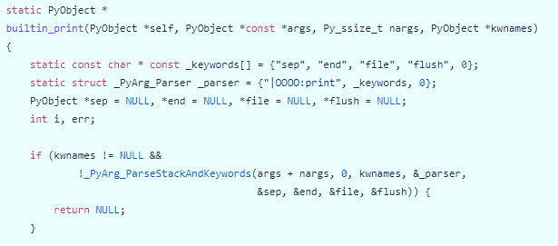
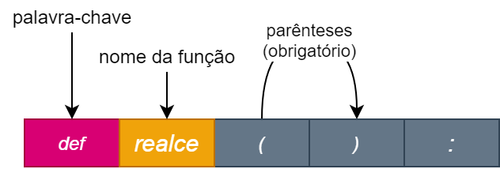
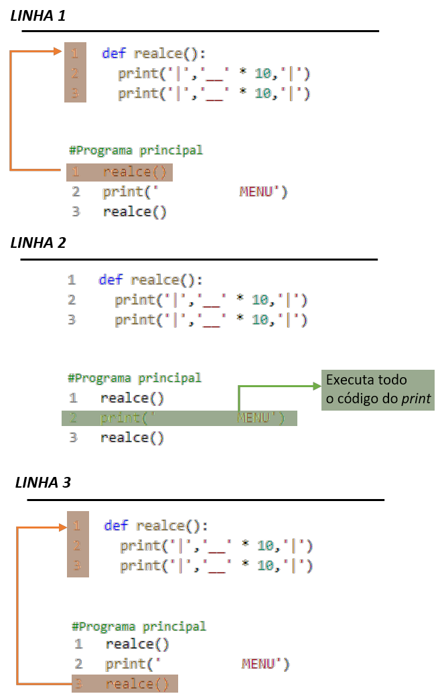
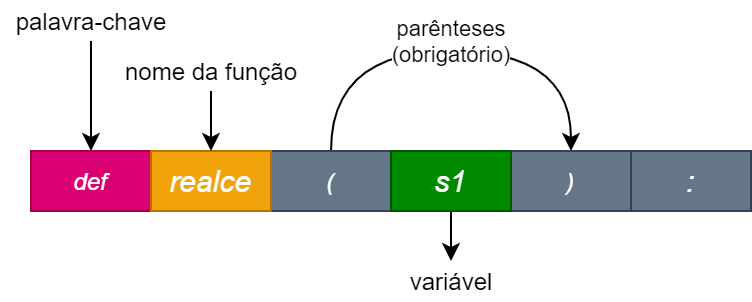

# Lógica de Programação e Algoritmos (937564)
## Aula 5 — Funções

> Texto integral da apostila oficial da Uninter (sem resumo). PDF original: [Aula_05.pdf](../_apostilas_pdf/01_Logica_Programacao/Aula_05.pdf)

Prof. Vinicius Pozzobon Borin, Me.

LÓGICA DE PROGRAMAÇÃO E ALGORITMOS AULA 5

Prof. Vinicius Pozzobon Borin

### CONVERSA INICIAL

Ao longo desta etapa você irá aprender um recurso bastante utilizado e aplicado em qualquer linguagem de programação, o de modularização de códigos.

Iremos investigar em linguagem Python como criamos funções. Com elas, poderemos criar rotinas em nossos códigos que irão atender por um nome, deixando nosso código mais legível, simples, e útil.

Assim como nas etapas anteriores, todos os exemplos apresentados neste material poderão ser praticados concomitantemente  em um Jupyter Notebook, como o Google Colab, e não requer a instalação de nenhum software de interpretação para a linguagem Python em sua máquina.

Ao longo do material você encontrará alguns exercícios resolvidos, que estão colocados em linguagem Python.

### TEMA 1 – FUNÇÕES

Você sabia que, desde que iniciamos nossos estudos em Python, você já tem empregado funções em todos os seus algoritmos? Citando alguns exemplos, você já manipulou o teclado com input e escreveu na tela com o print. Você também converteu dados para outro tipo com o int e o float. E também definiu o intervalo de operação do laço de repetição for usando o range. Até então, chamávamos de instruções, ou comandos, cada um destes recursos do Python. Porém, para a nossa linguagem de programação, eles são funções. Funções são rotinas de códigos que podem ser executadas quando tem seu nome invocado dentro do programa. Funções trabalham com o conceito de abstração e têm como finalidade abstrair comandos complexos em uma única chamada. Existem funções que são pré-definidas pela linguagem de programação, como as citadas no parágrafo anterior. Toda e qualquer função contém dentro de si um algoritmo que serve para resolver uma tarefa menor dentro do programa.

Vejamos o print por exemplo. O objetivo desta função é escrever na tela para o usuário uma mensagem de texto. Portanto, o código desta função faz exatamente, e somente, isso. Inclusive o código desta função (e de diversas

outras fundamentais em Python) foi escrito em outra linguagem de programação (linguagem C). Na Figura 1, temos as primeiras linhas de código da função print em linguagem C.

Figura 1 – Primeiras linhas de código da função print

Imagem extraída de <https://github.com/python/cpython/blob/3.8/Python/bltinmodule.c#L1821>.

Um dos motivos do Python usar a linguagem C em alguns de seus recursos básicos é porque o C é uma linguagem em que você tem mais controle do código quando precisa manipular dispositivos de E/S, como teclado, ou tela. A função print completa contém aproximadamente 80 linhas de código. Mesmo que fossem escritas em Python, imagine você escrever estas 80 linhas de código toda a vez que você precisar fazer a impressão de algo na tela. Inviável, certo? Seria extremamente complexo, até porque o print não é uma função trivial de ser implementada, uma vez que envolve manipulação de recursos do sistema, como o driver de vídeo. Isso iria deixar o código de difícil compreensão, bem como iria espantar programadores iniciantes. Consegue imaginar você na sua primeira aula de programação escrevendo no seu primeiro programa de Olá Mundo o código do print? Melhor nem imaginarmos! Acredito que tenha ficado claro o motivo pelo qual utilizamos funções predefinidas pela linguagem desde o nosso primeiro exercício. O motivo é para facilitar o desenvolvimento de nossos códigos, bem como deixá-los mais portáveis. Porém, não existem funções predefinidas para resolver todo e qualquer problema que tenhamos em nossos algoritmos. Sendo assim, nesta etapa, daremos um passo além com funções, e vamos aprender a criar as

nossas próprias rotinas para solucionar nossos problemas particulares. O ato de criar rotinas é também conhecido como modularização de código (criar módulos). 1.1 Primeira função Vamos inicialmente observar no exemplo em Python a seguir um programa que imprime na tela um texto qualquer e insere, antes e depois dele, duas linhas para destacar este texto, como se fosse um realce nele. print('|','__' * 10,'|') print('|','__' * 10,'|') print('          MENU') print('|','__' * 10,'|') print('|','__' * 10,'|')

Note que foi necessário escrever 4 vezes a função print. Imagine se quiséssemos colocar esse destaque nos textos em diversos momentos ao longo do nosso programa. Seria algo trabalhosos de se fazer. Porém, podemos criar uma função capaz de gerar este realce para nós, somente invocando o seu nome.

Para criamos uma função em linguagem Python, iniciamos com a palavra- chave def (abreviação de definition, em inglês). Em seguida, colocamos um nome para nossa função. Ao decidirmos por um nome, devemos ter bom senso, assim como temos para escolher o nome de variáveis. Ou seja, devemos cuidar para que o nome da função represente com a maior precisão possível a sua tarefa. Vamos adotar o nome realce.

### Saiba mais

Relembre, na aula 2, as regras de como criar nomes de variáveis, pois elas também se aplicam aqui para a escolha dos nomes de funções. A seguir, precisamos abrir e fechar parênteses. Detalhe, diferente dos blocos de controle da linguagem, como if, for e while, aqui os parênteses são obrigatórios. Lembre que em todas as funções que você já manipulou até hoje tem parênteses? O print, input, range, etc. Por fim, finalizamos com os dois pontos, nunca esqueça dele. A Figura 2 ilustra graficamente a criação de uma função em Python.

Figura 2 – Construção de uma função em Python

Fonte: Borin, 2024.

Vejamos como isso irá ficar de fato em nosso código Python a seguir. def realce():

#corpo da função print('|','__' * 10,'|') print('|','__' * 10,'|')

Com a função realce definida. Sempre que invocar o seu nome em qualquer programa Python, estaremos automaticamente executando as duas linhas de print dentro desta função. Chamamos de corpo da função o código contido dentro dela. Vejamos o nosso primeiro exemplo agora com a função criada. Note a seguir que a saída do programa é idêntica, exatamente como deveria ser. Ainda, conforme o comentário colocado no algoritmo, definimos aqui nosso programa principal como sendo aquele que contém a lógica base de funcionamento do nosso algoritmo.

#Programa principal realce() print('          MENU') realce()

### Saiba mais

Para pensar!

O que acontece quando você faz a definição da função realce e aperta na célula para executá-la? Você percebeu que seu programa não gera nenhuma saída?

Isso é normal e é o esperado de se acontecer, uma vez que, quando você cria uma função, está somente definindo-a em seu programa, porém não a está executando.

Para que ela possa ser executada, é necessário invocar seu nome pelo seu programa principal.

1.2 Fluxo de execução de um programa contendo funções Você já aprendeu que um programa computacional é executado linha por linha, de cima para baixo, correto? Caso não exista uma quebra nesta sequência, chamamos de algoritmo sequencial. Caso tenhamos, por exemplo, um laço de repetição, temos um desvio, uma vez que o loop faz com que executemos repetidas vezes um conjunto de instruções. Mas e com funções? Como se dá a sequência de execução de um algoritmo?

Vamos compreender um pouco melhor como nosso programa executa uma função dentro dele. Na Figura 3 temos o exemplo anterior, do realce, mas agora dividido passo a passo. Note que, embora nosso algoritmo tenha a função criada antes do programa principal, a execução do algoritmo sempre se dará iniciando pelo programa principal. Portanto, conforme ilustrado na imagem, a primeira linha a ser executada é a que contém a função realce. Por ser uma função, o algoritmo principal será interrompido e passará a executar todas as linhas dentro desta função. Uma vez finalizada a função, o algoritmo principal é retomado, partindo para a linha 2, onde temos a função print. Como vimos na Figura 1 desta etapa, o print contém um extenso código dentro dele, portanto, novamente o programa principal é interrompido e o código do print é executado. Por fim, quando retornamos ao programa principal, executamos sua linha 3, que contém outra função realce. Assim, pela terceira vez nosso programa é interrompido, a respectiva função executada e, quando finalizada, nosso programa chegará ao fim.

Figura 3 – Sequência de execução de um algoritmo com funções

Fonte: Borin, 2024.

### Saiba mais

O que acontece quando você inverte o código do seu programa principal com a definição da função? Ou seja, primeiro você escreve o programa principal e depois faz a definição da função?

Resposta: não irá funcionar! Toda e qualquer função em linguagem de programação Python deve ser definida antes de ser invocada pela primeira vez,

caso contrário, seu algoritmo não saberá que ela existe, e irá causar um erro na compilação.

### TEMA 2 – PARÂMETROS EM FUNÇÕES

Todas as funções que criamos até então são simples rotinas que executam blocos de códigos. Porém, funções fazem bem mais do que isso. Elas são capazes de receber dados de variáveis oriundos do programa principal (ou de outras funções) e manipular estes dados dentro da sua rotina. Chamamos os dados recebidos pelas funções de parâmetros, e o ato de enviar um dado para uma função é chamado de passagem de parâmetro.

Você já está trabalhando com passagem de parâmetros deste as funções print e input. Lembra que você, ao criar uma instrução como print(‘Olá Mundo’) colocava uma string dentro dos parênteses? Todas as informações inseridas dentro dos parênteses são os parâmetros da função.

Uma função pode ser criada com quantos parâmetros desejar. Lembre-se do exemplo da função range, que pode receber de 1 até 3 parâmetros. E nem todos são obrigatórios. Todos os valores ali inseridos poderão ser manipulados pela rotina da função.

Vamos praticar nossa primeira função com passagem de parâmetros. Para tal, vamos retomar o exercício do realce. Quando criamos a função realce anteriormente, estávamos fazendo a impressão na tela somente das linhas antes e depois do texto. Mas e se pudermos passar a string do texto como parâmetro, e criar tudo com uma só chamada de função? Vejamos como fica nossa rotina a seguir.

def realce(s1):

print('|','__' * 10,'|') print('|','__' * 10,'|') print(s1) print('|','__' * 10,'|') print('|','__' * 10,'|')

Agora, dentro dos parênteses inserimos o nome de uma variável s1. Esta variável servirá para receber como parâmetro a string colocada durante a

chamada da função lá em nosso programa principal. Aliás, nosso programa principal ficará com somente uma linha de código agora, veja a seguir. #Programa principal realce('          MENU')

SAÍDA:

| ____________________ | | ____________________ | MENU | ____________________ | | ____________________ |

Assim, quando o realce é invocado, ela faz todos os print e também recebe a nossa palavra como parâmetro e a usa para também imprimir na tela. Para criamos uma função em linguagem Python com parâmetro, iniciamos com a palavra-chave def, conforme Figura 4. Em seguida, colocamos um nome para nossa função. Após, precisamos abrir e fechar parênteses. Agora, como temos parâmetros, inserimos o nome da variável a nossa escolha dentro dos parênteses. Podemos ter mais do que um parâmetro e, para isso, precisaremos separá-los por vírgula dentro dos parênteses.

Figura 4 – Construção de uma função em Python com parâmetro

Fonte: Borin, 2024.

Vamos criar uma rotina agora que recebe dois parâmetros. A função que iremos criar realiza a subtração de dois valores quaisquer. Sendo assim, iremos chamá-la de sub2 e ela terá duas variáveis (x e y) recebidas como parâmetro. Veja a seguir como fica a função e também a chamada dela no programa principal. Lembrando que, portanto, o início da execução do nosso programa se

dará pela linha sub2(5, 7), em seguida voltando para a linha 1 e executando a função.

def sub2(x, y):

res = x - y print(res)

#Programa principal sub2(5, 7)

SAÍDA:

-2

Note que, como temos mais de um parâmetro, a ordem por meio da qual nós os passamos dentro dos parênteses faz toda a diferença. Se olharmos para a definição da rotina, o primeiro parâmetro é a variável x, e o segundo a variável y. Isso significa que quando escrevemos sub2(5, 7)¸ estamos fazendo com que x = 5 e y = 7¸ e portanto, x - y = 5 – 7 = -2. Se invertermos a ordem dos parâmetros, o resultado da subtração será diferente, pois teremos x = 7 e y = 5 (7 – 5 = 2). Veja a seguir.

#Programa principal sub2(5, 7) sub2(7, 5)

SAÍDA:

-2

A linguagem Python até permite que passemos os parâmetros fora de ordem, porém para que funcione é necessário explicitarmos durante a passagem qual variável terá determinado valor. Veja a seguir. Apesar disso, é recomendável que sempre busque manter a ordem dos parâmetros da função que você criou para melhor legibilidade do seu programa.

sub2(y = 7, x = 5)

SAÍDA:

-2 2.1 Parâmetros opcionais Podemos dar uma flexibilidade maior para nossas funções criadas por meio do uso de parâmetros opcionais, permitindo que nem sempre se usem todos os parâmetros na chamada da função. Você já vem trabalhando com parâmetros opcionais a bastante tempo, inclusive. Por exemplo, a função range usada no for continha parâmetros opcionais. O próprio print contém, quando usamos, ou não o separador “end”.

Vamos criar uma função que soma até 3 valores. Se criarmos a função da maneira convencional como aprendemos até então, teremos o código a seguir, em que recebemos 3 valores (x, y e z), calculamos a soma e fazemos o print do resultado na tela.

def soma3(x, y, z):

res = x + y + z print(res)

Podemos deixar com que os parâmetros sejam opcionais. Isso significa que, caso quisermos somar somente dois valores, seria possível, omitindo o terceiro parâmetro. Para isso, basta colocarmos um valor padrão no momento da criação das variáveis da função. Assim, caso um dos parâmetros seja omitido, o valor padrão é usado.

### Saiba mais

Lembra da função range do for? Podíamos omitir o valor inicial do iterador e p passo dele. A função iria portando adotar os valores padrões de zero para o início e um incremento unitário.

Veja o código a seguir.

def soma3(x = 0, y = 0, z = 0):

res = x + y + z print(res)

Para essa nossa rotina, iremos definir como zero todo e qualquer valor não informado. Sendo assim, neste exemplo, caso um deles seja omitido, o valor zero não terá impacto algum no calculo da soma, parecendo que a variável omitida nem foi utilizada no cálculo aritmético. Assim, ao realizarmos as chamadas da função, temos uma flexibilidade maior no uso de parâmetros. Veja as possíveis maneiras distintas a seguir.

soma3(1,2,3) soma3(1,2) #z foi omitido soma3(1)   #y e z foram omitidos soma3()    #x, y e z foram omitidos

SAÍDA:

No exemplo foram realizadas 4 chamadas da mesma função. Todas de maneira distinta. Note que podemos omitir um, dois, ou mesmo os três parâmetros da função. Caso a última opção ocorra, acontecerá que todos os valores serão zero, e a soma apresentada será zero. Mas note que isso não gera erro pelo programa.

Parâmetros opcionais são particularmente uteis para habilitar ou desabilitar recursos de uma função. Por exemplo, nem sempre queremos realizar uma soma e imprimir o seu resultado. Às vezes só desejamos armazenar em uma variável. Podemos adaptar a nossa rotina de somatório para decidirmos se queremos realizar o print na tela, criando um parâmetro opcional. Vejamos. def soma3(x = 0, y = 0, z = 0, imprime=False):

res = x + y + z if imprime:

print(res)

Temos uma variável booleana chamada de imprime que por padrão está definida como falsa. Portanto, se realizarmos uma chamada da função como a seguir, nenhuma impressão será gerada.

soma3(1,2,3)

Agora, se quisermos realizar o print na tela também, temos que informar isso no último parâmetro.

soma3(1,2,3, True)

Muito cuidado! Se quisermos omitir um dos números da soma, e ainda assim fazer o print, o código a seguir não irá funcionar.

soma3(1,2, True)

Isso porque neste caso estaríamos passando os seguintes parâmetros a rotina: x = 1, y = 2 e z = True. Ou seja, nenhum parâmetro foi passado para a variável imprime, e portando o valor padrão (False) foi assumido pela rotina. Para conseguirmos somar somente dois valores e ainda escrever na tela, iremos precisar explicitar que o True se refere a variável imprime. Veja:

soma3(1,2, imprime=True)

2.2 Exercícios Agora vamos consolidar nossos conhecimentos resolvendo alguns exercícios de funções com passagens de parâmetros.

Exercício 1 Escreva uma rotina que crie uma borda ao redor de uma palavra para destacá-la como sendo um título. A rotina deve receber como parâmetro a palavra a ser destacada. O tamanho da caixa de texto deverá ser adaptável de acordo com o tamanho da palavra. A seguir veja alguns exemplos de como deve ficar a borda na palavra.

+-----------+      +-----+ | Vinicius |        | Olá | +-----------+      +-----+

Python # Exercício 1 def borda(s1):

tam = len(s1)

# só imprime caso exista algum caractere if tam:

print('+','-' * tam,'+') print('|',s1,'|') print('+','-' * tam,'+')

#Programa Principal borda('Olá, Mundo!') borda('Lógica de Programação e Algoritmos')

Exercício 2 Escreva uma rotina que crie um laço de repetição que faz uma contagem e imprime esta contagem na tela em uma só linha. Porém, como parâmetro, a função deve receber o valor inicial da contagem, o final, e o passo da iteração. Deixe os parâmetros inicial e de passo como opcionais. Você pode fazer o laço com for ou com while.

### Saiba mais

Para realizar o print sem quebrar a linha, utilize um parâmetro opcional end='' da função print. Exemplo: print(x, end='')

Python def contador(fim, inicio = 0, passo = 1):

for i in range(inicio, fim+1, passo):

print(f'{i}', end=' ') print('\n')

contador(20, 10, 2) contador(12)

Exercício 3 Escreva uma rotina que recebe três valores como parâmetro e coloque- os em ordem crescente, ou seja, o menor ao maior. Imprima na tela os três valores.

### Saiba mais

Para realizar o print sem quebrar a linha, utilize um parâmetro opcional end='' da função print. Exemplo: print(x, end='').

Utilize condicionais de múltipla escolha e composta.

Python def maior3(v1=0, v2=0, v3=0):

if (v1 and v2 and v3):

if ((v1 > v2) and (v1 > v3)):

if (v2 > v3):

print(f'Ordem crescente: {v3}, {v2}, {v1}') else:

print(f'Ordem crescente: {v2}, {v3}, {v1}') elif ((v2 > v1) and (v2 > v3)):

if (v1 > v3):

print(f'Ordem crescente: {v3}, {v1}, {v2}') else:

print(f'Ordem crescente: {v1}, {v3}, {v2}') elif ((v3 > v1) and (v3 > v2)):

if (v1 > v2):

print(f'Ordem crescente: {v2}, {v1}, {v3}') else:

print(f'Ordem crescente: {v1}, {v2}, {v3}')

#Programa Principal x = int(input('Digite o valor 1: ')) y = int(input('Digite o valor 2: ')) z = int(input('Digite o valor 3: ')) maior3(x, y, z)

### TEMA 3 – ESCOPO DE VARIÁVEIS

Um escopo é a propriedade que determina onde uma variável pode ser utilizada dentro de um programa. Em linguagem de programação, existem dois tipos de escopos, o escopo global e o escopo local.

Variáveis criadas, seja no campo de um parâmetro ou dentro do corpo da função fazem parte do escopo local daquela função, e são chamadas de variáveis locais. Estas variáveis só existem dentro daquela própria função.

Um escopo local é criado sempre que uma função é chamada. É interessante perceber que, sempre que a rotina se encerrar, o escopo local dela será destruído, limpando as variáveis por completo da memória. Caso a função seja invocada novamente, todas as variáveis terão seus valores reiniciados, pois eles não existiam mais na memória do programa.

Já as variáveis globais pertencem a um escopo global, e são variáveis criadas dentro do programa principal. Uma variável global existe também em todas as funções invocadas ao longo do programa.

Uma das grandes vantagens de se trabalhar com escopos locais em linguagens de programação é justamente a de tentar minimizar a quantidade de bugs gerados nos códigos e também acelerar na detecção dos mesmos, pois o problema estará confinado ao escopo local de uma função, tornando mais fácil localizar o erro e corrigi-lo se comparado a um só grande e extenso código. Vamos compreender melhor escopos nos exemplos a seguir. Foi criada uma função chamada omelete. Dentro desta função foi criada uma variável chamada ovos, que recebeu o valor 12.

def omelete():

ovos = 12 # variável local

#Programa principal omelete() print(ovos) # escopo global

SAÍDA (ERRO):

------------------------------------------------------------------- -------- NameError                                 Traceback (most recent call last) <ipython-input-1-d936695b9a7b> in <cell line: 6>() 4 #Programa principal 5 omelete() ----> 6 print(ovos)

NameError: name 'ovos' is not defined Note que no programa principal a função omelete foi invocada, portanto a variável ovos foi criada localmente. Ao fazer o print da variável ovos no programa principal, o erro apresentado acima ocorre, gerando a mensagem “NameError: name ‘ovos’ is not defined”. Em tradução livre, está sendo dito que ovos não foi definido no programa. Esse problema era esperado e ocorre, pois, ovos é uma variável que pertence ao escopo local da função omelete. Só existindo dentro dela. Ademais, quando a função é encerrada, as variáveis locais são destruídas, tornando impossível termos acesso a ovos no escopo global do programa principal. Portanto, se quisermos imprimir esta variável, devemos fazer isso dentro da função local.

Vamos agora adaptar este código, colocando a atribuição da variável ovos para o programa principal e trazendo para dentro da função o print. Observe que agora não obtivemos um erro, e o resultado foi apresentado na tela.

def omelete():

print(ovos) # escopo local

#Programa principal ovos = 12 # variável global omelete()

SAÍDA:

Mas e por que agora funcionou se a atribuição e o print não estão dentro da função? Porque agora a variável ovos pertence ao escopo global. Nesse escopo, todas as variáveis existem também em um escopo local, ou seja, dentro da função omelete. Portanto, fazer o print dela irá resultar no valor atribuído. Vejamos mais um exemplo envolvendo o escopo das variáveis. A seguir foram definidas duas funções distintas: omelete e bacon. No programa principal, invocamos somente a função omelete. A seguir, vamos a linha 2 e a variável ovos recebe o valor 12. Em seguida, a função bacon é invocada (linha 3). Dentro de bacon, note que ovos tem seu valor alterado para 6. Quando bacon é encerrado voltamos a função omelete, e realizamos um print da variável ovos (linha 4). Note que a saída apresentou o valor 12, ao invés de 6. def omelete():

ovos = 12 bacon() print(ovos)

def bacon():

ovos = 6

#Programa principal omelete()

SAÍDA:

Por que isso ocorre se primeiro definimos ovos como 12 e depois como 6? O que acontece em linguagem Python é que dentro da função omelete temos a variável ovos no seu escopo local. Também, dentro da função bacon o Python irá criar outra variável de nome ovos localmente. Portanto, teremos duas variáveis de mesmo nome, mas em escopos distintos, ou seja, nenhum irá interferir com a outra. Não obstante, ao realizarmos o print dentro de omelete, a variável a ser impressa será a definida no escopo local de omelete, e não a do escopo de bacon, resultando em 12.

Vamos a mais um exemplo a seguir. Agora, vamos compreender melhor o uso de variáveis de mesmo nome em nosso programa e em cada escopo. A variável ovos foi criada dentro do programa principal, mas também dentro da função bacon e da função omelete. Sendo assim, temos três variáveis distintas com o mesmo nome ovos e dados diferentes. Vejamos.

def omelete():

ovos = 12 #'variável local de omelete' print('Ovos = ', ovos)

def bacon():

ovos = 6 # 'variável local de bacon' print('Ovos = ', ovos) omelete() print('Ovos = ', ovos)

#Programa principal ovos = 2 # 'variável global' bacon() print('Ovos = ', ovos)

SAÍDA:

Ovos =  6 Ovos =  12 Ovos =  6 Ovos =  2

Vamos compreender com calma como a saída do nosso programa resultou no que foi apresentado acima. Inicialmente, inicia-se a execução pelo programa principal e, portanto, a variável ovos recebe o valor 2. A seguir, invocamos a função bacon. Dentro de bacon, uma nova variável ovos é criada localmente recebendo o valor 6. A seguir o primeiro print ocorre, e é realizado

dentro da função bacon localmente, fazendo com que a primeira mensagem na tela seja: Ovos = 6.

Em seguida, na linha 8, invocamos omelete dentro de bacon, fazendo com que criemos uma terceira variável local ovos = 12. E fazemos o print local dentro de omelete, aparecendo na tela a segunda linha de mensagem: Ovos = 12. A função omelete é encerrada e voltamos à função bacon para fazer mais um print (linha 9). Como voltamos a bacon, a terceira mensagem a aparecer corresponde à variável ovos dentro da função bacon, portanto: Ovos = 6 aparece mais uma vez na tela.

Quando por fim a função bacon é encerrada, voltamos ao programa principal e realizamos o seu respectivo print (linha 14). Neste caso, estamos imprimindo na tela a variável global ovos, resultando na última linha de print: Ovos = 2.

3.1 Instrução global Acabamos de ver anteriormente que caso tenhamos variáveis de mesmo nome dentro de um escopo global e um local, sempre serão criadas novas variáveis localmente que irão ter prioridade local fronte a uma variável global. Porém, podemos forçar nosso programa a não criar uma variável local de mesmo nome, e manipular somente a global dentro de uma função. Podemos fazer isso utilizando uma instrução chamada de global em linguagem Python. Vejamos. def omelete():

global ovos ovos = 6

#Programa principal ovos = 12 omelete() print(ovos)

Vamos analisar o que aconteceu neste algoritmo. A variável ovos foi inicializada na linha 6 com o valor 12. Portanto, independentemente do que fosse acontecer dentro da função omelete invocada na linha 7, o print da linha 8 deveria resultar em 12. Porém, não foi o que aconteceu. Isso porque dentro da função omelete foi colocada a instrução global ovos. Isso indica ao programa

que ele não deve criar uma variável local chamada ovos, mas sim, utilizar a variável global existente. Dessa maneira, quando alteramos o valor de ovos para 6 na linha 3, estamos alterando na variável global, diretamente. E, portanto, ao fazer o print da linha 8, teremos o resultado indicado como sendo ovos = 6. Vejamos outro exemplo para fixarmos o conhecimento. Você consegue identificar por que a saída a seguir resultou no print de 6 ovos, duas vezes? Vamos analisar com cuidado.

1. def omelete():

2.  global ovos 3.  ovos = 6 4.  bacon()

5. def bacon():

6.  ovos = 12 7.  pimenta()

8. def pimenta():

9.  print(ovos)

10. #Programa principal 11. ovos = 4 12. omelete() 13. print(ovos)

A seguir está colocada a sequência de execução do algoritmo, indicando linha por linha na ordem em que as ações são executadas:

• Linha 11. Variável ovos = 4; • Linha 12. Função omelete é invocada; • Linha 2. A variável ovos é indicada como sendo global. Portanto, não será criada uma nova variável local de mesmo nome dentro da função omelete; • Linha 3. A variável global ovos é alterada para 6; • Linha 4. Função bacon é invocada; • Linha 6. Uma variável local da função bacon é criada, esta variável se chama ovos e recebe 12.

• Linha 7. Função pimenta é invocada;

• Linha 9. Um print de ovos é feito. O valor 6 aparece na tela. Porque apareceu 6? Bom, como dentro da função pimenta não criamos nenhuma variável ovos, ela faz o print da variável definida anteriormente como global, lá em omelete.

• Linha 13. Todas as funções foram encerradas. Portanto, voltamos ao programa principal e fazemos o print de ovos, que irá resultar também em 6, uma vez que a função omelete havia alterado seu valor globalmente. 3.2 Resumo de escopos Vimos diversos detalhes neste terceiro. Portanto, a seguir você encontra um breve resumo do que estudamos neste tópico:

• Um código em escopo global (programa principal), não pode usar nenhuma variável local; • Um código de escopo local (qualquer função criada ou pré-definida) pode acessar uma variável global; • Nenhum escopo local pode acessar as variáveis de outro escopo local; • Podemos ter diversas variáveis com o mesmo nome, desde que estejam em escopos distintos; • Caso tenhamos variáveis com o mesmo nome, uma em escopo global e outra em escopo local, no escopo local a variável local terá prioridade e somente ela será manipulada; • Caso tenhamos variáveis com o mesmo nome, uma em escopo global e outra em escopo local, e quisermos manipular a variável global dentro da função local, precisamos usar a instrução global.

Por fim, é importante frisar que uma variável terá seu escopo definido quando estiver sendo criada, sendo impossível alterar seu escopo quando desejar durante a execução do programa. Por exemplo, se você criar uma variável ovos dentro da função omelete, ela será local neste escopo. E caso não tenha utilizado a instrução global no início da função, será impossível transformá- la em global durante a execução dessa função.

Observe também que, caso tente fazer um print de uma variável local sem antes tê-la definida localmente, resultará em um erro, mesmo que ela exista globalmente.

Veja o exemplo a seguir: a variável ovos existe globalmente. Porém, o print local não funciona. Isso porque a linguagem Python, para fazer o print local, cria uma nova variável local chamada de ovos. E como ela não tem nenhum dado definido, um erro ocorre pois não existe nada a ser impresso. def omelete():

print(ovos) ovos = 6

ovos = 12 omelete()

SAÍDA:

---------------------------------------------------------------------- ----- UnboundLocalError                         Traceback (most recent call last) <ipython-input-12-ee629754642a> in <cell line: 6>() 5 ovos = 12 ----> 6 omelete()

<ipython-input-12-ee629754642a> in omelete() 1 def omelete():

----> 2     print(ovos) 3     ovos = 6 5 ovos = 12

UnboundLocalError: local variable 'ovos' referenced before assignment

### TEMA 4 – RETORNO DE VALORES EM FUNÇÕES

Até o momento você aprendeu a criar rotinas que são executadas, mas que nunca geram um resultado a ser devolvido ao programa principal, ou mesmo a outra função que a chamou.

De acordo com Puga e Risseti (2016, p. 102), as rotinas de código que conter, ou não parâmetros, mas que nunca retornam um dado são chamadas de procedimento (procedure).

Diferente de um procedimento, uma função é dada como sendo uma rotina que retorna valores associados ao seu nome. Desse modo, uma

função pode ser empregada em atribuições ou mesmo em expressões lógicas (Puga; Risseti, 2016, p. 108).

Embora exista essa diferença conceitual entre procedimento e função, é bastante comum no meio de desenvolvimento utilizarmos somente a nomenclatura de funções, tendo retorno ou não. E é por esse motivo que estamos utilizando a palavra função desde o início desta etapa e as principais bibliográficas recomendadas desse estudo também trabalham assim. Mas vejamos como criar e manipular uma função com retorno em linguagem Python. Vamos voltar a uma função criada anteriormente no tema 2 desta etapa, que soma até 3 valores numéricos. Relembre-a a seguir.

def soma3(x, y, z):

res = x + y + z print(res)

Agora, suponha que não queremos mais realizar o print dentro dessa função. Vamos querer na verdade somente receber o resultado do somatório final para então fazermos um print no próprio programa principal. Para isso, iremos utilizar o recurso de retorno de valores em funções. Utilizaremos a palavra-chave return (que significa, em português, retornar) para resolver nosso problema. Veja como ficaria nossa nova função com retorno:

def soma3(x = 0, y = 0, z = 0):

res = x + y + z return res

Note que removemos a linha do print e inserimos em seu lugar a palavra- chave return seguida no nome de uma variável. A variável escolhida para ser retornada é a res, pois ela conterá o valor do somatório. Desse modo, o valor de res será devolvido ao programa principal. Porém, como aprendemos no tema sobre escopos, a variável res não existirá no escopo global. Sendo assim, devemos criar no programa principal outra capaz de receber o resultado da função variável (que pode, ou não, conter o mesmo nome da variável de retorno). Veja como ficaria a seguir.

#Programa principal

retornado = soma3(1,2,3) print(retornado)

#forma alternativa simplificada print(soma3(2,2))

SAÍDA:

A função soma3 agora irá retornar um valor. O valor retornado será armazenado em uma variável chamada retornado (linha 2). Em seguida, na linha 3, fazemos o print do resultado. De maneira alternativa, podemos fazer tudo em uma só linha, conforme apresentado na linha 6. Conforme já aprendemos sobre precedência de operações em Python, primeiro resolvemos o que está dentro dos parênteses mais interno, portanto a função soma3, em seguida, seu resultado já será utilizado pela função print que irá se encarregar de apresenta- lo na tela.

Dessa maneira, com retorno, podemos também ir armazenando diversos resultados de somatórios ao longo da execução do programa e fazer a impressão deles somente no final. Veja como ficaria no exemplo a seguir com um único print de três somatórios distintos.

#Programa principal retornado1 = soma3(1,2,3) retornado2 = soma3(1,2) retornado3 = soma3() print(f'Somatórios: {retornado1}, {retornado2} e {retornado3}.')

Uma das características mais interessantes de se retornar um valor de uma função é que podemos retornar dados distintos de acordo com alguma condição dentro da função.

Vamos investigar um exemplo trazendo de volta um algoritmo bastante conhecido por vocês, o do par ou ímpar. A seguir, para relembrar, temos um algoritmo implementado que faz a impressão na tela informando se um número é par ou ímpar. Fizemos isso em etapa anterior, verificando se o resto da divisão por dois resulta em zero, pois assim será par. Caso contrário, ímpar.

# par ou ímpar sem funções x = int(input('Digite um valor inteiro: ')) if (x % 2 == 0):

print('O número é par!') else:

print('O número é ímpar!')

SAÍDA:

Digite um valor inteiro: 6 O número é par!

Agora vamos encontrar uma solução de criar uma função para resolver este problema. Na função, iremos retornar a palavra par ou ímpar, dependendo da situação. Vejamos abaixo como fica a solução.

# par ou ímpar com funções def par_impar(x):

if (x % 2 == 0):

return 'par' else:

return 'impar'

#Programa principal print(par_impar(int(input('Digite um valor inteiro: '))))

SAÍDA:

Digite um valor inteiro: 7 Impar

Agora, em vez de fazermos o print dentro da função, temos dois return. Somente um dos return irá acontecer a cada chamada de função, nunca ambos. Sempre retornando um dos dois valores distintos. No programa principal aninhamos 4 funções na mesma linha de código. Isso não é obrigatório de se fazer, mas caso seja feito, compreenda que primeiro será executado a função mais interna nos parênteses, ou seja, o input, seguido pela int, depois a par_impar e, por fim, o print.

4.1 Validando dados de entrada com funções Em etapa anterior, de laços de repetição, aprendemos a validar dados de entrada utilizando laços de repetição. Os códigos de validação de dados tendem a ser longos devidos aos loops, e bastante repetitivos. Nesse caso, uma prática bastante comum é a de criarmos funções com retorno para validar os nossos dados de entrada.

Vejamos o exemplo a seguir onde temos uma função de validação que recebe como parâmetro um inteiro e o intervalo em que o valor digitado pelo usuário deve estar.

def valida_int(pergunta, min, max):

x = int(input(pergunta)) while ((x < min) or (x > max)):

x = int(input(pergunta)) return x

#Programa principal x = valida_int('Digite um valor inteiro: ', 0, 100) print(f'Você digitou {x}. Encerrando o programa...')

SAÍDA:

Digite um valor inteiro: 190 Digite um valor inteiro: 101 Digite um valor inteiro: 66 Você digitou 66. Encerrando o programa...

No programa principal temos somente uma chamada para a função de validação. Porém, nosso algoritmo só irá avançar da linha 8 para a linha 9 quando a função de validação permitir, pois dentro dela temos um loop. 4.2 Exercícios Agora vamos consolidar nossos conhecimentos resolvendo alguns exercícios de funções envolvendo retorno bem como trazendo todos os conteúdos já apresentados nesta etapa.

Exercício 1 (adaptado de Menezes, 2019, p. 169) Escreva uma função para validar uma string. Essa função recebe como parâmetro a string, o número mínimo e máximo de caracteres. Retorne

verdadeiro se o tamanho da string estiver entre os valores de mínimo e máximo, e falso, caso contrário.

Python def valida_string(pergunta, min, max):

s1 = input(pergunta) tam = len(s1) while ((tam < min) or (tam > max)):

s1 = input(pergunta) tam = len(s1) return s1

#Programa principal x = valida_string('Digite uma string: ', 10, 30) print(f'Você digitou a string: {x}. \n Dado válido. Encerrando o programa...')

Exercício 2 Fatorial é um número inteiro positivo, representado por n!

Calculamos a fatorial pela multiplicação desse número n por todos os seus antecessores até chegar em 1. Ainda, fatorial de 0! Sempre será 1. Considerando a breve explicação sobre fatorial, escreva uma função que calcule o fatorial de um número recebido como parâmetro e retorne o seu resultado. Faça uma validação dos dados por meio de uma outra função, permitindo que somente valores positivos sejam aceitos.

Python def valida_int(pergunta, min, max):

x = int(input(pergunta)) while ((x < min) or (x > max)):

x = int(input(pergunta)) return x

def fatorial(num):

fat = 1 if num == 0:

return fat # esta parte do código só será executada caso num > 0 for i in range(1, num+1, 1):

fat *= i return fat

#Programa principal

x = valida_int('Digite um valor para calcular a fatorial: ', 0, 99999) print(f'{x}! = {fatorial(x)}.')

Exercício 3 (adaptado de Puga; Risseti, 2016, p. 117) Faça uma função que recebe dois valores inteiros e positivos como parâmetro. Calcule a soma dos n valores inteiro existentes entre eles, inclusive estes números.

Python def valida_int(pergunta, min, max):

x = int(input(pergunta)) while ((x < min) or (x > max)):

x = int(input(pergunta)) return x

def soma_intervalo(inicio, fim):

soma = 0 i = inicio while i <= fim:

soma += i i = i + 1 return soma

#Programa principal x = valida_int('Digite um valor inteiro e positivo: ', 1, 99999) y = valida_int('Digite um segundo valor inteiro e positivo: ', 1, 99999) print(f'Somatório entre {x} e {y} é {soma_intervalo(x, y)}.')

### TEMA 5 – RECURSOS AVANÇADOS COM FUNÇÕES

Neste último tópico desta etapa, vamos investigar alguns recursos avançados e essenciais caso queira tornar-se um bom programador e desenvolvedor em linguagem Python.

5.1 Exceções e erros Com toda a certeza você já deve ter criado algum programa em Python que gerou algum erro, seja qual for o motivo. Vimos também, em nosso estudo,

alguns destes erros aparecendo e impedindo nosso algoritmo de funcionar corretamente.

Existem majoritariamente dois tipos de erros em programação. O primeiro deles é o erro de sintaxe. Esse tipo de erro ocorre quando o programador comete algum erro de digitação ou esquece de alguma palavra-chave, ou caractere, ou mesmo erra na indentação do código. Estes erros são mais comuns em iniciantes na linguagem.

Veja a seguir um exemplo onde tentamos fazer um Olá, Mundo!

juntamente de um laço de repetição, porém esquecemos de colocar os dois pontos ao final do laço, o que gerou um erro de sintaxe (SyntaxError: invalid syntax). A linha do erro foi sublinhada no programa, tornando mais fácil a detecção do problema.

# Erro de sintaxe while True print('Olá, mundo!')

SAÍDA:

File "<ipython-input-16-9bb355f44a3e>", line 2 while True ^ SyntaxError: expected ':'

O segundo tipo de erro em programação, e que iremos explorar mais a fundo agora, são as exceções. Nesse tipo de erro, a sintaxe está correta, porém um erro durante a execução do programa ocorre, normalmente devido a um dado digitado de maneira inválida e não tratado durante o programa. Ou seja, normalmente representa algum cenário não previsto pelo programador durante a criação de seu código.

O exemplo mais clássico de exceção é o de divisão por zero. É comum criarmos um algoritmo que realiza um cálculo de divisão, e esquecermos que, caso o denominador seja zero, a divisão gera um erro. Esse erro é também retratado dentro do Python. Veja no exemplo a seguir.

print(100 * (2/0))

SAÍDA:

------------------------------------------------------------------- -------- ZeroDivisionError                         Traceback (most recent call last) <ipython-input-18-1cb29ae39e13> in <cell line: 1>() ----> 1 print(100 * (2/0))

ZeroDivisionError: division by zero

Cada exceção apresenta um nome identificador dentro da linguagem. O próprio interpretador apresenta este nome. Nesse caso temos uma exceção do tipo ZeroDivisionError: Division by zero.

A parte da mensagem de erro antes dos dois pontos apresenta o contexto em que ocorreu a exceção. O próprio site da linguagem Python contém uma lista com todas as exceções existentes na linguagem. A relação é bastante extensa e iremos nos ater aqui somente a algumas mais comuns.

### Saiba mais

Caso tenha interesse em conhecer mais sobre as exceções existentes em Python, acesse o link a seguir:

EXCEÇÕES embutidas. Python, S.d. Disponível em:

<https://docs.python.org/pt-br/3/library/exceptions.html#bltin-exceptions>. Acesso em: 23 jan. 2024.

Vejamos mais uma exceção bastante comum, a ValueError.

x = int(input('Por favor digite um número: '))

SAÍDA:

Por favor digite um número: c ---------------------------------------------------------------------- ----- ValueError                                Traceback (most recent call last) <ipython-input-19-7c0a6b59e0c9> in <cell line: 1>() ----> 1 x = int(input('Por favor digite um número: '))

ValueError: invalid literal for int() with base 10: 'c' O erro de ValueError ocorre quando o programa está aguardando um dado de um determinado tipo, como int, e o usuário digita um caractere, por

exemplo. No exemplo mostrado foi digitado o caractere c em vez de um inteiro, e isso gerou uma exceção.

Como podemos resolver este tipo de problema? Podemos contornar uma exceção com uma estrutura em Python chamada de try (em tradução livre para o português significa tentar). Veja a seguir como ficaria o código para tratar o problema do ValueError.

while True:

try:

x = int(input('Por favor digite um número: ')) break except ValueError:

print('Oops!  Número inválido.  Tente novamente...')

SAÍDA:

Por favor digite um número: c Oops!  Número inválido.  Tente novamente...

Por favor digite um número: 12

No código apresentado fazemos uma validação de dados. Deixamos o nosso algoritmo preso dentro de um loop infinito realizando uma tentativa (try). O comando try irá tentar executar a linha 3 sem erros. Caso obtenha sucesso, ou seja, caso um valor inteiro seja digitado, o laço se encerra no break. Caso a tentativa falhe, a exceção ocorre, e temos um tratamento para esta exceção. Para tratar uma exceção é necessário colocar a palavra-chave except seguida do nome exato da exceção, neste caso ValueError. Sendo assim, ao invés da exceção ocorrer e o programar parar, no seu lugar um print será executado (linha 6) e não irá gerar a exceção. Desse modo, o programa continuará e retornará ao início do laço, solicitando novamente um valor inteiro.

Podemos inserir quantas clausulas except quisermos. Por exemplo, vamos criar um programa que agora lê um nome (string) e em seguida solicita um índice, fazendo o print do caractere no respectivo índice. Para tal, inserimos dois except, o ValueError para tratar se o dado digitado é do tipo string, e um IndexError, para tratar caso o usuário digite um índice não existente dentro da palavra digitada. Veja como ficaria a seguir.

i = 0

while True:

try:

nome = input('Por favor digite o seu nome: ') ind = int(input('Digite um índice do seu nome digitado: ')) print(nome[ind]) break except ValueError:

print('Oops! Nome inválido. Tente novamente...') except IndexError:

print('Oops! índice inválido. Tente novamente...') finally:

print(f'Tentativa {i}') i += 1

SAÍDA:

Por favor digite o seu nome: vinicius Digite um índice do seu nome digitado: 23 Oops! índice inválido. Tente novamente...

Tentativa 0 Por favor digite o seu nome: vinicius Digite um índice do seu nome digitado: 4 c Tentativa 1

Ademais, percebeu que uma cláusula chamada de finally (em tradução livre, finalmente) foi utilizada dentro do try? Nós a colocamos sempre após todos os except. O bloco de finally diz que, independentemente de acontecer uma exceção, ou não, execute o bloco de código dentro do try. Perceba que, no código apresentado, o finally serve para incrementar um contador e imprimir na tela quantas tentativas já foram realizadas pelo usuário. E isso deve sempre acontecer.

O tratamento de exceções normalmente está atrelado à criação de uma função dentro do programa. É de praxe deixarmos o tratamento dos erros fora do programa principal, uma vez que não tem relevância para o funcionamento principal da lógica do programa. A seguir temos uma função que realiza a divisão de dois valores e retorna o resultado desta divisão.

def div():

try:

num1 = int(input("Digite um número: ")) num2 = int(input("Digite um número: ")) res = num1 / num2

except ZeroDivisionError:

print("Oops!  Erro de divisão por zero...") except:

print("Algo de errado aconteceu...") else:

return res finally:

print("Executará sempre!")

# programa principal print(div())

Dentro da função fazemos uma tentativa (try) de ler dois valores e dividir. Se tudo der certo, ou seja, nenhuma exceção acontecer, nosso programa irá para a cláusula else. O else é opcional e sempre irá executar caso nenhuma exceção aconteça. Neste caso colocamos o return dentro do else, pois só queremos retornar algo caso nenhum erro tenha sido gerado.

Note também que a exceção colocada foi a de divisão por zero (ZeroDivisionError). Também colocamos um except sem nenhum nome atrelado a ele. Quando fazemos isso estamos dizendo que, para qualquer outra exceção não prevista (não tratada), um erro genérico irá aparecer.

5.2 Função lambda A linguagem Python permite que criemos funções mais simples, sem nome, chamadas de funções lambda. Elas podem ser escritas em uma só linha de código e dentro do programa principal. Uma função lambda é utilizada quando o código da função é muito simples ou utilizado poucas vezes, e é um recurso existente em diversas outras linguagens de programação. Vejamos um exemplo.

res = lambda x: x * x print(res(3))

SAÍDA:

No código apresentado temos uma função que recebe um número como parâmetro e calcula o seu quadrado. A sintaxe apresentada é bastante distinta

da que você já conhece para criação de funções. Na linha 1 temos uma variável res que recebe o resultado retornado da função lambda. A função contém o parâmetro x, que é colocado antes dos dois pontos, e o cálculo aritmético é colocado após os dois pontos. Dessa maneira, temos uma função bastante simples criada. Se quisermos usá-la no código, basta chamar o nome da variável res, colocando parênteses e o valor a ser passado como parâmetro, como res(3), res(5), res(7), etc.

Podemos passar mais do que um parâmetro para a função. Veja a seguir um exemplo envolvendo um somatório entre dois valores x e y. Note que já resolvermos este mesmo exercício anteriormente com funções de uma maneira tradicional. Porém, por ser uma operação bastante simples, o uso de uma função lambda pode vir a ser até mesmo mais interessante do que a maneira convencional que já aprendemos.

soma = lambda x, y: x + y print(soma(3, 5))

SAÍDA:

Exercício 1 Faça uma função lambda que recebe dois valores numéricos como parâmetro. Ao primeiro valor, sempre some 5. Em seguida multiplique ambos e retorne o resultado.

Python calc = lambda a, b: (a + 5) * b print(calc(5, 10))

### FINALIZANDO

Nesta etapa, aprendemos a modularizar programas em Python com a criação de funções. Iniciamos construindo funções sem retorno, mas também aprendemos a retornar valores de uma função.

Vimos que a passagem de parâmetros em funções faz com que possamos manipular dados de outro escopo, dentro do escopo local. E falando em escopo, aprendemos a diferença do escopo local para o global.

Reforço que tudo o que foi visto nesta etapa continuará a ser utilizado de maneira extensiva ao longo das próximas, portanto pratique e resolva todos os exercícios do seu material.

### REFERÊNCIAS

FORBELLONE, A. L. V. et al. Lógica de programação: a construção de algoritmos e estruturas de dados. 3. ed. São Paulo: Pearson, 2005. MATTHES, E. Curso intensivo de Python: uma introdução prática baseada em projetos à programação. São Paulo: Novatec, 2015.

MENEZES, N. N. C. Introdução à programação Python: algoritmos e lógica de programação para iniciantes. 3. ed. São Paulo: Novatec, 2019. PERKOVIC, L. Introdução à computação usando Python – um foco no desenvolvimento de aplicações. Rio de Janeiro: LTC, 2016.

PUGA, S.; RISSETI, G. Lógica de programação e estrutura de dados. 3. ed. São Paulo: Pearson, 2016.
