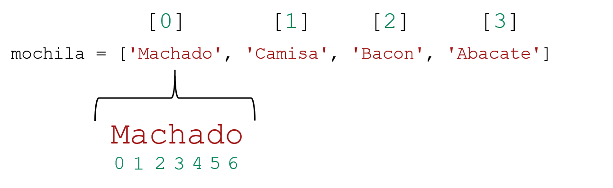

# Lógica de Programação e Algoritmos (937564)
## Aula 6 — Tuplas, listas, dicionários e strings

> Texto integral da apostila oficial da Uninter (sem resumo). PDF original: [Aula_06.pdf](../_apostilas_pdf/01_Logica_Programacao/Aula_06.pdf)

Prof. Vinicius Pozzobon Borin, Me.

LÓGICA DE PROGRAMAÇÃO E ALGORITMOS AULA 6

Prof. Vinicius Pozzobon Borin

### CONVERSA INICIAL

Ao longo dest a abordagem, vamos  aprender a trabalhar com vari áveis compostas em Python, por meio d os tr ês principais tipos existentes na linguagem: as tuplas, as listas e os dicionários.

Vamos investigar em linguagem Python as caracteristicas e diferenças de cada uma, assim como criar e manipular todas elas. No último tópico, vamos aprender mais alguns recursos de manipulação de strings  para comsolidar o nosso conhecimento.

Todos os exemplos apresentados, assim como em momentos anteriores de nossos estudos, poderão ser praticados concomitantemente em um Jupyter Notebook, como o Google Colab, e não requer a instalação de nenhum software de interpretação para a linguagem Python em nossa máquina.

Ao longo do conteúdo, vamos encontrar alguns exercícios resolvidos, que estão colocados em linguagem Python.

### TEMA 1 – TUPLAS

Iniciaremos esta abordagem  retomando um conceito apresentado em momento anterior, em que vimos, por meio de uma analogia, que variáveis são como gavetas em uma estante, na qual cada gaveta contém um nome e, dentro de cada uma, vamos armazenar um único dado.

Porém, imagine mos agora que queremos armazenar itens para uma mesma finalidade nas gavetas. Para essa situação, seria interessante que todas as gavetas pudessem atender pelo mesmo nome (nome da variável). Se todas as gavetas terão o mesmo nome, como podemos identificar qual gaveta será aberta? A resposta é: por intermédio de uma numeração, como um índice. Desse modo, podemos dizer: “abra a gaveta 3”, ou “abra a gaveta 5”. Vejamos um segundo exemplo lúdico. O nosso mascote, Lenhadorzinho, estava com dificuldade de transportar seus itens ao sair para sua aventura. Ele só conseguia transportar um item por vez em suas mãos. Sendo assim, ele resolveu comprar uma mochila para expandir seu espaço. Agora, dentro do seu inventário cabem quatro itens: ele decide carregar seu machado, uma camisa e comida (bacon e abacate). Os itens dentro de sua mochila são os dispostos na Figura 1 a seguir.

Figura 1 – Mochila do Lenhadorzinho

Créditos: Shanvood/Shutterstock; Batshevs/Shutterstock; L.Rey/Shutterstock; inspiring.team/Shutterstock.

Observe que, antes da existência da mochila, somente um item podia ser transportado por vez. Isso seria o equivalente a termos uma variável capaz de armazenar na mem ória um único dado por vez, que chamamos de variável simples.

A nossa mochila seria o que chamamos de variável composta. Nesse tipo de variável , temos diversos espaços iguais na memória capazes de armazenar dados, e todos eles atendem pelo mesmo nome. Nesse caso, se quisermos acessar o machado, escrevemos mochila[0]. O bacon? Colocamos mochila[2].

A variável apresentada no exemplo é uma estrutura de dados. Uma estrutura de dados é um conjunto de dados organizados e uma maneira especifica na memória do programa. A maneira como os dados estão organizados na memória, como podem ser buscados, manipulados e acessados são o que definem e diferenciam as estruturas de dados. Desse modo, em linguagem Python temos majoritariamente três tipos de variáveis que armazenam diversos valores: tuplas, listas e dicionários. Todas apresentam características organizacionais distintas, e vamos investigar todas elas ao longo desta abordagem.

1.1 Construindo e manipulando tuplas Vamos agora à primeira estrutura. A tupla é o tipo de variável composta em Python mais simples. Ela tem como característica primária ser imutável. Nunca esqueçamos dessa informação, pois uma tupla, uma vez criada, não pode mais ser alterada ao longo da execução do programa.

A tupla é uma estrutura estática de dados. Isso significa que, uma vez alocada na memória, não pode mais ter seu endereçamento alterado. Repetindo, a tupla é imutável.

Apesar de conter suas particularidades, a tupla se assemelha um pouco às estruturas de vetor/array, para quem já conhece linguagens de programação como C/C++ ou Java.

A representação de uma tupla em Python ocorre da maneira a seguir. Colocamos os dados que desejamos cadastrar na tupla separados por vírgula e dentro de parênteses.  Se fizermos o print da tupla, todos os dados serão impressos junto dos parênteses.

mochila = ('Machado', 'Camisa', 'Bacon', 'Abacate') print(mochila) SAÍDA:

('Machado', 'Camisa', 'Bacon', 'Abacate') Podemos manipular e fatiar a tupla da mesma maneira que aprendemos com strings, em momento anterior de nossos estudos. A seguir, encontramos um resumo com algumas possibilidades de fatiamento e manipulação de índices em tuplas.

print(mochila[0]) #print do Elemento 1 - Índice 0 print(mochila[2]) #print do Elemento 3 - Índice 2 print(mochila[0:2]) #print dos Elementos 1 e 2 - Índice 0 e 1 print(mochila[2:]) # print dos elementos a partir do índice 2 print(mochila[-1]) #print do último SAÍDA:

Machado Bacon ('Machado', 'Camisa') ('Bacon', 'Abacate') Abacate Lembrando que, como uma tupla é imutável, isso significa que não podemos realizar atribuições com tuplas. Se , por exemplo, tentarmos substituir o valor bacon por ovos, ocorre um erro: tuple object does not support item assignment (“objeto tupla não suporta atribuição”).

mochila[2] = 'Ovos' SAÍDA (ERRO):

------------------------------------------------------------------- -------- TypeError                                 Traceback (most recent call last) <ipython-input-3-10e5e4bdcd85> in <cell line: 1>() ----> 1 mochila[2] = 'Ovos'

TypeError: 'tuple' object does not support item assignment Podemos fazer uma varredura pelos elementos da tupla utilizando um laço de repetição. Como a tupla contém um tamanho finito, vamos trabalhar com o laço for. Para tuplas, o for é capaz de trabalhar mesmo sem a função range. Podemos somente fazer o laço a seguir que estaremos imprimindo todos os elementos da tupla na tela.

for item in mochila:

print('Na minha mochila tem: {}'.format(item)) SAÍDA:

Na minha mochila tem: Machado Na minha mochila tem: Camisa Na minha mochila tem: Bacon Na minha mochila tem: Abacate A variável item está funcionando como um iterador nesse caso, e vai passar por todos os elementos da tupla  realizando um print de cada um . Caso prefiramos, podemos também  criar a varredura na tupla da maneira convencional, com range, mas para isso precisaremos inicialmente  encontrar o tamanho da tupla usando a função len , e, em seguida, fazer o laço para esse tamanho. Veja a seguir.

tam = len(mochila) for i in range (0, tam, 1):

print('Na minha mochila tem: {}'.format(mochila[i])) SAÍDA:

Na minha mochila tem: Machado Na minha mochila tem: Camisa Na minha mochila tem: Bacon Na minha mochila tem: Abacate Nessa segunda possibilidade, precisamos explicitar o índice de cada item da mochila, caso contrário, o print não é realizado corretamente.

Agora, vamos imaginar que vamos fazer um aprimoramento na mochila do Lenhadorzinho, inserindo mais dois espaços para itens. Se nossa variável da mochila contém quatro espaços e é uma tupla, ela não pode ter seu tamanho alterado. Porém, podemos criar uma nova variável de tupla que conter á a mochila antiga mais a atualização de tamanho. Podemos juntar ambas tuplas por intermédio de concatenação, assim como já aprendemos com strings. Vejamos:

mochila = ('Machado', 'Camisa', 'Bacon', 'Abacate') upgrade = ('Queijo', 'Canivete') mochila_grande = mochila + upgrade

print(mochila) print(upgrade) print(mochila_grande) SAÍDA:

('Machado', 'Camisa', 'Bacon', 'Abacate') ('Queijo', 'Canivete') ('Machado', 'Camisa', 'Bacon', 'Abacate', 'Queijo', 'Canivete') Temos agora uma tupla de seis dados, ou seja, uma mochila com seis espaços. É importante observar que, como fizemos uma concatenação, estamos juntando duas tuplas. Isso significa que a ordem como fazemos a junção faz toda a diferença. Vejamos no exemplo a seguir.

mochila_grande_invertida = upgrade + mochila print(mochila_grande) print(mochila_grande_invertida) SAÍDA:

('Machado', 'Camisa', 'Bacon', 'Abacate', 'Queijo', 'Canivete') ('Queijo', 'Canivete', 'Machado', 'Camisa', 'Bacon', 'Abacate') 1.2 Desempacotamento de parâmetros em funções Podemos empregar tuplas para realizar um procedimento bastante poderoso em Python, o de desempacotar um parâmetro em uma função. Suponhamos que quer emos realizar o somatório de diversos valores, porém não sabe mos quantos valores serão somados. Pode ser que sejam somente 2, ou então 10, ou mesmo 100 números. Como criar uma função capaz de receber um número tão variável de parâmetros? Vejamos no exemplo a seguir o recurso do desempacotamento.

def soma(*num):

acumulador = 0 print('Tupla: {}'.format(num)) for i in num:

acumulador += i return acumulador

#Programa principal print(f'Resultado: {soma(1,2)}\n') print(f'Resultado: {soma(1,2,3,4,5,6,7,8,9)}\n') SAÍDA:

Tupla: (1, 2) Resultado: 3

Tupla: (1, 2, 3, 4, 5, 6, 7, 8, 9) Resultado: 45 No código apresentado, é interessante notar que criamos uma função soma com um parâmetro. Porém, colocamos um asterisco  antes do nome da variável. O símbolo de asterisco em Python indica que queremos desempacotar a variável num. Vamos observar, então, que no programa principal realizamos duas chamadas distintas da função soma(): uma com dois valores, e outra com nove valores. Todos esses valores serão armazenados em uma mesma variável dentro da função, e uma tupla será criada com os dados recebidos. Notemos que, dentro da função, foi realizado um print mostrando que os dados ali colocados são uma tupla (os parênteses na saída indicam que é uma tupla). Dentro da função, fazemos um laço da maneira como foi apresentado, andando por todos os elementos da tupla e somando-os, retornando o resultado final do somatório.

1.3 Exercícios Vamos praticar um pouco o conceito de tuplas e o de desempacotamento de funções.

1.3.1 Exercício 1 Crie um programa que contenha uma tupla com o nome de 10 linguagens de programação: Javascript, Rust, Swift, Python, Kotlin, Go, C#, Dart, Julia e Typescript. Em qual posição está a linguagem Python? Mostre na tela.

Python linguagens = ('Javascript', 'Rust', 'Swift', 'Python', 'Kotlin', 'Go', 'C#', 'Dart', 'Julia', 'Typescript')

i = 0 while (linguagens[i] != 'Python'):

i += 1 print(f'Encontramos Python na {i + 1} posição!') 1.3.2 Exercício 2 Escreva uma função que contenha dois parâmetros. Essa função recebe como parâmetro uma string com uma mensagem a ser impressa na tela, e outro parâmetro como sendo uma quantidade arbitr ária de números empacotados . Dentro da função, encontre o maior dentre todos os números recebidos e escreva na tela, dentro da função, a mensagem e o maior valor. Python def func_maior(msg, *num):

maior = 0 for i in num:

if i > maior:

maior = i

print(msg, maior)

#programa principal func_maior('Maior: ', 8, 6, 4, 78, 56, 12, 9)

### TEMA 2 – LISTAS

Uma tupla é imutável, certo? Porém, existe uma maneira de criarmos uma variável composta em Python com que seja possível alterar seus dados: a lista. Exemplificando, vamos imaginar que o Lenhadorzinho em sua aventura comeu o bacon e encontrou no caminho uma laranja. Ele deseja substituir a laranja pelo espaço que estava o bacon na sua mochila. Podemos fazer isso com uma estrutura do tipo lista.  Escrevemos uma lista utilizando colchetes. Vamos observar a seguir a diferença de uma lista para tupla em Python. mochila = ('Machado', 'Camisa', 'Bacon', 'Abacate') print('Tupla: ', mochila)

mochila = ['Machado', 'Camisa', 'Bacon', 'Abacate'] print('Lista: ', mochila)

SAÍDA:

Tupla:  ('Machado', 'Camisa', 'Bacon', 'Abacate') Lista:  ['Machado', 'Camisa', 'Bacon', 'Abacate'] Uma tupla sempre é escrita com parênteses, enquanto, a lista, é sempre com colchetes. Agora, caso queira fazer a substituição de bacon  por laranja, a lista possibilitará (lembre-se de que na tupla isso resultava em um erro). Vejamos.

mochila[2] = 'Laranja' print('Lista: ', mochila) SAÍDA:

Lista:  ['Machado', 'Camisa', 'Laranja', 'Abacate'] 2.1 Manipulando listas As possibilidades de manipulação de listas em Python são bastante vastas. Podemos realizar todas as manipulações já aprendidas com tuplas, mas vamos além.

Começamos aprendendo a inserir um elemento no final da lista . Nossa mochila atualmente contém 4 dados (índices 0 até 3). Se tentarmos adicionar um quinto item, fazendo mochila[4] = ‘Ovos’¸ não funcionará, pois não destinamos um espaço de memória para um quinto dado. Não podemos adicionar elementos dessa maneira na lista, então precisamos utilizar um método chamado de append, que se encarregará de alocar a memória no programa extra. Veja mos como utilizar a seguir.

mochila.append('Ovos') #adiciona no final da lista print('Lista: ', mochila) SAÍDA:

Lista:  ['Machado', 'Camisa', 'Laranja', 'Abacate', 'Ovos'] Dessa maneira, adicionamos mais um elemento no final da nossa  lista, totalizando 5. O append só funciona para inserção no final , m as é também possível inserir um dado em qualquer posição da lista . Para isso, é necessário utilizar o método insert, passando como parâmetro o índice em que se deseja inserir. Assim, todo os elementos existentes serão deslocados para a direita e o novo elemento inserido no respectivo índice. Vamos inserir um canivete no índice

de valor um. Veja que a camisa, que estava no índice um, agora está no dois, e assim por diante.

mochila.insert(1,'Canivete') #insere no índice informado print('Lista: ', mochila) SAÍDA:

Lista:  ['Machado', 'Canivete', 'Camisa', 'Laranja', 'Abacate', 'Ovos'] Por fim, podemos também remover um elemento qualquer da nossa lista. Existem algumas maneiras distintas de fazer isso, vejamos duas delas. Na primeira, indicamos o índice (del) do dado a ser removido e, na outra, indicamos o nome específico do dado ( remove). O uso de cada uma dependerá da aplicação desejada.

del mochila[1] #deleta do índice informado print('Lista: ', mochila)

mochila.remove('Ovos') #deleta o dado informado print('Lista: ', mochila) SAÍDA:

Lista:  ['Machado', 'Camisa', 'Laranja', 'Abacate', 'Ovos'] Lista:  ['Machado', 'Camisa', 'Laranja', 'Abacate']

### Saiba mais

Você observou que, nos exemplos anteriores, nos referimos ao append¸ insert, remove etc. por método ao invés de função? Por que essa alteração de nomenclatura agora?

O que acontece é que uma lista em Python é, na verdade, um objeto de uma classe chamada de list dentro da linguagem. Os conceitos de objetos e classe são outro paradigma de programação, que chamamos de “programação orientada a objetos” (POO), em que programamos classes e objetos ao invés de somente manipular funções.

É uma maneira distinta de programar e que não será abordada em nossos estudos, pois é um assunto extenso, logo, podemos aqui somente compreender como aplicar es ses métodos que , para nós , serão simples funções. No paradigma de POO, acessamos uma função/métodos invocando o nome da

variável, seguida de um ponto e, após o ponto, o nome da função. Por exemplo, como vimos:

- mochila.append(‘Ovos’) - variável.função(parâmetro) A quantidade de métodos disponíveis para manipularmos os objetos de listas, e mesmo tuplas e dicionários, é bastante grande e podem ser encontrados no link a seguir . Disponível em: < https://docs.python.org/pt-br/3/tutorial/ datastructures.html>. Acesso em: 27 jan. 2024.

Em nossos estudos,  vamos trabalhar somente com alguns deles. Recomendamos investigar os outros, caso haja o interesse de se tornar um programador avançado em Python.

2.1 Cópia de listas A linguagem Python apresenta uma característica bastante interessante quando falamos de cópia de listas. Vamos observar o código a seguir. #mesma referência lista_original = [5, 7, 9, 11] lista_referenciada = lista_original print(lista_original) print(lista_referenciada) SAÍDA:

[5, 7, 9, 11] [5, 7, 9, 11] Iniciamos o código criando uma lista, na linha 2 . Na linha 3, estamos fazendo com que uma nova variável chamada lista_refenciada receba a mesma lista criada chamada lista_original. Como já era de se esperar, ao realizarmos o print de ambas, o resultado impresso é idêntico. Agora, vamos alterar o valor do índice zero da lista lista_refenciada e realizar o print de ambas na tela. lista_referenciada[0] = 2 print(lista_original) print(lista_referenciada) SAÍDA:

[2, 7, 9, 11] [2, 7, 9, 11]

Se a lteramos somente a variável lista_refenciada , por que o print  das listas lista_original e lista_refenciada saíram iguais? Nós alteramos lista_original também? Como?

O que acontece aqui é que toda a lista é um objeto, se fizermos algo como lista_referenciada = lista_original em um objeto, somente estamos criando um segundo objeto com a mesma referência do primeiro e, portanto, caso alteremos um, estamos alterando o outro também (como se existisse uma conexão invisível entre eles). É como se estivéssemos dando mais um apelido para a variável lista_original, que agora atende por lista_referenciada também. Desse modo, existe uma maneira de realmente criar uma cópia independe da lista lista_original e da lista lista_referenciada? Sim, existe. Vejamos a seguir como fazemos isso.

#cópia lista_original = [5, 7, 9, 11] lista_referenciada = lista_original[:] print(lista_original) print(lista_referenciada) SAÍDA:

[5, 7, 9, 11] [5, 7, 9, 11] É importante notar a alteração na linha 3. Ao invés de uma simples atribuição de uma variável na outra, fazemos lista_referenciada = lista_original[:]. Isso garante que uma cópia de lista_original  é colocada em lista_referenciada . O uso dos dois pontos dentro dos colchetes garante a cópia integral. Caso queiramos copiar somente uma parte, podemos  realizar um fatiamento de lista_original. Assim, qualquer manipulação feita com uma variável não afetará a outra, conforme visto no print  a seguir , em que agora temos resultados diferentes.

lista_referenciada[0] = 2 print(lista_original) print(lista_referenciada) SAÍDA:

[5, 7, 9, 11] [2, 7, 9, 11]

### TEMA 3 – STRINGS E LISTAS DENTRO DE LISTAS

Vimos até então como acessar um dado individual dentro de uma variável composta por intermédio de seu índice. Isso vale para tuplas e listas. Porém, existem dados que são compostos na sua essência, como uma string . Nesse caso, podemos ir além e acessar os índices individuais da string dentro de um único índice de uma lista.

Voltamos a nosso exemplo da mochila. Se quisermos realizar o print de um dos dados da lista, basta fazer como o indicado abaixo.

mochila = ['Machado', 'Camisa', 'Bacon', 'Abacate'] print(mochila[0]) SAÍDA:

Machado Nenhuma novidade até aí. Também j á aprendemos que podemos fatiar uma string e acessar seus índices individualmente, e aqui não será diferente. Nesse caso, temos uma dupla indexação. Ou seja, temos um índice referente a cada item da lista, e um segundo índice referente a cada caractere da string. Assim, podemos acessar não só cada dado dentro da lista, mas também cada caractere das strings de um índice da lista. Na Figura 2, ilustramos a indexação dupla de listas com strings. Destacamos que foram colocados os índices de cada item da lista acima deles. Porém, dentro de um item temos uma string que também pode ser acessada individualmente. Por exemplo, no índice zero temos o Machado. Ele contém sete caracteres, os quais podemos acessar individualmente.

Figura 2 – Strings com listas

Fonte: o autor.

A lógica por trás do acesso individual de cada caractere está no fato de que devemos abrir e fechar colchetes duas vezes, ao invés de somente uma. A primeira vez representa o índice dentro da lista, e a segunda, o índice dentro da string. Se quisermos acessar o primeiro caractere de Machado, fazemos mochila[0][0]. Já mochila[2][1] , por exemplo, nos dá o terceiro item ( bacon), segundo caractere (a).

mochila = ['Machado', 'Camisa', 'Bacon', 'Abacate'] print(mochila[0][0]) print(mochila[2][1]) SAÍDA:

M A Já aprendemos a realizar o print de uma variável composta empregando um laço de repetição  (seção 1). Porém, existe uma maneira alternativa de realizar isso, que é passando por ambos os índices. Para fazermos uma varredura dupla de índices, colocamos dois laços de repetição aninhados. Veja a seguir.

mochila = ['Machado', 'Camisa', 'Bacon', 'Abacate'] for item in mochila:

for letra in item:

print(letra, end='') print() SAÍDA:

Machado Camisa Bacon Abacate O primeiro laço de repetição anda pelos itens da lista, enquanto o segundo, ainda dentro do primeiro, faz a varredura caractere por caractere daquele item. Assim, só avançamos para o próximo item quando terminado o atual.

O print da linha 4 contém o parâmetro end=’’ que impede que o print pule de linha a cada caractere impresso. Já o  print da linha 5 está vazi o propositalmente, servindo apenas para dar uma quebra de linha após uma palavra e outra.

Outra maneira de realizar essa varredura dupla, assim como aprendemos lá em tuplas, é com o código a seguir.

mochila = ['Machado', 'Camisa', 'Bacon', 'Abacate'] for i in range(0,len(mochila),1):

for j in range(0,len(mochila[i]),1):

print(mochila[i][j], end='') print() SAÍDA:

Machado Camisa Bacon Abacate Lembrando que a impressão da lista com dois laços resulta, nesse caso, no mesmo resultado apresentado com um só laço de repetição que aprendemos lá nas tuplas , e que valem também para listas. Apesar disso, essa maneira alternativa que acabamos de aprender não é desprovida de utilidade, podendo ter alguma aplicação dependendo do algoritmo a ser resolvido. Por exemplo, vamos imaginar que precisamos verificar caractere por caractere das palavras da lista procurando um determinado padrão. Essa varredura dupla poderá vir a ser bastante útil.

Agora, vamos imaginar uma situação em que devemos realizar o cadastro de uma lista de compras em um sistema. Cada produto comprado deverá ser registrado, com seu nome, quantidade e valor unitário.

Para resolver esse problema, talvez a solução mais simples que venha na nossa mente seja a de criar três listas simples distintas, uma para cada tipo de dado. Porém, o Python nos possibilita ir além, pois podemos criar uma lista única em que, dentro de cada índice da lista, teremos outra uma lista contendo os campos de nome, quantidade e valor. Este é mais um caso de indexação dupla. Vejamos a seguir como implementar isso em Python. Vamos criar uma lista vazia e ir adicionando um produto por vez nela. O laço de repetição de cadastro possibilita somente 3 itens para fins de simplificação do exercício. item = [] mercado = []

for i in range(3):

item.append(input('Digite o nome do item:')) item.append(int(input('Digite a quantidade:'))) item.append(float(input('Digite o valor:')))

mercado.append(item[:]) item.clear() print(mercado) SAÍDA:

Digite o nome do item:Cebola Digite a quantidade:2 Digite o valor:0.99 Digite o nome do item:Tomate Digite a quantidade:5 Digite o valor:0.89 Digite o nome do item:Saco de Arroz Digite a quantidade:1 Digite o valor:5 [['Cebola', 2, 0.99], ['Tomate', 5, 0.89], ['Saco de Arroz', 1, 5.0]] Na linha 1 e linha 2, criamos duas listas vazias. A lista item é uma variável temporária que servirá para inserir a lista dentro da lista mercado. Dentro do laço de repetição, povoamos com leituras de dados via teclado a lista item, usando append. Colocamos nela o nome de um produto, sua quantidade e o valor unitário. Em seguida, na linha 8, inserimos uma cópia dela dentro da lista mercado (não se esquecer do [:]). Na linha 9, limpamos a lista item para que na próxima leitura de dados ela não contenha as informações que já inserimos no loop anterior. O print realizado nos mostra na tela que temos uma lista externa e, dentro dela, diversas pequenas listas separadas por vírgulas. Cada lista menor conterá uma trinca de valores heterogêneos: uma string, um int e um float. Uma maneira alternativa de solucionarmos o mesmo problema é, ao invés de criarmos duas listas, uma temporária menor e outra principal, c riarmos somente a principal e variáveis simples para cada campo da lista. Veja mos a seguir como ficaria esse código.

mercado = []

for i in range(3):

nome = input('Digite o nome do item:') qtd = int(input('Digite a quantidade:')) valor = float(input('Digite o valor:')) mercado.append([nome, qtd, valor]) print(mercado) A saída resultante é idêntica à anterior. A diferença é que declaramos três variáveis nome, qtd e valor, e inserimos ela dentro da lista mercado  no formato de uma lista [nome, qtd, valor].

Podemos acessar individualmente um dado somente da lista mercado ? Certamente. Vejamos o que os exemplos a seguir retornam.

# Qual o nome do primeiro produto?

print(mercado[0][0]) # Quanto custa um tomate?

print(mercado[1][2]) # Quantos sacos de arroz foram comprados?

print(mercado[2][1])

### Saiba mais

Podemos acessar somente um caractere dentro de uma lista com listas? Por exemplo, como acessaríamos a letra C da palavra Cebola?

Dica: teremos uma string dentro de uma lista que está dentro de outra lista. Portanto, uma indexação tripla!

Finalizando o assunto de manipulação de listas de listas. Podemos pegar a lista de compras do mercado e realizar um print dela na tela, informando em colunas cada um dos dados, bem como o valor total do pedido. O resultado em código é apresentado a seguir.

soma = 0 print('Lista de compras:') print('-' * 20) print('item | quantidade | valor unitário | total do item') for item in mercado:

print('{} | {} | {} | {}'.format(item[0], item[1], item[2], item[1] * item[2])) soma += item[1] * item[2] print('-' * 20) print(f'Total a ser pago: {soma}') SAÍDA:

Lista de compras:

-------------------- item | quantidade | valor unitário | total do item Cebola | 2 | 0.99 | 1.98 Tomate | 5 | 0.89 | 4.45 Saco de Arroz | 1 | 5.0 | 5.0 -------------------- Total a ser pago: 11.43 3.1 Exercícios Vamos praticar um pouco o conceito de listas.  Lembrando que manipulações vistas com tuplas continuam sendo válidas também.

3.1.1 Exercício 1 Escreva um algoritmo em Python que crie uma lista vazia e vá adicionando valores referentes a notas de um aluno nesta lista. Quando o usuário desejar parar de digitar notas (digitando um valor negativo, por exemplo), calcule a média das notas digitadas.

Python

notas = list() x = float(input('Digite uma nota:')) while (x >= 0):

notas.append(x) x = float(input('Digite uma nota:'))

soma = 0 for valores in notas:

soma += valores

media = soma/len(notas) print(notas) print(f'Média das notas digitadas: {media}') 3.1.2 Exercício 2 O algoritmo mais simples de se buscar um dado em uma estrutura de dados é chamado de busca sequencial. A busca sequencial é uma varredura simples do primeiro ao último  elemento da estrutura, verificando se o dado desejado se encontra presente.

Escreva uma função em Python que receba como parâmetro uma lista e um dado. Verifique se o dado está presente na lista e retorne da função o seu índice, caso ele esteja presente. Caso contrário, retorne –1. Python def buscaSequencial(lista, dado):

x = 0 while x < len(lista):

if (lista[x] == dado):

return x x += 1 return -1

#Programa principal teste = [3,7,9,1,0,7,5,12]

#utilize o tipo de dado que quiser, basta alterar aqui dado = int(input('Digite um valor inteiro: ')) res = buscaSequencial(teste, dado) if res >= 0:

print(f'Posição onde o {dado} foi encontrado: {res + 1}') else:

print('Dado não localizado...') 3.1.3 Exercício 3 Escreva um algoritmo que leia o nome, a altura e o peso de pessoas, e armazene as informações em uma lista. O programa deve cadastrar um número indeterminado de dados e armazenar dentro da lista também o IMC da pessoa. Ao final do programa, imprima a lista completa e também:

• o total de cadastros; • a pessoa com o maior IMC; • a pessoa com o menor IMC.

O cálculo do IMC deve ser realizado empregando uma função lambda e é dado como: IMC = peso / (altura²).

Python pessoas = [] imc = lambda peso, altura: peso / (altura * altura)

while True:

nome = input('Nome: ') altura = float(input('Altura (m): ')) peso = int(input('Peso (kg): ')) x = imc(peso, altura) pessoas.append([nome, altura, peso, x])

res = input('Deseja fazer mais um cadastro? [S/N]') if res in 'Nn':

break

print('Cadastros: ', pessoas) print('Total de Cadastros: ', len(pessoas))

maior = 0 menor = 99 for cadastro in pessoas:

if cadastro[3] > maior:

maior = cadastro[3] if cadastro[3] < menor:

menor = cadastro[3]

print('Maior IMC:',maior) print('Menor IMC:',menor)

### TEMA 4 – DICIONÁRIOS

Vejamos agora a última estrutura de dados, o dicionário. É válido iniciar este tópico relembrando que todas as manipulações que aprende mos em tupla e em lista continuam valendo em dicionário. Vamos somente expandir o nosso conhecimento com essa nova estrutura.

Nas tuplas, indicávamos elas por meio de parênteses. As listas, com colchetes. Já os dicionários, serão criados com a abertura de chaves. mochila = ('Laptop', 'Smartphone', 'Power Bank', 'Carregadores e Cabos') print('Tupla: ', mochila)

mochila = ['Laptop', 'Smartphone', 'Power Bank', 'Carregadores e Cabos'] print('Lista: ', mochila)

mochila = {'Laptop':1, 'Smartphone':2, 'Power Bank':3, 'Carregadores e Cabos':4} print('Dicionário: ', mochila) SAÍDA:

Tupla:  ('Laptop', 'Smartphone', 'Power Bank', 'Carregadores e Cabos') Lista:  ['Laptop', 'Smartphone', 'Power Bank', 'Carregadores e Cabos'] Dicionário:  {'Laptop': 1, 'Smartphone': 2, 'Power Bank': 3, 'Carregadores e Cabos': 4} Um dicionário contém no seu cerne uma estrutura de dados chamada de hash. Uma hash é um tipo de estrutura de dados que é capaz de inserir e buscar dados utilizando chaves (também chamadas de “ palavras-chaves”), e não os seus índices. A estrutura de dicionário no Python funciona de maneira semelhante ao map/hashmap, presente em linguagens como C++ e Java. Nos dicionários, chaves são utilizadas para referenciar os dados ao invés de Índices . Desse modo, as palavras- chaves dos dicionários vão funcionar como índices para acessarmos os dados . Ao invés de termos índices numéricos atrelados aos cadastros, podemos ter palavras que melhor atendam às necessidades da nossa aplicação. Vejamos um exemplo de criação

de um dicionário em que temos três chaves: nome de um jogo de videogame, desenvolvedora do jogo e ano de lançamento.

game = {'nome':'Super Mario', 'desenvolvedora':'Nintendo', 'ano':1990} print(game)

SAÍDA:

{'nome': 'Super Mario', 'desenvolvedora': 'Nintendo', 'ano': 1990} No dicionário, cada dado inserido é composto de um par no formato chave:dado. S eparamos a chave do seu respectivo valor por dois pontos. Portanto, em ‘nome’:’Super Mario’, a chave é a string  nome. Já seu respectivo valor é Super Mario, assim como desenvolvedora  e ano são chaves também. Quando realizamos o print do dicionário, estamos imprimindo sempre o par chave e valor associado.

Como todas as estruturas com variáveis compostas que já aprendemos, podemos imprimir somente o valor referenciando o índice que desejarmos. Como o índice no dicionário é a chave, e não um número, colocamos: print(game['nome']) print(game['desenvolvedora']) print(game['ano']) SAÍDA:

Super Mario Nintendo 1990 Existem alguns métodos que auxiliam nesse processo de obter as informações de um dicionário. Se quisermos somente imprimir todos os valores do dicionário, invocamos o método/função values.

print(game.values()) SAÍDA:

dict_values(['Super Mario', 'Nintendo', 1990]) Podemos realizar uma varredura pelos valores do dicionário com um laço, assim como fizemos em listas e tuplas:

for values in game.values():

print(values) SAÍDA:

Super Mario Nintendo 1990 É possível realizarmos o acesso somente das chaves de todo o dicionário utilizando método/função keys  (que significa “chave” , em inglês).  É importante notar que foram impressas as três chaves: nome, desenvolvedora, ano. print(game.keys()) SAÍDA:

dict_keys([‘nome’, ‘desenvolvedora’, ‘ano’]) Assim como para os valores, podemos andar por todas as chaves usando um laço de repetição:

for keys in game.keys():

print(keys) SAÍDA:

nome desenvolvedora ano Existe um terceiro método/função que acessa o par chave e valor, que é o items.

print(game.items()) SAÍDA:

dict_items([(‘nome’, ‘Super Mario’), (‘desenvolvedora’, ‘Nintendo’), (‘ano’, 1990)]) Também podemos varrer o dicionário acessando sempre a dupla de chave e valor. Para isso, fazemos um laço de repetição com duas variáveis. A primeira será para as chaves (i) e a segunda para os valores (j). for keys, values in game.items():

print(f’{keys} = {values}’) SAÍDA:

nome = Super Mario desenvolvedora = Nintendo

ano = 1990 4.1 Listas com dicionários Aprendemos a criar um dicionário. Porém, e se quisermos criar uma coleção de itens dentro do dicionário? Por exemplo, ao invés de somente um nome de jogo de video game, inserirmos vários . Podemos construir essa estrutura combinando uma lista com um dicionário em que cada índice da lista conterá um cadastro completo de um dicionário. Vejamos o exemplo a seguir. games = [] game1 = {'nome':'Super Mario', 'videogame':'Super Nintendo', 'ano':1990} game2 = {'nome':'Zelda Ocarina of Time', 'videogame':'Nintendo 64', 'ano':1998} game3 = {'nome':'Pokemon Yellow', 'videogame':'Game Boy', 'ano':1999} games = [game1, game2, game3] print(games) SAÍDA:

[{'nome': 'Super Mario', 'videogame': 'Super Nintendo', 'ano': 1990}, {'nome': 'Zelda Ocarina of Time', 'videogame': 'Nintendo 64', 'ano': 1998}, {'nome': 'Pokemon Yellow', 'videogame': 'Game Boy', 'ano': 1999}] Nele criamos uma lista chamada games. A lista inicia vazia. Em seguida, estamos criando três variáveis de dicionário game1, game2 e game3. Todos os dicionários contêm  três chaves: nome, desenvolvedora  e ano. Na linha 11, juntamos todos os dicionários dentro da lista games , criando uma coleção de jogos de video game.

É claro que a maneira apresentada anteriormente não é dinâmica o suficiente, pois só possibilita três cadastros. Podemos, então, criar uma inserção via teclado dos dados empregando um laço de repetição. Para isso, criamos uma estrutura de lista e uma de dicionário vazias. A lógica aqui é povoar o dicionário com dados do teclado e, em seguida, colocar o dicionário dentro da lista fazendo um append. Vejamos a seguir o código.

game = {}

games = []

for i in range(3):

game['nome'] = input('Qual o nome do jogo?') game['videogame'] = input('Para qual video game ele foi lançado?') game['ano'] = input('Qual o ano de lançamento?') games.append(game.copy()) print('-' * 20) for jogos in games:

for chave, valor in jogos.items():

print(f'O campo {chave} tem o valor {valor}.') Dentro do laço de repetição, lemos os dados via teclado inserindo-os nas respectivas chaves nome¸ videogame e ano. Na linha 7, fazemos o append para a inserção de um novo elemento na lista. Nesse momento, precisamos utilizando uma função/método chamado de copy , pois em razão d as características da estrutura de dicionário, não podemos fazer algo como game.append(game[:]) ¸ isso não vai funcionar. Nas linhas 8 até 11, fazemos o print de tudo que foi cadastrado utilizando dois laços de repetição. O laço da linha 9 serve para andar pela lista, e o laço interno da linha 10 serve para andar dentro de cada dicionário colocado em um índice da lista.

4.2 Dicionários com listas Podemos fazer o processo contrário  do que acabamos  de aprender ao invés de criar uma lista em que, em cada índice, conterá um dicionário. Podemos criar um único dicionário e, para cada palavra-chave, teremos uma lista. A seguir, encontramos o código exemplo. É preciso comparar bem a saída desse código com a saída dos exemplos de listas com dicionários , bem como observar bem onde ficam os colchetes e as chaves. A gora temos uma chave envolvendo toda a estrutura, e dentro das chaves temos colchetes representado listas. A palavra-chave nome contém sua lista de nomes, assim como videogame e ano.

games = {'nome':['Super Mario', 'Zelda Ocarina of Time','Pokemon Yellow'], 'videogame':['Super Nintendo','Nintendo 64','Game Boy'], 'ano':[1990,19998,1999]} print(games)

SAÍDA:

{'nome': ['Super Mario', 'Zelda Ocarina of Time', 'Pokemon Yellow'], 'videogame': ['Super Nintendo', 'Nintendo 64', 'Game Boy'], 'ano': [1990, 19998, 1999]} Também podemos criar a inserção dos dados no dicionário com listas via teclado, assim como víamos anteriormente. Vejamos o código a seguir. games = {'nome':[],'videogame':[],'ano':[]} for i in range(3):

nome = input('Qual o nome do jogo?') videogame = input('Para qual video-game ele foi lançado?') ano = input('Qual o ano de lançamento?') games['nome'].append(nome) games['videogame'].append(videogame) games['ano'].append(ano) print('-' * 20) print(games) Na linha 1, criamos a estrutura base do dicionário, já inserindo as palavras-chave e criando para cada uma delas uma lista completamente vazia. Em seguida, dentro do laço de repetição, fazemos a inserção dos dados em variáveis simples e, em seguida, fazemos um append na respectiva lista do dicionário.

4.3 Exercícios Vamos praticar um pouco o conceito de dicionários, e suas relações com listas.

4.3.1 Exercício 1 Escreva um programa em Python que leia o nome de um aluno e três notas. Armazene em um dicionário o nome e a média aritmética da nota. Ainda, armazene no dicionário a situação do aluno:

• Média >= 7, aprovado; • Média < 7 e >= 5, em exame; • Média < 5, reprovado.

Apresente tudo na tela ao final do programa em um formato organizado.

Python aluno = {} aluno['nome'] = input('Qual o nome do aluno?') n1 = float(input('Qual a primeira nota?')) n2 = float(input('Qual a segunda nota?')) n3 = float(input('Qual a terceira nota?')) aluno['media'] = (n1 + n2 + n3) / 3 if aluno['media'] >= 7:

aluno['status'] = 'A' elif aluno['media'] >= 5 and aluno['media'] < 7:

aluno['status'] = 'E' else:

aluno['status'] = 'R'

for chave, valor in aluno.items():

print(f'{chave} = {valor}') 4.3.2 Exercício 2 Crie um programa em Python para controle de estoque de produtos de um estabelecimento que vende produtos de hortifrúti. Para o estoque, armazene tudo dentro de um dicionário contendo listas. A chave deverá ser o nome de cada produto e dentro de cada lista teremos  o preço e a quantidade disponível no estoque. O estoque pode estar pré- cadastrado no sistema com quantos itens desejar.

Simule uma compra. Peça ao usuário para digitar o nome do produto e a quantidade que deseja até que ele decida encerrar a compra. Ao final,  apresente tudo na tela em um formato organizado, mostrando o total a ser pago por produto e o total final do pedido.

Ainda, dê baixa no sistema descontado o que foi comprado do total. Imprima na tela o estoque restante.

Python loja = {'cenoura':[100, 0.99], 'brócolis':[50, 3.99], 'batata':[200, 0.49], 'cebola':[75, 1.10]}

pedido = [] while True:

item_nome = input('Digite o nome do item que deseja comprar: ') item_qtd = int(input('Deseja comprar quantos?')) pedido.append([item_nome, item_qtd]) res = input('Desejar adicionar outro item? [S/N]') if res in 'Nn':

break total = 0 print('\nVendas:') for item in pedido:

produto = item[0] qtd = item[1] preco = loja[produto][1] valor_produto = preco * qtd print(f'{produto}: {qtd} x {preco} = {valor_produto}') loja[produto][0] -= qtd total += valor_produto print(f'Custo total: {total}\n') print('Estoque:') for chave, valor in loja.items():

print('Descrição:', chave) print('Quantidade:', valor[0]) print(f'Preço: {valor[1]}\n')

### TEMA 5 – TRABALHANDO COM MÉTODOS EM STRINGS

Aprendemos em momento anterior a manipular strings, bem como a fatiar, concatenar, encontrar o tamanho etc. Porém, strings  é um assunto bastante vasto e que apresenta muitas funcionalidades. Agora que aprendemos o que são métodos e como usá-los, como também o conceito de listas , podemos praticar um pouco mais com strings. Vamos encerrar nossos estudos aprendendo mais algumas funcionalidades com strings para que fiquemos com um conhecimento sólido nesse assunto.

O primeiro assunto que é importante comentar é que uma string, uma vez criada, é imutável, assim como uma tupla. Portanto, alterar um dado dentro dela é impossível. Veja a seguir o erro.

s1 = 'Algoritmos' print(s1) s1[0] = 'a' SAÍDA (ERRO):

Algoritmos ---------------------------------------------------------------------- ----- TypeError                                 Traceback (most recent call last) <ipython-input-31-8c04c5f6db42> in <cell line: 3>() 1 s1 = 'Algoritmos' 2 print(s1) ----> 3 s1[0] = 'a'

TypeError: 'str' object does not support item assignment

Apesar disso, agora que aprende mos sobre listas, podemos transformar uma string em uma lista utilizando a função list¸ conforme a seguir. Se fizermos o print convencional, veremos que cada caractere será impresso separado por virgula, caracterizando uma lista. Podemos fazer o print em um formato de texto caso fizermos como apresentado na linha 3.

s1 = list('Algoritmos') print(s1) #print separado print(''.join(s1)) #print agrupado SAÍDA:

['A', 'l', 'g', 'o', 'r', 'i', 't', 'm', 'o', 's'] Algoritmos 5.1 Verificando caracteres Podemos verificar se uma string  qualquer é iniciada com um ou mais caracteres. Para fazermos essa verificação,  utilizamos o método startswith (“início com”, em tradução livre). Fazemos:

s1 = 'Lógica de Programação e Algoritmos' s1.startswith('Lógica') SAÍDA:

True Nesse exemplo, estamos verificando se a palavra Lógica está contida na string s1. Caso exista, o resultado aparece como True. Podemos testar o final da string com endswith (“termina com”, em tradução livre). Vejamos a seguir. s1 = 'Lógica de Programação e Algoritmos' s1.endswith('Algoritmos') SAÍDA:

True Um detalhe interessante é que os métodos startswith  e endswith diferenciam caracteres maiúsculos de minúsculos. Ou seja, verificar se a palavra “Algoritmos” está presente é diferente de verificar se “algoritmos” existe. Vejamos o que acontece a seguir.

s1 = 'Lógica de Programação e Algoritmos' s1.endswith('algoritmos')

SAÍDA:

False Nesse caso,  a palavra procurada  não existe por causa do caractere minúsculo, retornando False. E se quisermos que o teste ignore se os caracteres são maiúsculos ou minúsculos, é possível? Sim. Podemos contornar isso convertendo todos os caracteres da string s1 para minúsculo antes de realizar a procura, fazemos isso com o método lower. Vejamos a seguir.

s1 = 'Lógica de Programação e Algoritmos' s1.lower().endswith('algoritmos') SAÍDA:

True Agora, como toda a string  está minúscula, procurar  por “algoritmos” vai retornar verdadeiro. Se o método lower converte toda a string para minúsculo, o método upper converte tudo para maiúsculo. Vejamos a seguir como fica s1 com ambos os métodos.

s1 = 'Lógica de Programação e Algoritmos' print(s1.upper()) print(s1.lower()) SAÍDA:

LÓGICA DE PROGRAMAÇÃO E ALGORITMOS lógica de programação e algoritmos 5.2 Contando caracteres Podemos contar a ocorrência de um caractere (ou vários) dentro de uma string com o método count . Vamos buscar pela letra a dentro da string s1, vejamos o resultado a seguir.

s1 = 'Lógica de Programação e Algoritmos' s1.count('a') SAÍDA:

É importante notar  que, novamente, se estamos buscando pela letra a , em minúsculo, a maiúscula não será contabilizada. Entretanto, se realizarmos um lower no string s1 antes de fazer a busca, va mos considerar todo s os caracteres do texto. Vejamos a diferença no resultado:

s1 = 'Lógica de Programação e Algoritmos' s1.lower().count('a') SAÍDA:

Podemos buscar por um conjunto específico dentro de uma string, como uma palavra, por exemplo. Vejamos o exemplo a seguir.

s1 = 'Um mafagafinho, dois mafagafinhos, três mafagafinhos...' s1.lower().count('mafagafinho') SAÍDA:

5.3 Quebrando strings É possível empregarmos um método que divide uma string em substrings, baseando-se em um caractere como divisor. O método responsável por isso é o split, o qual recebe como parâmetro qual caractere será usado para dividir. s1 = 'Um mafagafinho, dois mafagafinhos, três mafagafinhos...' s1.split(' ') SAÍDA:

['Um', 'mafagafinho,', 'dois', 'mafagafinhos,', 'três', 'mafagafinhos...'] A string foi quebrada sempre onde apareceu um espaço, criando uma lista em que cada dado dela é uma palavra.

5.4 Substituindo strings É possível substituir um caractere, ou mesmo uma palavra dentro de uma string com o método replace. O método recebe sempre dois parâmetros obrigatórios, o primeiro é a palavra a ser substituída, e o segundo, a nova palavra. Vejamos a seguir.

s1 = 'Um mafagafinho, dois mafagafinhos, três mafagafinhos...' s1.replace('mafagafinho','gatinho') SAÍDA:

Um gatinho, dois gatinhos, três gatinhos...

Podemos adicionar um terceiro parâmetros, opcional, que nos diz quantas vezes a substituição deve acontecer. Se indicar o valor um, somente uma vez a troca é feita:

s1 = 'Um mafagafinho, dois mafagafinhos, três mafagafinhos...' s1.replace('mafagafinho','gatinho',1) SAÍDA:

Um gatinho, dois mafagafinhos, três mafagafinhos...

5.5 Validando tipos de dados A linguagem Python contém inúmeras funções capazes de validar se os dados dentro de uma string atendem a um determinado critério. Por exemplo, o método isalnum testa se a string contém caracteres e números dentro dela, somente. Caso ela esteja vazia ou contenha caracteres especiais, retornará False. Vejamos a seguir  duas strings. A primeira contém letra e espaços ; a segunda, somente números.

s1 = 'Lógica de Programação e Algoritmos' s2 = '42' Ao fazermos isalnum  nelas, a primeira retornar á False, pois contém espaços. Já a segunda  retorna verdadeiro em razão da existência somente de números.

print(s1.isalnum()) print(s2.isalnum()) SAÍDA:

False True Existe também o método isalpha , que é mais restritivo que isalnum , retornando verdadeiro se na string  existir somente caracteres regulares e com acentuação. Qualquer outra situação é False. Vejamos:

print(s1.isalpha()) print(s2.isalpha()) SAÍDA:

False False

Ambas retornaram falso, pois na primeira string  temos espaços e, na segunda string, números. Caso removêssemos os espaços da primeira, isso resultaria em verdadeiro, vejamos:

s1 = 'LógicadeProgramaçãoeAlgoritmos' print(s1.isalpha()) SAÍDA:

True A quantidade de funções/métodos de validação de  strings é bastante vasta, bem como sua aplicabilidade. Qualquer programa desenvolvido com um caráter mais profissional deve se preocupar com a validação dos dados, portanto, nunca devemos nos esquecer da existência dessas funções. Deixamos a seguir um quadro contendo todas as principais possibilidades e seu respectivo objetivo.

Quadro 1 – Relação de métodos para validação de dados em strings Função/método Retorna True para uma string com...

isalnum Letras e números, somente. Acentos são aceitos.

isalpha Letras, somente. Acentos são aceitos.

isdigit Números, somente.

isnumeric Números, somente. Aceita também caracteres matemáticos, como frações. isupper Caracteres maiúsculos, somente.

islower Caracteres minúsculos, somente.

isspace Espaços, somente. Inclui TAB, quebra de linha, retorno, etc. isprintable Caracteres possíveis de serem impressos na tela, somente. 5.6 Resumo A linguagem Python é vasta quando se trata de funções/métodos para uso em strings. A seguir , disponibilizamos um resumo dos principais métodos mostrados nesta abordagem, bem como mais alguns que nos poderão vir a ser úteis.

Quadro 2 – Relação de métodos para uso com strings Função/método Objetivo startswith Verifica se caracteres existem no início da string. endswith Verifica se caracteres existem no final da string.

lower Converte string para minúscula.

upper Converte string para maiúscula.

find Busca a primeira ocorrência de um padrão de caracteres em uma string. rfind Idêntico ao find, mas inicia a busca da direita para a esquerda. center Centraliza uma string.

ljust, rjust Ajusta uma string com alinhamentos a esquerda, ou direita, respectivamente. split Divide uma string.

replace Substitui caracteres em uma string.

lstrip, rstrip Remove espaços em branco a esquerda, ou direta, respectivamente. strip Remove espaços em branco das extremidades.

### FINALIZANDO

Nesta abordagem, aprendemos a manipular as três principais estruturas de dados da linguagem Python: tuplas, listas e dicionários.

As tuplas são as mais simples e são imutáveis. As listas e os dicionários apresentam características mais dinâmicas e, portanto, são mais empregadas. O que diferencia listas de dicionários é que as primeiras são indexadas por valores inteiros numéricos, enquanto os dicionários são indexados por chaves (palavras-chave).

Na representação em Python, cada uma delas é indicada por:

• Tuplas: () • Listas: [] • Dicionários: {} Para finalizar, a seguir disponibilizamos um quadro comparativo entre as três estruturas, com diferenças e aplicações.

Quadro 3 – Resumo das estruturas de dados estudadas Tuplas Listas Dicionários Ordem dos elementos Fixa Fixa Mantida a partir do Python 3.7 Tamanho Fixo Variável Variável Elementos repetidos Sim Sim Pode repetir valores, mas as chaves devem ser únicas Pesquisa Sequencial, índice numérico Sequencial, índice numérico Direta por chave Alterações Não Sim Sim Uso primário Sequências constantes Sequências  Dados indexados por chave Fonte: elaborado com base em Menezes, 2019, p. 137.

Aprendemos também que podemos realizar diferentes manipulações com estas estruturas invocando métodos, que são semelhantes a funções que aprendemos em momento anterior.

Este material contém os conceitos mais avançados de nossos estudos , portanto, é essencial  praticar e resolver todos os exercícios dispostos com bastante calma.

### REFERÊNCIAS

MENEZES, N. N. C. Introdução à Programação Python: algoritmos e lógica de programação para iniciantes. 3. ed. São Paulo: Novatec, 2019.
