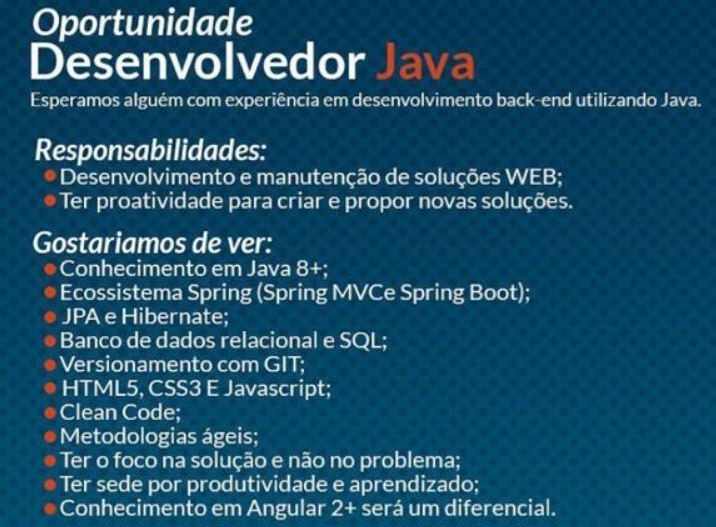
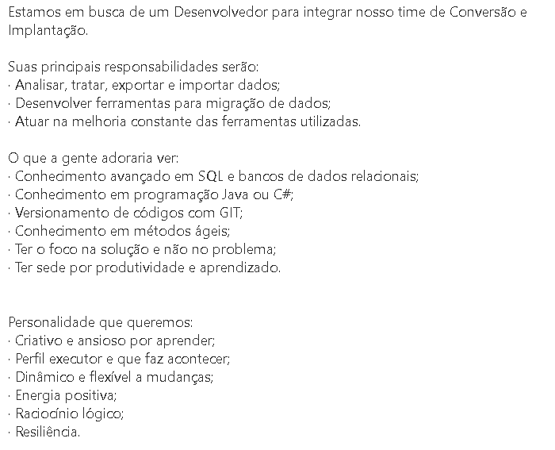
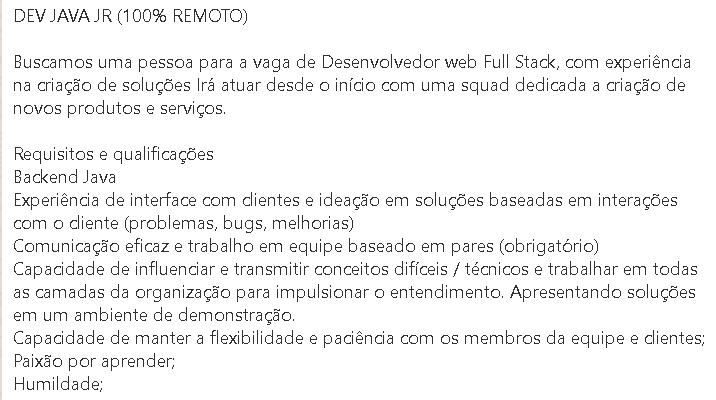
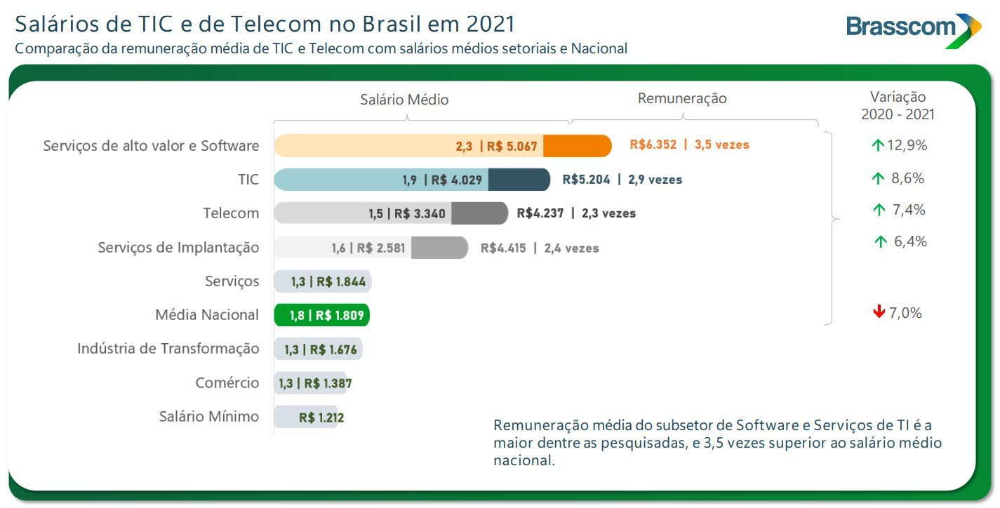

# Ferramentas de Desenvolvimento Web (937563)
## Aula 2 — O profissional de TI e sua atuação

> Texto integral da apostila oficial da Uninter (sem resumo). PDF original: [Aula_02.pdf](../_apostilas_pdf/02_Ferramentas_Web/Aula_02.pdf)

FUNDAMENTOS DE DESENVOLVIMENTO DE SOFTWARES AULA 2

Prof.ª Luciane Yanase Hirabara Kanashiro

### CONVERSA INICIAL

Essa discussão tem como foco o profissional de TI  (Tecnologia da Informação) e sua atuação. Sendo assim, inicialmente começaremos essa etapa vendo como surgiu a crise do software, seu significado para o desenvolvimento de software e com isso entender a importância do profissional de TI. Serão abordados também os diferentes papeis do profissional de TI e qual é o perfil do profissional de TI que o mercado de trabalho busca. Veremos ainda a i mportância da área de TI , destacando o panorama do mercado de trabalho e as mulheres na área de TI.

Conheceremos também alguns m itos e verdades sobre o desenvolvimento de software.

### TEMA 1 – CRISE DO SOFTWARE

A Crise do Software é um termo que surgiu em 1965 e refere- se ao problema do software não acompanhar o desenvolvimento do hardware. Antes de 1965,  não existia qualquer planejamento ou projeto para desenvolver um software ou formação específica para desenvolvedor ou engenheiro. Em outras palavras, não existia documentação nenhuma. Os problemas relacionados ao desenvolvimento de software começaram a surgir quando a demanda por software começou a subir. O número de usuários de computador começou a aumentar e,  consequentemente, a demanda por software. Era uma época em que a codificação do software era entendida apenas por quem o tinha desenvolvido. Imaginem o problema que era!

Era então necessária uma solução para esse problema ou, como muitos autores dizem, era necessário colocar ordem ao caos.  A formação de profissionais e o uso de técnicas, métodos e ferramentas para o desenvolvimento de software minimizou esse problema. No entanto, veremos a seguir que a crise do software ainda persiste e continuaremos com a explanação para melhor compreensão do que é a crise do software.

A crise que se iniciou em 1965 se acentua na década seguinte e a necessidade de solução para os problemas cresce. Nessa época do surgimento da crise do software, os computadores começam  a ficar menores  com o surgimento dos CIs (Circuitos Integrados). A época dos C Is ficou conhecida como terceira Geração de computadores. A partir da terceira geração, começou-

se a miniaturização do hardware.  Nessa época,  surgem os computadores de mesa, que ficaram conhecidos como PC (Personal Computer). Se antes os computadores eram us ados apena para fins militares, a partir desse momento passam a ser adquiridos para fins pessoais.

Com o crescimento da demanda por computador, o que se observa então é o crescimento da demanda por software, e é  por essa razão que falamos que o software não conseguiu acompanhar a demanda pelo hardware. Como citado anteriormente, nessa época não existiam  profissionais formados na área de desenvolvimento. O software era então desenvolvido de maneira informal, não seguindo nenhuma metodologia para o seu desenvolvimento. A ausência de metodologia, como bem sabemos hoje, causa erros de sistemas, problemas de cálculos, perdas financeira e perda de tempo, porque as estimativas de prazo são imprecisas.

Então, é preciso que entendam que a expressão “Crise do software” surge em 1965 e continua até os dias de hoje. A seguir, veremos alguns dos bugs mais icônicos da Informática que ilustram bem a crise do software. O termo Bug se refere a um erro na interpretação de um requisito, na sintaxe de um código ou ainda pode se referir a uma causa (ainda desconhecida) da queda de um sistema. O Bug ficou amplamente conhecido no final da década de 1990, quando se especulava que haveria o “Bug do Milênio”  nos sistemas computacionais quando se mudasse do ano 1999 para o ano 2000. A expressão bug, porém, su rgiu muito antes dessa época. Anti gamente, os computadores eram gigantescos, construídos com milhões de v álvulas. As válvulas tinham tamanho de uma lâmpada. Algumas vezes alguns bichos, a exemplo de mariposa, passavam entre as válvulas e ficavam presos, ocasionando a queda do Sistema - lembrando que “bug”, em inglês, se refere a inseto. A seguir, são apresentados alguns dos bugs mais famosos da história da engenharia de software.

Bug 1 - Falha na Sonda Mariner 1 Datada de 1962, o bug da sonda Mariner 1 se deve ao fato da fórmula escrita a lápis ter sido digitada errada no computador de cálculo. A sonda Mariner era um foguete projetado pela NASA para exploração do planeta vênus e depois do lançamento observou- se um desvio do curso preestabelecido. A sonda teve que ser destruída quando se encontrava sobrevoando o atlântico.

Esse bug tão gr otesco ainda é relembrado e até hoje é utilizado como referência para ilustrar a crise do software.

Bug 2 – Acelerador médico Therac- 25 O therac-25 era uma máquina de radioterapia para tratar tumores utilizado nos hospitais na década de 80, mais precisamente entre 1985 e  1987. O caso do Therac é conhecido como o desastre da engenharia. O problema: devido a uma falha de programação, a máquina emitia 100 vezes mais radiação do que a requerida. Consequência: cinco pacientes morreram e várias pessoas sofreram os efeitos de ficarem expostas a um elevado índice de radiação. Esse caso também é muito utilizado para se ilustrar a crise do software, devido a erros ridiculamente grotescos, como, por exemplo, falta de revisão/teste do software, falta de documentação e manual fornecido ao usuário que não explicava os significados dos códigos de erro que a máquina retornava.

Bug 3 - divisão de números com ponto flutuante no Pentium Um bug clássico que ocorreu em 1993 com os processadores Pentium da Intel. O problema foi descoberto por um professor de matemática que percebeu um erro quando se fazia divisão de números com ponto flutuante. Esse bug não custou vidas, mas custou milhões de dólares a Intel, pois foi obrigada a trocar de 3 a 5 milhões de chips, totalizando um prejuízo de mais de meio bilhão de dólar. Por exemplo ao executar a divisão daria o seguinte erro:

4195835,0/ 3145727,0 = 1,33374 O correto seria:

4195835,0/ 3145727,0 = 1,33382

Até aqui, deu para ter um entendimento do que foi a crise do software. O que ela ocasionou e que foi responsável pelo surgimento da engenharia de software. No entanto, se engana quem pensa que nos dias atuais estamos livres dos bugs. Recentemente, em 2022, o banco Nubank teve problemas com erro de arredondamento de ponto flutuante. O bug foi resolvido rapidamente, embora causou transtornos para vários usuários  que foram  impossibilitados de fazer transação via pix de determinados valores enquanto o bug persistia.

### TEMA 2 – PROFISSIONAL DE TI

Aqui, serão abordadas as áreas de atuação de diferentes profissionais da área de TI.

Engenheiro de software Os engenheiros de software são os profissionais que aplicam o processo da engenharia de software. É o profissional formado no curso de engenharia de software. Recentemente, em 2018,  a Engenharia de software foi vinculada ao CREA. Ressaltamos aqui que a SBC (Sociedade Brasileira de Computação) não concorda com essa regulamentação, mas este é um assunto que não nos cabe discutir. Para entender o que o engenheiro de software é, primeiram ente veremos o que ele não é. O engenheiro de software  não é um desenvolvedor que trabalha nas atividades de análise e produção de código, também não tem a função de analista de sistemas. Embora constantemente tenha a função confundida com a dessas duas profissões , o papel desempenhado pelo Engenheiro de software é diferente. Seria como confundir o engenheiro civil com o pedreiro, ou seja,  o engenhei ro não coloca a mão na massa.  Segundo Wazlawick (2013):

O engenheiro de software acompanha e avalia o desenvolvimento de todos os projetos da empresa para verificar se o processo estabelecido é executado de forma eficiente e efetiva. Caso sejam necessárias mudanças no processo estabelecido, ele as identifica e realiza, garantindo que a equipe adote tais mudanças. Ele reavalia o processo continuamente. (Wazlawick, 2013. p. 5) Analista de sistema O analista de sistemas é o profissional responsável pela compreensão do problema, ou seja,  é de responsabilidade do analista o l evantamento dos requisitos e da modelagem  do sistema utilizando a metodologia escolhida. Quando se fala de requisitos diz respeito ao que o sistema deve fazer e como serão feitos. São basicamente dois tipos de requisit os: funcionais e não funcionais. Os funcionais especificam o que o sistema deve fazer e os não funcionais definem como serão feitos. Um dos principais fatores para fracassos em projetos de software é a má especificação dos requisitos, sendo assim , o analista tem a grande responsabilidade de coletá- los e interpretá- los corretamente. Os requisitos iniciais serão fornecidos pelo cliente, portanto,  é o analista de sistemas  quem irá descobrir o que o cliente precisa e planejar a solução. O analista precisa ainda conhecer sobre banco dados e linguagens de

programação, porém não necessita de conhecimento profundo na linguagem de programação.

Desenvolvedor/ Programador O Programador será o responsável pela implementação da solução a partir das especificações coletadas pelo analista de sistemas. Esse profissional é que det ém o profundo c onhecimento da linguagem de programação e do ambiente de programação e das bibliotecas.  Deve ainda ter conhecimento sobre teste e depuração.  Dentre os programadores, ainda existem aqueles que se especializam em determinadas áreas. Por exemplo, o desenvolvedor pode ainda querer atuar no desenvolvimento de aplicativos móveis, ou ainda ir para a área de desenvolvimento de jogos.

Para esse profissional, são imprescindíveis o raciocínio lógico e a lógica de programação, importantíssimo e indispensável nessa área, pois sem a lógica de programação é impossível o domínio das linguagens de programação. A lógica de programação é o uso correto das leis do pensamento e de processos de raciocínio e simbolização formais na programação de computadores. Tem-se como objetivo a racionalidade e a produção de soluções logicamente validas e coerente. Permite ainda resolver com qualidade os problemas que se desejam  programar. Segundo Forbelone, a lógica de programação é concebida pela mente treinada e é representada pela linguagem de programação.  Atualmente, muitas empresas estão dando muita mais importância à lógica do que ao domínio de linguagens de programação específicas, pois sabendo a lógica se aprende qualquer linguagem com facilidade.

Infelizmente, na prática essa divisão de papeis dos três profissionais citados não é observada. Apenas grandes empresas podem se dar ao luxo de contratar um profissional para desempenhar um papel específico. Muitas vezes, o que vemos na prática é um profissional desempenhando as três funções.  No entanto, é importante que se tenha em mente que, ainda que uma pessoa execute mais de um papel no processo de desenvolvimento de software, esses papéis são distintos.

Gestor de TI Nem todo profissional da área de TI trabalha com desenvol vimento de programas de computador. O gestor de TI é um deles. Esse profissional é quem administra os recursos de TI. Quando falamos em recursos de TI, estamos nos

referindo ao tratamento, armazenamento e proteção de sistemas e informações. O Gestor de TI ainda é responsável  por garantir a segurança dos dados.  Na gestão de TI , além de saber  sobre desenvolvimento, também  deve ter conhecimento sobre marketing e administração, pois deve ter competência para fazer planejamento com ações estratégicas. Deve saber como utilizar as ferramentas tecnológicas a favor da empresa.

Cientista de Dados O cientista de dados deve ter conhecimento em computação, matemática e análise de dados. Ele é o profissional responsável por reunir e interpretar os dados. O cientista de dados é um Especialista analítico, pois trabalha com a análise de dados, resolvendo problemas complexos.

Com o surgimento da big data, os cientistas de dados se tornar am imprescindíveis em muitas empresas . Com capacidade de ler, escrever, comunicar e raciocinar com dados , diferente do analista de dados que apenas analisa e comunica as informações, o cientista deve ter conhecimento de métodos científicos, pois deve formular hipóteses e achar soluções. Engenheiro da Computação O engenheiro da computação é um profissional que tem uma base mais sólida em cálculo. Além de aprender cálculo, tecnicamente aprende tudo o que se aprende em engenharia de software. O engenheiro de computação está apto a desenvolver software e hardware. A diferença com o engenheiro de software é que o engenheiro  da computação está mais direcionado a desenvolver softwares, por exemplo, para mic rocontroladores e projetos de chips . O Engenheiro de computação seria uma junção entre cientista da computação e o engenheiro eletricista.

Administrador /Analista de Redes de Computadores O foco para quem é formado nessa área de redes são as profissões como: administrador de redes, analista de suporte,  analista em segurança de redes, supervisor de segurança de redes, entre outros. Esse profissional é responsável pela Instalação e implementação de infraestrutura de sistemas. Tem a habilidade de documentar  projetos de redes , configurar e gerenciar redes . É ainda o profissional responsável pelas soluções para desempenho da rede, garantindo a comunicação segura de programas e equipamentos . Muito comume nte os profissionais dessa área se especializam na parte de web segurança.

Administrador de Banco de Dados O profissional dessa área implementa, projeta as soluções  e gerencia o Banco de dados, sendo responsável ainda pela segurança e integridade dos dados. O profissional dessa área, apesar de não ser um engenheiro de dados, pode ainda trabalhar na área de engenharia de dados.

### TEMA 3 – PERFIL DO PROFISSIONAL DE TI

Aqui, será abordado o perfil do profissional de TI.  Embora o profissional de TI tenha diferentes papeis, de modo geral, as competências e habilidades não diferem.

Molinaro (2010) cita três habilidades inerentes ao profissional de TI: habilidade básica, habilidade técnica e habilidade comportamental. A seguir, são descritas sucintamente as três habilidades.

Habilidades básicas: diz respeito as habilidades  básicas de TI, como conhecer o sistema operacional, saber utilizar editores e planilhas, saber fazer uma apresentação no Power  point e saber lidar com outros aplicativos considerados básicos.

Habilidades técnicas: atualmente conh ecida como hard skills.  As habilidades téc nicas são  quantificáveis. Entendemos as habilidades técnicas aquelas que adquirimos através de estudo formal, como por fazer um curso de desenvolvimento para aprender as técnicas e ferramentas utilizadas nessa área. As competências técnicas são o conhecimento fundamental que um profissional deve ter. O profissional de TI deve ser especialista em alguma área e generalista nas outras.

Habilidades comportamentais : nos dias atuais , a habilidade comportamental é mais conhecida como soft skills.  São características subjetivas, difíceis de avaliar e estão também relacionadas ao comportamento do profissional: como ele interage em grupo,  habilidade de resolver problemas, de trabalhar em equipe, de se comunicar, de planejar - embora sejam subjetivas, podem ser desenvolvidas pelo profissional. São habilidades que geralmente são analisadas nas entrevistas de emprego.

Essas habilidades surgem como novas capacidades sociais e comportamentais (soft skills), que possuem caráter universal. Hoje em dia, é

muito importante desenvolver as soft skills, existindo até profissionais especializados nessa área, os chamados coaching de carreira. Com tantas habilidades requeridas, o perfil do profissional de TI é um tanto quanto complexo, podemos assim dizer, pois o profissional deve ainda gostar de aprender novas tecnologias e estar sempre atualizado, além de ser um profissional criativo deve dominar as tecnologias emergentes. Além da facilidade de aprender e se adaptar rapidamente as novas tecnologias, se for ainda um desenvolvedor, deve ser capaz de programar em várias linguagens e para várias plataformas. Quando falamos em diversas plataformas estamos nos referindo a dispositivos móveis (celular/tablets), computador.

Já deu para notar que o profissional de TI deve estar em constante aprendizado e atualização, não é?

E não é só isso. A lém das habilidades técnicas inerentes à profissão,  o inglês também é indispensável para esta profissão assim como a facilidade de trabalhar em equipe, pois essa área é muito complexa e o profissional muitas vezes deve trocar ideias com outros colegas de profissão. O velho perfil do nerd, de ser um cara isolado em um porão e que trabalha sozinho, já não existe mais. Mas o que realmente o mercado busca?

Competência profissional!

A competência profissional abrange o conhecimento, a habilidade e a atitude. O conhecimento é o saber . A habilidade é o saber fazer . A atitude é o saber ser. A ssim, a inter secção dessas 3 dimensões formam a competência profissional.

Conhecimento HabilidadeAtitude Competência Profissional

A seguir , são mostrados exemplos de anúncios reais para vagas de emprego para profissionais da área. Observe que além das habilidades técnicas são exigidas também as comportamentais.

No tópico a seguir, veremos sobre a importância do profissional da área de TI (Tecnologia da Informação) , discut iremos sobre empreendedorismo  e mercado de trabalho na área de TI.

### TEMA 4 – IMPORTÂNCIA DO PROFISSIONAL DE TI

A chegada da pandemia acelerou o processo de digitalização de muitas empresas. Com isso, o mercado de Tecnologia da Informação (TI) ganhou ainda mais destaque no processo de transformação digital, exigindo a figura de um profissional imprescindível para a criação de soluções em diferentes áreas de negócios. Profis sionais da área de TI, como desenvolvedores, analistas e administradores de redes e outras áreas afins tornaram imprescind íveis para diferentes organizações.

4.1 Mercado de TI A área de TI é a que mais cresce atualmente e com o advento da pandemia da Covid-19 os recursos tecnológicos se mostraram imprescindíveis. Algumas instituições brasileiras trazem dados importantes acerca da utilização das tecnologias no país. Segundo dados do Cetic , que é Centro Regional de Estudos para o Desenvolvimento da Sociedade da Informação, que monitora a adoção das T ecnologias de I nformação e Comunicação (TIC) no Brasi l, entre 2019 e 2021 –  período marcado pela emergência da pandemia COVID -19 – a proporção de empresas brasileiras que comercializaram produtos e serviços online cresceu de 57% para 73% (Cetic, 2021).

Ainda de acordo com os indicadores do Cetic em pesquisa feita sobre a utilização das TICs pelas empresas no brasil, entre 2013 e  2021 houve um crescimento de 9% na proporção de empresas que possuem área ou departamento de TI. O ano de 2013 foi o ano em que houve a primeira edição sobre proporção de empresas que possuem área ou departamento de TI. À primeira vista , o crescimento médio em porcentagem de 9%  em um período de pouco menos de uma dé cada pode parecer pouco, mas se observamos o gráfico podemos perceber que a porcentagem nas empresas de pequeno porte subiu mais de 16% e na de médio o crescimento foi de 18%. Nas empresas de grande porte,  a porcentagem continuou estável com 89% das empresas possuindo departamento de TI. Esse aumento nas pequenas e médias

empresas mostra um cenário otimista, pois quer dizer que as pequenas e médias empresas estão investindo cada vez mais em serviços e produtos da área de TI.

Pequeno De 10 a 49 pessoas Médio De 50 a 249 pessoas Grande Mais De 250 pessoas

Fonte: Brascom.

De acordo com a B rasscom (Associação Brasileira das Empresas de Tecnologia da Informação e Comunicação) no relatório setorial referente a 2021, a demanda por mão de obra na área de TI considerando de 2021 a 2025 é de 797 mil, com uma média simples de 159 mil empregos por ano.

Hoje, o Brasil forma cerca de 52 mil pessoas com perfil tecnológico por ano, com relativo descasamento entre oferta e demanda de mão de obra. Esta é uma grande oportunidade para o os profissionais de TI do país, especialmente em um momento em que se verifica uma taxa de desemprego de mais de 11% (considerado 2021) .  Ainda de acordo com a Brasscom, a remuneração média do subsetor de Software e serviços de TI é a maior dentre as pesquisadas e 3,5 vezes superior ao salário médio nacional. O gráfico a seguir mostra os salários de TIC e Telecom no país.

Pequeno Médio Grande 2013 2021

Fonte: Brasscom 2021 e UT.

No Relatório da Brasscom, a remuneração do setor TIC, do subsetor de Serviços de alto valor agregado e Software, Telecom e Serviços de Implantação inclui benefícios comumente oferecidos no setor.

4.2 Empreendedorismo e startups Apesar de não ter sido citado como habilidade inerente do profissional de TI, o espírito empreendedor também é muito bem-vindo aos profissionais dessa área.

Saber sobre empreendedorismo também é um quesito que não pode ser deixado de fora. A lém de desenvolver os sistemas ou pres tar serviços de TI, muitas vezes o profissional deve saber como divulgar e vender seu produto/serviço. Ter um espírito empreendedor pode ser o caminho para o sucesso. Muit as startups começam assim, com uma ideia criativa e espírito empreendedor.

A popularização da internet e smartphones  também contribui enormemente para o crescimento do mercado digital  no Brasil . No mercado digital, houve a proliferação de startups brasileir as. Startup é um grupo de pessoas à procura de um modelo de negócios repetível e escalável, trabalhando em  condições de extrema incerteza. As empresas startups que atingem mais de 1 bilhão de dólares são chamadas de unicórnio.

As fintechs no Brasil mostraram aumento de 96% ao ano. De acordo com a Nubank , as fintech s são startups ou empresas que desenvolvem produtos

financeiros totalmente digitais, nas quais o uso da o uso da tecnologia é o principal diferencial em relação às empresas tradicionais do setor. Algumas das fintechs mais conhecidas no Brasil: Neon, S tone, Nubank, Getnet, Ebanx, Contabilizei, C6bank, Vero, Safrapay, Pagseguro, Nibo, Contaazul, Mercado pago, banco I nter, Geru e C reditas. Essas fintechs  utilizam uma abordagem centrada no consumidor.

O Brasil ingressou no rank dos países com mais unicórnios no mundo, possuindo 16 deles (considerando até 2021) : Stone, Gympass, Nubank, Ifood, Loggi, Quinto andar, Arco, Pagseguro, 99, WildLife, Creditas, Loft, Vtex, C6 Bank e Madeira Madeira.

A presença de startups está concentrada em São Paulo. Sua economia é comparável a dos maiores países do mundo.

Por que essas informações são importantes? São relevantes para nós que somos da área de TI porque nos mostra um cenário que é favorável para o desenvolvimento. Se, cada vez mais, mais pessoas estão conectadas a internet, utilizando dispositivos digitais como computadores e principalmente smartphones, isso indica que as pessoas estão baixando mais apps, e que as empresas vão precisar de mais desenvolvedores  e consequentemente mais profissionais na área de TI.

4.3 A mulher e o mercado de TI Essa parte da etapa aborda como é o mercado de trabalho na área de TI para as mulheres. Primeiramente, veremos algumas mulheres que contribuíram para o desenvolvimento tecnológico no mundo.

Créditos: HappySloth/Shutterstock.

O primeiro programador da história é na verdade uma programadora. Seu nome é Ada Lovelace. Ela era uma matemática inglesa e escreveu o primeiro algoritmo para a máquina analítica de Charles Babbage. A linguagem de programação Ada foi criada em homenagem a ela pelo Departamento de Defesa dos Estados Unidos.

Crédito:Smile Ilustras.

Grace Murray Hopper foi analista de dados da marinha americana e criou a linguagem de programação Flow-Matic, que serviu de base para a criação do COBOL. É de autoria dela o termo “bug”.

Créditos: patuletail//Shutterstock.

Hedwig Eva Marie Kiesler, mais conhecida como Hedy Lamarr , é a mãe do wifi. Mais famosa como atriz do que como cientista em sua época, durante a segunda guerra,  ela inventou um aparelho de interferência em rádio, que posteriormente possibilitou a criação de tecnologias como wifi e CDMA  (Code Division Multiple Access, ou Acesso Múltiplo por Divisão de Código). Vimos sucintamente (muito sucintamente, eu diria! ) sobre essas três mulheres que em muito contribuíram para o desenvolvimento tecnológico no mundo. C om base nesses nomes, posteriormente você pode se aprofundar fazendo pesquisas na internet e conhecendo mais sobre essas mulheres maravilhosas. A seguir, vemos sobre a presença das mulheres no mercado de TI. No censo da indústria de jogos digitais  realizada pela Abra Games em 2022, constatou- se que n a maioria dos casos o desenvolvedor era do sexo masculino. Apesar de ser um censo da indú stria de jogos, esses números refletem a área de TI.  E stima-se que mais de 80% dos profissionais que trabalham nesta área são homens, ou seja, a participação das mulheres na área de TI ainda é muito pouco.

No segundo censo,  as mulheres que realmente trabalhavam  com programação atingiam apenas 11%, enquanto os homens atingiam 89%. Apesar de parecer uma porcentagem muito pequena, a presença de mulheres vem aumentando nos últimos anos . Entre os anos de 2014 e  2018, o aumento do número de mulheres na área de desenvolvimento de jogos triplicou. Já no censo feito pela Abra Games em 2022 essa proporção de colaboradoras que trabalham com programação aumentou para 15%.

Na área de desenvolvimento de software em geral não é diferente. Segundo pesquisa da Revelo,  feita entre janeiro e  dezembro de 2021,  apenas 12,3% de desenvolvedores são do sexo feminino. Apesar de parecer um número pequeno, entre 2014 e  2019, houve um aumento significativo de 60% de mulheres na área de desenvolvimento.  Ainda de acordo com a Revel o, considerando experiência e gênero, a proporção de profissionais de tecnologia, em sua maioria desenvolvedoras, diminu i conforme o aumento da senioridade. Isso ilustra um cenário positivo, pois quer dizer que cada vez mais as mulheres mais jovens estão se interessando por essa área de desenvolvimento. No gráfico a seguir, podemos visualizar com mais clareza esse cenário.

Fonte: Revelo e UT.

Em tempo: Revelo é uma empresa de tecnologia no setor de recursos que oferece uma plataforma de recrutamento e seleção que conecta candidatos às vagas de forma ágil e humanizada.

No último tópico, voltaremos a falar sobre as mulheres na área de TI. 4.4 Tecnologias emergentes 4.4.1 virtualização e  conteinerização A computação em nuvem, muitas vezes referenciada como cloud computing, tem como definição mais básica um computador localizado em algum lugar acessado via Internet e usado de alguma maneira.

A AWS (Amazon Web Services) , provedora de serviços de computação em nuvem, define, baseada em seus serviços, que a computação em nuvem é a entrega sob demanda de poder computacional, armazenamento de banco de dados, aplicativos e outros recursos de TI por meio de uma plataforma de serviços de nuvem via Internet com definição de preço conforme o uso. Mas por  que falar em  computação em  nuvem? Tendências que foram ressaltadas pela pandemia é a da virtualização e conteinerização pois a criação de um ambiente de desenvolvimento pode ser árdua e demorada. Mais adiante, discutiremos com mais detalhes a virtualização.

91,9% 89,0% 86,4% 84,0% 8,1% 11,0% 13,6% 16,0% 7 ou mais anos 3-6 anos 1-2 anos Menos de 1 ano Experiência por gênero Homens Mulheres

A solução é hospedar códigos e criar, testar e implantar os aplicativos na nuvem. Isso possibilita disponibilizar softwares com mais rapidez, fazendo ainda com que o time se torne mais produtivo.

Durante a p andemia de Covid- 19, houve um  enorme crescimento da utilização de serviços na nuvem . De acordo com os Dados da Brasscom , em 2020 houve um destaque de crescimento em relação ao ano anterior  para software na Nuvem com 165,8% e infraestrutura na Nuvem com 127,8%.  Já no relatório setorial referente a 2021,  o crescimento foi de 32% para software na nuvem e infraestrutura na nuvem com 42%.

Existem várias empresas que oferecem serviços na nuvem. A AWS (Amazon Web Services) é uma delas, sendo líder global em serviços de nuvem. A Amazon Web Services disponibiliza vários serviços de computação em nuvem para os três modelos de serviço: IaaS  (Infraestrutura como Serviço), PaaS (Plataforma como serviço)  e SaaS (Software como Serviço) . A AWS utiliza a prática do dogfooding, ou seja, utiliza seu próprios produtos e serviços, tendo um foco implacável no cliente.

Como mencionado anteriormente, veremos a seguir as características da virtualização, para que seja possível compreendermos o que é conteinerização e computação de borda.

A virtualização consiste em uma m áquina física que emula v árias máquinas virtuais. Cada máquina Virtual roda uma cópia do sistema operacional, como Windows, Mac OS ou Linux. Ou seja, a virtualização cria um ambiente virtual de computação ( simulando um ambiente real)  ao invés de um ambiente físico. Um exemplo de emulador é o VMWare e VirtualBox. O conceito de virtualização não é novo, existe desde 1960,  mas é uma tendência que foi ressaltada com a popularização da computação em nuvem.

Os contêineres são um método de virtualização do sistema operacional que permite executar um aplicativo e suas dependências em processos isolados de recursos.  Simplificadamente os containers empacotam o código, as configurações e as dependências de um aplicativo em um único objeto. O Docker é um bom exemplo de produto que utiliza virtualização para entregar pacotes de softwares denominados contêineres. A seguir,  podemos visualizar a logo do Docker, que representa uma baleia com o dorso empilhado de contêineres.

4.4.2 Computação de borda Se procurarmos um pouco na internet, encontraremos várias definições sobre computação de borda. A seguir, algumas definições dadas por empresas reconhecidas mundialmente na área de TI.

A definição dada pela Intel é de que “a computação de borda se refere ao processamento, análise e armazenamento de dados mais próximos de onde eles são gerados para permitir análises e respostas rápidas, quase em tempo real”. Já a IBM define a computação de borda como “um modelo de computação distribuída que aproxima os aplicativos corporativos das fontes de dados, como dispositivos de IoT ou servidores de borda local ”. Essa proximidade com os dados em sua fonte pode gerar grandes benefícios de negócios: insights mais rápidos, tempos de resposta melhores e disponibilidade de largura de banda aprimorada.

A Hewlett Packard dá uma definição mais simplificada dizendo que “a computação de borda é uma forma de computação realizada no local ou próximo a uma fonte de dados em particular, minimizando a necessidade de os dados serem processados em um data center remoto.” Analisando as definições, podemos simplificar  ainda mais e dizer que a computação de borda aproxima os equipamentos de onde estão os dados que são gerados. A computação de borda é uma evolução da computação em nuvem e teve origem em 1990 com o surgimento das CDNs  (Redes de entrega de conteúdo), que armazena conteúdo próximo dos locais de entrega. Esse é o recurso utilizado por empresas como Netflix e Disney plus , que conseguem entregar conteúdo rapidamente e sem “ travar”. A computação de borda é uma tendência que foi ressaltada com  o aparecimento do conceito d e IoT (Internet das Coisas). Com a possiblidade de se conectar à  internet objetos que utilizamos no dia a dia, como eletrodomésticos, carros, baba eletrônica surgiu o conceito de IoT.

### TEMA 5 – MITOS E VERDADES DO DESENVOLVIMENTO DE SOFTWARE

Os mitos do desenvolvimento de softwares são definidos como sendo crenças comuns, sem fundamento científico sobre o software e o processo utilizado para cri á-lo. De acordo com Pressman  (2016), existem os mitos de gerenciamento, mitos do cliente e mitos dos profissionais da área. A seguir ,

veremos essas três categorias de mitos, conforme disposto por Pressman (2016).

Mitos de gerenciamento Existem muitos outros mitos na  área de gerenciamento. Listamos aqui alguns mitos relacionados ao gerenciamento de projetos de software. Mito Realidade Já temos um livro cheio de padrões e procedimentos O livro é utilizado?

Se o cronograma atrasar, acrescentarmos mais programadores Acrescentar mais pessoal atrasa o projeto Ao terceirizar o projeto é possível relaxar Acompanhamento contínuo. Fonte: Kanshiro com base em Pressman (2016).

Mitos do Cliente Compreender as necessidades  do cliente é um grande desafio em qualquer projeto. No desenvolvimento de software não é diferente. Muitas vezes, o cliente tem expectativas  de como o software funcionará, muitas vezes errôneas. Cabe lembrar aqui que, apesar de ser o cliente que deve definir o que será feito, é o profissional de TI, como especialista da área, que  deve saber convencer o cliente quando achar que uma especificação não cabe em uma solução de tecnologia. O quadro a seguir mostra os mitos relacionados ao cliente.

Mito Realidade Uma definição geral dos objetivos é suficiente para começar a escrever os programas – podemos preencher os detalhes posteriormente.

A principal causa do fracasso de projetos de software são os requisitos iniciais maus definidos/entendidos de maneira errônea. A probabilidade de sucesso de um projeto aumenta se os requisitos iniciais forem bem definidos Os requisitos de software mudam continuamente, mas as mudanças podem ser facilmente assimiladas, pois o software é flexível O impacto da mudança depende de quando ela é introduzida.

Fonte: Pressman (2016).

Mitos dos profissionais da área Apesar de muito estudo, muitos profissionais da área ainda caem em alguns dos mitos do desenvolvimento de software. Listamos os mitos mais conhecidos relacionados aos profissionais da área.

Mito Realidade Uma vez que o programa foi feito e colocado em uso, nosso trabalho está́ terminado.

Entre 60 e 80% de todo o esforço será́ despendido após a entrega do software ao cliente pela primeira vez Até́  que o programa esteja “em execução”, não há como avaliar sua qualidade Existem formas de avaliar a qualidade antes da implementação do sistema.

O único produto passível de entrega é o programa em funcionamento.

Uma variedade de outros artefatos são necessários: modelos, documentos, planos etc.

A engenharia de software nos fará criar documentação volumosa e desnecessária e, invariavelmente, vai nos retardar.

Objetivo: criar um produto de qualidade.

Uma qualidade melhor leva à redução do retrabalho.

Fonte: Pressman (2016).

Além dos mitos de engenharia de software, temos também aqueles mitos não técnicos da área de TI. A seguir, são abordados alguns desses mitos. TI não é uma área para mulheres Alguns podem até dizer que TI não é uma área para mulheres, mas a própria história contradiz isso, e temos exemplos de mulheres como A da Lovelace, Hedy Lamarr e Grace Hooper. Mas então por que temos um número tão baixo de mulheres na área de TI?

Atualmente, estão sendo feitas muitas pesquisas em relação à predominância de homens, não só na área de TI, mas na STEM  (acrónimo em inglês para " Science, Technology, Engineering and M athematics"). E m um estudo feito por D O (2021), são resumidas as questões que influenciam as escolhas de mulheres jovens ao estudar STEM/TI . Essas questões levantadas por vários pesquisadores da área de psicologia e comportamento foram divididas em três níveis: individual, interpessoal e estrutural. No nível individual são elencadas algumas questões individuais que afetam a motivação e as decisões das mulheres ao buscar um diploma de TI em nível superior. Dentre as questões levantadas estão: autoeficácia; atitudes e interesses; exposição prévia à computação; e percepção de carreira.  A seguir, uma breve explicação de cada quesito que compõe o nivel individual:

Autoeficácia: é a crença na própria capacidade de realizar uma tarefa ou um objetivo.

Atitudes e interesses: esse quesito faz referência a atitudes em relação aos computadores  e afirma que os interesses das meninas preveem significativamente sua busca por um diploma de TI Exposição prévia à computação: meninas com experiência em computação têm maiores interesses e maior probabilidade de concluir um curso de TI. Esta  relação é explicada pelo argumento de que o acesso precoce a computadores reduz a intimidação e aumenta a percepção de capacidade. A familiaridade  com computadores estimula também o interesse e a curiosidade da criança e, simultaneamente, promove seu senso de competência. (Adya, M.; Kaiser, K.M. 2005. “Early Determinants of Women in the IT Workforce: A Model of Girls’ Career Choices.” apud Do (2021)) Percepção de carreira:  estudos indicaram que trabalhos que envolvem interações sociais e que valorizam as recompensas sociais têm maior probabilidade de atrair mulheres do que aquelas que exigem trabalho com objetos físicos e/ou estão mais focadas em ganhar altos salários e poder. Há uma percepção errônea de que uma carreira em STEM não é associada a objetivos comunitários, o que leva as mulheres a se afastarem d essa área (Dasgupta, N. Stout, J.G. 2014. “Girls and Women in Science, Technology, Engineering, and Mathematics: STEMing the Tide and Broadening Participation in STEM Careers.” Policy Insights from the Behavioral and Brain Sciences 1(1):21–29 apud (DO (2021)) Além das questões individuais , também são mostradas  questões interpessoais como influência dos pais e dos pares e modelos femininos “comuns” a serem seguidos  em uma área dominada por homens . A pesquisa também cita que a presença de mentores, podendo ser um amigo, irmão, primo, ajuda as alunas a combaterem várias formas de isolamento, micro agressão e a escassez de modelos de mulheres.

Quanto a questões estruturais levando em consideração o ambiente acadêmico, infelizmente a literatura aponta vários casos do papel negativo dos professores escolares no reforço dos estereótipos de gênero em STEM.  O relatório cita ainda que a indústria de games  e filmes pode reforçar os estereótipos de gênero,  visto que ainda hoje proliferam a exist ência de personagens femininas sexualizadas, o estudo aponta ainda que a porcentagem de personagens femininas principais não evoluiu ou se desenvolveu ao longo do tempo.

Embora essas constatações não sejam definitivas, nos levam realmente a pensar qual é a motivação e as expectativas de uma mulher ao se buscar um diploma na área de TI.

Ser bom em matemática Nem toda área de TI exige cálculos avançados. Em um vídeo de divulgação para incentivar futuros  programadores feito pela code.org, onde vários famosos da área de TI, como Zuckeberg do Facebook, Jack, criador do Twiter, e Bill Gates, fundador da Microsoft, participam. O próprio Bill diz que para ser um programador “é preciso apenas saber adição e fração ...” e, é claro, um pouco de multiplicação também.

E embora tenhamos mitos, algumas coisas são verdades:

Saber Inglês é imprescindível Um profissional da área de TI que não sabe inglês pode perder muitas oportunidades. Em um mundo globalizado, onde a tecnologia muda rapidamente é importantíssimo que se aprenda o básico de inglês, permitindo assim que se comunique, entenda outros profissionais e saiba pelo menos entender um manual ou uma especificação em inglês.  Mas existem bons tradutores online ! Sem dúvida, mas saber o básico de inglês pode abrir um mar de oportunidades. Área de TI é uma área em expansão Como vimos anteriormente, a demanda por  profissionais de TI só aumenta. Essa área é uma que não sofreu  crise por conta da pandemia, ao contrário, esses profissionais ficaram ainda mais disputados. Profissionais de TI devem estar em constante aprendizado Se vai trabalhar na área de TI, deve ter em mente que vai ter que estudar durante a vida toda, pois a tecnologia muda rapidamente. De um ano para outro as tecnologias são aprimoradas, enquanto outras novas surgem. As versões de linguagens e softwares existentes mudam continuamente. Constantemente quando acha que dominou uma linguagem ou framework, determinado comando fica “deprecated” – obsoleto - e (re)começa a saga para se adaptar ao “novo jeito” de fazer.

### FINALIZANDO

Nessa etapa, aprendemos um pouco sobre a crise do software, pudemos ver os diferentes papeis do p rofissional de TI. V erificamos que, embora um profissional desempenhe  várias funções, ainda assim são papéis diferentes. Pudemos conhecer ainda o p erfil do profissional de TI e ver um panorama do mercado de trabalho para os profissionais da área. Aqui, vimos ainda que, apesar de estar aumentando a presença de mulheres na área, no Brasil apenas 20% dos profissionais de TI representam a participação feminina.  Finalmente ainda pudemos conhecer alguns dos mitos e verdades do desenvolvimento de software.

### REFERÊNCIAS

AUEL, A. The Mathematics of Grace Murray Hopper . In: Notices of the American Mathematical Society, Boston-USA, volume 66, número 3, p. (330 e 340), março, 2019 BES, P., et al. Soft Skills. Disponível em: Minha Biblioteca, Grupo A, 2021. BRASSCOM. Relatório Setorial de TIC . Brasscom, 2022. Disponível em: <https://brasscom.org.br/pdfs/relatorio-setorial-de-tic/>. Acesso em: 29, set.de 2022.

COMER, D. E. Redes de Computadores e Internet. Tradução: José Valdeni de Lima, Valter Roesler. 6. ed. Porto Alegre : Bookman, 2016 DO, T, L. B., P, M., C & S., Y 2021, Championing girls and women in information technology: a review of challenges, opportunities and initiatives, Monash University, Melbourne. Disponível em :

<https://www.monash.edu/__data/assets/pdf_file/0005/2748515/Women-in- STEM-and-IT-Report.pdf>. Acesso em: 28 set. 2022 FORTIM, I. (Org). Pesquisa da indústria brasileira de games 2022. ABRAGAMES: São Paulo, 2022.

HEWLETT PACKARD. O que é computação de Borda? Hewlett Packard, 2022. Disponível em: <https://www.hpe.com/br/pt/what -is/edge- computing.html?jumpid=ps_hlhof84xt_aid- 520061468&ef_id=CjwKCAjwvsqZBhAlEiwAqAHElQrVHjEoTyVm_aOhTMV3z mWoQR8- eBYERirRchw9KMR4w9ICduCyjxoCl8QQAvD_BwE:G:s&s_kwcid=AL!13472!3! 618178081353!e!!g!!defini%C3%A7%C3%A3o%20de%20computa%C3%A7% C3%A3o%20de%20borda!18132262206!141266576835&>. Acesso em: 29, set.de 2022.

IBM. O que é computação de Borda? IBM, 2022. Disponível em:

<https://www.ibm.com/br-pt/cloud/what-is-edge-computing>. Acesso em: 29, set.de 2022.

MCKINSEY, CO. Brazil Digital Report – 1 Ed. 2019.Disponivel em <https://www.mckinsey.com/br/~/media/McKinsey/Locations/South%20America/

Brazil/Our%20Insights/Brazil%20Digital%20Report/Brazil-Digital-Report-1st- Edition_Portuguese-vAjustado.ashx>.  Acesso em 29/09/2022 MOLINARO, C. R. Gestão de Tecnologia da Informação - Governança de TI: Arquitetura e Alinhamento entre Sistemas de Informação e o Negócio. Rio de Janeiro: LTC, 2011.

PRESSMAN, R. S., BRUCE R. M. Engenharia de software: uma abordagem profissional; [traduçã o: Joã o Eduardo N óbrega Tortello; revis ão t écnica: Reginaldo Arakaki, Julio Arakaki, Renato Manzan de Andrade]. –  8. ed. – Porto Alegre: AMGH, 2016.

SAKUDA, Luiz Ojima.; FORTIM, Ivelise (Orgs.). II Censo da Indústria Brasileira de Jogos Digitais. Ministério da Cultura: Brasília, 2018 TIC Empresas –  2021. Cetic.br, 2022. Disponível em:

<https://cetic.br/pt/pesquisa/empresas/indicadores/>.  Acesso em:  29, set.de 2022.

WAZLAWICK, R. Engenharia de Software -  Conceitos e Práticas. Rio de Janeiro: Elsevier, 2013.
