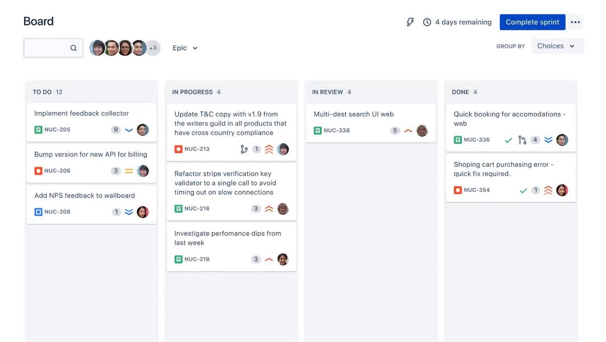
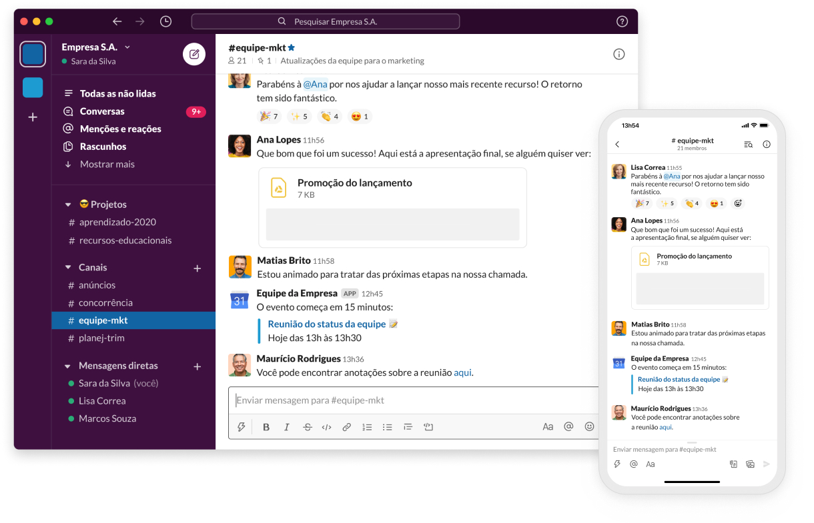
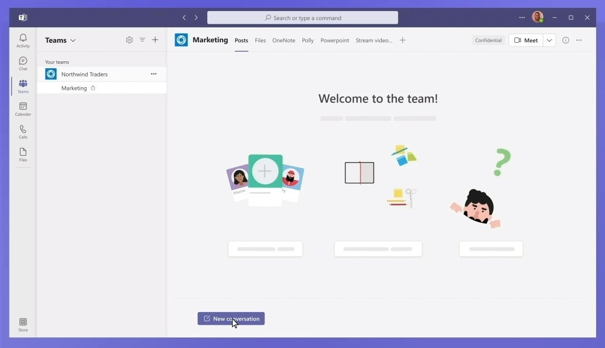
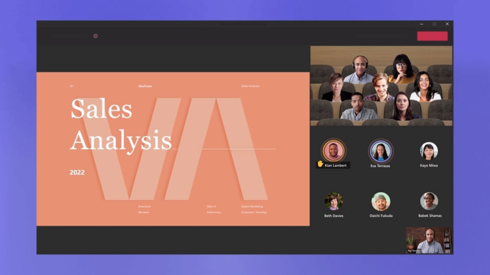
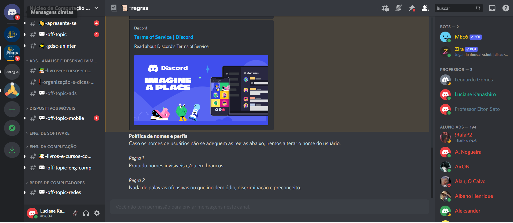
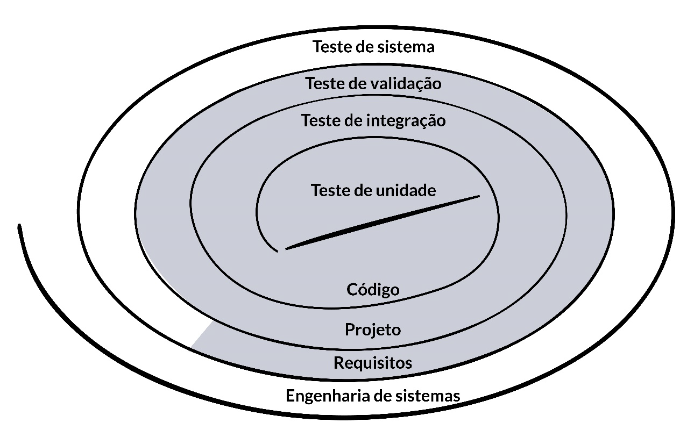
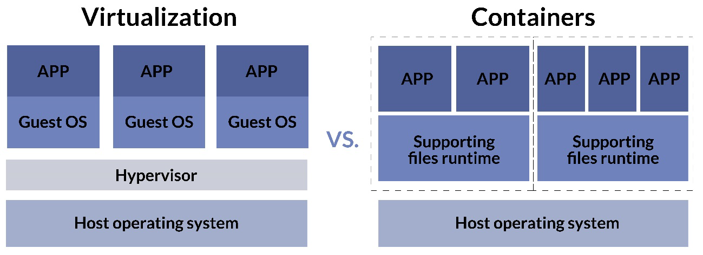

# Ferramentas de Desenvolvimento Web (937563)
## Aula 3 — Desenvolvimento Colaborativo

> Texto integral da apostila oficial da Uninter (sem resumo). PDF original: [Aula_03.pdf](../_apostilas_pdf/02_Ferramentas_Web/Aula_03.pdf)

FUNDAMENTOS DE DESENVOLVIMENTO DE SOFTWARES AULA 3

Profª Luciane Yanase Hirabara Kanashiro

### CONVERSA INICIAL

Desenvolvimento colaborativo: do início ao fim Nessa etapa teremos uma visão geral sobre o desenvolvimento colaborativo. Veremos como nasce um softwar e e quais são as ferramentas colaborativas de trabalho mais usadas atualmente.  Conheceremos um pouco sobre o conceito e a importância de versionamento e reúso, assim como alguns repositórios de códigos para sabermos onde procurar informações quando codificamos. Enfim, veremos sobre Testes de software, a relação com a qualidade de software e sua importância para o desenvolvimento de software. Essa etapa está dividida nos seguintes tópicos:

1. Como nasce um software? Trabalho em equipe e boas práticas em reuniões; 2. Ferramenta colaborativa de trabalho em equipe; 3. Versionamento e reúso; 4. Repositórios de códigos; 5. Testes de software, controle de qualidade e deploy.

### TEMA 1 – COMO NASCE UM SOFTWARE?

Muito antes de se começar a codificar um software,  um levantamento de requisitos é realizado para coletar as funções requeridas no software. Após essa fase de análise e levantamento de requisitos, é hora de colocar a mão na massa. A rotina para o desenvolvimento de software basicamente consiste em baixar o código de um repositório, codificar, validar e  integrar os novos códigos criados e testar as novas funcionalidades.

Quando baixamos um código do repositório, estamos adquirindo o código. E não fazemos isso apenas uma vez  ao longo do projeto. Adquirimos uma nova versão do código várias vezes ao longo de um  projeto. Cada vez que é necessária alguma atualização na codificação,  é preciso também a atualização da versão no repositório. Para isso é que se utiliza os sistemas de controle de versão que falaremos com mais detalhes ao longo dess e conteúdo. Detalhes como colocar nomes adequados ao repositório,  além de ajudar mais rapidamente na sua localização, é uma boa prática que deve ser seguida.

Após baixar o código do repositório, vem a fase da codificação. Más práticas de programação,  como código duplicado e manipulações desnecessárias no B anco de Dados, podem afetar o desempenho de um programa. Na fase de codificação devem ainda ser observados critérios básicos como formatação e nomenclatura no código.

A validação do código desenvolvido não é uma fase realizada por teste de software, mas, sim, testes realizados pelo programador em se u próprio código para verificar se tudo funciona de acordo com o que foi especificado. Essa validação é necessária para que o código seja integrado ao projeto sem erros. As boas práticas a serem aplicadas aqui englobam a programação em pares e a consulta aos casos de uso relacionados às funcionalidades implementadas. Após a revisão do código ele é integrado ao restante do projeto por meio de sistemas de controle de versão.

Apesar de estar colocado por ú ltimo, os testes de softwares não necessariamente devem ser feitos apenas no final do projeto.  Como boas práticas na fase de testes de softwares estão a automatização de t estes, o desenvolvimento orientado a testes e a realização das atividades de testes durante a codificação.

1.1 Trabalho em equipe e boas práticas em reuniões Vimos anteriormente o ciclo de vida de um software. Vimos como  um software nasce, vive e morre. O ciclo de vida é importante para o planejamento da construção de um software. Mas são as pessoas que fazem um software. A Metodologia Á gil dá import ância às pessoas. Vamos retornar ao Scrum e verificar: um time é formado pelo Product Owner , Scrum Master e Desenvolvedores.  No Scrum as r euniões diárias, conhecidas como dailys , consistem em uma pequena reunião de não mais que 15 minutos para que cada membro da equipe possa atualizar todos os outros sobre o que estão trabalhando naquele dia.  O objetivo das dailys é priorizar tarefas  e a comunicação  com a equipe, tendo  como foco  o cliente.

Mesmo que não seja utilizada a metodologia S crum, as equipes ainda assim são formadas por pessoas. O trabalho em equipe e a colaboração impacta no sucesso de uma aplicação.  Uma equipe que não colabora, que não sabe em quê o outro parceiro está trabalhando, uma equipe cansada não rende!

Reuniões  é uma boa estratégia para saber em que cada um do time está trabalhando e quais tarefas são prioridades. Mas , como mencionado anteriormente, um time cansado não rende. O excesso de reuniões pode atrapalhar a produtividade. Temos ent ão que dar ênfase nas boas práticas em reuniões. As reuniões precisam ser produtivas.

Segundo artigo do Harvard  Business Review (Rogelberg, 2019), cerca de 90% das pessoas  afirmam sonhar acordado em reuniões e 73% admitem que usam o horário da reunião para fazer outro trabalho.

O que fazer , então? Eliminar as reuniões, uma vez   que não são produtivas?

Não! O objetivo não deve ser eliminar todas as reuniões, somente àquelas que são desnecessárias e melhorar a qualidade daquelas que permanecem. O Ministério Público do Rio de Janeiro (MPRJ), por meio de seu Laboratório de Inovação  (INOVA) , realizou uma pesquisa com seus integrantes e obteve as seguintes conclusões:

• 82,3% dos entrevistados consideram uma mudança importante a escolha criteriosa de temas; • 91,6% dos entrevistados consideram uma mudança importante o envio prévio da pauta; • 89,4% dos entrevistados consideram uma mudança importante a definição de quem faz o quê; • 85,8% consideram como uma mudança importante a limitação do tempo total de reunião; • 68,1% consideram como uma mudança importante a limitação de participantes.

Os números levantados pelo MPRJ nos traz reflexões importantes. Quem nunca participou de uma reunião e conc luiu que as questões levantadas na reunião poderiam ser resolvidas  de outra maneira, como,  por exemplo, em um comunicado por email ? Quem já participou de uma reunião que dura horas e saiu sem entender qual era a finalidade do encontro?

O envio prévio da pauta poderia evitar situações como essa. As definições de quem faz o quê em uma reunião também é importante, pois todos devem sair cientes de seus compromissos. Isso pode  começar antes da reunião, definindo, por exemplo,  quem será responsável pela ata, quem será responsável por

atribuir as notas e as responsabilidades de cada integrante. Ao final da reunião, será que cada integrante ficou ciente do que deve ser feito e quem fará? Quem já participou de uma reunião e achou uma perda de tempo? Que os assuntos tratados não t êm relação com sua função ou que a sua expertise não tem relação com nenhuma pauta da reunião? Limitar participantes seria uma ótima opção para aumentar a eficácia de uma reunião. Convidar participantes e deixarem que decidam se a pauta tem relevância com a sua atividade ou expertise seria uma opção. As pessoas não deveriam se sentir obrigadas  ou constrangidas de não aceitar um convite de participação se ela não tem nada a agregar naquelas pautas propostas em reunião.

1.2 Boas práticas em reuniões A seguir veremos algumas boas práticas em reuniões. Cons ideraremos especialmente as reuniões por web conferência, visto que é uma tendê ncia. A Zendesk, empresa de software com origem na Dinamarca, famosa por sua plataforma para o serviço de atendimento ao cliente hospedada na nuvem , elenca alguns fatores para reuniões eficientes, com eçando com a condução da reunião.

Para como conduzir uma reunião, são elencados os seguintes fatores: • Não se atrase para a reunião; • Quem faz o convite deve guiar a reunião; • Prepare-se para a reunião; • Apresente todos os participantes; • Estabeleça as regras da reunião; • Seja direto e objetivo; • Pergunte como as pessoas estão se sentindo.

Para que as reuniões sejam mais eficientes, os seguintes fatores são elencados:

• Verifique se o assunto de fato pede uma reunião; • Marque reuniões mais curtas; • Evite encontros fora do horário comercial e tente não remarcar; • Envie o convite já com um contexto do que será abordado; • Convide apenas as pessoas realmente necessárias para o encontro;

• Esteja presente e evite distrações; • Tenha sempre cuidado com a câmera e o microfone; • Faça uma ata da reunião remota.

As videoconferências ou webconferências se tornaram populares devido ao isolamento social imposto pela pandemia da covid- 19 e é outra tendência. A webconferência traz vantagens como custo e tempo. Economia de tempo, devido a logística, ou seja, não é necessário o deslocamento para o local físico das reuniões; e economia de dinheiro, pois sem o deslocamento não é necessário gastos com transporte ou locação física de uma sala de reuniões.  Apesar das vantagens, também existem algumas desvantagens.

Recentemente surgiu o termo Zoom Fadigue ou fadiga do zoom  que relaciona a fadiga causada pelo excesso de videoconfer ências. O Zoom é uma das ferramentas mais conhecidas de videoconferência, apesar da fadiga levar o seu nome, a s índrome é referente a utilização de qualquer ferramenta de webconferência. De acordo com Riedl ( 2022) são características da fadiga do Zoom:

• Termo que se refere aos aspectos negativos da videoconferência em geral; • Uso prolongado e repetido de ferramentas de videoconferência; • Exaustão física e mental; • Cansaço, preocupação, ansiedade, esgotamento, desconforto e estresse. De acordo com estudos da S tanford (Ramachandran, 2021), são causas do Zoom Fadigue:

• Excesso de contato visual: nas videoconferências todo mundo olha para todo mundo ao mesmo tempo.  Outra fonte de estresse é que os rostos podem parecer grandes demais dependendo da resolução do monitor. • Muito tempo vendo a si mesmo:  nas webconferências vemos n ós mesmos enquanto estamos falando.  Isso pode causar estresse e desconforto.

• Redução de mobilidade: estudos apontam que quando a pessoa se move, ela tem melhor desempenh o cognitivo.  Quando falamos em cognitivo fazemos relação com o processo mental de percepção, memória e raciocínio.

• Videochamadas demandam maior carga cognitiva:  cara a cara a comunicação não verbal é bastante natural, m as nos chats de vídeo trabalhamos mais para enviar e receber sinais.

Por ser ainda uma síndrome recente, vários estudos ainda estão sendo conduzidos, mas alguns especialistas e pesquisadores dessa fadiga colocam algumas atitudes simples que podem minimizar o efeito da fadiga, como,  por exemplo, desabilitar sua própria vista nos aplicativos de videoconfer ência para que não fique se vendo o tempo todo e desligar a câmera por alguns minutos para que possa se movimentar um pouco.

### TEMA 2 – FERRAMENTAS COLABORATIVAS DE TRABALHO EM EQUIPE

As ferramentas de colaboração são softwares ou plataformas que permitem o compartilhamento de arquivos e a efetiva comunicação entre os integrantes de um mesmo projeto.

Mesmo antes da pandemia da covid, na área de desen volvimento de software sempre houve a necessidade de utilização de ferramentas colaborativas. Porém , mais do que nunca é necessário a colaboração e comunicação entre os integrantes de um mesmo time.  O termo ferramentas colaborativas é relativamente novo.

O Trello e Jira são dois exemplos de ferramentas colaborativas utilizadas pelas empresas.

2.1 Trello De acordo com o próprio fabricante,  Trello é um a ferramenta visual que possibilita ao time o gerenciamento de qualquer tipo de projeto, fluxo de trabalho ou monitoramento de tarefas.

Até um tempo atrás, o Trello era denominado como ferramenta de gestão on-line para métodos ágeis, auxiliando na organização de tarefas. Trello tem uma versão gratuita com recursos limitados, standard, premium e enterprise, sendo a última a versão mais completa e cara.

A figura a seguir ilustra uma tela do Trello. O Trello trabalha com conceito de quadros, listas e cartões, permitindo que se gerencie tarefas com facilidade. Os cartões mantêm todas as informações de um  time organizadas e em um só lugar. O Trello permite que sejam adicionados membros, datas de entrega, deixe

comentários e outras funções, tendo como slogan “É mais do que trabalho. É a maneira de trabalhar juntos”.

A figura abaixo mostra como é o ambiente do Trello.

Figura 1 – Trello

Fonte: Trello, 2022 2.2 Jira É uma ferramenta para gestão de projetos. O Jira é um painel Scrum personalizado para o próximo sprint, exclusivo para desenvolvimento ágil, sendo mais indicado para empresas grandes.

A princípio, Jira  foi desenvolvido como um rastreador de bugs e itens. Hoje, é uma ferramenta de gerenciamento para todos os tipos de casos de uso, desde gerenciamento de casos de teste e requisitos, até desenvolvimento ágil de software.

Figura 2 – A ferramenta número 1 de desenvolvimento de software usada por equipes ágeis

Fonte: Jira, 2022.

Jira possui algumas diferenças em relação ao T rello. Enquanto o Jira é indicado para colaboração entre os integrantes do time, o Trello pode ser visto como um painel flexível e visual para trocar ideias sobre novos produtos. Trello e Jira são praticamente da mesma empresa.  O Jira foi criado primeiro pela empresa australiana Atlassian. Posteriormente, uma subsidiária da Atlassian criou o Trello. O Trello é um a aplicação na nuvem , enquanto o Jira deve ser instalado.  O quadro abaixo traz uma comparação entre as duas ferramentas.

Quadro 1 – Comparação entre Trello e Jira Trello Jira Planeje e acompanhe o trabalho das equipes que desenvolvem, executam e dão suporte ao software Execute seu sprint de desenvolvimento de software de ponta a ponta com fluxos de trabalho Scrum e Kanban e relatórios que ajudam você a obter insights úteis, em tempo real, sobre o desempenho da sua equipe.

Faça retrospectivas e reuniões sobre o sprint Faça retrospectivas produtivas e reuniões melhores criando itens de pauta claros com acompanhamento prático.

Troque ideias sobre desenvolvimento e produtos Transparência para compartilhar, discutir e priorizar ideias com os gerentes de produto e as partes interessadas com recursos visuais e flexibilidade

Integração com Bitbucket ou GitHub Mantenha a organização e chegue à programação com rapidez, criando ramificações direto de onde você planeja, acompanha e colabora no trabalho.

Fácil de configurar e gerenciar Deixe tudo pronto em poucos cliques com uma solução personalizável simples para atender aos requisitos exclusivos da sua equipe.

Fonte: Atlassian, [S.d.].

A seguir veremos algumas ferramentas de mensageria que, devido às suas características, são consideradas também como ferramentas colaborativas. 2.3 Slack O Slack é ferramenta de mensagem, uma das ferramentas mais conhecidas e utilizadas no setor corporativo. O Slack utiliza o conceito de canais, que são espaços organizados para cada aspecto do trabalho. Com pessoas, mensagens e ar quivos relacionados a um assunto em um único canal a produtividade é agilizada, afetando também organização da vida profissional. O Slack tem uma versão gratuita, porém , se for necessário acesso a histórico de mensagens ilimitado e integrações externas ilimitadas, há o custo de US$ 80. O plano gratuito inclui:

• Acesso aos últimos 90 dias do histórico de mensagens; • 10 integrações com outros apps como Google Drive, Office 365 e muito mais; • Conversas individuais de áudio e de vídeo com compartilhamento de tela. A figura abaixo mostra como é o ambiente do Slack.

Figura 3 – Interface do Slack

Fonte: Slack, [S.d.].

2.4 Teams O Teams da Microsoft tornou-se gratuito para concorrer com ferramentas como o Slack. O Teams tem como objetivo principal  substituir o email, porém conta com ferramentas como chamadas de vídeo, edição de documentos e ainda permite integração com outros aplicativos . O Team s também torna o trabalho mais produtivo. Na versão gratuita, cada reunião pode durar até 60 min. O plano gratuito inclui:

• Reuniões em grupo ilimitadas por até 60 minutos; • Até 100 participantes por reunião; • 5 GB de armazenamento na nuvem por usuário; • Chat ilimitado com colegas de trabalho e clientes; • Compartilhamento de arquivos, tarefas e pesquisas; • Criptografia de dados para reuniões, chats, chamadas e arquivos.

Figuras 4 e 5 – Interface Teams

Fonte: Teams, 2022.

Fonte: Teams, 2022.

2.5 Discord O Discord não poderia ficar de fora dessa lista de ferramentas colaborativas. Muito popular entre a comunidade gamer , a pesar de ter sido criado com o um aplicativo para conectar gamers, sua evolução permitiu que atualmente seja usado no mundo corporativo. O Discord pode  também ser utilizado online sem necessidade de instalação. De acordo com a página da

própria desenvolvedora: “Imagine um lugar… onde você possa pertencer a um clube escolar, um grupo de gamers, ou uma comunidade artística mundial. Onde você e alguns amigos possam passar um tempo juntos. Um lugar que torna fácil conversar todos os dias e socializar com mais frequência” (Discord, 2022). Além do mundo corporativo, muitas universidades também estão utilizando o Discord para que os alunos possam socializar, organizar -se e se enturmar.

O Discord sempre foi gratuito, porém oferece também uma ver são paga, conhecida como Versão Nitro. A Versão Nitro inclui emojis melhores, avatar animado, upload maiores, v ídeo HD-Vídeos, compartilhamentos de tela e transmissões Go Live em alta resolução.

Figura 6 – Interface Discord

Fonte: Discord, 2022.

2.6 Zoom O Zoom também entra na lista de ferramentas de colaboração. Como plataforma de reunião virtual mais conhecida e utilizada no mundo, oferece videoconferência e troca de mensagens simplificadas entre qualquer dispositivo, permitindo a colaboração móvel. No plano gratuito o Zoom oferece: • Reuniões o Até 100 participantes o Limite de 40 minutos • Quadro de compartilhamento o 3 whiteboards

• Mensagem o Chat e compartilhamento de arquivos em grupo Aqui foram citadas apenas algumas ferramentas colaborativas dentre inúmeras outras existentes.

### TEMA 3 – VERSIONAMENTO E REÚSO

O reúso no desenvolvimento de software vai além da simples reutilização de códigos em um programa. Reúso de código diz respeito a qualquer parte de um sistema implementado anteriormente, podendo ser uma especificação, módulo, arquitetura e padrões, dentre outras.  Segundo Somerville (2019), o reúso pode ser empregado em qualquer fase do projeto, desde a concepção até sua implantação, e cada técnica aplicada dependerá dos requisitos do sistema, da tecnologia, de ativos reusáveis disponíveis e do conhecimento da equipe de desenvolvimento.

As vantagens para reúso de código inclui o aument o na produtividade, redução do tempo de entrega do produto e consequente aumento da qualidade do software. A ideia de reúso, no entanto, não é nova: surgiu no final década de 1960 na indústria de CIs e, devido ao aumento da complexidade de sistemas, foi introduzida também no desenvolvimento de softwares. Como citado anteriormente, o reúso engloba todo processo de desenvolvimento de softwares. De acordo com Rozante (2003) outros  fatores de qualidade de software como funcionalidade, confiabilidade, usabilidade, eficiência, manutenibilidade e portabilidade são afetados pel o reúso. A tabela abaixo resume como o reúso afeta os fatores de qualidade de software. O termo componente de software citado várias vezes por Rozante (2003) é qualquer artefato ou produto de software como códigos, especificações de projeto, conhecimento de domínio, experiência, processos, modelos de dados, métodos, templates, entre outros. Fator de qualidade Como é afetada pelo reúso Funcionalidade A funcionalidade dos sistemas baseados em componentes de software pode ser melhorada devido à possibilidade de reutilização de sistemas similares como protótipos para captura dos requisitos funcionais (o que pode otimizar tal função). Além disso, o reúso possibilita o descobrimento de requisitos durante a avaliação dos possíveis componentes, a oferta de funcionalidades adicionais e permite que diversos usuários (durante o desenvolvimento de componentes reutilizáveis) discutam o problema, descobrindo mais cedo questõ es

latentes, as quais, em outra situação, poderiam somente ser descobertas tardiamente.

Confiabilidade Quanto à con fiabilidade desses sistemas, esta é afetada de maneira positiva e negativa pelo reúso de componentes. Como fator positivo , pode-se citar o aumento da confiabilidade do sistema devido ao uso correto de componentes bem testados, os quais, quanto mais utilizados , menos problemas conterão. Por outro lado, o uso incorreto ou fora do escopo de u m componente, embora bem testado, constitui-se um risco para o sistema.

Usabilidade A usabilidade do sistema pode ser melhorada pelo uso de componentes já que estes normalmente obtiveram maior dedicação no seu desenvolvimento. No entanto, componentes com características suavemente diferentes podem não ser aceitáveis para um sistema do ponto de vista da usabilidade. Eficiência Com relação à melhora de eficiência de sistemas baseados em componentes, ela ocorre visto que um maior esforço é despendido e justificável na construção de um componente eficiente. Além disso, componentes específicos podem ser adaptados para necessidades específicas, sendo mais eficientes que componentes genéricos.

Manutenibilidade Quanto à manutenibilidade desses sis temas, esta pode ser melhorada já que muitas das modificações que poderiam ser necessárias já estão incorporadas ou planejadas nos requisitos de desenvolvimento dos componentes. Ademais, modificações fora do planejado, apesar de serem mais difíceis de implementar, podem ter o seu custo dividido pelos diversos "reusers" (ou reutilizadores).

Portabilidade Por fim, a portabilidade, por ser um importante aspecto inerente ao desenvolvimento de componentes reutilizáveis, é incorporada naturalmente ao componente.

Fonte: Rozante, 2003.

Além dos fatores de qualidade de software citados acima, outros fatores como custo, produtividade e tempo de mercado também são influenciados pelo reúso. O reúso reduz a quantidade de trabalho, o tempo de desenvolvimento e, consequentemente, o custo de desenvolvimento, vantagens já citadas anteriormente.

Mas se o reúso traz tantos benefícios, então por que não temos um maior número de empresas que utilizam o reúso  para abreviar o processo de desenvolvimento?

A introdução do reúso no processo de desenvolvimento de software envolve mudanças em diversos itens da empresa, como processos, técnicas e, principalmente, a mudança na mentalidade da equipe, sendo, portanto, uma tarefa difícil de ser executada. Os desafios listados para o reúso de software são muitos e vai desde c ompreender a parte reutilizada, até a i mplementação de

prática de reúso e esbarra, ainda, na não existência de p artes elaboradas para reutilização.

Além dos fatores de qualidade  de software que mencionamos , outros fatores como custo, produtividade e tempo de mercado também são influenciados pelo reú so. Ele reduz a quantidade de trabalho, o tempo de desenvolvimento e, consequentemente, o custo de desenvolvimento, vantagens já citadas anteriormente.

Mas, se o reúso traz tantos benefícios, então por que não temos um maior número de empresas que o utilizam para abreviar o processo de desenvolvimento?

A introdução do reú so no processo de des envolvimento de software envolve mudanças em diversos itens da empresa, como processos, técnicas e principalmente a mudança na mentalidade da equipe, sendo, portanto, uma tarefa difícil de ser executada. Os desafios listados para o reúso de software são muitos, desde compreender a parte reutilizada até a implementação de prática de reúso, esbarrando ainda na não existência de p artes elaboradas para reutilização.

Sendo assim, há uma série de impedimentos para a reutilização de software. O quadro a seguir mostra uma coletânea de problemas que dificultam a implantação do reúso.

Quadro 2 – Dificuldades para implantação do reúso Problema Causa Síndrome NIH (Not Invented Here) Muitos profissionais reescreveriam uma rotina a partir do zero em vez de reutilizar uma rotina escrita por outra pessoa, subentendendo-se que uma rotina não é boa a menos que eles próprios a tenham escrito.

Medo de falhas Muitos desenvolvedores estariam ávidos para reutilizar uma rotina se pudessem ter certeza de que ela não introduziria falhas no produto.

Custo da reutilização A reutilização pode ser cara. Custos envolvidos: o custo de tornar alguma coisa reutilizável, o custo de reutilizá-la e o custo para definir e implementar um processo de reutilização.

Questões legais Podem surgir questões legais com software sob contrato. Em termos do tipo de contrato normalmente estabelecido entre um cliente e uma empresa de desenvolvimento de software, o produto de software pertence ao cliente. Portanto, se o desenvolvedor de software reutilizar um componente desse produto em um cliente diferente, isso se constitui, essencialmente, como uma violação de copyright do primeiro cliente.

Compreender a parte reutilizada

Muitos profissionais não compreendem o que reusar e como reusar.

Implementação de prática de reúso e mudança na mentalidade da equipe

Objetivos e benefícios do reúso muitas vezes são percebidos apenas a longo prazo. Isso pode desmotivar a equipe.

Fonte: Elaborado por Luciane Yanase Hirabara Kanashiro, com base em Schach, 2010, p. 222. Apesar de estarmos citando componentes de software, a reutilização de frameworks e arquitetura orientada  a serviços (SOA) também são técnicas de reúso. Outra estratégia que também contribui para o reúso é o versionamento, cuja definição já foi apresentada. Agora, conheceremos um pouco mais sobre versionamento e entenderemos qual é a sua contribuição para o reúso. Monteiro (2021) define versionamento de um modo bem simples: De maneira bem simples, os arquivos de um projeto são armazenados em um repositório, no qual o histórico de suas versões é registrado. Os programadores podem acessar e recuperar a última versão disponível e realizar uma cópia local, que possibilitará fazer alterações sobre ela. É possível submeter cada alteração executada ao repositório e recuperar as atualizações feitas pelos outros membros da equipe. (Monteiro, 2021) Antes dos sistemas de controle de versão, controlar as versões de um projeto de software era uma coisa complicada, feita manualmente. Era necessário armazenar várias versões do projeto e não raramente a equipe se perdia nessas versões. Poderia ainda ocorrer de um programador sobrepor a função de outro ou ainda desenvolver uma versão utilizando uma função que já foi sobrescrita por outro desenvolvedor. Com o advento dos controles de versão, essa tarefa foi simplificada, ficando mais fácil reusar um código já pronto de uma versão e/ou adaptá-lo a uma nova versão se necessário.

Sendo assim, um sistema de controle de versão dá suporte ao desenvolvimento de software por meio do registro de histórico, permitindo que

mais de um programador realize as modificações concorrentemente, e proporcionando ainda a manutenção de diferentes versões de um projeto. Existem várias ferramentas de controle de versão no mercado, que serão abordadas a seguir, em repositórios de códigos.

### TEMA 4 – REPOSITÓRIOS DE CÓDIGOS

Guardamos todo os artefatos (componentes, código s) em repositórios. Podemos citar duas perspectivas de repositório: repositório de gerência de configuração e repositório de reutilização.

Como repositórios de gerência de configuração, temos os sistemas de controle de versão. De acordo com Monteiro (2021), Um sistema de controle de versão, também conhecido como VCS (do inglês Version Control System) ou SCM (do inglês Source Code Management) na função prática da computação e da engenharia de software, tem como finalidade gerenciar várias versões no desenvolvimento de um documento qualquer. Isso garante a gestão de forma mais inteligente e eficaz para organizar qualquer projeto, possibilitando o acompanhamento de históricos de desenvolvimento, atividades paralelas, customização de uma determinada versão e finalidades específicas sem a necessidade de se alterar o projeto principal ou até mesmo recuperar uma versão anterior, caso tenha ocorrido perda de alguma informação.

De acordo com o Git Book ([S.d.]), o controle de versão é um sistema que registra alterações em um arquivo ou conjunto de arquivos ao longo do tempo, para que você possa lembrar versões específicas mais tarde. Isso quer dizer que os sistemas de controle de versão são ferramentas que auxiliam a controlar a mudança de versão nos c ódigos ao longo do projeto.  Existem dois tipos de sistema de controle de versão: centralizado e descentralizado (distribuído). Basicamente, o sistema de controle de versão centralizado é composto por um único servidor central e várias estações de trabalho. Os sistemas de controle de versão descentralizado possuem diversos repositórios autônomos e independentes para cada desenvolvedor.

Um dos sistemas mais conhecidos  e utilizados por desenvolvedores  é o Git, porém, existem outros que também são considerados bons SCM s no mercado. A seguir, veremos algumas das ferramentas de controle de versão mais utilizadas e conhecidas e um resumo de suas características.

• Git o O Git foi desenvolvido por Linus Torvalds (criador do Linux) utilizando a linguagem C, e atualmente é mantido por  Jun Hamano, um engenheiro de software japonês. No Git, cada diretório de trabalho é um repositório com histórico completo das versões e não depende de acesso a um servidor ou rede central, sendo distribuído. Inicialmente, essa ferramenta visava ajudar os desenvolvedores do kernel do Linux na tarefa de versionar, de forma eficiente, as mudanças no kernel que antes eram versionadas por meio do BitKeeper (ferramenta que posteriormente virou paga). O Git conta com interface gráfica agradável, traz endo eficácia e desempenho ao processo de desenvolvimento de software.

• BitKeeper o BitKeeper é o sistema de gerenciamento de código que deu origem ao Git. Anteriormente software proprietário, em 2016 pass ou a ser open source sob a licença Apache 2.0. O BitKeeper é um SCM distribuído rápido, pronto para a empresa e que pode ser dimensionado para projetos muito grandes e até pequenos.

• Subversion o O Subversion  é centralizado, possui código aberto, sendo i ndicado para equipes menores reunidas em um mesmo espaço físico.

Popularmente conhecido pelos desenvolvedores como SVN , foi desenvolvido em  2000 pela CollabNet e,  posteriormente, em  2010, rebatizado como Apache Subversion.

• Mercurial o O Mercurial é uma ferramenta gratuita e distribuída, utilizada por grandes empresas como Facebook e Google. E scrito em Python com uma pequena parte em C , por motivos de desempenho,  o Mercurial possui ainda interface fácil e intuitiva, e é open source.

Como repositório de reutilização, podemos mencionar vários , como Bootstrap, Spring e Angular. A seguir , mostramos alguns repositórios e um resumo de suas características. Informações detalhadas podem ser encontradas na própria página do desenvolvedor da ferramenta.

• Bootstrap o O Bootstrap é uma biblioteca de componentes front-end  muito popular entre os desenvolvedores front-end. O Bootstrap é uma ferramenta gratuita para desenvolvimento HTML, CSS e JS. Segundo a própria página da ferramenta, tem uma abordagem  mobile first ,  que é uma estratégia em que se otimiza o código para dispositivos móveis primeiro e, depois, começa a pensar em media queries para aparelhos maiores. • Github o O Github, já mencionado, é uma plataforma de hospedagem de código que engloba recursos de controle de versão por meio de ferramentas como o Git. Ele tem repositórios abertos que permitem que desenvolvedores e futuros desenvolvedores possam acessar e reutilizar os códigos dos projetos disponibilizados. Grandes empresas disponibilizam seus Githubs para acesso.

• Spring o O Spring é um framework open source para a plataforma Java. Segundo a própria desenvolvedora, um elemento-chave do Spring é o suporte de infraestrutura no nível do aplicativo: o Spring se concentra no “encanamento” dos aplicativos corporativos para que as equipes possam se concentrar na lógica de negócios no nível do aplicativo, sem vínculos desnecessários com ambientes de implantação específicos. O Spring possui código aberto e oferece suporte completo para construir aplicativos Java, estando na categoria de estrutura Java EE. • Angular o É um framework para desenvolvimento web front -end, desenvolvido pela Google utilizando typescript. Utilizado para desenvolvimento de aplicações mobile e aplicações web desktop .

Além dos repositórios de conteúdo tradicionais, temos ainda os chamados repositórios de ideias , que v ão além de  repositórios de códigos, criando um espaço em que que os desenvolvedores e futuros desenvolvedores podem trocar informações e dicas sobre ferramentas, códigos e linguagens.  A seguir, são listados alguns desses repositórios.

• Oracle Developer o Várias empresas de TI oferecem verdadeiros repositórios de ideias para desenvolvedores. A Oracle é uma delas. Fundada em 1977 por Larry Ellison, Bob Miner e Ed Oates , como Software Development Laboratories. Em 1982,  a empresa mudou seu nome de Relational Software (SDL) para Oracle Corporation. Em 1995,  Larry Ellison apresentou uma estratégia de produto para fornecimento de softwares Oracle via internet. Em 1999, o Oracle database foi nomeado como um dos produtos mais influentes da década de 1990. Em 2010,  a Oracle adquiriu a Sun Microsystems, consolidando sua estratégia de projetar juntas hardware e software. Tornou-se, assim, o administrador do Java. A Oracle se conecta a nuvem  e sua revolucionária arquitetura ajuda a fornecer uma nuvem de banco de dados segura e consolidada o Atualmente, a Oracle oferece um amplo e completamente integrado conjunto de serviços de plataforma e aplicativos na nuvem. O site da Oracle Developer traz dicas, eventos e ferramentas para desenvolvedores. A empresa disponibi liza vários códigos para desenvolvedores e futuros desenvolvedores no GitHub. Segundo seu site, a Oracle Developer tem a missão de capacitar os desenvolvedores e continuar apoiando tecnologias de código aberto. Por meio do Oracle Cloud Infrastructure e suas 39 regiões de nuvem, são oferecidas  mais oportunidades do que nunca para disponibilizar a tecnologia de código aberto para todos.

• Cisco o A Cisco tem um  programa de desenvolvedor que ajuda desenvolvedores e profissionais de TI a desenvolver aplicativos e implementar integrações. O site ( em inglês ) traz guias, instruções e conselhos para desenvolvedores de software corporativo. Mas tem também a Cisco Networking Academy em colaboração com Cisco DevNet, popularmente conhecid a como Netacad. A  Netacad oferece capacitação com possibilidades de carreira. Segundo a própria Cisco [S.d.]), A Cisco Networking Academy transforma a vida de alunos, educadores e comunidades com o poder da tecnologia, da educação e das oportunidades de carreira. Disponível para qualquer pe ssoa, em

qualquer lugar. No momento, estamos oferecendo assistência para que você ensine e aprenda remotamente. [...] A criação de uma ponte até as oportunidades de emprego.

o Devido a sua importância na comunidade acadêmica, veremos com mais detalhamento as  características da Cisco Networking Academy. Trata-se de um programa global de educação de TI e segurança cibernética, que forma parcerias com instituições de ensino em todo o mundo para capacitar pessoas com oportunidades de carreira. É o maior é mais longo programa de responsabilidade social corporativa da Cisco.

o A Netacad  começou como um ato comunitário. Em 1997, a Cisco doou alguns equipamentos de rede para uma escola local , mas ninguém recebeu treinamento, e os equipamentos ficaram inutilizados. Essa doação inicial levou a uma observação muito importante de que a tecnologia tem um poder transformador quando combinada com a educação. A Cisco Networking Academy nasceu naquele dia, enquanto a Cisco treinava os professores para construir suas redes.

o A Cisco Networking Academy cresceu rapidamente e deixou de ser uma única escola para se tornar uma comunidade de alunos, educadores, empregadores, ONGs, funcionários da Cisco e clientes , sempre em expansão. Presente em 180 países , o programa ajuda a formar comunidades e economias em todo o mundo, criando um canal de talentos téc nicos pronto para inovar e moldar o futuro. A Cisco trabalha em parceria com mais de 29 mil educadores em 12 mil academias, oferendo os melhores currículos para o mundo.

• AWS (Amazon Web Services) o Jeff Bezos fundou a Amazon em 5 de julho de 1994. Durante muitos anos, ficou conhecida  como uma loja de livros. Por volta dos anos 2000, a Amazon viu a necessidade de uma infraestrutura de TI. Em períodos como bl ack friday e natal , a Amazon verificava picos de utilização dos seus servidores e então viu a necessidade de uma grande estrutura de TI espalhada pelo mundo. Em 2002, a empresa iniciou a AWS, que tem foco implacável no cliente e utiliza o conceito de dogfooding. O dogfooding pode ser traduzido como “comer sua própria comida de cachorro”, uma gíria da área de TI que se caracteriza pelo desenvolvimento e utilização de seus próprios serviços. A Amazon

se orgulha de demonstrar que utiliza o dogfooding e mostra isso até mesmo nas páginas de erro, quando nos deparamos com alguma página inexistente da Amazon. A figura a seguir ilustra uma mensagem de erro quando encontramos algum link quebrado na Amazon.

Figura 7 – Mensagem de erro Amazon

Fonte: Amazon, 2022 o AWS também tem um programa acadêmico que prepara os alunos para a vida profissional. A AWS Academy fornece às instituições de ensino superior um currículo de computação na nuvem gratuito e pronto para ensinar, que prepara os alunos para buscar certificações reconhecidas no setor e tarefas na nuvem em demanda. Segundo a própria AWS, o currículo fornecido pela AWS ajuda os educadores a permanecer na vanguarda da inovação da Nuvem AWS, para que eles possam equipar os alunos com as habilidades necessárias para serem contratados em um dos setores que mais crescem.

• Mozilla o A Mozilla, detentora do navegador Firefox, também dispõe de uma plataforma de aprendizagem denominada MDN, acrônimo para Mozzila Developers Network). A MDN  tem como missão  prover uma completa, exata e útil documentação para tudo sobre a open web, sendo construído e suportado ou não pela Mozilla. Se é uma tecnologia aberta e web, eles documentam. A Rede de Desenvolvedores da Mozilla (MDN) é uma plataforma de aprendizagem em evolução para tecnologias da web e o software que alimenta a web, incluindo padrões

web como CSS, HTML, e JavaScript, desenvolvimento de aplicativos da open web e desenvolvimento de add-ons do Firefox.

o Os manuais das l inguagens também são fontes importantes de conhecimento. Antigamente,  as versões oficiais dos livros de linguagem de programação eram denominadas Bíblia . Hoje em dia , podemos encontrar refer ências espec íficas das linguagens nos próprios manuais da linguagem, geralmente disponibilizadas on- line. Um exemplo é o manual do Python, a página oficial conta com uma versão em português. A seguir , mostraremos algumas características da página do manual de Python. É disponibilizad a também uma breve descrição da seção do Java na página da Oracle Developer e, ainda, uma referência de um site muito conhecido entre aprendizes das linguagens de programação.

• Manual do Python o A página disponibiliza a referência da linguagem Python. Esse manual de referência descreve a sintaxe e a semântica central da linguagem, trazendo também uma seção com a Biblioteca Padrão do Python. Para quem ainda não conhece, o Python é uma linguagem de programação poderosa e fácil de aprender. Ela tem estruturas de dados eficientes e de alto nív el, bem como  uma abordagem simples, mas efetiva de programação orientada a objetos. A elegância de sintaxe e a tipagem dinâmica de Python, aliadas à sua natureza interpretativa fazem dela a linguagem ideal para programas e desenvolvimento de aplicações rápidas em diversas áreas e na maioria das plataformas.

• Site do Java o O site do Java, pertencente à  empresa Oracle,  também traz uma sessão para developers com vários recursos como artigos e podcasts, com tutoriais para quem quer aprender a linguagem Java.

• W3Schools o Outro site interessante é W3Schools que traz refer ências e exemplos didáticos de comandos em várias linguagens. Voltado para quem está aprendendo uma nova linguagem, traz exemplos básicos de utilização de comandos. Apesar de ser um site voltado para desenvolvimento web, traz exemplos para várias linguagens como C, Java e Python. Durante muito tempo, não teve uma boa reputação e era rechaçado por

desenvolvedores mais experientes, mas recentemente tornou-se um site que tem boa reputação em relação a exemplos básicos para linguagens entre os developers.

### TEMA 5 – TESTES DE SOFTWARE, CONTROLE DE QUALIDADE E DEPLOY

Utilizamos teste de software para garantir que o software funcione corretamente atendendo às especificações. Pressman (2021) afirma que  o teste de software é um elemento de um tema mais amplo, muitas vezes conhecido como verificação e validação (V&V). Verificação refere-se ao conjunto de tarefas que garantem que o software implemente corretamente uma função específica. Validação refere-se ao conjunto de tarefas que asseguram que o software foi criado e pode ser rastreado segundo os requisitos do cliente (Pressman, 2021, p. 373).

Teste de software tem como objetivo revelar os erros de um software. Embora no dia a dia utilizemos as palavras erro , bug, falha e defeito para nos referirmos a qualquer erro no software, no âmbito de testes de software esses termos têm co notações diferentes. Segundo o IEEE (Instituto de Engenheiros Eletricistas e Eletrônicos) o termo defect (“defeito” em português) é utilizado para definir uma imperfeição ou deficiência em um produto de software, sendo que esse produto não atende aos requisitos ou especificações e precisa ser reparado ou substituído. Cabe ressaltar que a palavra utilizada em ingl ês para descrever essa imperfeição tem um outro termo com mesmo significado e que é mais amplamente utilizado no desenvolvimento de software, esse termo é o fault (em português, pode ser traduzido como “ defeito”). O quadro a seguir apresenta os termos em inglês e português e o significado de cada um deles. Quadro 3 – Uso de termos error (mistake) Uma ação humana que produz um resultado incorreto. erro/engano fault Manifestação de um erro em software. Popularmente conhecidos como bugs. defeito (bug) failure

Incapacidade de um sistema ou componente de software de executar suas funções exigidas dentro dos requisitos de desempenho especificados.

falha

Uma failure ocorre quando uma fault é encontrada.

Fonte: Kanashiro, 2022.

Segundo Delamaro (2022), essas definições não são seguidas o tempo todo nem são unanimidade entre os pesquisadores e engenheiros de software, principalmente em situações informais do dia a dia. Em particular, utiliza-se erro de maneira bastante flexível, muitas vezes significand o “defeito”, “erro” ou até “falha” (Delamaro, 2022, p. 1).

No desenvolvimento de software , sabemos ainda que os custos de modificar um software aumentam conforme o projeto avança. O gráfico a seguir ilustra o aumento do custo para corrigir bugs.  Observe que à medida que avançamos nas etapas de desenvolvimento de software o custo para correção de bugs aumenta consideravelmente. Além disso, quanto mais cedo esses bugs forem detectados nos testes de softwares, mais fácil será corrigi-los. Figura 8 – Custo x tempo

Créditos: cidepix/Shutterstock.

Os testes de software garantem ainda que a qualidade do produto seja alcançada. A garantia de qualidade de software é um conjunto de atividades técnicas aplicadas durante todo o processo de desenvolvimento. Esse conjunto de atividades engloba vários testes a fim de garantir um software de qualidade. A figura a seguir representa uma estratégia de teste de software vista no conceito de espiral proposto por Pressman.

Especificação Design Desenvolvimento Teste Liberação Custo para correção Tempo em que o bug é encontrado

Figura 9 – Estratégia de teste de software

De acordo com Pressman ( 2021), o teste de unidade começa no centro da espiral e se concentra em cada unidade ( por exemplo, componente, classe ou objeto de conteúdo de WebApp) do software, conforme implementado no código-fonte. O teste prossegue movendo-se em direção ao exterior da espiral, passando pelo teste de integração, em que o foco está no projeto e na construção da arquitetura de software. Continuando na mesma direção da espiral, encontramos o teste de validação, em que requisitos estabelecidos como parte dos requisitos de modelagem são validados em relação ao software criado. Por fim, chegamos ao teste do sistema, no qual o software e outros elementos são testados como um todo. P ara testar um software de computador, percorre- se a espiral em direção ao seu exterior, ao longo de linhas que indicam o escopo do teste a cada volta (Pressman, 2021, p. 376).

O quadro a seguir resume o que cada teste faz.

Quadro 4 – Testes Teste de sistema Conhecidos também como testes de interface com o usuário, compõem as atividades que verificam se todos os requisitos estão de acordo com o especificado e se foram realmente atendidos. Isso ocorre após a revisão de todos os componentes, ou seja, essa atividade verifica se o que foi especificado está sendo atendido ou atinge um padrão de qualidade que proporciona o aumento da probabilidade de ser adquirido pelo usuário final.

Teste de Validação Mostra se o software atende aos requisitos, se um programa faz o que é proposto a fazer. Teste de Integração Tese de integração, verifica se as unidades se comunicam, se integram corretamente sem falhas. Realizado após serem testadas as unidades individualmente.

Teste de Unidade teste de unidade ou unitários tem como objetivo testar pequenas unidades em um sistema, ou seja, verificar pequenas unidades que compõem o sistema. Geralmente  de responsabilidade do próprio desenvolvedor Fonte: Pressman, 2021.

Depois de tudo pronto, é feita a implantação do software, conhecida também como deploy. Embora pareça fácil, implantar um software é uma tarefa árdua. Na implantação de um software, é necessário, além dele, as suas dependências, bem como interpretadores,  compiladores, pacotes e extensões. Existem ainda a configuração do ambiente, licenças  de outros softwares  e senhas de banco de dados.

O tempo e esforço gastos para provisionar servidores, conectar com a rede, configurar e atualizar patches  de segurança, monitoramento e gerenciamento pode m ser minimizados utilizando o conceito de contêiner. O contêiner surge para resolver  um grande problema de desenvolvimento: um programa rodar bem no ambiente de desenvolvimento e não funcionar em outro ambiente.

Basicamente, um contêiner é um pacote que contém um software e todas as depend ências necessárias para que ele execute e forneça facilidade de manuseio e economia de tempo, facilitando a implantação (deploy). Já vimos a definição de container e máquina virtual anteriormente, mas iremos resgatar algumas definições para que seja possível uma melhor compreensão da  diferença  entre os dois termos.

Segundo Mariano (2020), do ponto de vista do sistema operacional,  os contêineres são um método de virtualização do sistema operacional que permite executar um aplicativo e suas dependências em processos isolados de recursos. A virtualização consiste em uma tecnologia que possibilita a execução de  um SO dentro de outro por meio de máquinas virtuais ( Virtual Machines – VM), contexto em que uma única máquina física pode dividir recursos com vários SO capazes de interagir ou se isolar completamente entre si. Por meio desse processo, podemos aproveitar a capacidade do hardware ao máximo, simplificar o gerenciamento e flexibilizar e ampliar o poder de processamento sem que as

aplicações sejam prejudicadas e sem risco de conflitos entre as VM: é como se você tivesse um ou mais computadores distintos dentro de um único, o que facilita também no caso de ambientes de testes, sem a necessidade de um custo adicional com hardware (Mariano, 2020, p. 108).

A dife rença entre contêiner e máquina virtual está relacionad a basicamente à escala e à portabilidade. A  Redhat, líder mundial em soluções empresariais de software open source e criadora do RedHat Linux e Fedora, adquirida pela IBM em 2019 para concorrer com as gigantes como AWS e Microsoft Azure, diferencia contêineres de máquinas virtuais da seguinte forma: • Geralmente, os contêineres são medidos em megabyte. Eles contêm, no máximo, a aplicação e os arquivos necessários para executá- la. Além disso, costumam ser usados para empacotar funções individuais que realizam tarefas específicas, os famosos microsserviços. Como são leves e têm um sistema operacional compartilhado, os contêineres  são muito fáceis de migrar entre vários ambientes.

• As máquinas virtuais são medidas em gigabyte. Costumam ter seu próprio sistema operacional, o que possibilita a execução simultânea de várias funções com uso intenso de recursos. Por terem um número maior de recursos à disposição, as máquinas virtuais são capazes de abstrair, dividir, duplicar e emular por inteiro servidores, sistemas operacionais, desktops, bancos de dados e redes.

Ou seja,  com a virtualização, é possível executar sistemas operaci onais simultaneamente em um único sistema de hardware, já os contêineres compartilham o mesmo kernel do sistema operacional e isolam os processos da aplicação do restante do sistema.

A figura a seguir ilustra a diferença entre contêiner e virtualização. À esquerda, temos um esquema de virtualização no qual podemos ter várias sistemas operacionais (uma simulação de hardware para cada SO), sendo controlados pelo hypervisor da máquina hospedeira. À direita, temos o esquema de contêiner, no qual as aplicações executam isoladas utilizando o kernel do sistema operacional hospedeiro.

Figura 10 – Virtualização e contêiner

Um dos exemplos mais icônicos de contêiner é o Docker.  Lançado em 2013, ele introduziu o que se tornaria o padrão do setor para contêineres. Resolveu a dor de cabeça de milhões de desenvolvedores solucionando o problema do “funciona na minha máquina...”. Para muitos  desenvolvedores, o Docker é a referência quando se fala em criar e compartilhar aplicativos em contêineres – do desktop à nuvem. Docker é baseado no LXC, que é um container Linux e implementa várias funções do LXC com o adicional de trabalhar com microsserviços e poder ser utilizado em várias plataformas (Linux,Windows, Unix).

### FINALIZANDO

Nesta etapa,  pudemos ver  a importância do trabalho colaborativo no desenvolvimento de software. Vimos ainda quanto tempo economizamos reutilizando códigos, conhecemos alguns repositórios de códigos e percebemos que os manuais de refer ência são ótimas fontes de informaç ão. Vimos ainda a importância do teste de software e que, quanto mais tarde encontramos um erro, maior é o custo para  conser tá-lo. Vimos ainda como a qua lidade está relacionada aos testes  e pudemos conhecer os conceitos e diferenças entre virtualização e conteinerização.

### REFERÊNCIAS

ATLASSIAN. Para que serve o Jira?. [S.d.]. Disponível em:

<https://www.atlassian.com/br/software/jira/guides/use-c ases/what-is-jira-used- for#Jira-for-requirements-&-test-case-management>. Acesso em: 7 dez. 2022. AWS. AWS Academy. [S.d.]. Disponível em:

<https://aws.amazon.com/pt/training/awsacademy/>. Acesso em: 7 dez. 2022. CISCO. Networking Academy. Capacitação de todos com possibilidades de carreira. [S.d.]. Disponível em: <https://www.netacad.com/pt-br>. Acesso em: 7 dez. 2022.

DELAMARO, M. Introdução ao Teste de Software. [S.l.]: Grupo GEN, 2016. DISCORD. Disponível em: <https://discord.com/>. Acesso em: 7 dez. 2022. GIT. Git Book . [S.d.]. Disponível em: < https://git-scm.com/book/pt- br/v2/Come%C3%A7ando-Sobre-Controle-de-Vers%C3%A3o>. Acesso em: 7 dez. 2022.

IEEE Computer Society. IEEE Standard Classification for Software Anomalies. [S.d.]. Disponível em:

<http://www.ctestlabs.org/neoacm/1044_2009.pdf>. Acesso em: 7 dez. 2022. _____. IEEE Standard Classification for Software Anomalies. [S.d.]. Disponível em: <http://www.ctestlabs.org/neoacm/1044_2009.pdf>. Acesso em: 7 dez. 2022.

JAVA. Disponível em: <https://dev.java/>. Acesso em: 7 dez. 2022. MARIANO, D. C. B. et al. Infraestrutura de TI. [S.l.]: Grupo A, 2020. MDN. For Developers, by Developers. Disponível em <https://developer.mozilla.org/pt-BR/>. Acesso em: 7 dez. 2022. MICROSOFT. Microsoft Teams. [S.d.]. Disponível em <https://www.microsoft.com/pt-b r/microsoft-teams/free#office- InlineSkuChooser-idpsh8s>. Acesso em: 7 dez. 2022.

MONTEIRO, E. R.; CERQUEIRA, M. V. B.; SERPA, M. da S. et al. DevOps. [S.l.]: Grupo A, 2021.

MPRJ. Para a reunião ser produtiva. [S.d.]. Disponível em:

<https://www.mprj.mp.br/documents/20184/1824668/para-a-r euniao-ser- produtiva.html>. Acesso em: 7 dez. 2022.

NETACAD. [S.d.]. Disponível em < https://www.devmedia.com.br/sistemas-de - controle-de-versao/24574>. Acesso em: 7 dez. 2022.

PRESSMAN, R. S.; BRUCE R. M. Engenharia de software. [S.l.]: Grupo A, 2021.

PYTHON. O tutorial de pyhton. Disponível em: < https://docs.python.org/pt- br/3/tutorial/>. Acesso em: 7 dez. 2022.

RAMACHANDRAN, V. Stanford researchers identify four causes for ‘Zoom fatigue’ and their simple fixes.  Stanford News, v. 23 fev. 2021. Disponível em: <https://news.stanford.edu/2021/02/23/four-causes-zoom-fatigue-solutions/>. Acesso em: 7 dez. 2022.

REDHAT. Containers e máquinas virtuais (VMs) . [S.d.]. Disponível em: <https://www.redhat.com/pt-br/topics/containers/containers-vs-vms>. Acesso em: 7 dez. 2022.

_____. O que é um container Linux. Disponível em:

<https://www.redhat.com/pt-br/topics/containers/whats-a-linux-container>. Acesso em: 7 dez. 2022.

RIEDL, R. On the stress potential of videoconferencing: definition and root causes of Zoom fatigue.  Electron Markets 32, 153–177, 2022. Disponível em <https://doi.org/10.1007/s12525-021-00501-3>. Acesso em: 7 dez. 2022. ROGELBERG, G. S.  Why Your Meetings Stink —and What to Do About It. Harvard Business Review. 2019. Disponível em: <https://hbr.org/2019/01/why- your-meetings-stink-and-what-to-do-about-it>. Acesso em: 7 dez. 2022. ROZANTE , T. A. A. Implantação do reúso de componentes no processo de desenvolvimento de software. 2003. Disponível em:

<https://www.teses.usp.br/teses/disponiveis/55/55134/tde-191220 17- 111204/publico/TalitaAndreaAvanteRozante.pdf>. Acesso em: 7 dez. 2022. SCHACH, S. R. Engenharia de Software. [S.l.]: Grupo A, 2010. SLACK. [S.d.]. Disponível em: < https://slack.com/intl/pt-br/pricing>. Acesso em: 7 dez. 2022.

SOMMERVILLE, I. Engenharia de Software. Tradução de Ivan Bosnic e Kalinka G. de O. Gonçalves; revisão técnica de Kechi Hirama. 10 ed. São Paulo: Pearson Pretince Hall, 2019.

ZENDESK. 8 dicas para fazer reuniões remotas mais produtivas. Disponível em: <https://www.zendesk.com.br/blog/reunioes-remotas/>. Acesso em: 7 dez. 2022.

ZOOM. Disponível em: <https://zoom.us>. Acesso em: 7 dez. 2022.
