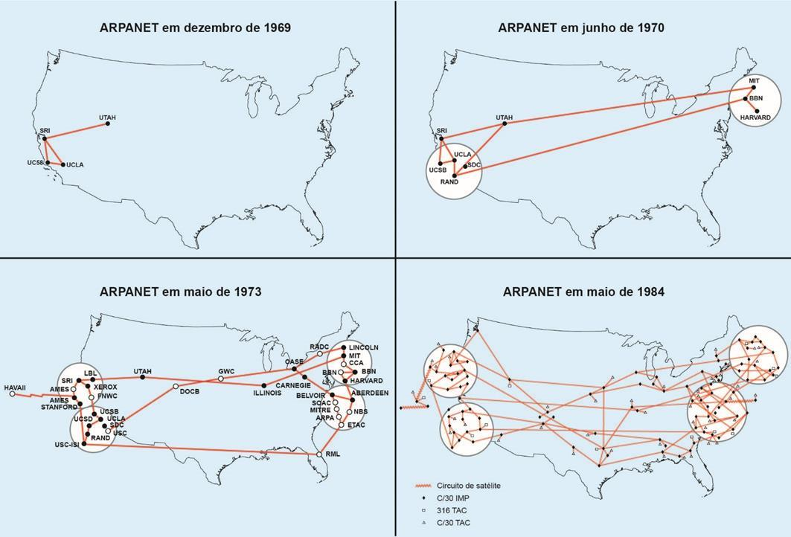
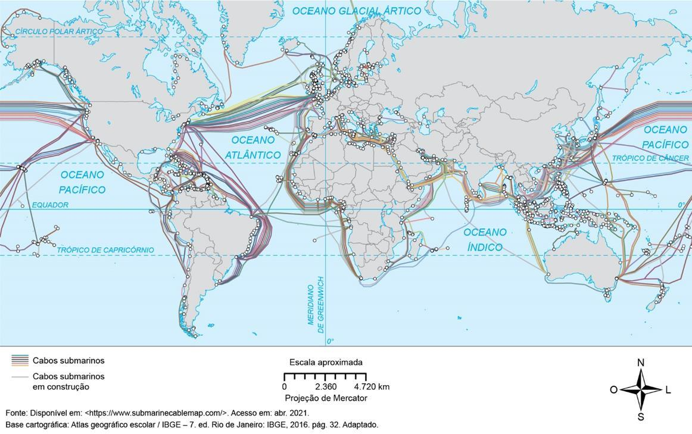
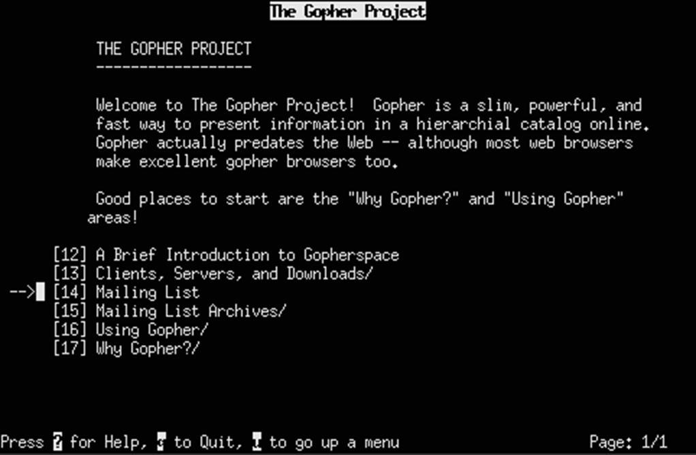
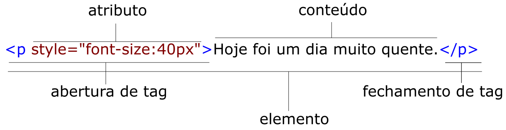

# Ferramentas de Desenvolvimento Web (937563)
## Aula 4 — Desenvolvimento de Site - HTML

> Texto integral da apostila oficial da Uninter (sem resumo). PDF original: [Aula_04.pdf](../_apostilas_pdf/02_Ferramentas_Web/Aula_04.pdf)

FUNDAMENTOS DE DESENVOLVIMENTO DE SOFTWARES AULA 4

Prof. Leonardo Gomes

### CONVERSA INICIAL

Nesta etapa, faremos uma introdução ao HTML, uma linguagem de marcação de texto, que é utilizada na construção de páginas na web. Veremos alguns exemplos práticos que servirão de base para os primeiros passos para o desenvolvimento de websites.

Ao final desta etapa, esperamos atingir os seguintes objetivos, que serão avaliados ao longo da disciplina da forma indicada.

Quadro 1 – Objetivos da aula Objetivos Avaliação 1. Domínio sobre os principais comandos HTML Questionário e questões dissertativas 2. Capacidade para desenvolver páginas web simples Questionário e questões dissertativas 3. Conhecimento prático e teórico sobre a função do HTML como ferramenta de desenvolvimento web.

Questionário e questões dissertativas

### TEMA 1 – INTERNET HISTÓRIA E INFRAESTRUTURA

Neste tópico, vamos discutir o princípio da internet e como é a infraestrutura na qual ela funciona. Assim, entenderemos melhor a necessidade do surgimento do HTML e sua importância.

1.1 História da internet No fim da década de 1960, a primeira rede de computadores surgiu. Chamava-se Arpanet e tinha a finalidade militar de assegurar uma forma segura de transmitir dados em postos de batalha no contexto da Guerra Fria. Ela operava ligando 4 universidades no Oeste dos Estados Unidos da América. Um conceito importante é o de protocolo de comunicação, que são as regras para estabelecer comunicação entre dois ou mais softwares e/ou hardwares. Os protocolos dizem que tipo de mensagens pode ser enviado e

como deve ser o formato dessas mensagens, assim permitindo que a comunicação seja estabelecida sem imprevistos.

Mesmo nesse formato primitivo de internet, já possuía protocolos importantes que são utilizados até os dias de hoje. O protocolo NCP – Network Control Protocol (Protocolo de controle de rede) combinava os demais subprotocolos de comunicação como:

• FTP – File Transfer Protocol (Protocolo de Transferência de Arquivos). Como o nome sugere, é um protocolo para transferência de arquivos, é utilizado até hoje para enviar arquivos de uma máquina para outra; • SMTP – Simple Mail Transfer Protocol (Protocolo Simples de Transferência de Correspondência). É o protocolo por meio do qual trocamos e-mails; • DNS – Domain Name System (Sistema de Nomes de Domínios). Sistema pelo qual os nomes dos sites são associados aos seus endereços de rede. O DNS não é exatamente um protocolo, mas sim um sistema de nomenclatura para computadores. É a estratégia adotada para associar o nome de uma página web, por exemplo, http://www.google.com.br com o seu endereço físico e consequentemente permitindo o trajeto do caminho que os dados devem percorrer. É um elemento importante da infraestrutura da internet até hoje. Em 1973, o protocolo NCP recebeu um grande concorrente, o protocolo TCP/IP, que foi a combinação de dois protocolos desenvolvidos por dois pesquisadores distintos que, em parceria, conseguiram solucionar diversos problemas existentes na época.

O protocolo TCP – Transmission Control Protocol (Protocolo de Controle de Transmissão) apresentou a ideia de quebrar as mensagens transmitidas em pequenos pacotes. Assim, em caso de falha de comunicação, apenas um pequeno trecho se perderia, e a comunicação poderia continuar de onde parou sem maiores prejuízos.

E o protocolo IP – Internet Protocol (Protocolo de Internet) permitiu uma estratégia mais elaborada de endereçamento das máquinas na rede, possibilitando que um grande número de computadores fosse adicionado na rede. Como a Arpanet previa um número relativamente baixo de computadores, a escalabilidade não era um problema, porém, à medida que novos públicos e usos para internet foram surgindo, rapidamente se tornou uma questão

importante.

Em aproximadamente uma década, o protocolo TCP/IP substituiu por completo o NCP, e a constante ampliação da rede mundial de computadores foi ininterrupta desde então. A seguir, nas Figuras 1 e 2 vemos um mapa desta evolução.

Figura 1 – Representação dos primeiros anos da Arpanet nos EUA e seu crescimento

Crédito: João Miguel.

Figura 2 – Representação do mapa do cabeamento submarinos ligando todos os continentes na década de 2020

Crédito: João Miguel.

1.2 Infraestrutura de comunicação Como a internet passou a assumir esse importante papel de interligar diversos computadores, surgiu a necessidade de dedicar máquinas para fornecer serviços à rede. Tais máquinas são chamadas de servidores. Existem diversos tipos de servidores: de e-mails, de arquivos, jogos on-line, banco de dados, páginas web etc. As máquinas que usufruem desses serviços são chamadas de clientes. Assim, estabeleceu-se o modelo de comunicação chamado Cliente-Servidor, que é o mais importante quando se trata de páginas web. Um computador dedicado disponibiliza o conteúdo do website que é acessado por diversos clientes. Os clientes acessam o serviço por meio de seus navegadores, aplicativos, jogos on-line. Enquanto os servidores oferecem o serviço por meio de softwares especializados, no caso das páginas web destacam-se Apache, Tomcat, Glassfish, entre outros.

Figura 3 – Representação da infraestrutura da internet e trajeto da comunicação

Crédito: Eliane Ramos.

### TEMA 2 – PRINCIPAIS TECNOLOGIAS PARA A INTERNET

No princípio, a navegação em páginas web se dava por uma interface de texto apenas, sem cores, imagens, sons ou variações de estilo de texto. O principal software de navegação era o chamado Gopher, que pode ser visto na Figura 4. Eis que então um importante pesquisador chamado Tim Berns-Lee propôs uma nova forma de descrever documentos que permitisse uma interface multimídia que atendesse a todas essas limitações do Gopher. Para isso desenvolveu no início da década de 1990 três importantes tecnologias: • HTML – HyperText Markup Language (Linguagem de marcação de hipertexto): uma linguagem descritiva com a qual é possível criar textos com muito mais recursos de estilo e multimídia chamado hipertexto; • O HTTP – HyperText Transfer Protocol (Protocolo de transmissão de hipertexto): protocolo com o qual os servidores se comunicam com os navegadores para exibir as páginas de hipertexto; • WWW – World Wide Web (Rede Mundial de Computadores): espaço virtual no qual é possível disponibilizar e acessar essas páginas, uma vez que se tenha o endereço web.

Figura 4 – Página web no Gopher, software precursor dos navegadores modernos

O HTML evoluiu bastante desde seu surgimento na década de 1990. No momento da escrita deste documento, a versão 5 é a mais popular. Ela agrega dentro dela diversas tecnologias que eram originalmente ferramentas independentes e se tornaram pilares fundamentais para o desenvolvimento web. São elas o HTML em si, o CSS e o JavaScript. As três linguagens serão tópico de estudo desta e das próximas etapas.

O HTML é o que chamamos de uma linguagem semântica e que se preocupa apenas em descrever o conteúdo da página. Não é, por exemplo, papel do HTML dizer como a página deve interagir com o usuário ou como ela deve se apresentar visualmente, apenas o conteúdo é relevante. É importante observar que não se trata de uma linguagem de programação, mas sim de descrição de documentos por meio do hipertexto.

O CSS – Cascading Style Sheets (Folha de estilo em cascata) é a responsável pela aparência da página, descrever cores, estilo do texto, layout etc. E também não é uma linguagem de programação, pois sua responsabilidade é apenas descrever estilos.

Por fim, o JavaScript, essa sim uma linguagem de programação, é responsável pela interação. A lógica e demais funcionalidades da página podem

ser implementadas aqui; o código, no entanto, é voltado para nível de cliente, ou seja, executa lógicas que podem ser trabalhadas de dentro do navegador do cliente sem interação imediata com dados que estejam no servidor.

### TEMA 3 – PRIMEIRO HTML

O HTML, vale reforçar, não é uma linguagem de programação, mas sim de uma linguagem de marcação de textos utilizada para que o seu navegador estruture adequadamente páginas web. O HTML utiliza uma série de elementos para incluir elementos, envolver ou marcar diferentes partes do conteúdo para que apareça ou aja de uma certa maneira.

Cada trecho que desejamos marcar utiliza uma tag, que do inglês significa etiqueta, e tem esse papel realmente de etiquetar conteúdos com determinado comportamento e marcar que pertencem a determinada classe. Por exemplo, se temos o texto:

Hoje foi um dia muito quente.

e queremos indicar que esse texto faça parte de um parágrafo, podemos colocar o conteúdo entre a tag 
 da seguinte forma:

Hoje foi um dia muito quente.
 Perceba que utilizamos o comando 
 para marcar o início do parágrafo e 
 para marcar o fim do parágrafo. Sem a barra é a tag de abertura e com a barra é a tag de fechamento. Uma tag também pode ser colocada dentro de outra. Se, por exemplo, desejarmos colocar em bold a palavra muito, temos a tag <strong> e ficaria da seguinte forma:

Hoje foi um dia <strong> muito </strong> quente.
 Para realizar seus testes, basta utilizar um editor de texto simples qualquer, no entanto recomendamos o Visual Studio Code, por oferecer diversas facilidades para escrever códigos HTML, CSS e Javascript. Porém qualquer editor de texto serve, basta deixar o arquivo com extensão .html e depois de editado e salvo abri-lo com o navegador de sua preferência.

### Saiba mais

Como alternativa ao editor de texto, temos um dos mais importantes websites para aprendizado de tecnologias de desenvolvimento web, incluindo o

HTML é o w3schools. Nele, além de diversas explicações sobre as o uso das tags, é possível rapidamente fazer testes sem a necessidade de realizar instalação de nenhuma ferramenta adicional.

W3SCHOOLS. Disponível em: <https://www.w3schools.com/>. Acesso em: 16 fev. 2023.

No entanto para testes rápidos outro site ainda mais conveniente e que recomendados bastante é o jsfiddle, que pode ser acessado no link a seguir. Ele combina tanto HTML quanto CSS e JavaScript, que são as três tecnologias que veremos neste estudo:

JSFIDDLE. Disponível em: <https://jsfiddle.net/>. Acesso em: 16 fev. 2023.

Agora que sabemos o que são as tags HTML, veja na sequência como podemos utilizá-las para gerar nossa primeira página HTML. Trata-se de uma página básica composta apenas de um título e um texto sem formatação nenhuma no corpo da página.

<!DOCTYPE html> <html> <head> <title>Título na aba do navegador</title> </head> <body> Texto que vai aparecer no corpo da página </body> </html> A tag <!DOCTYPE html> é uma tag especial, que não tem abertura e fechamento; ela é uma tag solitária e indica qual a versão do html estamos utilizando. No caso da forma que foi descrito, indica que a versão é o html corrente, ou seja, o html5.

Já a tag <html> indica que seu conteúdo é a totalidade da página html em si.

No caso da tag <head> indica o cabeçalho da página e recebe informações que dizem respeito a página como um todo.

A tag <title> indica, por sua vez, o conteúdo que será apresentado no título da página, geralmente na aba do navegador.

Por fim, <body> indica o corpo da página, e todo o conteúdo dela estará presente aqui dentro.

### TEMA 4 – SINTAXE

O principal elemento do HTML são justamente as tags, cuja sintaxe funciona da seguinte maneira:

• Tag de abertura: trata-se do nome do elemento que é apresentado entre os sinais de menor e maior, também chamado de parênteses angulares de abertura e fechamento. A tag indica onde o elemento começa a aplicar o seu efeito. No exemplo dado acima, a tag p foi iniciada marcando o começo do parágrafo; • Tag de fechamento: semelhante à tag de abertura, exceto que inclui uma barra antes do nome do elemento e não é necessário repetir eventuais atributos. Ela representa o fim do elemento. No exemplo, o final do parágrafo; • Conteúdo: como o nome sugere, é o conteúdo da tag. Neste exemplo, é o texto somente; • Elemento: formado pelo conjunto de tudo, a tag de abertura, a de fechamento e o conteúdo; • Atributo: elemento extra que transmite informações adicionais. Quando não é utilizado, a tag apresenta um comportamento padrão. Neste exemplo, o style é o nome do atributo e font-size:40px é o valor do atributo.

Esse atributo define a formatação da fonte do texto para tamanho de 40 pixels.

Ainda sobre o atributo, é importante atentar para suas regras de sintaxe: • É possível que exista mais de um atributo, no entanto é essencial que exista um espaço os separando; • O nome do atributo deve ser sempre seguido do sinal de igual (=) para separar o nome do valor do atributo; • O valor do atributo deve ser sempre envolto por aspas duplas. 4.1 Aninhamento É importante reforçar que podemos também colocar um elemento dentro de outro, o que chamamos de aninhamento. Vamos retomar o exemplo visto anteriormente:

Hoje foi um dia <strong> muito </strong> quente.
 É importante que o elemento que foi aberto mais interno seja fechado antes do elemento mais externo, ou seja, o </strong> precisa vir antes do 
. Se invertermos a ordem dos dois, estaria incorreto.

4.2 Elemento vazio Nem todos os elementos possuem conteúdo, e esses que não possuem são chamados de elementos vazios. Um exemplo importante é o elemento , que é utilizado para colocar uma imagem na página.

 O elemento possui uma tag de abertura com dois atributos, mas nenhum conteúdo e nem tag de fechamento. A finalidade desse elemento é carregar uma imagem na página e não envolver algum conteúdo interno com certo comportamento, por isso basta apenas a tag de abertura.

### TEMA 5 – PRINCIPAIS COMANDOS HTML

Neste tópico, vamos avançar a discussão sobre os principais elementos HTML.

5.1 Cabeçalhos Para dar uma aparência diferenciada e destacar título, subtítulos, cabeçalhos e afins, temos um conjunto de 6 tags HTML. h1, h2, h3, h4, h5 e h6. Sendo h1 o maior destaque, e h6 o menor. A letra “h” indica justamente a palavra header no inglês, que quer dizer cabeçalho. Teste o código a seguir. <h1>Título 1</h1> <h2>Título 2</h2> <h3>Título 3</h3> <h4>Título 4</h4> <h5>Título 5</h5> <h6>Título 6</h6> 5.2 Parágrafos Os parágrafos no HTML utilizam a tag p, que organiza o texto com o espaçamento como em blocos, um abaixo do outro.

Parágrafo com texto 1.
 
Parágrafo com texto 2.
 
Parágrafo com texto 3.
 5.3 Imagens A tag img é a que coloca imagens em páginas html. Ela é uma tag vazia, que não precisa de fechamento nem conteúdo, apenas a tag de abertura, no entanto é importante que ela utilize atributos, especialmente o atributo src, que aponta o arquivo de origem. O atributo alt é opcional, mas muito recomendado. É utilizado para descrever a imagem, o que é útil para tornar a página acessível para quem possua limitações de visão ou por questões ligadas à conexão não possam carregar a imagem. A tag title também é opcional e traz um título para a imagem que é exibida ao colocar o cursor do mouse sobre a imagem, o texto do atributo title aparecerá em uma tooltip – caixa de texto.

 5.4 Links Os links são geralmente utilizados para direcionar o usuário para outra página ao ser clicado, mas também podem levar para outra área da mesma página. A tag é apenas a letra “a” e precisa do atributo href que indica o destino do link. No conteúdo deve estar presente que será exibido.

<a href="outrapagina.html">Outra página</a> 5.5 Tabelas As tabelas são geralmente utilizadas para exibir dados de forma organizada em linhas e colunas. No entanto, é possível utilizar tabela para organizar qualquer tipo de conteúdo. Em versões mais antigas do HTML, as tabelas foram muitas vezes utilizadas para formatar o estilo da página, porém no HTML moderno existem outros meios mais adequados de formatar o layout, e o uso de tabelas basicamente se restringe à organização de dados apenas. A tag table indica a definição de uma tabela, a tag tr indica linhas e td indica a célula da tabela, ou seja, cada dado individual.

<table> <tr> <td>Linha 1 - Coluna 1</td> <td>Linha 1 - Coluna 2</td> </tr> <tr> <td>Linha 2 - Coluna 1</td> <td>Linha 2 - Coluna 2</td> </tr>

<tr> <td>Linha 3 - Coluna 1</td> <td>Linha 3 - Coluna 2</td> </tr> </table> Além destas tags principais, existem também outras que organizam a tabela em cabeçalho com a tag thead; o corpo com a tag tbody; e o rodapé da tabela com a tag tfoot.

<table> <thead> <tr> <th>Mês</th> <th>Valor Arrecadado</th> <th>Participantes</th> </tr> </thead> <tbody> <tr> <td>Janeiro</td> <td>R$ 500,00</td> <td>1</td> </tr> <tr> <td>Fevereiro</td> <td>R$ 350,00</td> <td>2</td> </tr> </tbody>

<tfoot> <tr> <td>Total</td> <td></td> <td>R$ 850,00</td> </tr> </tfoot> </table> 5.6 Listas No HTML, as listas são utilizadas principalmente para organizar um grupo de itens em formato de lista ordenadas. É possível criar três tipos diferentes de lista. com a tag ol a lista é não numerada e com ul a lista é numerada. Opcionalmente a lista pode receber uma descrição com a tag dl. Cada item na lista é indicado com a tag li. Abaixo apresentamos os dois tipos de lista. Também é possível aninhar uma lista dentro da outra, ou seja, criar uma lista no conteúdo de um item de outra.

<ol> <li>Janeiro</li> <li>Fevereiro</li> <li>Março</li> </ol>

<ul> <li>Janeiro</li> <li>Fevereiro</li> <li>Março</li>

</ul> 5.7 Formulários Os formulários HTML são o principal meio utilizado para transmitir informações do usuário para o servidor. Utilizamos a tag form para indicar a área do formulário e dentro dela colocamos todos os elementos de entrada de dados necessários para cada informação. a tag input é utilizada para esses elementos de entrada de dados, e o seu atributo type indica qual tipo específico de dado será utilizado.

<form action="pagina_destino.php" method="post"> <input type="text" placeholder="Digite aqui seu nome">   <input type="radio" name="pais">Nacional   <input type="radio" name="pais">Estrangeiro   <input type="checkbox">Concorda com os termos?   <input type="submit" value="Enviar"> </form>

### FINALIZANDO

Nesta etapa, passamos por um breve histórico da internet, sua importância e como funciona a infraestrutura da internet na qual as páginas web estão inseridas. Demos também nosso primeiro passo com o HTML, uma linguagem de marcação de texto que é base para todo o desenvolvimento de páginas web. Discutimos sua sintaxe e comandos básicos com os quais já é possível dar os primeiros passos para desenvolver suas próprias páginas web.

### REFERÊNCIAS

DEITEL, P. J. A. Rich Internet Applications e desenvolvimento Web para programadores. São Paulo: Pearson Prentice Hall, 2008.

FLASTCHART, F. HTML 5: embarque imediato. Rio de Janeiro: Brasport Livros e Multimídia Ltda., 2011.

FLANAGAN, D. Java Script – O guia definitivo. 6. ed. Porto Alegre: Bookman Companhia Editora ltda.

OLIVEIRA, C. L. V.; ZANETTI, H. A. P. JavaScript descomplicado: programação para a Web, IOT e dispositivos móveis. São Paulo: Érica, 2020. PUREWAL, S. Aprendendo a desenvolver aplicações web. São Paulo: Novatec, 2014.

ZAKAS, N. C. Princípios de orientação a objetos com JavaScript. São Paulo: Novatec, 2014.
