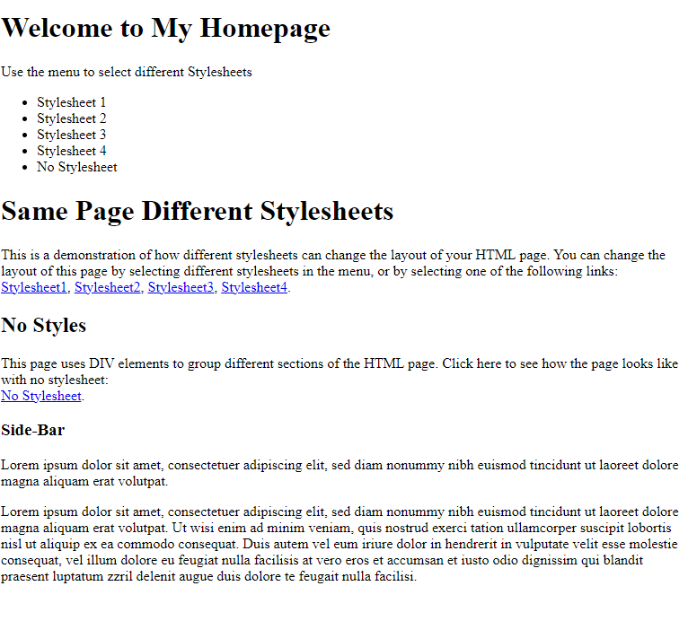
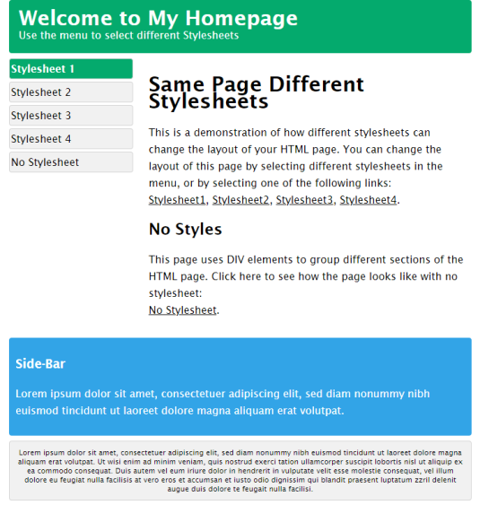
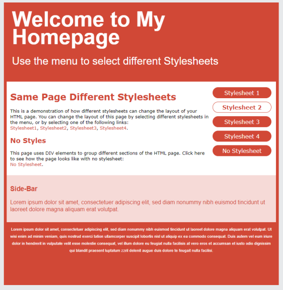
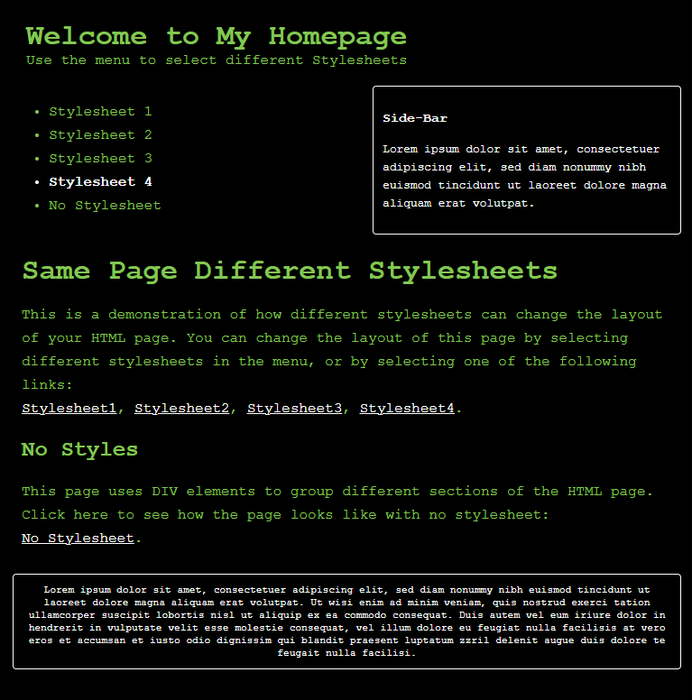
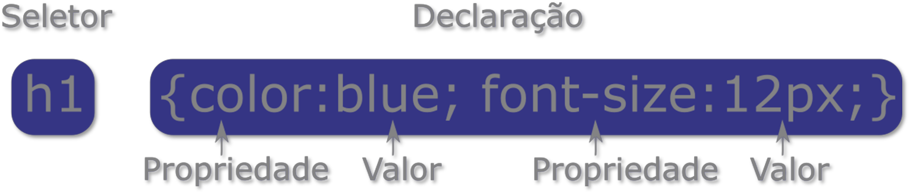

# Ferramentas de Desenvolvimento Web (937563)
## Aula 5 — Desenvolvimento de Site - CSS

> Texto integral da apostila oficial da Uninter (sem resumo). PDF original: [Aula_05.pdf](../_apostilas_pdf/02_Ferramentas_Web/Aula_05.pdf)

FUNDAMENTOS DE DESENVOLVIMENTO DE SOFTWARES AULA 5

Prof. Leonardo Gomes

### CONVERSA INICIAL

Vamos dar continuidade aos conteúdos de desenvolvimento de páginas web discutindo outra tecnologia de muita importância para ditar a aparência das páginas. Essa tecnologia é o cascading style sheets (CSS, folha de estilo em cascata), em que apenas trocando o arquivo CSS de uma página web é possível alterar completamente o layout de um mesmo conteúdo, tecnologia mais relevante para essa função. Vamos aprender tanto a sintaxe geral quanto especificações dos principais comandos da linguagem de estilos.

### TEMA 1 – DEFINIÇÃO DO CSS

O cascading style sheets (CSS, folha de estilo em cascata) controla como os elementos são apresentados na tela, enquanto o HTML diz o que a página deve ter, por exemplo, e indica onde estão os parágrafos, imagens, listas etc. O CSS vai dizer como esses parágrafos devem ser, que fonte de texto utilizam, qual o tamanho da imagem, que cor deve aparecer a numeração da lista e assim por diante.

E quanto ao nome cascata? O que quer dizer? Assim como uma cascata no mundo real é composta por sucessivas quedas d'água, o estilo das páginas segue uma organização similar. É possível criar vários arquivos para definir a aparência da página. Primeiramente, um layout bem genérico de todo o site como um todo, depois um arquivo mais específico descrevendo uma página em particular, outro mais específico ainda para descrever como a tabela deve funcionar dentro daquela página em particular, por exemplo. Cada elemento HTML vai combinando essas instruções de layout seguindo todas tanto quanto possível e, em caso de conflito, optar pela instrução mais específica e menos generalista.

É possível descrevermos HTML e CSS dentro de um mesmo arquivo e colocar tudo em um único arquivo .html. No entanto, como boa prática de escrita de páginas web, é interessante separar em um arquivo .css próprios, tornando, assim, o projeto mais organizado. Pense que, quando uma atualização na página for necessária e ela afetar apenas o estilo da página, somente o arquivo .css correspondente precisará ser modificado.

Em versões mais antigas do HTML, como a versão 3.2, algumas funções de estilo foram adicionadas na linguagem, por exemplo: a tag font servia para

definir fonte de texto, entre outros exemplos. E esse tipo de estratégia para definir estilo se mostrou muito ineficiente pela quantidade de retrabalho gerado. Vamos supor que você tenha um site composto por 50 páginas web diferentes. Cada página web tem seu próprio arquivo .html e, como as páginas pertencem ao mesmo site, a ideia é que todas compartilhem a mesma imagem de fundo, estilo de texto, cores, organização dos botões nas páginas entre outros. Todos esses códigos de estilo eram então repetidos 50 vezes – afinal, são 50 arquivos diferentes e, caso em algum momento no futuro desejássemos trocar o tamanho da fonte, essa mudança deveria ser feita 50 vezes. Vale salientar que, além de ser ineficiente do ponto de vista da quantidade de trabalho envolvido, são 50 oportunidades de um erro acontecer.

Já com o CSS, esse problema do retrabalho na definição do estilo das páginas foi solucionado, uma vez que você pode escrever o estilo das páginas uma única vez, em uma linguagem própria para descrever estilos, e as 50 páginas podem carregar esse mesmo arquivo, evitando retrabalho. Ainda é possível utilizar tags de estilo HTML; pontualmente, pode ser interessante ainda fazer pequenas intervenções dessa maneira, porém, reforçando o que já foi dito, é uma boa prática de desenvolvimento e o estilo deve ser colocado em páginas .css próprias.

Outra vantagem do CSS é que foi criado pela própria World Wide Web Consortium (W3C, Consórcio da Rede Mundial de Computadores), que é a organização composta por um consórcio de diversas empresas, órgãos governamentais e independentes e responsável pela padronização da WWW. E, sendo assim, ela é completamente integrada ao HTML, especialmente a partir da versão 5.

A página da w3schools, além de possuir excelente material sobre html, também detém um rico material sobre CSS. Da página da w3schools, veja um exemplo de uma mesma página HTML modificando apenas o conteúdo do arquivo de estilo CSS

Figura 1 – Representação dos diferentes estilos que uma página pode assumir modificando apenas o CSS sem modificar o conteúdo HTML. A primeira representação no canto superior esquerdo não possui estilo nenhum. O conteúdo original pode ser encontrado no link <https://www.w3schools.com/css/css_intro.asp>. Acesso em: 23 fev. 2023.

### TEMA 2 – SINTAXE

Neste tópico, vamos discutir a sintaxe do CSS, novamente recomendamos para testes o editor de texto do visual studio code ou o site do jsfiddle, por meio do link <https://jsfiddle.net> (acesso em: 23 fev. 2023). Caso você esteja fazendo o teste por um editor de texto, recomendamos criar uma tag  como última coisa dentro do conteúdo da tag head da sua página, tudo o que estiver dentro da tag style será código CSS e não mais HTML. Se estiver testando por meio do jsfiddle, pode editar no documento CSS a parte. Experimente criar no html da página um cabeçalho h1 com algum texto qualquer, por exemplo <h1> sou um teste </h1>. Em um primeiro momento, deverá aparecer em preto, em fonte maior que o texto normal, o conteúdo da tag. Porém, se desejarmos modificar o comportamento das tags h1 em nosso documento, podemos fazer no CSS o código h1 { color:blue; font-size:12px;}. Esse código CSS irá transformar o comportamento das tags h1 para fonte tamanho 12 pixels e cor azul. Vamos analisar em detalhes.

O primeiro trecho dos comandos CSS é o seletor e, como o nome sugere, trata-se da seleção dos elementos afetados. Na sequência entre chaves, vem a declaração, seletor e declaração são separados por um espaço. A declaração pode alterar diversas propriedades – no exemplo, está alterando as propriedades color e font-size, que, respectivamente, modificam a cor e o tamanho da fonte do texto. Perceba que, logo após cada propriedade, vem o símbolo dois-pontos, o novo valor da propriedade em questão. Por fim, ponto-e-vírgula fecha a definição de cada propriedade.

A propriedade color foi alterada para blue – que, do inglês, significa azul. Tem diversas formas de definir cores no CSS, e o nome das cores em inglês é uma dessas formas. A propriedade font-size foi alterada para 12 pixels, mas

existem várias formas de mensurar tamanho de fonte no CSS, e contagem de pixels é uma delas também.

É importante observar que essa mudança afeta todos os componentes com tag h1 na nossa página. Se desejarmos fazer uma seleção mais específica, afetar apenas um único h1 em particular ou uma classe deles, também temos estratégias para isso, que serão abordadas no tópico a seguir.

### TEMA 3 – SELETOR

Neste tópico, vamos debater um dos aspectos mais importantes para se compreender e fazer bom uso do CSS: o seletor. Como o nome sugere, ele seleciona quais elementos html serão afetados por aquele comando. Podemos classificar alguns tipos diferentes de seletores. Veremos cada um deles em maiores detalhes: seletor universal, por tag, por classe e pseudoclasse, entre outros.

3.1 Seletor universal O seletor universal seleciona todos os elementos e é representado pelo asterisco *. Ele é interessante de ser utilizado sempre que desejamos afetar todos os elementos da página – por exemplo, para definirmos a cor de texto verde para todos os elementos, ficaria da seguinte forma:

*{    color:green;} 3.2 Seletor por tag O seletor por tag irá selecionar todos os elementos da página que possuam tag com aquele mesmo nome. No exemplo a seguir, as tags h1 terão a cor do texto modificadas para verde, e os parágrafos terão a cor de fundo alteradas para vermelho.

h1{ color:green;} p{ background-color: red;}

3.3 Seletor por classe Por vezes, queremos selecionar tags específicas que possuem alguma coisa em comum – digamos, por exemplo, que certos parágrafos e cabeçalhos em nossas páginas alertam o usuário de alguma informação essencial e desejamos dar um destaque somente para esses elementos. Então, na hora criarmos o html da página, podemos identificar esses elementos como pertencentes a certa classe alerta e depois, no CSS, modificar as características somente dessa classe. Veja no exemplo a seguir:

<h1 class="alerta"> Leia atentamente</h1> 
 As informações são sigilosas e de suma importância.
 .alerta{ font-weight:bold ; color:red; } Para classificar o elemento html, basta colocar a propriedade class com o nome da classe que você quiser criar. É possível que um elemento pertença a várias classes e, portanto, basta separá-las por espaço, por exemplo < p class="alerta titulo" >. O elemento p pertence, ao mesmo tempo, à classe alerta e à classe titulo. Já no css, é importante marcar o seletor com o ponto . para indicar que se trata de uma classe.

3.4 Seletor por id O seletor por id é feito para identificar individualmente um elemento. Dos vários parágrafos que a sua página possui, um você deseja estilizar de forma diferente dos demais. Para isso, o parágrafo deve ser identificado com a propriedade id, muito semelhante ao que foi feito com o seletor por classe, e, em vez do ponto, no css, o marcador de id será a cerquilha #.  Confira o exemplo a seguir.

 parágrafo 1... 
 
 parágrafo 2... 
 
 parágrafo 3... 
 #invertido{ background-color:black ; color:white; } Importante: não se deve dar o mesmo id para mais do que um elemento. 3.5 Seletor de filhos O seletor de filhos é representado pelo símbolo > (maior que). E o que quer dizer "filhos"? Seriam aqueles elementos que são conteúdos diretamente de um outro elemento. Veja que, em uma página html padrão, todo o conteúdo da página está dentro da tag body – portanto, são filhos de body e, por sua vez, body e head estão dentro do conteúdo da tag html – logo, são filhos de html. No exemplo a seguir, temos uma tag div com id div1 e todos os filhos diretos dessa div específica terão cor de texto azul.

 <h1>Meus parágrafos</h1> 
 parágrafo 1... 
 
 parágrafo 2... 
 
 parágrafo 3... 
 
 
 parágrafo 4... 
 
 parágrafo 5... 

#div1 > p { color:blue;} Neste exemplo, repare que estão sendo selecionadas apenas as tags p que sejam filhos do elemento com id div1 – a tag h1 será ignorada e as tags p, que não são filhos de div1, também.

A propósito, a tag div não possui nenhum efeito sozinha no html, ela serve para gerar divisões lógicas para situações como essa, em que se deseja separar alguns elementos de outros e dar comportamento específico para ele por meio de código css ou Javascript associados. A tag span possui a mesma finalidade – geralmente, div são blocos maiores e span para blocos menores de uma única linha.

Note que o sinal de maior > seleciona somente os filhos diretos, caso desejasse selecionar todos os descendentes, tanto filhos diretos como filhos de filhos, bastaria omitirmos o sinal de maior, no exemplo ficaria. #div1 p { color:blue;} 3.6 Seletor por irmão Outra forma de selecionarmos no css é por irmãos, que entendemos que sejam as tags que estão no mesmo nível hierárquico que também sejam filhos do mesmo elemento-pai. Temos dois símbolos distintos para isso. O símbolo do mais +, que marca o irmão mais próximo, e til ~ que, seleciona todos os irmãos. Confira no exemplo a seguir.

 
 parágrafo 1... 
 
 parágrafo 2... 
 
 parágrafo 3... 
 
 
 parágrafo 4... 
 
 parágrafo 5... 

#par1 + p{color:blue;} #par1 ~ p{color:blue;} No exemplo, temos dois CSS distintos: um com o sinal de + e outro com o sinal de ~. Teste ambos e veja a diferença: no primeiro caso, está sendo selecionado o próximo parágrafo-irmão daquele com id par1 e, no segundo caso, todos os irmãos e não apenas o mais próximo.

3.7 Seletor por pseudoclasse O seletor por pseudoclasse seleciona elementos que recebem determinada classe interna do sistema. Isso acontece mediante certas condições: se o elemento atende àquelas condições, terá a classe e será alterado, caso contrário não. É possível tornar o css um pouco mais interativo com isso. O exemplo clássico de pseudoclasse é o hover, que é marcada quando o elemento está com o cursor do mouse sobre ele. Confira o exemplo a seguir: 
 parágrafo 1... 
 
 parágrafo 2... 
 
 parágrafo 3... 
 
 parágrafo 4... 
 
 parágrafo 5... 
 p:hover{color:red;} No exemplo, os parágrafos que estiverem com o cursor sobre si mesmos mudarão sua cor para vermelho. A lista de possíveis pseudoclasses é bem extensa, e alguns exemplos são:

● :active – para quando um link é está sendo clicado; ● :checked – para quando um checkbox ou radiobutton está marcado; ● :empty – para quando um determinado elemento não tem filhos; e ● :first-child – para quando o elemento é o primeiro filho de seu elemento pai.

Recomendamos o site da w3schools para a listagem completa das pseudoclasses com exemplos.

### TEMA 4 – ORDEM DA CASCATA DE ESTILO

Neste tópico, vamos entender melhor um conceito da precedência da ordem de estilo. Suponha que múltiplas regras CSS estejam afetando um mesmo conjunto de elementos html e que essas regras estejam afetando algumas propriedades em comum: qual regra que vai valer de verdade? Em outras palavras, qual regra terá precedência?

<head>  </head>

<body> 
 Minha Logo 
 
 
 Corpo da página...

 
 </body> Este exemplo contém três regras CSS. Todas as três regras CSS definem a propriedade font-size e duas das regras CSS definem a propriedade font- family. A regra CSS para o elemento body é herdada pelos elementos div, span e p. Além disso, o elemento span possui uma regra CSS direcionada a ele por

sua classe logo e o elemento p possui uma regra CSS direcionada a todos os elementos p. Quais estilos acabam sendo aplicados para os elementos span e p elementos?

Quando o navegador precisa decidir quais estilos aplicar a um determinado elemento HTML, ele usa um conjunto de regras de precedência CSS. Dadas essas regras, o navegador pode determinar quais estilos aplicar. As regras são:

1. A presença do comando !important.

2. Especificidade dos seletores de regras CSS.

3. Sequência de declaração.

Detalhes do que essas regras significam nas seções a seguir. Observe que a precedência CSS ocorre no nível da propriedade CSS. Portanto, se duas regras CSS tiverem como destino o mesmo elemento HTML e a primeira regra CSS tiver precedência sobre a segunda, todas as propriedades CSS especificadas na primeira regra CSS terão precedência sobre as propriedades CSS declaradas na segunda regra. No entanto, se a segunda regra CSS contiver propriedades CSS não especificadas na primeira regra CSS, elas ainda serão aplicadas. Em outras palavras, as regras CSS são combinadas quando possível.

4.1 Comando !Important Se você precisar que uma determinada propriedade CSS tenha precedência sobre todas as outras regras que definem a mesma propriedade para os mesmos elementos HTML, você pode adicionar a instrução !important, a qual tem precedência mais alta de todos os fatores de precedência. Confira o exemplo.

 Texto especial.

 Neste exemplo, a precedência no que diz respeito à propriedade font-size seria a da classe .especial por ser mais específica; no entanto, por conta da instrução !important, tem prioridade a instrução font-size:16px. 4.2 Especificidade dos seletores As prioridades seguem a abstração de uma cascata, daí o nome cascading style sheets (folha de estilo em cascata, CSS). Todos os atributos são aplicados de forma combinada e, em caso de conflito, vale aquele cujo seletor seja mais específico, conforme o Quadro 1 a seguir.

Quadro 1 – Seletores e especificidades Seletor Descrição Estilo herdado Especificidade mais baixa de todos os seletores – trata-se do estilo herdado do elemento-pai.

* Hierarquicamente acima do estilo herdado e abaixo dos demais, temos o seletor universal.

elemento Maior especificidade do que o seletor universal e estilos herdados.

atributo Maior especificidade do que o seletor de elemento.

classe Maior especificidade do que atributos, elementos e seletores universais.

id Especificidade mais alta que o seletor de classe.

Seletor combinado Obtém a especificidade dos seletores combinados. Propriedade definida internamente com atributo style Especificidade mais forte que o seletor de ID.

Por fim, se temos dois atributos conflitantes com o mesmo seletor, o que vale é o que vem por último, pois o que sequencialmente veio depois terá maior prioridade.

### TEMA 5 – PRINCIPAIS COMANDOS CSS

Neste tópico, vamos discutir alguns dos principais comandos CSS e mostrar exemplos de uso.

5.1 Cores As cores no CSS são utilizadas em diversos comandos distintos e existem três formas de representa-las, conforme a lista a seguir.

● Nome das cores em inglês: existe uma lista vasta de nomes de cores em inglês que é reconhecida pelo CSS que internamente substitui por uma cor predefinida, é uma representação muito útil para realizar testes rápidos e tornar o código facilmente legível. Importante notar que não é sensível a maiúsculas e minúsculas, red, Red ou RED vão representar a cor vermelha da mesma forma.

● Valor RGB: a sigla RGB vem das palavras red, green, blue (vermelho, verde, azul) e diz respeito à combinação dessas cores. O padrão RGB é muito famoso e utilizado em diversos outros contextos, especialmente digitais. Quando combinadas, essas três cores-base podem gerar qualquer outra cor do espectro visível, pois a ideia é que cada canal de cor seja representada por um entre 0 e 255 (ou seja, 1 byte para cada canal de cor), e é representado sempre na ordem vermelho, verde e azul; então, por exemplo: RGB (255,105,0) é uma cor que combina 100% de vermelho – por isso o 255, um pouco acima dos 40% de verde – por isso 105, e nada de azul – por isso o valor 0 no fim, o que dá uma cor alaranjada.

● Valor hexadecimal: essa representação é igual a RGB, porém, um pouco mais compacta, em vez de utilizarmos números decimais, utilizamos hexadecimal 2 dígitos para cada canal de cor com uma cerquilha na frente e todos os valores juntos, por exemplo: #00ff00 é igual a RGB (0,255,0), que representa a cor verde.

5.2 Background-color O background-color é um atributo que modifica a cor de fundo do elemento, por exemplo:

body{background-color: lightblue;} body{background-color: rgb(173,216,230);} body{background-color: #add8e6;} Os exemplos anteriores são três formas distintas de colocar a cor  azul- clara no fundo de todo o corpo da página.

5.3 Background-image O background-image é o atributo para colocar uma imagem de fundo nos elementos selecionados. Veja no exemplo a seguir que é necessário colocar, no entanto, o endereço relativo do arquivo contendo a imagem dentro dos parênteses comando url(). Caso o elemento seja maior do que a imagem, ela, por padrão, irá se repetir vertical e horizontalmente. Com a propriedade background-repeat, é possível configurar esse comportamento para que a

imagem não se repita ou seja repetida apenas em um eixo. Os valores para o atributo são: no-repeat, repeat-x ou repeat-y. Respectivamente não repete, repete no eixo horizontal, repete no eixo vertical.

body{ background-image:url("imgs/gatinhos.jpg"); background-repeat: repeat-x; } No exemplo, a imagem gatinhos.jpg, que está localizada na pasta imgs, será adicionada ao fundo do corpo da página e, caso a página seja mais larga do que a imagem, ela será repetida horizontalmente, mas não verticalmente. 5.4 Margin A margem é como chamamos o espaço que fica em volta da borda do elemento HTML, e é possível configurar quanto de espaço vazio desejamos que exista em torno daquele elemento. Confira no exemplo a seguir os atributos margin-top, margin-bottom, margin-right e margin-left, respectivamente a quantidade de pixels que terá de espaço no topo, fundo, direita e esquerda: p{ margin-top:100px; margin-bottom: 100px; margin-right: 150px; margin-left: 80px; } Existem formas mais simplificadas de descrever o tamanho das margens. Caso apenas com o atributo margin seja fornecido com um único valor, ele vale para todos os lados. Se dois valores forem dados, o primeiro irá para as margens verticais e o segundo para as horizontais. E, caso quatro valores sejam dados, daí serão aplicados para as margens superior, direita, inferior e esquerda, nessa ordem.

5.5 Padding O conceito de padding, preenchimento, é semelhante ao da margem, porém, enquanto a margem é o espaçamento externo a partir da borda, o preenchimento é o espaçamento interno a partir da borda.  No exemplo a seguir, vemos que as mesmas lógicas da margem também se aplicam.

p{ padding-top:100px; padding-bottom: 100px; padding-right: 150px; padding-left: 80px; } 5.6 Text align Text-align indica como o nome sugere o alinhamento do texto. Por padrão, todo o texto é alinhado à esquerda, mas podemos centralizar ou alinhar à direita por meio dessa configuração. Veja o exemplo a seguir: os elementos h1, h2 e h3 estão respectivamente alinhados no centro, esquerda e direita: h1{ text-align: center;} h2{ text-align: left;} h3{ text-align: right;}

5.7 Estilização de texto Para configurar a estilização de texto, existem diversos parâmetros que podemos querer configurar, como a família da fonte, tamanho da fonte, estilo itálico ou estilo oblíquo, negrito etc. No exemplo a seguir, demonstramos como esses parâmetros são configurados:

p{ font-family: "Time New Roman",'Times New Roman', Times, serif; font-style: italic; font-size: 30px; font-weight: bold; } No exemplo anterior, vemos o comando que o atributo font-family configura a família da fonte e seus parâmetros. Com font-style, configuramos o estilo, que pode ser tanto itálico como oblíquo; font-size para configurar o tamanho da fonte; font-weight, que dá a espessura das letras, no exemplo, bold quer dizer negrito.

### FINALIZANDO

Aqui, discutimos os principais conceitos envolvendo o CSS, suas aplicações e primeiros exemplos, bem como, em maiores detalhes, sua sintaxe, o seletor e algumas das principais propriedades que podemos manipular por intermédio do CSS.

### REFERÊNCIAS

CSS introduction. W3 Schools, [s. d.]. Disponível em:

<https://www.w3schools.com/css/css_intro.asp>. Acesso em: 17 fev. 2023; DEITEL, P. J. A., RICH. Internet Applications e desenvolvimento Web para programadores. São Paulo: Pearson Prentice Hall, 2008.

FLANAGAN, D. Java Script: o guia definitivo. 6. ed. Porto Alegre: Bookman Companhia Editora ltda.

FLASTCHART, F. HTML 5: embarque Imediato. Rio de Janeiro: Brasport Livros e Multimídia Ltda.

JSFIDDLE. Disponível em: <https://jsfiddle.net>. Acesso em: 17 fev. 2023. OLIVEIRA, C. L. V. JavaScript descomplicado: programação para a Web, IOT e dispositivos móveis São Paulo: Érica, 2020.

PUREWAL, S. Aprendendo a desenvolver aplicações Web. São Paulo: Novatec, 2014.

ZAKAS, N. C. Princípios de orientação a objetos com JavaScript. São Paulo: Novatec, 2014.
