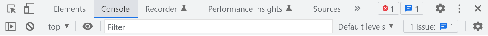

# Ferramentas de Desenvolvimento Web (937563)
## Aula 6 — Desenvolvimento de Site - JavaScript

> Texto integral da apostila oficial da Uninter (sem resumo). PDF original: [Aula_06.pdf](../_apostilas_pdf/02_Ferramentas_Web/Aula_06.pdf)

FUNDAMENTOS DE DESENVOLVIMENTO DE SOFTWARES AULA 6

Prof. Leonardo Gomes

### CONVERSA INICIAL

Faremos uma introdução da linguagem de programação Javascript e sua aplicação no desenvolvimento web. Vamos debater sua sintaxe e manipulação de elementos HTML, seus principais comandos e também uma importante linguagem de notação de objetos, chamada JSON.

Ao final desta etapa, esperamos atingir os seguintes objetivos que serão avaliados da forma indicada.

Objetivos Avaliação 1 – Domínio sobre os principais comandos do JavaScript Questionário e questões dissertativas 2 – Capacidade de gerar interações simples com usuário e elementos HTML de páginas web e desenvolver pequenas soluções utilizando Javascript Questionário e questões dissertativas 3 – Conhecimento prático e teórico sobre a função do Javascript no conceito de desenvolvimento web Questionário e questões dissertativas

### TEMA 1 – HISTÓRIA DO JAVASCRIPT

Neste tópico, vamos contextualizar um pouco da história do Javascript para melhor compreendermos a razão de existir e a relevância dele para o desenvolvimento de páginas web.

1.1 História do JavaScript O Javascript surgiu em 1995 e foi projetado pelo cientista da computação Brendan Eich junto da equipe que desenvolveu o navegador Netscape, um importante antecessor dos atuais navegadores Mozilla e Firefox. A linguagem passou por diversos nomes, como Mocha e Livescript, até chegar no nome Javascript.

Importante observar que o nome Javascript não tem relação nenhuma com a linguagem Java. Apesar da semelhança no nome, ela se dá apenas por jogada de marketing da equipe de Brendan Eich que, aproveitando da popularidade crescente da linguagem Java, escolheu batizar seu próprio produto com um nome semelhante.

A adoção do Javascript pelo Netscape rapidamente solucionou diversos problemas de navegação e se mostrou realmente revolucionária. A empresa Microsoft, com o seu navegador Internet Explorer, rapidamente adaptou uma versão própria do Javascript para si, chamada de JScript. Tanto o Netscape quanto o Internet Explorer foram desenvolvidos baseados no mesmo código fonte de um navegador chamado Mosaic. Portanto, adaptar o Javascript foi uma tarefa relativamente rápida. As duas versões competiram por espaço no mercado até 1997, quando uma versão padronizada do Javascript foi criada para que os desenvolvedores não precisassem criar códigos páginas específicas para cada navegador. A versão padronizada se chama ECMAScript e é mantida pela empresa também chamada ECMA.

Quando falamos de Javascript, JScript e ECMAScript, estamos falando da mesma linguagem; apenas o ECMAScript diz respeito ao padrão em si e as outras duas são variantes da mesma linguagem que respeitam o padrão enquanto introduzem pequenas modificações.

1.2 Para que serve o Javascript Antes do Javascript, as páginas eram completamente estáticas. A única forma de uma página web interagir e mudar qualquer coisa em seu conteúdo para o usuário era por meio da comunicação com o servidor. Em meados da década de 1990, as conexões domésticas geralmente se davam por linha telefônica e modem de 28,8 kbps, muitas vezes mais lenta do que estamos acostumados nos dias de hoje.

Nesse contexto, o Javascript surgiu como a primeira linguagem que atua dentro do navegador do cliente, utilizando processamento local e permitindo realizar pequenas tarefas que não precisam de informação nova do servidor, diminuindo a necessidade de troca de informações apenas para o que for absolutamente necessário, o que acarreta em uma grande vantagem para o cliente, que terá uma navegação mais fluida e menos dependente da conexão – e é bom para o servidor também, que receberá menos solicitações.

Para dar alguns exemplos práticos do que o Javascript é capaz de fazer, segue alguns exemplos:

• clicar no botão “curtir” e a cor do botão mudar, sendo contabilizado um pequeno contador soma um sem a necessidade de recarregar a página; • menus que, ao serem clicados, apresentam submenus; • páginas que carregam conteúdo extra automaticamente à medida que fazemos a rolagem da barra; • pequenas aplicações web como calculadoras, jogos etc.; • validar se determinado parâmetro em um formulário foi preenchido; e • alertas no formato pop-up.

Hoje, o Javascript é adotado em diversos outros contextos. Por exemplo, o Node.Js, da Google, é a implementação do Javascript para ser executado fora do navegador, e se tornou popular como linguagem para servidores de aplicações web. Também é utilizada em um importante framework de desenvolvimento de jogos chamado Unity.

No HTML5, o Javascript é completamente integrado ao HTML e consegue muito facilmente acessar e manipular os elementos HTML da página. Vamos discutir em maiores detalhes como fazer isso nos próximos tópicos desta etapa.

### TEMA 2 – CONFIGURAÇÕES

Vamos discutir três formas diferentes de colocar código Javascript no seu HTML. A primeira forma é dentro da tag script, a segunda é por um arquivo Javascript externo e, por fim, dentro de atributos especiais. 2.1 Tag script Como já foi mencionado antes, o Javascript é complementar ao HTML5. É uma parte integral dele. Portanto, não é necessário fazer uma instalação externa, basta apenas criar a tag script e codificar códigos Javascript no conteúdo da tag. Veja no exemplo abaixo como fica o código HTML com Javascript para abrir um simples alerta com a mensagem: ‘Olá Mundo’.

<!DOCTYPE html> <head> <title>Título</title> </head> <body>  </body> </html> O comando alert é responsável pela mensagem ser exibida em formato de alerta pop-up.

Com relação à tag script, ela pode aparecer tanto como conteúdo da tag head quanto da tag body. Pode também aparecer múltiplas vezes e será executada sempre em ordem de cima para baixo. Como uma boa prática, é melhor colocar sempre no final do body, pois muitas vezes os scripts interagem com os elementos HTML da página, e como eles são carregados de cima para baixo, se o script aparecer no fim é garantido que os elementos em questão já terão sido devidamente carregados pelo navegador.

2.2 Arquivo externo No entanto, é possível também separar o código Javascript em um arquivo externo, o que é uma boa prática de desenvolvimento, pois permite uma maior organização dos códigos, uma melhor divisão do trabalho de desenvolvimento e também associar um mesmo arquivo Javascript com várias páginas HTML distintas, diminuindo o eventual retrabalho.

Para carregar um arquivo Javascript separado, basta no HTML utilizar o atributo src dentro da tag script. O atributo src vem da expressão source, do

inglês origem, ou seja, qual a origem do arquivo que se deseja carregar, qual o endereço dele relativo à página corrente. Veja no exemplo abaixo que o arquivo script.js será carregado. A extensão .js é geralmente adotada para representar códigos Javascript.

Página HTML <!DOCTYPE html> <head> <title>Título</title> </head> <body>  </body> </html> Arquivo script.js alert('Ola Mundo!'); 2.3 Propriedades especiais Como uma terceira forma de carregar código javascript, é possível também colocá-lo entre aspas dentro de certas propriedades especiais, como a propriedade onclick, que quer dizer “ao clicar”. Essa propriedade se trata de um evento que, como o nome sugere, acontece quando o elemento associado recebe um clique e dispara o código associado. Confira o exemplo a seguir, quando o botão recebe um clique e altera o conteúdo do parágrafo.

<body> 
Texto original do parágrafo.
 <button onclick= "document.getElementById('par1').innerHTML='Texto novo'"> Clique Aqui!</button> </body> Note que entre aspas duplas está o código Javascript que irá alterar o conteúdo do elemento HTML que possuir ID ‘par1’. Isso acontece pois o comando document.getElementById seleciona elementos por sua ID e a segunda parte do comando .innerHTML indica que o que se deseja manipular é o conteúdo dentro da tag do elemento selecionado. Por fim, o =’Texto novo’ está atribuindo um novo conteúdo para o elemento.

### TEMA 3 – SINTAXE

Neste tópico, apresentamos uma introdução sobre como funciona o código Javascript. Vamos discutir o conceito de variável e desvio de fluxo de código. A ideia aqui é dar uma noção inicial de como essa lógica de programação funciona no Javascript.

Para facilitar nossos testes, é conveniente utilizar o modo desenvolvedor do navegador. Para o Google Chrome, por exemplo, basta apertar F12 no teclado e buscar por uma aba chamada Console, conforme a figura a seguir: Figura 1 – Modo desenvolvedor, aba console no Google Chrome Com isso, conseguimos interagir com o console do navegador que está executando o interpretador Javascript e escrever mensagens para testes e controle, também chamados de log. Para isso, basta utilizar o comando console.log conforme exemplo a seguir, que irá imprimir a mensagem “Bom dia” no console.

console.log("Bom dia");

3.1 Variáveis Um dos conceitos mais importantes em programação, e que também está presente aqui, é de variável, um espaço de memória com um nome associado no qual guardamos alguma informação. Por exemplo, para armazenar a informação de um nome podemos criar uma variável e atribuir nela o valor que desejarmos. Pode ser atribuído um valor diretamente ou extrair essa informação de um formulário, por exemplo. Confira o exemplo a seguir:

var nome = "Mario"; console.log(nome); nome="Luigi"; console.log(nome); Neste exemplo, criamos uma variável chamada nome, que recebe inicialmente o valor “Mario”. Essa informação então é impressa no console, e depois o valor da variável é alterado para “Luigi”; o valor antigo se perdeu, e agora, quando a mesma variável é impressa novamente, vemos que o valor novo será “Luigi”.

As variáveis podem tanto assumir o valor de textos, chamados de strings no contexto de programação, quanto valores numéricos. No exemplo a seguir, demonstramos isso por meio da variável idade.

var idade; idade=20; idade = idade+1; console.log('Oi ' + nome + ' sua idade: ' + idade); Inicialmente, a variável idade recebe o valor 20. E na sequência esse valor é alterado para o valor original de idade (20) somado com 1, resultando em 21, que será o valor impresso junto ao valor do nome no console. Repare que no exemplo acima o símbolo + tem duas funções distintas: realiza a soma de números e a concatenação de textos para imprimir.

Com relação às variáveis, repare que sempre colocamos a palavra reservada var antes, para indicar que a palavra que se segue será nome de uma variável. No entanto, existem outras duas formas mais modernas e indicadas de fazermos a mesma coisa, que é utilizando as palavras let e const. Elas funcionam de forma idêntica à var, exceto que const indica uma constante, um tipo de variável cujo valor nunca se altera, e let, uma variável que pode sim ser alterada. Por exemplo, você leu a informação do login do usuário, que não deverá ser alterada ao longo da execução do código, então pode ser declarada usando const. Agora, o total da compra vai ser modificado ao longo da execução, então utilizamos let.

Veja no exemplo a seguir que a linha final irá gerar um erro no console, pois estamos tentando modificar uma constante.

const login = "mario@super.com"; let total= 0; total= total+10; login = "luigi@super.com"; 3.2 Comando if Além do conceito de variáveis e constantes, o conceito de fluxo de código também é muito pertinente para a programação de forma geral: todo código que escrevermos será executado em ordem, de cima para baixo, linha por linha. Mas digamos que desejamos que uma determinada linha execute ou não, dependendo de uma condição. Para isso temos o comando if, muito comum em diversas linguagens de programação, e pode ser traduzido como SE, para criar lógicas do tipo: “SE o valor de idade for menor que 18”, determinado bloco de código será executado ou ignorado. Confira no exemplo a seguir esse uso:

var idade = 15; if(idade< 18){ console.log("Acesso bloqueado"); } console.log("Fim"); Nesse exemplo, caso a idade seja menor que 18, o código entre chaves será executado; do contrário, ele será ignorado. Independentemente de ter executado ou não o código associado entre chaves, o fluxo do código volta ao normal e executa o comando que imprime “Fim” na tela.

É possível também fazer um senão, e criar um bloco de código para executar somente quando a condição associada ao if falhar. Fazemos isso utilizando o comando else conforme o exemplo abaixo.

var idade = 15; if(idade< 18){ console.log("Acesso bloqueado"); } else{ console.log("Acesso liberado"); } console.log("Fim"); Perceba no exemplo que o else não requer nenhuma lógica associada a ele, e deve sempre vir imediatamente seguido do bloco do if. 3.3 Comando while Outro comando de muita importância para a lógica de programação é o while, também presente aqui no javascript. Ele é responsável pela repetição de

blocos de códigos. Do inglês while, quer dizer enquanto, e ele tem exatamente essa funcionalidade: enquanto a condição associada for verdadeira, o bloco de código será executado. Confira o exemplo:

var quantidadePessoas = 5;

while(quantidadePessoas >0){ console.log("Bom dia!"); quantidadePessoas= quantidadePessoas-1; } Nesse exemplo, “Bom dia!” será impresso na tela enquanto o valor da variável quantidadePessoas for maior do que zero. Repare que o código associado fará duas coisas: primeiro imprimir a mensagem “Bom dia”, e segunda, diminuir o valor da quantidadePessoas em 1. Então o código vai executar 5 vezes nesse momento quantidadePessoas vai passar a valer 0, a condição associada ao while será falsa e fluxo do código irá continuar. Temos possibilidades ilimitadas para criar lógicas muito complexas e elaboradas, e o objetivo aqui foi dar uma pequena amostra disso. 3.4 Função Outro conceito muito importante dentro da lógica de programação é a função. Basicamente, consiste em você dar um nome para um bloco de código. Assim como a variável é um apelido para um espaço de memória com um valor, a função é um “apelido” para um bloco de código. Sempre que chamamos determinada função pelo seu nome ou “apelido”, a função associada é executada. Confira o exemplo a seguir: a função necessita da palavra reservada function, em seguida deve vir o nome da função, depois abre e fecha parênteses para eventuais parâmetros e por fim abre e fecha chaves com o bloco de código associado.

console.log("Seja bem vindo Mario"); cumprimentos(); console.log("Seja bem vindo Luigi"); cumprimentos();

function cumprimentos(){ console.log("Bom dia"); console.log("Boa tarde"); console.log("Boa noite"); } No exemplo, a função chamada cumprimentos está associada ao bloco de código que imprime “Bom dia”, “Boa tarde” e “Boa noite”. E sempre que escrevermos “cumprimentos()”, o código será executado, o que é uma facilidade para quando desejamos repetir muitas vezes um mesmo bloco de código sem a necessidade de repetir toda sua digitação.

É possível também passar parâmetros para a função. Nesse caso, o bloco de código o executará baseado no valor determinada variável passada por parâmetro. No exemplo a seguir, a idade está sendo passada como parâmetro para a função acesso, e dependendo do valor da variável idade uma mensagem diferente irá aparecer no console.

acesso(17); function acesso(idade){ if(idade<18){ console.log("Acesso bloqueado"); } else{ console.log("Acesso liberado"); } 3.5 Lista Mais um conceito de grande importância na programação são as listas. Como o nome sugere, serve para listar itens de forma ordenada. Digamos que seja interessante armazenar o nome de várias cidades em uma única variável. É possível fazer isso por meio das listas, conforme o exemplo a seguir: var capitaisSul = ["Curitiba", "Florianópolis", "Porto Alegre"]; console.log([capitaisSul[0]]); console.log([capitaisSul[1]]); console.log([capitaisSul[2]]); Conforme o exemplo dado, uma lista chamada capitaisSul foi criada e nela temos três itens. A lista é criada utilizando o colchetes, e cada item é separado por vírgula. Para acessar os itens posteriormente, seja para modificá-los ou ler o seu conteúdo, basta colocar entre colchetes a posição deles iniciando por zero. No exemplo dado, “Curitiba” está na posição 0, “Florianópolis” na posição 1 e “Porto Alegre” na posição 2.

### TEMA 4 – PRINCIPAIS COMANDOS

Neste tópico, vamos discutir como fazemos para o Javascript interagir com os elementos HTML da página. Vamos discutir um tipo especial de lógica que existe dentro do Javascript, chamada de evento.

Para apresentar esse conceito de evento, vamos partir de um exemplo prático primeiro e na sequência destrincharemos em maiores detalhes o que está acontecendo. O código abaixo irá adicionar um evento de “clique” ao parágrafo de id #para, ou seja, no momento que o parágrafo em questão receber um clique, ele irá executar a função que altera seu conteúdo.

Parágrafo com texto 1.
 
Parágrafo com texto 2.
  No começo do código, vemos a criação de alguns parágrafos, sendo que um deles possui a id #para. Na sequência, temos o trecho Javascript que começa criando uma variável chamada paragrafo, que recebe o conteúdo da função document.querySelector(“#para”); Essa função irá selecionar o elemento HTML que possua o primeiro resultado compatível com o parâmetro (no caso #para), ou seja, aqui no exemplo, o parágrafo com aquela id.

Na sequência, estamos adicionando um gerenciador de eventos para o parágrafo, mas que tipo de evento? Aquele passado por parâmetro, no caso, um evento de clique. Ou seja, sempre que o parágrafo receber um clique irá executar a função passada por parâmetro. E a função associada é a trocaTexto, que irá modificar o conteúdo do parágrafo.

Existem diversos outros eventos que podemos configurar além do clique. Para dar alguns exemplos, vemos o que se segue.

• change: quando o elemento HTML recebe alguma alteração.

• mouseover: quando o cursor do mouse passa sobre o elemento. • mouseout: quando o cursor do mouse sai de sobre o elemento. • load: quando o navegador termina de carregar o elemento HTML. • keydown: quando o usuário pressiona uma tecla em seu teclado.

### TEMA 5 – JSON

Neste tópico, vamos discutir o JSON, JavaScript Object Notation, que, traduzido, quer dizer notação de objetos do JavaScript. Essa notação de objetos é a forma JavaScript de descrever e organizar dados e facilitar seu acesso, permitindo colocar as informações com que estamos trabalhando em um formato de texto que seja facilmente compartilhável. Confira o exemplo a seguir: let pessoa = {"nome":"Mario", "idade":31, "pais":"Italia"}; pessoa.nome; pessoa["nome"];

A notação do JSON é bastante simples. Conforme o exemplo, estamos descrevendo uma pessoa, e essa pessoa tem três atributos associados a ela: nome, idade e país de origem. O objeto em si fica entre chaves e cada atributo é separado por vírgula. Cada atributo é composto pela sua chave, que é o nome do atributo e o valor desse atributo. No exemplo anterior, as chaves são: nome, idade e país, e seus respectivos valores “Mario”, 31, ”Italia”. Note no exemplo acima que, para acessar um atributo de um objeto, basta colocar o nome do objeto seguido do ponto e o nome do atributo desejado, ou entre colchetes a string com o nome do atributo.

Para cada objeto, é possível criar quantos atributos se queira e o valor dos atributos pode ser tanto uma string, um número, lista ou até mesmo um outro objeto. A seguir, um exemplo de um objeto mais elaborado.

empresa = { "chefe":{ "nome": "Shao", "sobrenome": "Kahn" }, "funcionarios": [ { "nome": "Liu",   "sobrenome": "Kang" }, { "nome": "Sonya", "sobrenome": "Blade" }, { "nome": "Kung",  "sobrenome": "Lao" }] }; No exemplo acima, temos um objeto chamado empresa que possui dois atributos, chefe e funcionários, O atributo chefe é um objeto em si, enquanto funcionarios é uma lista composta por três objetos. Cada um desses objetos internos da empresa possui os atributos nome e sobrenome. Se quisermos acessar o sobrenome do segundo funcionário da empresa, ficaria: empresa.funcionarios[1].sobrenome Da empresa, estamos acessando a lista funcionários na posição 1 (lembrando que os índices começam pelo zero), e desse funcionário na posição 1 estamos acessando o sobrenome.

5.1 XML Outra linguagem de notação de objetos, concorrente ao JSON, é o chamado XML. Ele funciona de forma parecida com o HTML, por tags, em que o atributo vira nome da tag e o valor é o conteúdo da tag. Confira o exemplo abaixo.

<pessoa> <nome> "Mario" </nome> <idade> </idade> </pessoa>

Tanto o XML quanto o JSON são bastante populares hoje. No entanto, vemos a tendência do XML, que surgiu primeiro, perder espaço para o JSON por esta ser uma notação mais simples de descrever e por conter menos texto, o que acaba sendo mais rápido de transmitir pela rede.

### FINALIZANDO

Nesta etapa, discutimos o Javascript no contexto do desenvolvimento web. Iniciamos falando da sua história e as funções do Javascript, depois continuamos a conversa explicando melhor a configuração e as diferentes formas de utilizá-lo em conjunto com nossa página. Depois falamos sobre os principais conceitos de programação e como é a sintaxe desses conceitos aqui no Javascript. Na sequência, discutimos os principais comandos que fazem o Javascript interagir com a página web e, por fim, falamos sobre a notação de objetos Javascript, também chamada de JSON.
