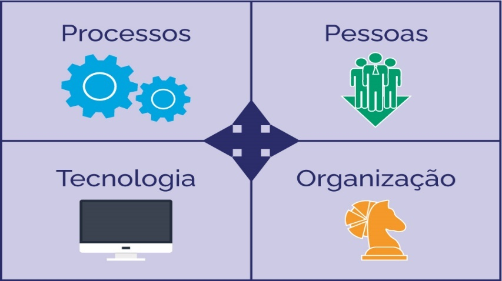
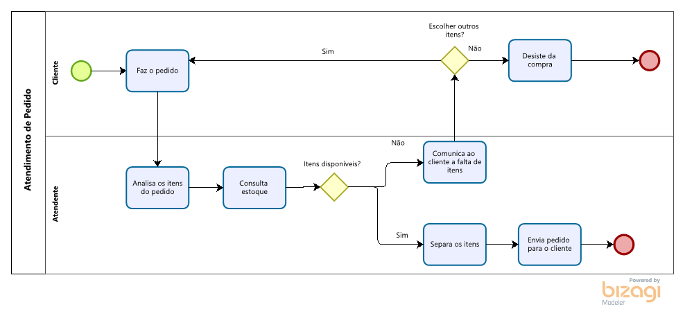
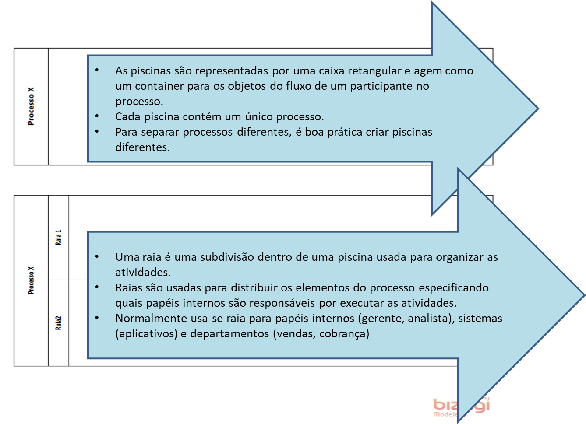
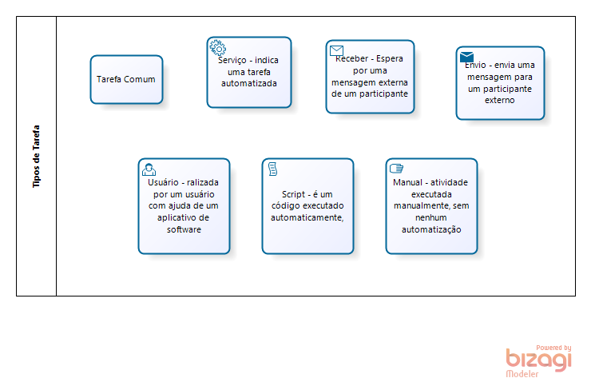
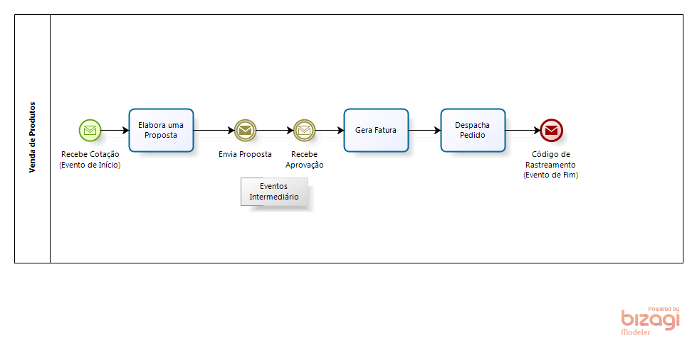
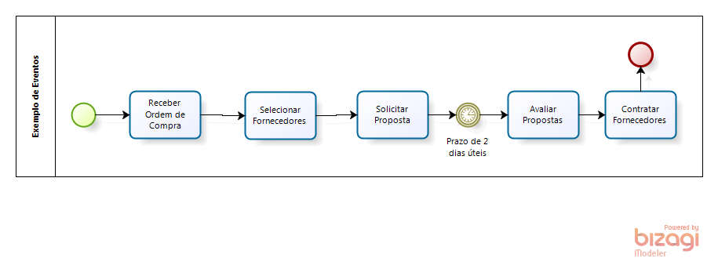
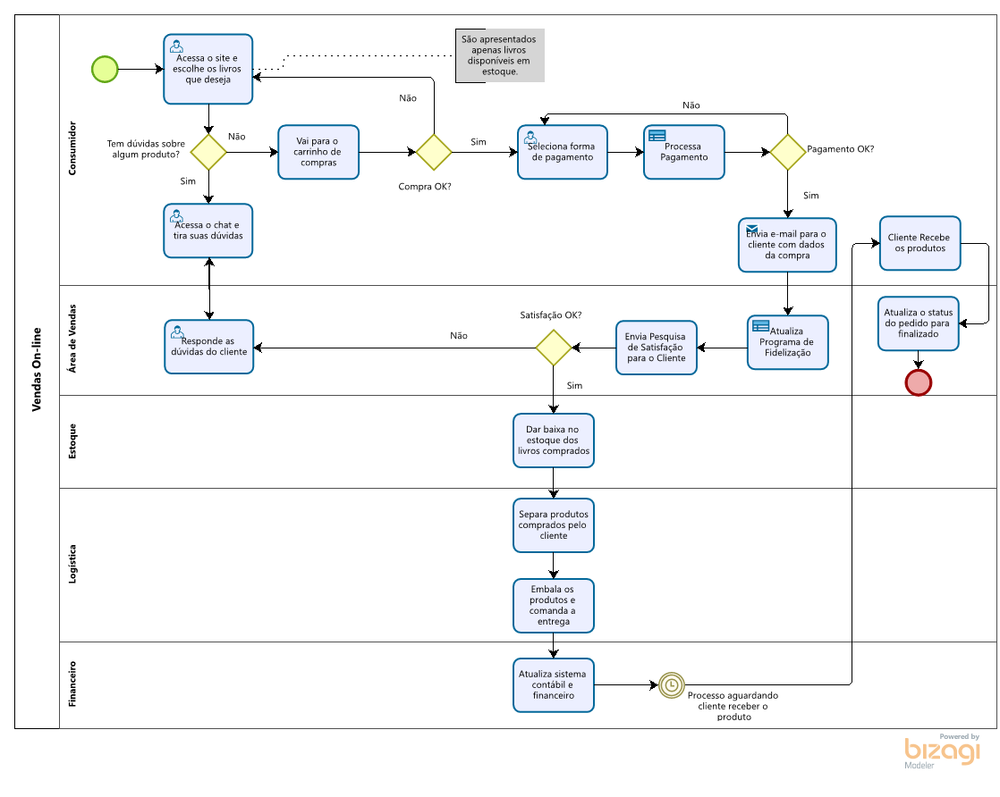

# Análise e Modelagem de Sistemas (937893)
## Aula 1 — Processos de Negócio e Notação BPMN

> Texto integral da apostila oficial da Uninter (sem resumo). PDF original: [Aula_01.pdf](../_apostilas_pdf/03_Analise_Modelagem/Aula_01.pdf)

ANÁLISE DE SISTEMAS AULA 1

Profª Adriana Bastos da Costa

### CONVERSA INICIAL

A temática de nossos estudos é fundamental para todo profissional que deseja desenvolver um software, pois é a disciplina que permite ao aluno traduzir, por meio de modelos e documentação específica, as necessidades de negócio do cliente em um projeto técnico de software . É a disciplin a que apresenta a necessidade de planejar tecnicamente um software antes de ele ser codificado para que os objetivos de negócio do cliente sejam atendidos. Nesta aula, vamos entender o que são processos de negócio e vamos discutir como representar os processos de negócio em formato de fluxo, para simplificar o entendimento do que será automatizado por meio de um software. Esta aula estará organizada em cinco grandes temas, sendo eles: 1. Entendendo o que são processos de negócios; 2. Mapeando os processos AS IS e elaborando o processo TO BE; 3.  Conhecendo e aplicando a notação BPM em processos de negócio; 4. Aprofundando a notação BPMN; 5. Analisando um exemplo de modelagem de processo.

### TEMA 1 – ENTENDER O QUE SÃO PROCESSOS DE NEGÓCIO

É comum ouvirmos falar em processos de negócio quando estamos buscando compreender como funciona uma empresa. Mas , afinal, o que é um processo de negócio? Ele  pode ser definido como um conjunto de tarefas estruturadas e relacionadas, o qual  tem como objetivo produzir um serviço ou produto específico. Esse produto ou serviço é entregue a um cliente específico ou um conjunto de clientes (Paim et al., 2009), ou seja, todo processo de negócio tem como objetivo gerar um produto ou serviço. Dessa forma, um processo de negócio que não gera um produto ou serviço não tem razão de existir. Baseado nisso, podemos entender que t oda empresa executa um conjunto de atividades para alcançar seus objetivos, o tempo todo. Por exemplo, as atividades de: a tender aos pedidos de compras , contratar funcionários, desenvolver novos produtos, comprar matéria-prima, fabricar produtos, contratar fornecedor são atividades que podem ser agrupadas em processos, envolvendo mais de uma pessoa em mais de um momento.  O termo p rocesso de negócio serve para nomear qualquer processo dentro de uma organização.

Vamos compreender melhor esse conceito. Imagine que você esteja comprando um carro. Já parou para pensar em todas as etapas e pessoas que foram necessárias para que o carro chegasse  até você, desde o processo de fabricação em si, passando pelo processo de logística que fez o carro chegar à concessionária, passando pelo processo financei ro e contábil e indo até o processo de faturamento, onde você efetivamente pagou pelo carro?  Não se esqueça do processo de controle de qualidade, da revisão e limpeza do carro, e da entrega efetiva para você. Podemos imaginar quantos procedimentos, atividades, normas e regras foram necessárias para que o carro fosse construído com sucesso e com a qualidade esperada.

Qualquer empresa, seja ela pequena ou grande, possui um conjunto de profissionais e departamentos que colaboram entre si para a entrega de algu m produto/serviço. No fluxo de um processo de negócio estão envolvidos profissionais, departamentos, sistemas, máquinas, matéria-prima e várias outras entidades que permitem que o processo seja executado da melhor maneira possível, de forma a entregar um produto ou serviço que atenda às necessidades dos clientes (Becker; Rosemann; Von Uthmann, 2000).

Pensando um pouco mais sobre o processo de comprar um carro, você consegue identificar quantos departamentos, tanto da montadora quanto da concessionária, foram envolvidos? Pois é, o caminho é longo e,  para que tudo funcione de forma adequada, é preciso que todo o fluxo esteja bem estruturado, evitando tarefas desnecessárias e garantindo que nada esteja faltando no fluxo, para que o carro seja fabricado e entregue ao cliente da forma mais rápida e eficiente possível.

Resumindo, processos de negócios podem ser entendidos como um conjunto sequenciado de tarefas que são executadas utilizando-se de insumos de entrada, processando essas entradas e gerando uma saída, que é um produto ou serviço.

Figura 1 – Processos de negócio

Vamos explorar um pouco mais os processos de negócio.

1.1 Classificando os processos de negócio Como visto anteriormente, um processo de negócio gera um produto ou serviço específico. Dessa forma, é possível entender que tudo o que é feito em uma empresa pode ser entendido como processo de negócio, sejam processos internos, que alimentam outras áreas da empresa, ou processos externos, que geram resultados para os clientes finais.

Assim, é comum classificar os processos de negócios em três categorias, dependendo do seu objetivo final, como processos primários , processos de suporte e processos gerenciais (Paim et al., 2009).

1.1.1 Processos primários Os processos primários, também conhecidos como processos finalísticos, são os processos essenciais de uma empresa, que representa m as atividades que uma empresa desempenha para cumprir sua missão. Pode- se destacar como processo primário a criação de um produto, a venda de um serviço, a realização de uma campanha de marketing ou qualquer outro processo cujo objetivo da saída seja atender à necessidade de um cliente do negócio. 1.1.2 Processos de suporte Os processos de suporte são aqueles processos que oferecem  algum apoio e suportam os processos primários. Ou seja, os processos de suporte facilitam ou viabilizam o caminho para que os processos primários possam ser executados. Os processos de suporte estão em todos os departamentos, sempre com o objetivo de apoiar o negócio final. O processo de contratação de profissionais do departamento de RH é um processo de suporte, pois garante que a área de produção tenha profissionais especializados para criar e construir os produtos que serão vendidos pela empresa.

1.1.3 Processos de manutenção O processo de manutenção de software do departamento de TI é um processo de suporte, pois garante que os softwares  necessários para automatizar a construção dos produtos da empresa estejam disponíveis e

funcionando adequadamente. Os processos da limpeza e segurança também são processos de suporte, pois garantem um ambiente de trabalho agradável e seguro, facilitando o trabalho de todos os profissionais e contribuindo para a qualidade do produto final gerado pela empresa.

Os processos gerenciais , por sua vez, são processos criados para coordenar e controlar as atividades da empresa. O grande objetivo des ses processos é gerir melhor  e garantir a execução adequada dos  processos primários e secundários, traçando planos e garantindo o atingimento das metas estratégicas definidas pela empresa. Dessa forma, os processos de governança, processos de gestão de projetos e até mesmo os processos de ges tão empresarial da área de negócio como um todo são processos gerenciais da empresa.

1.2 Documentando os processos de negócio Os processos de negócio servem para formalizar a visão da empresa sobre sua forma de funcionamento, ou seja, organizam como as empresas funcionam. Uma montadora de carros tem como objetivo final projetar, construir e fabricar carros, porém cada montadora faz isso de uma forma diferente. Os processos ajudam a implementar a estratégia do negócio  – a visão, missão e valores da empresa são colocados em prática por meio dos processos. Por isso, os p rocessos são ativos de grande valor para a organização, pois o diferencial competitivo de uma empresa está refletido nos seus processos. Fica claro, então, perceber que os processos refletem como a empresa funciona, e que processos bem definidos refletem a qualidade do serviço ou do produto que será entregue ao cliente. Em última instância, os processos são responsáveis pela criação de valor na perspectiva do cliente. No entanto,  nem sempre os processos de negócio são formais e documentados e, em muitos casos, não são definidos de forma clara.

Dessa forma, uma empresa deixa que a sua forma de funcionamento esteja apenas na mente de seus colaboradores . Uma modelagem clara, documentada e conhecida por todos dos processos é muito importante para que exista uma alta eficiência na empresa, padronizando o resultado dos processos, de forma que qualquer profissional consiga seguir o passo a passo e gerar um resultado com a mesma qualidade esperada.

Você já comeu sanduíche no McDonald’ s? Independentemente da loja onde você compre o sanduíche, você sabe o que esperar. Não importa se você gosta ou não do McDonald’ s, você sabe o sabor que o sanduíche terá, não é mesmo? Pois é, essa padronização de resultado é fruto de um processo definido e conhecido por todos os profissionais que trabalham no McDonald’s. A importância de ter processos definidos e conhecidos por todos é permitir que os colaboradores que vão executar os processos conheçam o passo a passo que devem seguir, e os clientes conheçam o resultado esperado quando compram um produto ou serviço de uma determinada empresa.

Não é fácil ter processos documentados e formalizados sobre o negócio de uma empresa. Muitas vezes uma empresa funciona, porém ninguém conhece em detalhes a totalidade dos processos , pois esses processos são executados por diferentes profissionais que conhecem apenas sua parte sem ter a visão do todo. Nesses casos, a perda ou a troca de profissionais pode ser muito custosa para a empresa, pois se perde também o conhecimento de parte do processo. Além disso, para mudar e melhorar um processo de forma a atingir melhores resultados, é preciso conhecer os detalhes desse processo, o passo a passo até chegar ao resultado final. Um processo mal definido ou mal executado pode gerar sérios prejuízos para uma empresa. Por exemplo, vamos voltar ao caso da montadora de carros que citamos no início desta aula: o que aconteceria se, no processo de fabricação, fosse col ocada uma peça errada no motor do carro? Provavelmente, depois de fabricar uma grande quantidade de automóveis, haveria a necessidade de recall  e conserto des ses automóveis, causando grandes custos para a empresa, financeiro e de imagem. Dessa forma, uma e mpresa que almeja alcançar o sucesso deve conhecer como funciona o mapeamento e a gestão dos processos. Vamos ver como mapear os processos no próximo tema desta aula.

### TEMA 2 – MAPEANDO OS PROCESSOS AS IS E ELABORANDO O TO BE

O primeiro passo no mapeamento e na gestão de processos é justamente identificar processos. P arece óbvio, mas nem sempre é simples identificar os processos, pois um processo pode passar por vários departamentos e ser executado por diversos profissionais, dificultando assim o entendimento de todos os passos envolvidos desde seu início até sua finalização. Portanto, p ara identificar o processo, é preciso antes saber quais são as características de um

processo. De acordo com Ogunnaike e Ray (1994), as principais características de um processo são:

• Processo é uma junção de atividades e recursos; • Processo é voltado à realização de um objetivo global; • Processo é orientado para o cliente final; • Processo é reforçado de maneira recorrente, para virar hábito; • Processo deve ter desempenho, organização e responsabilidades; • Processo é uma organização estruturada de tarefas; • Processo tem e ntrada e processamento, para gerar um  resultado como saída.

Identificando um processo, é possível mapeá -lo em forma de fluxo, para ter a visão completa da sua extensão, mostrando o passo a passo, os envolvidos e como ele é executado. Para isso, vamos entender o que é a técnica AS IS para modelagem de fluxos de processos.

2.1 Entendendo o que são os processos AS IS Após identificar um processo, é preciso mapear os passos que são executados do seu início até sua finalização. Esse mapeamento é chamado de AS IS (traduzindo para português, seria um sinônimo para como é), ou seja, é a identificação dos passos do processo como ele é executado no momento do mapeamento.

A técnica de mapeamento de processos AS IS envolve o levantamento e a documentação da situação atual do processo, a qual é representada em um fluxo. Durante o mapeamento dos processos AS IS , é possível identificar também   os problemas, falhas ou fragilidades, assim como as oportunidades de melhoria do processo.

Para mapear o processo AS IS , é preciso entrevistar as pessoas que executam o processo ou mesmo analisar a execução do processo presencialmente. Por isso é preciso identificar todos os profissionais que de alguma forma interagem com o processo, para ter a visão completa de todos os passos e de como es ses passos são executados. É importante realmente entender como o processo é executado no dia a dia, para que não haja nenhum problema no mapeamento do processo, buscando sempre ser o mais fiel possível à realidade. Em algumas situações é importante também que clientes e

fornecedores participem das entrevistas, para que a visão do processo fique ainda mais completa (Rosemann; Brocke; Honorato, 2013).

Não é raro encontrar resistência por parte de quem executa o processo no momento de mapeamento. Isso ocorre, muitas vezes, porque os profissionais têm medo de serem substituídos por processos automatizados ou mesmo para não demonstrar alguma falha no trabalho que é executado.  Por isso, o analista de negócio responsável pelo mapeamento do processo AS IS deve ser sensível para entender os pr oblemas, empático para passar tranquilidade para os entrevistados e atento a todos os detalhes. Os envolvidos na execução do processo AS IS são também chamados de atores.

Dessa forma, o objetivo principal do analista de negócios é tentar extrair o máximo dos atores durante o mapeamento do processo, fazendo o cotejo entre as respostas recebidas para garantir que o processo está coerente e completo. Por conta das dificuldades que podem ser encontradas e para garantir que o processo AS IS é fiel à realidade da empresa, é preciso tomar alguns cuidados no momento do mapeamento do processo, tais como:

• Sempre fazer a documentação junto aos gestores , para garantir a aderência ao que realmente é feito no dia a dia; • Conversar com os gestores sobre as melhorias e possíveis ganhos que são esperados , além de entender se no futuro o processo continuará sendo executado. Isso ajuda a identificar as falhas que devem ser corrigidas no processo TO BE; • Definir o padrão de notação para o mapeamento e a ferramenta que será utilizada, para garantir o padrão do mapeamento de todos os processos . Atualmente o padrão mais adotado é o BPMN ( Business Process Model and Notation), por ser um padrão de fácil compreensão e utilização. Para garantir o entendimento completo do processo e entender o fluxo de todas as  atividades, é necessário aplicar questionários  para coletar a maior quantidade possível de informações. Para aumentar a rapidez, a qualidade e a assertividade na documentação, m uitas vezes é interessante juntar todos os envolvidos no processo para coletar as informações, já verificando pontos contraditórios ou faltantes para o entendimento do processo como um todo. Outro ponto importante e que é uma característica fundamental de um bom analista de negócios é a visão crí tica e questionadora, para identificar

problemas que precisam ser resolvidos. Os problemas identificados em um processo podem ter origem em vários itens diferentes, como problemas relacionados a burocracia, falta de planejamento, atividades  desnecessárias, prazos inadequados, riscos não tratados , baixo desempenho dos resultados , altos custos de execução e controles não oficiais da empresa, atrapalhando a padronização e a previsibilidade dos resultados.

2.2 Elaborando os processos TO BE Após mapear o processo AS IS, ou seja, identificar e entender como o processo é executado no momento da modelagem, fica mais fácil propor correções de falhas e melhorias para deixar o processo mais eficiente e ágil. Para propor um novo processo de negócio ou melhorias no processo já existente, é utilizada a técnica TO BE , quando são realizadas discussões, definições e documentação da proposta de situação futura para o processo. Essa proposta também é representada por meio de um fluxo , que pode ser chamado de redesenho ou modelagem.

Nessa fase da elaboração do processo TO BE , é fundamental a participação das pessoas que realizam as tarefas no dia a dia, como também dos gestores e outras pessoas com experiências que possam enriquecer o processo (Rosemann; Brocke; Honorato, 2013). Tudo isso é importante para que a melhoria proposta para o processo realmente traga os ganhos esperados. Melhorar um processo sem um propósito claro, apenas pelo fato de melhorar, não é recomendado, pois não trará os ganhos necessários para o negócio, além de gerar um custo adicional de difundir e treinar os profissionais na execução do novo processo.

Para que o processo TO BE seja útil e traga os benefícios esperado, é importante reforçar alguns passos que devem ser realizados, tais como: • Trabalhar de forma priorizada com pequenos blocos do processo, para que melhorias controladas sejam propostas; • Cuidar para que apenas pessoas que possam contribuir para melhorar o processo estejam nas reuniões de elaboração do TO BE, evitando dessa forma pessoas apegadas com o processo antigo e que possam atrapalhar a visão de melhorias para o processo futuro;

• Evitar pensar nas restrições ou limitações, mas sim em como o processo deveria ser , simplificando ao máximo  as tarefas que fazem parte do processo; • Validar com a alta gestão toda nova sugestão para o processo, garantindo que a visão e estratégia da empresa estão sendo respeitados. Algumas vezes, não é fácil pensar em formas diferentes de executar o processo, pois o modo de fazer está tão arraigado que se perde a visão ampla do negócio. Para quebrar a falta de criatividade e deixar as ideias fluírem, é fundamental que o analista de negócio responsável pela elaboração do processo TO BE incentive os participantes com as seguintes perguntas: • O que é feito que não apresenta valor para o processo?

• O que não é feito, mas apresenta valor para o processo?

• O que é feito de uma forma que não traz o resultado esperado? • O que é feito além do que é esperado?

• O que pode ser eliminado?

• O que pode ser substituído?

• O que pode ser adicionado?

• O que pode ser melhorado?

• O que pode ser unificado?

• O que pode ser paralelizado para ser executado mais rapidamente? É interessante que, com esses questionamentos e a reflexão de todos os envolvidos no processo, é estimulada a busca por pontos de melhoria para aumentar a produtividade, diminuir os custos e em muitos casos, melhorar o produto final, ou seja, o resultado que é gerado pelo processo em si. É importante que todas as sugestões  sejam devidamente documentadas , que responsabilidades sejam definidas e que seja organizado um cronograma para implementação do novo processo, deixando claros os ganhos esperados para cada melhoria proposta.  Os ganhos esperados podem ser medidos após a implantação do novo processo, para avaliar se o processo proposto é eficaz ou não ao que se propôs.

Com o novo processo mapeado e documentado , fica mais fácil treinar novos profissionais nas suas tarefas, além de manter contínua a preocupação com a melhoria produtiva dos processos, sempre buscando maiores ganhos para o negócio.

### TEMA 3 – CONHECENDO E APLICANDO A NOTAÇÃO BPMN EM PROCESSOS

DE NEGÓCIO Estudamos até agora que é preciso identificar e entender o funcionamento dos processos para conseguir identificar falhas ou pontos de melhoria. Toda a gestão dos processos só é possível se os envolvidos no processo entenderem os fluxos modelados, identific ando as tarefas realizadas, assim como a ordem de execução e os relacionamentos entre elas. Para que todos os envolvidos consigam entender o processo modelado, é preciso usar uma linguagem única de fácil leitura e compreensão de todos.

Essa linguagem única ou notação é baseada na disciplina BPM (sigla que em português significa modelagem de processos de negócio) , que é a mais utilizada atualmente para modelar e fazer a gestão dos processos de negócios. O BPM é , portanto, uma disciplina de gestão própria para entender o funcionamento dos processos de negócios que considera os seguintes pontos: • As pessoas e as formas como elas trabalham juntas; • O mapeamento, análise, redesenho e implantação de processo de negócio; • O cumprimento de objetivos que os processos devem sustentar (ligação entre os processos e a estratégia); • O gerenciamento dos processos de ponta a ponta, do seu início até sua finalização, gerando o resultado esperado; • Mudanças na organização para suportar o gerenciamento de processos, podendo sugerir até novos papéis e responsabilidades.

Resumindo, então, o BPM combina processos de negócio, pessoas, tecnologia e organização para criar uma visão única e integrada de negócios.

Figura 2 – Visão do BPM, unificando os processos com as pessoas que os executam, por meio de tecnologias trazendo uma organização para o negócio

Créditos: Kozhedub_NC/Shutterstock.

O BPM propõe a notação BPMN  (que, em português, significa notação para modelagem de processos de negócio) , que é amplamente utilizada pelos analistas de negócio e de fácil entendimento por todos os envolvidos com processos de negócios.

O BPMN possui uma notação gráfica que  facilita a comunicação e o entendimento dos processos, por ser uma notação única e de fácil leitura por todos (Pizza, 2012). Atualmente, a BPMN  está na sua versão 2.0.  e pode ser encontrada em várias ferramentas de modelagem ou até mesmo ser usada manualmente por analistas de negócios.

A notação BPMN é composta de vários elementos que possuem objetivos distintos e que ajudam na modelagem dos processos de negócios, representando os passos envolvidos na execução dos mesmos desde o seu início até sua finalização. A forma como o processo é modelado pode interferir do resultado gerado, portanto, reforçando o que foi dito anteriormente, é fundamental manter a aderência ao processo executado no dia a dia. Vamos agora conhecer os elementos que fazem parte da notação BPMN.

3.1 Visão macro do BPMN O objetivo do BPMN é modelar processos utilizando elementos conhecidos e que representem o encadeamento de eventos/atividades , mostrando como começa um processo, quais os passos e a ordem de execução destes passos e como ele é finalizado. Todas as partes do processo , ou os passos, se ligam por meio de conectores (Silver; Richard, 2009). Veja o exemplo de fluxo a seguir: é possível ler e entender o que faz esse fluxo? Figura 3 – Fluxo do processo de atendimento de pedido de cliente

Fonte: Costa, 2021; Bizagi.

Vamos detalhar o  fluxo apresentado? Antes de tudo, este fluxo foi modelado utilizando a ferramenta Bizagi Modeler, que é uma ferramenta gratuita para modelagem de negócios. Existem outras ferramentas no mercado, tanto gratuitas quanto pagas. Escolha a que melhor atendê-lo. O importante é que a ferramenta utilize a notação BPMN para facilitar o entendimento e a divulgação dos fluxos modelados.

Esse fluxo apresenta a sequência de passos que são executados para atender ao pedido de um cliente , começando pela solicitação do cliente, passando pelo atendente analisando se os itens do pedido estão corretos, se os itens estão disponíveis no estoque. Com es sa verificação, é apresentado um ponto de decisão no processo, em que o processo principal pode ser dividido em

mais de um caminho, ou seja, o caminho chamado de caminho feliz , quando o objetivo do processo foi atendido (o item escolhido pelo cliente está disponível para venda) e o caminho alternativo, quando o processo não pôde atender ao seu objetivo (o item escolhido pelo cliente não estava disponível para a venda, não sendo possível então atender ao pedido do cliente).

Portanto, neste fluxo é possível entender como o processo de atendimento de um pedido de cliente funciona nes sa empresa, m ostrando os envolvidos, ou atores do processo (cliente e atendente) e os passos que são executados até a conclusão do processo. Por conta da necessidade de negócio, esse fluxo possui duas finalizações: uma que ocorre quando o pedido é atendido e outra quando não é possível atender ao pedido. Ou seja, o fluxo mostra exatamente como o processo ocorre, com todos os passos seguidos e as consequências a partir de decisões que precisam ser tomadas, além de mostrar quem executa cada uma das tarefas modeladas.

Agora vamos detalhar um pouco mais cada um dos elementos apresentados.

3.2 Elementos do BPMN Para compreender exatamente como modelar processos usando a notação BPMN, vamos entender para que serve cada um de seus elementos. Começando pela organização do que a notação chama de pis cina e raia, conforme explicado a seguir:

Figura 4 – Diferença entre piscina e raia, no BPMN

Fonte: Costa, 2021; Bizagi.

Dentro de cada raia, podemos utilizar elementos como:

• Evento de início (verde) ou de fim (vermelho) – círculo: são eventos que mostram qual ator inicia e finaliza um processo. Um processo pode ter mais de um início e mais de um fim, caso seja necessário. Por exemplo, um processo pode ser iniciado por contato telefônico ou por acesso a um site, e pode ser finalizado utilizando-se de mais de um caminho diferente, mostrando as opções de finalizações possíveis, dependendo da situação de decisão escolhida.

Figura 5 – Evento de início ou de fim

• Atividades ou tarefas – retângulo: representam um trabalho realizado em uma etapa do processo de negócio. É um passo do processo. As atividades são sequenciais e uma atividade chama a próxima atividade, mostrando como elas estão relacionadas.

Figura 6 – Atividades ou tarefas

• Fluxo de sequência  – seta: o conector de fluxo de sequência é representado por meio  de uma linha sólida com uma seta preenchida apontando para o destino. Um fluxo de sequência deve partir de um único elemento e apontar para um outro elemento único, para que o fluxo seja claramente compreendido. Se um fluxo de sequência deixa dúvida quanto ao seu caminho, apontando para mais de um elemento, es se fluxo deve ser revisado, pois não consegue direcionar para onde vai, gerando dúvida quanto à execução do processo.

Figura 7 – Fluxo de sequência

• Gateway (porta ou acesso)  – losango: é o elemento que utiliza questionamento lógico para decisões de fluxos diferentes no processo, ou seja, é o elemento utilizado para separar ou juntar os diferentes caminhos de um processo.

Figura 8 – Gateway

Os elementos apresentados aqui são os elementos básicos na notação. Mas a notação BPMN oferece inúmeros outros elementos que permitem detalhar mais o diagrama ou fluxo do processo.

Por exemplo, você pode inserir símbolos nas tarefas para especificar se ela é uma tarefa manual, automática, de usuário ou um script  (Silver; Richard, 2009). Também existem elementos para informar tarefas de envio ou espera de mensagens, eventos que mostram um espaço de tempo entre a realização de uma tarefa e outra, gateways que representam tarefas sendo executadas em paralelo e formas de mostrar subprocessos, dentro de um processo maior.

Essa especificação facilita o entendimento e o aprofundamento de como o processo é executado. Quanto mais detalhado for o processo, melhor é o seu entendimento.

Depois de estudar os elementos básicos de uma modelagem de processo de negócio, pode surgir a dúvida sobre a diferença entre tarefas e eventos. Por que existem estes dois elementos, se eles possuem finalidades tão semelhantes? Na verdade, poderíamos modelar um fluxo inteiro de processo de negócio utilizando apenas t arefas, iniciando e finalizando o fluxo também com uma tarefa de f im e de início do processo. Mas existe uma diferença entre esses elementos que nos ajuda a compreender quando utilizar uma tarefa ou um evento.

As tarefas geralmente representam ações previamente mapeadas  no fluxo, que ocorrem ao longo do processo e cujo ator executante é conhecido. Por exemplo, “Cadastrar Cliente”, “Cadastrar Produto”, “Emitir Fatura” e outras tarefas que seriam realizadas por um vendedor , no caso de um processo de vendas.

Quando falamos em e ventos, nos referimos a algo que no processo acontece com um estímulo direto do ambiente externo, que, apenas com o intuito de facilitar o entendimento, poderia ser considerado como uma atividade externa ao processo  modelado. Por exemplo, o evento de i nício de um processo é disparado por algum estímulo que faz com que o fluxo do processo seja iniciado, ou seja, para iniciar qualquer fluxo de processo de negócio , sempre há um evento envolvendo um executor ou um processo externo que ocorre e o dispara.

### TEMA 4 – APROFUNDANDO O CONHECIMENTO DA NOTAÇÃO BPMN

Além dos elementos principais que vimos anteriormente, o BPMN ainda oferece especializações dos elementos principais, de forma a facilitar a leitura do fluxo e o entendimento de como um processo funcionará de forma automatizada. Os elementos principais já vistos anteriormente permitem modelar um bom fluxo, porém com as especializações é possível, inclusive, pensar em como o TO BE funcionará apoiado por um software. Nesse momento, já estamos avançando na modelag em dos processos de negócio, modelando sua futura automatização.

Vamos nos aprofundar nesses elementos especiais.

4.1 Atividades ou tarefas As tarefas podem ser especializadas para deixar mais claro como será seu funcionamento, conforme mostrado na figura a seguir.

Figura 9 – Tipos de tarefas

Fonte: Costa, 2021; Bizagi.

• Tarefa comum – é a tarefa sem nenhuma especialização, ou seja, a tarefa que reflete apenas os passos a serem seguidos, sem especificar como estes passos serão realizados; • Tarefa do tipo serviço –  é uma tarefa executada de forma automatizada, ou seja, identifica tarefas que serão executadas através de um software. • Tarefa de recebimento – é um tipo de tarefa que aguarda uma mensagem externa para continuar o processamento do processo. Por exemplo, imagina uma proposta de seguro que aguarda o OK do cliente para continuar com a contratação do seguro; • Tarefa de envio – é um tipo de tarefa programada para enviar uma mensagem externa ao sistema. Por exemplo, um envio de e- mail, SMS ou até mesmo WhatsApp; • Tarefa de usuário – é um tipo de tarefa comandada por um usuário, ou seja, não é completamente automática, mas que tem um software apoiando, ou seja, podemos entender es se tipo de tarefa como sendo o

preenchimento de um cadastro no sistema de compra de produtos, por exemplo, em que o atendente preenche os dados do cliente e o sistema processa a compra; • Tarefa script – uma tarefa do tipo script  é uma tarefa automatizada, que pode ser executada pelo sistema no momento de um processamento ou durante a noite, por exemplo. Imagina que uma empresa tenha um sistema que processe todas as vendas realizadas durante o dia, com um script programado para rodar e processar as vendas do dia anterior sempre às 2:00 da manhã. Para representar este tipo de tarefa em um processo de negócio, podemos utilizar a tarefa do tipo script; • Tarefa manual – é uma tarefa sem nenhum apoio de um software, ou seja, uma tarefa executada em sua totalidade por um usuário. Um exemplo desse tipo de tarefa poderia ser um processo de venda de seguro, em que o corretor liga para o cliente para oferecer uma cotação. Es sa tarefa de ligar para o cliente é totalmente manual, pois é o atendente pegando um telefone e fazendo uma ligação para o cliente.

4.2 Eventos Assim como ocorre com as tarefas, os eventos também podem ser especializados, para facilitar o entendimento do processo de negócio, o u seja, para facilitar o entendimento de como será o TO BE. Vamos conhecer alguns eventos especializados:

Figura 10 – Exemplo de Eventos Específicos

Fonte: Costa, 2021; Bizagi.

Figura 11 – Exemplo de Evento de Tempo

Fonte: Costa, 2021; Bizagi.

Os eventos de início e de fim de processo já foram vistos anteriormente, correto? Em um processo de negócio, podemos ter mais de um evento de início e mais de um evento de fim, dependendo da lógica e do funcionamento do processo. Por exemplo, um processo de compra pode ser iniciado por um contato telefônico ou por um acesso ao site  da empresa. E pode ser finalizado com o atendimento do pedido da compra e entrega do produto para o cliente ou pode ser finalizado simplesmente com o cancelamento do pedido de compra, porque os produtos solicitados estão em falta no estoque.

Além dos eventos de início e fim de processo, podemos encontrar eventos intermediários, como:

• Evento de envio de mensagem – é um evento muito parecido com a tarefa de envio de mensagem, em que o sistema está programado para enviar uma mensagem para que o fluxo do processo continue. A diferença entre uma tarefa e um evento de envio de mensagem é a forma de implementação do código. Ou seja, usando tarefas podemos programar a ocorrência de repetição e multi-instância. Por outro lado, a utilização de eventos para receber as mensagens permitem gerenciar fluxos através de controles como o uso do gateway  baseado em eventos, o que não seria possível com o uso de atividades.  Portanto, a escolha do uso de um evento ou de uma tarefa de envio de mensagem depende da

implementação que será feita no software. Para efeito de entendimento de um fluxo de processo de negócio, não faz diferença utilizar um evento ou uma tarefa de envio de mensagem; • Evento de recebimento de mensagem – ocorre o mesmo já explicado anteriormente para o envio de mensagem, só que nesse tipo de evento a ordem é invertida, pois o sistema pausa o fluxo de processamento até que uma mensagem seja recebida; • Evento de tempo –  este evento mostra que o fluxo do  processo fica parado, aguardando a conclusão de alguma outra ação. Como no exemplo da Figura 10, o fluxo do processo permite até dois dias de prazo para o recebimento de uma proposta, e só depois disso o processo continua com as demais tarefas que serão executadas.

### Saiba mais

As ferramentas de modelagem, como o Bizagi Modeler, por exemplo, costumam ter help on- line, facilitando o uso correto dos elementos. Também é possível se aprofundar na notação acessando o link a seguir: OMG. Business Process Model and Notation (BPMN). OMG, jan. 2011. Disponível em: <https://www.omg.org/spec/BPMN/2.0/PDF>. Acesso em: 2 set. 2021.

A OMG é a organização que mantém o BPM e o BPMN, portanto, para se manter atualizado nas evoluções sobre a disciplina e a notação, acesse o link a seguir:

OMG. Business Process Model And Notation – Versão 2.0. OMG, dez. 2010. Disponível em: < https://www.omg.org/spec/BPMN/2.0/About-BPMN/>. Acesso em: 2 set. 2021.

Acreditamos que tenha ficado claro que as especializações de elementos na modelagem de um processo de negócio devem ser usadas quando o propósito realmente é automatizar o processo, pois, para modelar o processo AS IS, basta utilizar os elementos básicos, que já será possível entender o seu funcionamento.

### TEMA 5 – ANALISANDO UM EXEMPLO DE MODELAGEM DE PROCESSO

Vamos analisar a modelagem de um processo de negócio na prática.  O objetivo é apresentar os elementos do BPMN estudados nesta aula em um caso

real. Atente-se para os detalhes e lembre-se: vamos utilizar este estudo de caso em outros momentos de nossos estudos também . Vamos evoluir com ele  por todas as etapas da análise  de sistemas de um ciclo de desenvolvimento, construindo vários modelos que ajudem a projetar a construção completa do software.

Nosso estudo de caso será o seguinte:  fomos contratados por  nosso cliente para modelar o processo de vendas on-line de livros. Ele tem uma livraria virtual, que vende produtos diretamente em um site próprio. O diferencial desta livraria é ter um estoque próprio, o que garante uma entrega mais rápida a seus clientes, e aceitar vários tipos de pagamento, como cartão de crédito, cartão de débito e boleto bancário. A livraria possui um programa de fidelidade, que permite desconto de 10% aos clientes que comprarem R$ 500,00 ou mais em 1 ano.

A empresa do nosso cliente é uma startup , portanto, já nasceu digital e não possui loja física. Dessa forma, nesse estudo de caso vamos apenas mostrar a modelagem do fluxo de negócio já automatizado, com o apoio de software . Como o negócio passa a existir jun to com o software , não existe um processo AS IS prévio.

O processo modelado nesse estudo de caso é o processo automatizado, ou seja, foi modelado para mostrar que o processo utiliza um software  como apoio. Estamos falando do software  que será desenvolvido para atender ao negócio, portanto essa modelagem será o input para as fases seguintes de análise e projeto do sistema de software.

O estudo de caso proposto pode ser modelado de diferentes formas, dependendo da estratégia usada para representar e implementar os requisitos do negócio. O exemplo a seguir representa uma das modelagens possíveis para o problema em questão.

Figura 12 – Exemplo de modelagem do Estudo de Cas o proposto para esta disciplina

Fonte: Costa, 2021; Bizagi.

Alguns pontos importantes que precisam ser a nalisados nesta modelagem do estudo de caso proposto:

• O processo foi organizado em raias, representando os diferentes atores que participam do processo. Todas as ações são executadas com o apoio do software e a organização em raias ajuda a entender a complexidade do software e todas as áreas suportadas por ele; • O processo de vendas on-line é iniciado pelo consumidor acessando o site e selecionando seus produtos, e finaliza com a área de vendas atualizando o status do pedido como f inalizado. Essa tarefa permite compreender que o pedido será acompanhado por um conjunto de status, o que será mais bem detalhado na descrição dos requisitos;

• As tarefas “Processa Pagamento” e “Atualiza Programa de Fidelização” são tarefas do tipo regra de negócio, ou seja, são tarefas que possuem processamento relacionado com as regras de negócios do cliente. Portanto, serão detalhadas nos requisitos, mais especificamente, nos casos de uso ou estórias de usuários.  As regras de negócio devem descrever detalhadamente como será o processamento esperado pelo cliente. Deve descrever de forma clara como funcionará o programa de fidelização para que os cálculos e regras previstas sejam corretamente transformadas, no momento do desenvolvimento, em linhas de código. O mesmo se aplica para a lógica utilizada na tarefa de “Processa Pagamento”, que deve prever todas as formas de pagamento disponíveis para o cliente; • Após a tarefa “Atualiza sistema financeiro e contábil” , o sistema prevê um evento de tempo, pois há uma espera que corresponde à entrega do produto ou produtos para o cliente, antes que o fluxo do processo continue com os próximos passos previstos. Esse tipo de i nformação é importante, pois ajuda a entender os tempos e movimentos envolvidos no processo como um todo; • O fluxo apresentado nes se estudo de caso poderia ser ainda mais detalhado se es se detalhamento agregasse valor ao entendimento do negócio. O nível de detalhamento de um fluxo de processo deve ser definido projeto a projeto, dependendo da complexidade do software  a ser construído e da complexidade do negócio a ser automatizado.

### FINALIZANDO

Chegamos ao final da nossa aula e esperamos que os conceitos vistos aqui tenham ficado claros. O mais import ante é entender que , quando falamos de modelagem de processos de negócios, estamos falando do início do processo de automação de um software, ou seja, estamos entend endo sobre o negócio para projetar o melhor software possível para resolver o problema do nosso cliente, ou melhor, para agregar valor e competitividade ao negócio. Para que o entendimento sobre o processo de negócio seja o mais fiel possível com a necessidade do cliente, é preciso que o fluxo esteja detalhado e de acordo com a visão de todos os usuários envolvidos no processo. Isso

garante que o fluxo estará completo  e adequado ao resultado que se deseja alcançar.

O BPMN foi a notação estudada nesta aula, por ser a mais conhecida e utilizada no mercado, mas é importante deixar claro que não é a única notação existente para modelar processos de negócios.

Na modelagem de processos de negócio, é fundamental utilizar um padrão para representar o fluxo de tarefas e acontecimento, independentemente de ser o BPMN ou outra notação. A padronização de uma notação ajuda a compreender o funcionamento e a comunicar a todos os envolvidos como o fluxo de processo está estruturado e organizado. Afinal, o grande objetivo de uma modelagem de processos de negócios é deixar claro o fluxo de negócio, permitindo analisar pontos de falha ou de gargalo, que gerem atrasos no processamento.

O BPM é uma disciplina de gestão que ajuda a compreender o funcionamento dos processos de negócio de qualquer empresa, consolidando o input que dispara cada processo e as tarefas que são realizadas para gerar um resultado. Logo, todo processo precisa transf ormar entradas em saídas. Toda saída será uma informação, um serviço ou um produto, que foi gerado com base em um processamento sequenciado e organizado de passos , chamados de tarefas.

Dessa forma, é fundamental o levantamento completo e devidamente sequenciado de todas as tarefas envolvidas no processo, pensando na sua ordem de execução para que o resultado obtido seja o esperado.  É importante entender que um processo bem modelado e bem desenhado é o reflexo de um bom resultado gerado, seja esse resultado  uma informação, um produto ou até mesmo um serviço.

Se o processo de negócio definido for engessado, complexo ou incompleto, o software que será criado com base nele dele não será um software que atenderá às necessidades do cliente.

Nas próximas aulas, vamos estudar como identificar as funcionalidades e requisitos do cliente, fazendo análise e o melhor projeto para implementar o software que atenda às necessidades do cliente , tendo como base o processo de negócio levantado.

### REFERÊNCIAS

BECKER, J.; ROSEMANN, M.; VON UTHMANN, C. Guidelines of business process modeling. In: VAN DER AALST, W.; DESEL, J.; OBERWEIS, A. (Ed.). Business Process Management. New York: Springer Berlin Heidelberg, 2000. p. 30-49.

COHN, M. User stories applied for agile software development. Redwood City, CA: Assison-Wesley Professional, 2004.

GANE, C.; SARSON, T. Análise estruturada de sistemas. Rio de Janeiro: LTC, 1983.

LAPLANTE, P. A. Requirements engineering for software and systems. Boca Raton: CRC Press, 2013.

MALL, R. Fundamentals of software  engineering. New Delhi: PHI Learning, 2014.

OGUNNAIKE, B. A.; RAY, W. H. Process dynamics, modeling, and control . Oxford: Oxford University Press, 1994.

PAIM, R. et al. Gestão de p rocessos: pensar, agir e aprender. Porto Alegre: Bookman. 2009.

PIZZA, W. R. A metodologia Business Process Management (BPM) e sua importância para as organizações. Monografia (Curso de Tecnologia em Processamento de Dados) –  Faculdade de Tecnologia de São Paulo –  FATEC SP, São Paulo, 2012.

PRESSMAN, R. S.; MAXIM, B. R. Engenharia de software : uma abordagem profissional. 8. ed. Mc Graw Hill Educattion, 2016.

ROSEMANN, M.; BROCKE, J. V.; HONORATO, B. Manual de BPM : gestão de processos de negócio. Porto Alegre: Bookman, 2013.

SILVER, B.; RICHARD, B. BPMN method and style . Aptos: Cody -Cassidy Press, 2009. v. 2.

WIEGERS, K.; BEATTY, J. Software  requirements. 3. ed. London: Pearson Education, 2013.

YOURDON, E . Análise estruturada moderna.  Tradução da Terceira Edição Americana.  São Paulo: Campus.
