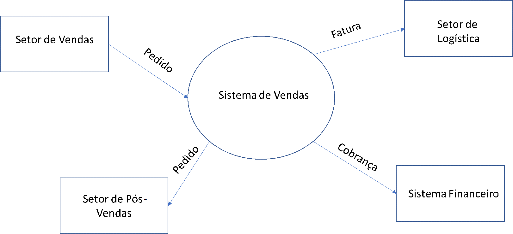
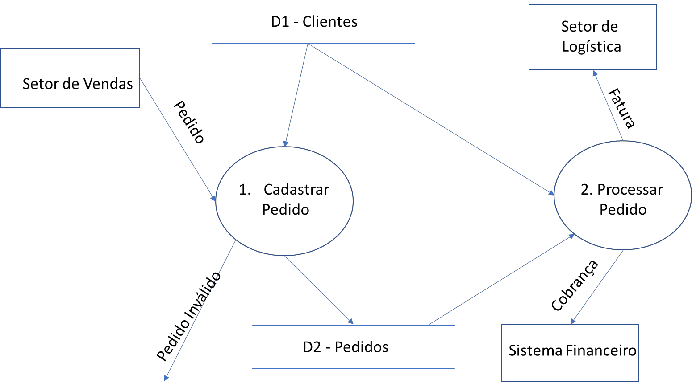
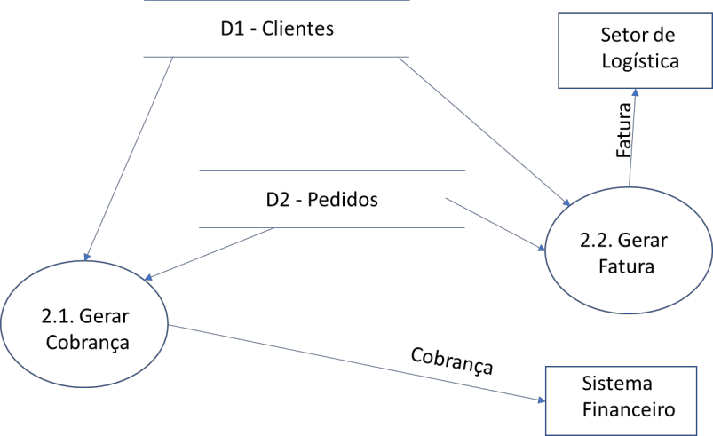
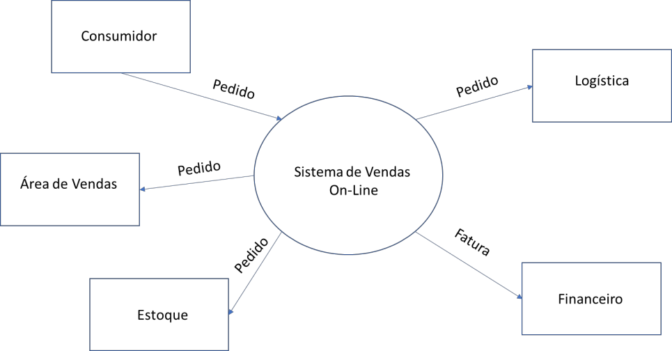
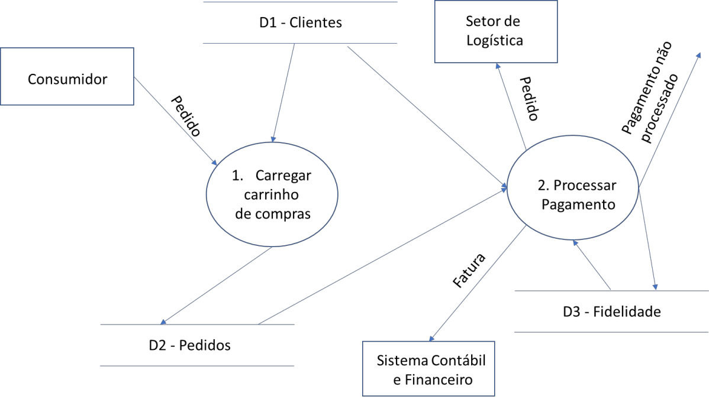

# Análise e Modelagem de Sistemas (937893)
## Aula 2 — Histórico e Diagrama de Fluxo de Dados

> Texto integral da apostila oficial da Uninter (sem resumo). PDF original: [Aula_02.pdf](../_apostilas_pdf/03_Analise_Modelagem/Aula_02.pdf)

ANÁLISE DE SISTEMAS AULA 2

Profª Adriana Bastos da Costa

### CONVERSA INICIAL

Os estudos em análise de sistemas são fundamentais para todo profissional que deseja desenvolver um software, pois é a disciplina que permite ao aluno traduzir, por meio de modelos e documentação específica, as necessidades de negócio do cliente em um projeto técnico de software. É a disciplina que apresenta a necessidade de planejar tecnicamente um software antes de sua codificação, para que os objetivos de negócio do cliente sejam atendidos.

Analisar, projetar e desenvolver um software são atividades complexas que envolvem as necessidades dos clientes, regras de negócios e tecnologia, por isso, precisam ser muito bem planejadas e estrategicamente pensadas para que sejam o mais eficientes possível na solução do problema pretendido. Não basta atender aos requisitos de negócio, é preciso ter um processamento rápido e eficiente.

Nesta aula, vamos conhecer o que é a análise estruturada, como ela surgiu e como um software pode ser projetado seguindo seus preceitos. Também vamos conhecer o que é um Diagrama de Fluxo de Dados (DFD) e descobrir como ele ajuda a analisar o funcionamento de um software.

Esta aula está organizada em cinco grandes temas, sendo eles: 1 – Análise de Sistemas – a história; 2 – Análise Estruturada; 3 – Diagrama de Fluxo de Dados (DFD); 4 – Níveis de um DFD; e 5 – Analisando um exemplo de DFD.

### TEMA 1 – ANÁLISE DE SISTEMAS – A HISTÓRIA

No século XX, vivemos o que se chamou de Era da Informação. Mas esse movimento ainda não parou, pois continuamos vivendo nessa era, e cada vez mais a informação está presente em todos os pontos da nossa vida. A informação flui com velocidade cada vez maior e em volumes espantosos. Estamos cercados por informações, fazendo uso delas o tempo todo nos nossos estudos, no nosso trabalho e até mesmo na vida social. É preciso criar mecanismos para processar o grande volume de informações que recebemos diariamente, separando o que é útil do que não nos ajuda em nada. O mesmo ocorre nas organizações. Há informações sobre clientes, sobre o mercado e sobre os concorrentes que estão o tempo todo influenciando a nossa tomada de decisão. As melhores decisões são tomadas baseadas em

informações, mas como separar as informações úteis das informações irrelevantes para o negócio? As informações corretas e relevantes são fontes de poder, uma vez que permitem analisar fatores do passado, compreender o presente e, principalmente, prever o futuro.

Os sistemas de informação computacionais surgiram com o objetivo de ajudar as empresas a organizarem suas informações. Eles surgiram de maneira simples, atendendo a poucas áreas da empresa, e evoluíram bastante, chegando até a incorporar BI (Business Intelligence) e inteligência artificial como forma de aprimorar o processamento do grande volume de informações que as empresas utilizam diariamente no seu processo de tomada de decisão, aumentando o desempenho financeiro e participação no mercado, que são alguns dos principais objetivos de toda empresa com fins lucrativos. A Tecnologia da Informação (TI) é composta por um conjunto de recursos de hardware e de software dedicados ao armazenamento, processamento e utilização da informação. Além disso, a TI define a maneira como os recursos de hardware e software estão organizados num sistema capaz de executar um conjunto de tarefas para manter e evoluir o negócio.

Com o uso cada vez mais intenso dos sistemas computacionais e com a evolução constante da tecnologia, foi necessário estruturar a construção de software, definindo padrões e metodologias que pudessem organizar e atender à complexidade crescente dos softwares solicitados pelos clientes. É fato que indivíduos, empresas e sociedade com um todo dependem dos sistemas de software avançados.

Dessa forma, a análise de sistemas surgiu e foi definindo formas mais efetivas de desenvolver softwares. É necessário criar sistemas confiáveis, com custo adequado e de forma a atender à velocidade das demandas dos indivíduos e das empresas.

1.1 Análise de sistemas A análise de sistemas tem como finalidade a realização de estudos de processos a fim de encontrar o melhor caminho lógico para que a informação possa ser processada. Segundo Pressman (2016), a análise de sistemas é uma prática baseada em modelos, com o objetivo de obter um melhor entendimento da entidade real a ser construída.

O modelo precisa representar a entidade física, como aluno, cliente e venda, bem como representar a informação referente às entidades físicas que o software precisa processar. O modelo também precisa representar a arquitetura e as funcionalidades que o software precisa entregar.

A modelagem do software precisa mostrar a solução a ser construída em diferentes níveis de abstração. Ou seja, é preciso mostrar o software do ponto de vista dos clientes e do ponto de vista técnico, de forma a permitir a análise da viabilidade de implementação dos requisitos de negócio.

Para representar os dois níveis de abstração, são usadas duas classes de modelos. Os modelos de análise representam os requisitos do software, mostrando três domínios diferentes, sendo eles: o domínio das informações que precisam ser tratadas; o domínio das funcionalidades a serem atendidas; e o domínio comportamental que deve ser seguido. Os modelos de projetos representam as características que ajudam tecnicamente a entender o funcionamento do software, sendo elas: a arquitetura; a interface do usuário ou camada visual do software; e os detalhes no nível de componentes, que é a camada física relacionada com a construção efetiva do software. Ao longo do tempo, um grande número de métodos de modelagem de análise foi definido e utilizado. Cada um dos métodos de análise possui um ponto de vista único, com foco e objetivos próprios. Mas todos os métodos encontrados na literatura possuem princípios claros e relacionados, sendo eles: • O domínio de informação relacionado com o software a ser construído precisa ser representado e entendido. Esse domínio envolve os dados que transitam dentro do sistema e para fora do sistema como resultado do que é processado pelo software. Os dados usados dentro do sistema podem vir de usuários finais, de outros sistemas ou de dispositivos externos. Os dados que são repassados para fora do sistema podem fluir por meio de interface do usuário, de interfaces de rede, de relatórios gerados, gráficos ou outros meios que mostrem o produto ou serviço final, objeto do software; • As funcionalidades a serem desenvolvidas pelo software devem ser detalhadamente definidas. As funções podem ser descritas em diferentes níveis de abstração, que podem ser uma simples declaração geral de objetivos ou um documento com o detalhamento dos elementos de processamento que precisam ser utilizados;

• O comportamento do software precisa ser representado e deve ser guiado pelas interações com o ambiente externo, pelo contexto de negócio no qual o cliente está inserido e pelo uso que o usuário dará para o software. O comportamento esperado para o software em termos de tempo de resposta e usabilidade, bem como seus critérios de qualidade, devem estar claros e documentados; • Os modelos que mostram informações, funcionalidade e comportamento devem ser particionados de modo que revelem os detalhes em forma de camadas. Isso é importante porque problemas complexos são difíceis de serem analisados e resolvidos como um todo. Um problema complexo ou grande é dividido em partes menores de forma que seja mais fácil de ser entendido e solucionado. Esse conceito é chamado de particionamento e consiste em uma estratégia-chave na modelagem de análise. Os modelos se integram até mostrar a solução completa do problema como um todo; • A tarefa de análise deve ir da informação essencial para o software até os detalhes de implementação do mesmo. A modelagem de análise começa descrevendo o problema na perspectiva do usuário final, que é quem realmente vai usar o software. O ponto principal do problema é descrito ainda sem se preocupar com a solução de software que será implementada. O foco aqui ainda é entender o problema do cliente. Essa é a essência pura e simples do problema. Já o modelo de projeto foca nos detalhes de implementação da solução que vai resolver o problema, ou seja, o modelo de projeto indica como a essência, que foi modelada no modelo de análise, será implementada.

A evolução da análise de sistemas propôs três grandes métodos de modelagem de sistemas, sendo eles: modelagem estruturada, modelagem essencial e modelagem orientada a objetos.

A análise estruturada está fundamentada na decomposição funcional do problema, ou seja, foca de forma principal nas funcionalidades que o software deve entregar. A modelagem estruturada utiliza um conjunto de ferramentas para organizar a visão de análise do problema, sendo o DFD e o Dicionário de Dados (DD) as principais ferramentas.

A análise essencial é considerada uma evolução da análise estruturada, mas com diferenças essenciais da decomposição do problema. Ela se utiliza das mesmas ferramentas de modelagem da análise estruturada, mas, em vez de

uma decomposição do mais geral para o mais específico (top-down), o método prevê que sejam identificados, inicialmente, os eventos externos que acionam o software, sendo derivadas, então, as ações (ou funções) em resposta a esses eventos e, posteriormente, os eventos gerados internamente e também as respectivas ações.

A análise orientada a objetos procura compreender o problema a ser resolvido por meio de simples objetos do mundo real. Objeto é uma entidade real ou abstrata que modela um conceito presente na realidade humana, ocupando espaço físico ou lógico. Por exemplo, um produto é um objeto com informações e características próprias. Um produto pode ter um código que o identifique, um nome, um peso, dimensões e outras características que façam sentido para o foco que o sistema quer dar ao objeto. Um objeto pode também ser algo não físico, como uma venda ou mesmo uma data de realização, produtos comprados, valor de venda, identificação do cliente, e outras características que estejam relacionadas ao objetivo dos requisitos.

1.2 O analista de sistemas TI é uma área muito ampla, com oportunidade para profissionais se especializarem em vários assuntos diferentes. É possível atuar no desenvolvimento de software como desenvolvedor, como analista de requisitos, como arquiteto de softwares, como DBA, como engenheiro de software, como cientista de dados, como analista de sistemas e muitas outras especializações. Um dos objetivos desta aula é discutirmos um pouco sobre o papel e as responsabilidades de um analista de sistemas.

Os analistas de sistemas estudam como o comportamento e as funcionalidades do software serão desenvolvidos por meio dos requisitos, transformando-se em soluções que serão padronizadas e transcritas da forma que o computador possa executar.

Os analistas de sistemas projetam softwares, que são executados em hardwares e são operados por usuários. Portanto, eles precisam traduzir a linguagem dos negócios em linguagem técnica, que vai se transformar em linhas de código pelas mãos dos programadores. Dessa forma, o analista de sistemas é o profissional que, por meio do trabalho do analista de requisitos, projeta uma solução, baseada na arquitetura definida pelo arquiteto de software, gerando

modelos e documentos que serão utilizados pelos programadores na construção do software.

Os analistas precisam estar preparados e treinados em procedimentos operacionais padronizados e dotados de conhecimentos necessários para executar seu trabalho. A análise de sistemas é uma profissão cujas responsabilidades concentram-se na análise dos sistemas a serem desenvolvidos e na administração de sistemas computacionais já em uso.

### TEMA 2 – ANÁLISE ESTRUTURADA

A análise estruturada de sistemas é composta por um conjunto de técnicas e ferramentas que continuam em constante evolução, apesar de ser um método mais antigo de se fazer análise de sistemas.

O objetivo principal da análise estruturada é a construção de um modelo lógico e não de um modelo físico de sistema. Ou seja, a análise estruturada busca compreender a lógica por trás de cada funcionalidade que precisa ser desenvolvida no software. Como toda modelagem, a análise estruturada também utiliza técnicas gráficas. Os modelos produzidos precisam ser capazes de levar usuários, analistas e projetistas a formarem um quadro claro e geral do sistema e de como suas partes se encaixam para atender às necessidades do cliente. A análise estruturada tem como objetivo fornecer uma abordagem sistemática, etapa por etapa, para desenvolver a análise e produzir uma especificação de sistema adequada para resolver o problema do cliente. Para conseguir esse objetivo, a análise estruturada busca uma comunicação clara, direta e concisa. A especificação do sistema é o elo entre a análise e o projeto, e fornece uma descrição dos requisitos do sistema a ser construído. O principal objetivo da análise é produzir uma especificação do sistema que defina a estrutura do problema a ser resolvido de acordo com a visão do usuário e em uma linguagem que possa ser entendida pela equipe técnica. O objetivo do projeto é definir a estrutura do problema com os requisitos do usuário, estruturando a implementação que será dada para a solução.

Os defensores da análise estruturada afirmam que o uso do mesmo método de construção para a especificação e para o projeto obriga os dois a ficarem mais coesos e a, provavelmente, representarem um sistema que satisfará às necessidades e expectativas do usuário. Por isso, mesmo sendo um método mais antigo, a análise estruturada ainda é encontrada, principalmente

em empresas que possuem sistemas legados, que precisam ser mantidos e evoluídos.

A especificação baseada na análise estruturada é composta de diagrama de fluxo de dados, de dicionário de dados e de especificações dos processos. Antes do desenvolvimento dessas ferramentas de Análise Estruturada de Sistemas, todos os detalhes da implementação física eram perdidos ou não eram pensados antecipadamente, o que gerava uma grande falha de entendimento. 2.1 A evolução da análise estruturada Até o final da década de 1970, os requisitos de um software eram documentados apenas por meio de uma narrativa em português, gerando, muitas vezes, um entendimento equivocado da real necessidade do usuário. A linguagem usada em conversas normais de dia a dia não é adequada para o detalhamento de requisitos, pois pode não ser clara e gerar inconsistência de entendimento. Por isso, é importante agregar diagramas ou qualquer outra ferramenta que mostre, de maneira gráfica e visual, o entendimento sobre o funcionamento dos requisitos.

Desde os primeiros autores que discutiram sobre análise estruturada, o método continuou evoluindo. Após a aplicação do método em alguns projetos de software, foram identificadas algumas alterações necessárias para a melhoria das técnicas e ferramentas. A seguir, algumas das principais melhorias: • Evitar a construção de modelos "físicos" e "lógicos" do sistema atual, pois o foco é a construção do novo sistema. Logo, se gasta muito tempo, vai ser descontinuado. Essa prática deveria ser trocada pela prática de modelagem de processos de negócio, e por meio desse fluxo de processos, trabalhar na análise lógica do novo sistema; • A distinção vaga entre os modelos lógico e físico é dependente da tecnologia. É preciso entender completamente a diferença entre os dois modelos. O modelo lógico é o modelo essencial que ajuda a entender a essência do sistema. O modelo físico é o modelo que se preocupa com a implementação, pois considera os aspectos tecnológicos do software; • Carência de técnicas de modelos para construir sistemas de tempo real, ou seja, sistemas que mostrem o funcionamento do software no momento em que o processamento ocorre. Para resolver essa falha, foi definido e

passou a ser utilizado na análise de software o Diagrama de Transição de Estado (DTE); • Percebeu-se também a necessidade de modelar as estruturas de dados dos sistemas, como forma de compreender o relacionamento entre elas. Com isso, começou-se a utilizar Diagramas de Entidades- Relacionamentos (DER), que focam no relacionamento entre as diferentes entidades que compõem um sistema e em como os dados fluem por meio delas; • Com a introdução de vários diagramas, além dos diagramas já utilizados na análise de sistema, era necessário buscar uma forma de melhor integrar todas essas ferramentas. É importante ressaltar que cada diagrama tem um objetivo a cumprir, e a junção coerente e integrada de todos geram uma visão mais completa do software que se quer construir. 2.2 Benefícios e problemas Como todo método, a análise estruturada foi pensada para atender a um conjunto de necessidades, mas não poderá ser aplicada a toda situação de software por ter uma visão focada no fluxo de dados que transitam do software e para o software.

Por isso, é preciso conhecer diferentes métodos para aplicar o que melhor agrega valor ao contexto de software em questão. O importante é que o problema a ser resolvido fique claro para a equipe de desenvolvimento. Vários benefícios podem ser identificados quando a análise estruturada é utilizada, tais como:

• Os usuários conseguem ter uma ideia mais clara do sistema proposto com o uso do diagrama de fluxo de dados em comparação ao obtido por meio apenas de narrativa e de fluxograma de sistemas físicos; • A apresentação dos requisitos em termos de fluxo lógico consegue mostrar mal-entendidos e pontos controversos, minimizando problemas em estágios mais avançados da construção do software; • As interfaces entre o novo sistema e outros sistemas já existentes são mostrados de modo bem mais claro, facilitando a compreensão da comunicação entre eles;

• O uso de dicionário de dados para guardar os itens do glossário do projeto economiza tempo ao resolver rapidamente os casos em que pessoas chamam as mesmas coisas por diferentes nomes, além de criar um padrão de nomenclatura que ajuda na qualidade de construção do software.

Alguns problemas também podem ser encontrados ao se utilizar análise de estrutura para modelar um software, principalmente quando o software é complexo e precisa de outras visões para ser mais bem compreendido e projetado. Vamos discutir alguns dos problemas que podem ser identificados, tais como:

• O esforço, a formalidade e o grau de detalhe necessários, especialmente na construção do dicionário de dados, muitas vezes, geram resistência por parte dos analistas de sistemas. Mas é importante reforçar que toda documentação de software deve agregar valor ao entendimento do problema, por isso deve ser focada no que é principal e essencial para o correto entendimento. E toda documentação deve ser mantida, ou seja, deve evoluir junto com as modificações nos requisitos do software. Uma documentação desatualizada pode ser fonte de confusão e desinformação em um projeto; • Tem havido uma certa preocupação por parte dos programadores de que ao obterem especificações detalhadas da lógica no português estruturado, acabarão “retirando todo o prazer da programação, tornando- os meros codificadores”, mas é preciso lembrar que existem programadores inexperientes que precisam de maior ajuda para desenvolver seu trabalho com maior qualidade; • Orientação dos usuários e treinamento dos analistas são necessários, pois, com a introdução da análise estruturada, foram mudadas as “regras do jogo”, e todos devem ser bem esclarecidos quanto às novas regras e à maneira como elas melhoram o jogo. Como a análise era feita anteriormente apenas com uma descrição dos requisitos, agora é preciso “aprender” a ler o diagrama. Mas a linguagem usada no DFD é tão simples que esse aprendizado não é um problema para a utilização do método.

### TEMA 3 – DIAGRAMA DE FLUXO DE DADOS (DFD)

O DFD é uma das ferramentas mais utilizadas na análise estruturada como forma de compreender e analisar o fluxo de dados dentro do próprio sistema e o fluxo entre o mundo exterior com o sistema. Quando falamos do fluxo exterior, precisamos detalhar tanto os dados que entram no sistema quanto os que saem do sistema.

O DFD possui uma representação em rede que mostra as funcionalidades que o sistema deve entregar e os dados que interligam essas funcionalidades. O objetivo principal do diagrama de fluxo de dados é mostrar o que o sistema faz e não como será feita a solução em desenvolvimento. Isso ocorre porque é o momento de análise, e não de projeto, no ciclo de vida do desenvolvimento. Outro ponto interessante a ressaltar é que o DFD mostra a lógica das funcionalidades e não a parte física da sua implementação, exatamente porque foca na análise, e não no projeto.

A criação de um DFD envolve os seguintes pontos:

• Escolha de nomes significativos para os seus componentes, de forma a facilitar o entendimento sobre o DFD e o que ele faz; • Numerar os processos, para facilitar a referência a eles em uma documentação escrita; • Criar o diagrama e ajustá-lo visando uma boa estética e comunicação adequada. Evitar DFD muito complexo. Um diagrama é uma ferramenta gráfica, portanto, o visual bem organizado é fundamental para a compreensão do todo; • Caso necessário, utilizar o particionamento em níveis, ou seja, quebrar o detalhamento em níveis de aprofundamento maiores. É mais fácil entender o todo por meio de partes menores. Mas é importante se certificar de que os diferentes níveis de entendimento gerados são consistentes internamente e também consistentes com os demais níveis relacionados.

O diagrama é composto por vários elementos ou componentes, chamados de processos, fluxos de dados, depósitos de dados e entidades. A representação gráfica de cada componente pode sofrer pequenas diferenças, dependendo do autor e do livro que se estiver seguindo. Os principais estudiosos sobre o método são Chris Gane, Trish Sarson, Tom DeMarco e Edward Yourdon.

Vamos analisar cada componente e entender a função de cada um no diagrama.

3.1 Processos O primeiro componente a ser analisado é o processo, pois ele é o coração do DFD. Ele mostra as funcionalidades ou processos que o software deve executar. Processos também são conhecidos como bolha, função ou transformação, pois representam as transformações de fluxos de dados de entrada em fluxos de dados de saída. Por proporcionar uma transformação, geralmente, o processo provoca mudanças de estrutura, conteúdo ou estado dos dados.

Para ficar intuitivo e mais fácil de ser compreendido, o nome do processo deve descrever o que ele faz. Quando o nome de um processo é claro e direto, todos os envolvidos no desenvolvimento do software conseguem compreender a que o DFD se refere e o que o software deve fazer.

Fazendo uma analogia: andar, caminhar e comer são processos ou ações, assim como “cadastrar cliente”, “registrar o pedido do cliente” ou “emitir nota fiscal para o cliente”. Os processos ou ações são também entendidos como as funcionalidades que o software deve entregar para o cliente. Portanto, entender como o fluxo de dados ocorre nesses processos é fundamental para entender o que o software deve fazer.

Em um DFD, os processos modelados podem ser manuais, como “arquivar uma pasta do cliente em um armário”, ou automatizados, como “arquivar os dados do cliente”.

Como boa prática de análise de sistemas, para representar processos, é interessante utilizar verbos, como extrair, produzir, criar, armazenar, recuperar, calcular, verificar, classificar, entre outros, a fim de demonstrar exatamente o que o processo irá executar.

Especificando ainda mais um processo, podemos nomear a que o processo se refere no contexto do software, por exemplo, a um cliente, a um aluno, a um produto, ou qualquer outro objeto. Dessa forma, o nome de um processo pode ser “Armazenar dados do cliente”, “Calcular média bimestral do aluno”, “Consultar dados do aluno” etc. Um processo pode ter as seguintes representações gráficas:

Figura 1 – Representações gráficas de processos

3.2 Fluxos de dados Os fluxos de dados são os componentes capazes de interligar os processos. Eles representam caminhos pelos quais passam os dados, sendo representados por meio de setas que indicam a origem e o destino do dado. Podemos entender os fluxos de dados também como um “tubo” hipotético, mas não necessariamente físico, pelo qual passam pacotes de dados. É importante que o nome do fluxo de dado seja documentado no dicionário de dados sempre que essa documentação facilitar o entendimento e o aprofundamento da análise. Tudo o que for documentado pode evitar mal- entendidos e facilitar a evolução do processo de análise.

Quando um cliente faz um pedido, por exemplo, envia um fluxo de dados. Podemos chamar esse fluxo de Pedido, que pode ser composto por: nome, CPF, nome do produto, código identificador do produto, descrição do produto, valor do produto, entre tantas outras informações necessárias para processar as funcionalidades do software relacionadas com Pedido. Cada fluxo deve ter um único nome, o qual deve identificar os dados transportados pelo fluxo. É preciso entender que, muitas vezes, um mesmo fragmento de dados pode ter significados diferentes em pontos distintos de um DFD. É possível ter CPF-Válido e CPF-Inválido, Aluno-Aprovado e Aluno-Reprovado, por exemplo. Perceba que o fluxo do dado mostra também o estado em que o dado se encontra, baseado no processo executado, mas ele não modifica o dado durante o transporte, apenas movimenta o dado de um ponto para outro. Os fluxos de dados transportam dados entre os componentes do DFD, ou seja, é possível encontrar fluxos de dados movimentando dados: de processo ⇔ processo, de entidade ⇔ processo e de depósito de dados ⇔ processo. O DFD mostra todos os movimentos dos dados dentro e fora do software. Os fluxos de dados podem ser classificados da seguinte forma:

• Fluxo externo: entre entidade e processo. São chamados de externos, pois envolvem não apenas processos, mas também outro componente do DFD; • Fluxo interno: entre dois processos; • Fluxo de acesso à memória: entre processo e depósito de dados; • Fluxo de erro ou rejeição: para fora de um Processo.

Um fluxo de dados pode ser representado por meio de setas, as quais podem estar direcionadas para a direita e para a esquerda, ou, ainda, para cima e para baixo. A ponta da seta indica o destino, portanto, no diagrama, deve-se observar a lógica da origem para o destino de cada fluxo de dado. Um processo pode ter as seguintes representações gráficas:

Figura 2 – Fluxo de dados

3.3 Depósito de dados Um depósito de dados representa uma coleção de pacotes de dados, mas não deve ser confundido com banco de dados, pois possuem objetivos diferentes. Utilizar depósito de dados em um DFD é um meio de se reter os dados que serão utilizados em outro momento pela mesma funcionalidade ou por outras. Os depósitos de dados são simples meios de armazenamento de dados estocados, sem maiores preocupações com suas características físicas, por isso, não podem ser confundidos com o banco de dados.

O depósito de dados representado em um DFD mostra a lógica e não a parte física do dado em si. Um banco de dados seria exatamente a parte física, ou seja, representa o dado fisicamente armazenado. O depósito de dados destina-se a informar aquilo que precisamos movimentar, independentemente de ser um bando de dados em si. É possível representar em um DFD a movimentação de dados partindo de um arquivo, por exemplo.

Seguindo o mesmo raciocínio, quando se tem um conjunto de clientes, os quais compram os produtos do nosso cliente, precisamos guardar em algum

lugar os dados de cada cliente para processá-lo. No âmbito do DFD, esse lugar é um depósito de dados, que chamaremos de Clientes, por exemplo. Se iremos guardar esses dados em um banco de dados físico ou apenas utilizá-los para um processamento e descartá-los, isso é a implementação física do software, representada nos modelos de projeto.

O nome de um depósito de dados, como boa prática, deve sempre estar no plural, representando que, no depósito, existem vários dados do mesmo contexto. Um depósito de cliente, por exemplo, deve se chamar Clientes, pois o software vai processar dados de vários clientes.

As possíveis representações gráficas de um depósito de dados são: Figura 3 – Depósito de dados

3.4 Entidades A entidades são categorias lógicas de “coisas” ou “pessoas”, as quais representam uma origem ou destino de transações. Se compararmos com a orientação a objetos, as entidades funcionam de modo similar ao dos objetos, pois representam parte do mundo real.

Também podem ser chamadas de Terminadores, por serem o ponto de partida ou de chegada de qualquer transação. As entidades são as fontes ou os destinatários das informações que entram e saem do sistema. A entidades também podem, além de representar “coisas” ou “pessoas”, representar um outro sistema, se este outro sistema tiver interface com o sistema que está sendo modelado.

Seguindo as boas práticas de análise de sistemas, a nomenclatura utilizada nas entidades deve estar no plural, devido ao mesmo motivo pelo qual é utilizado plural nos depósitos de dados, ou seja, para representar um grupo de pessoas ou coisas. Normalmente, as entidades têm, intencionalmente, seu nome escrito em maiúsculo, para diferenciá-las de possíveis depósitos de dados com o mesmo nome.

Quando a entidade representar um sistema externo, deve ser incluída a palavra sistema ao seu nome, como sistema de contabilidade. Isso nos ajuda a entender com qual sistema o DFD está interagindo.

A representação gráfica de uma entidade é:

Figura 4 – Representação gráfica de entidade

### TEMA 4 – NÍVEIS DE UM DFD

O DFD deve ser modelado em uma série de níveis, de modo que, a cada nível, ofereça sucessivamente mais detalhes sobre uma parte do nível que lhe seja superior.

Muitas vezes, o DFD de um sistema é algo não trivial, pois reflete a complexidade do problema que vai ser resolvido por meio de um software. Como o objetivo é ajudar a analisar e a compreender o funcionamento dos requisitos e das funcionalidades que devem ser implementas, é preciso montar diagramas com níveis diferentes do processo. Dessa forma, para evitar que tudo seja definido num único diagrama, que geralmente é difícil de ser entendido e mantido, criam-se DFDs que detalham um processo de um nível mais alto para o mais baixo.

O principal objetivo de organizar o DFD em níveis é mostrar o diagrama de fluxo de dados do nível mais macro até o nível mais detalhado. E qual é o limite de criação de níveis em um DFD? O limite é o correto e o completo entendimento do problema. Ou seja, enquanto for necessário detalhar algum processo para ajudar no desenvolvimento do software, deve ser criado mais um nível de DFD. Vamos entender cada um nos principais níveis conhecidos e definidos em um DFD.

4.1 DFD de contexto Este é o DFD de nível mais alto, sendo o que dá a visão das principais funções do sistema. Ele é macro, contendo um processo que representa o sistema como um todo, os principais fluxos de dados e os agentes externos, ou

seja, os sistemas com os quais o sistema modelado faz interface, ou mesmo os diversos setores da empresa que terão algum tipo de acesso ao sistema. Ele é simples, porque não detalha nenhum dos processos do sistema, mas dá uma visão do todo e dos principais relacionamentos.

Vamos analisar um exemplo de DFD de contexto.

Figura 5 – Sistema de vendas – exemplo de DFD de contexto

Crédito: Costa, 2021.

O DFD do exemplo apresentado modela o sistema de vendas que é acionado pelo setor de vendas quando um pedido é feito por um cliente. Quando o pedido é processado e faturado, o setor de logística é acionado com a fatura, para que separe e entregue os produtos comprados pelo cliente. O pagamento do pedido feito pelo cliente é feito por outro sistema, o sistema financeiro, que recebe os dados de cobrança. E, por último, o setor de pós-vendas recebe os dados do Pedido para fazer o atendimento ao cliente e verificar a satisfação com a compra, após ele ter recebido os produtos comprados.

Veja que é uma visão de alto nível, mas que explica o objetivo do software, os principais dados trafegados e as entidades mais importantes. Porém, esse nível de diagrama não permite entender os detalhes do funcionamento. Por isso, é preciso criar outros diagramas, nos níveis maiores de detalhe. 4.2 DFD de nível zero Após ter a visão macro do sistema, é preciso analisar os principais processos do software e colocar uma lupa nos fluxos e nas entidades envolvidas

nesses processos. Nesse nível de DFD, é possível encontrar detalhes sobre as principais funcionalidades do software.

O DFD imediatamente abaixo do diagrama de contexto é conhecido como DFD de nível zero. Ele representa a visão de mais alto nível das principais funções do sistema, bem como das principais interfaces entre essas funcionalidades.

Cada uma dessas bolhas, que representam os principais processos ou funcionalidades, deve ser numerada para fácil identificação e referência. Explicando com outras palavras, o DFD de nível zero contém as macrofunções do sistema.

Vamos analisar um exemplo de DFD de nível zero:

Figura 6 – Sistema de vendas – exemplo de DFD de nível zero

Crédito: Costa, 2021.

Como o exemplo ilustra um sistema de vendas, as principais funcionalidade são a criação e o processamento de um pedido feito por um cliente. Dessa forma, os depósitos de dados principais envolvidos com as funcionalidades apresentadas são clientes e pedidos. Cliente é o que inicia todo o sistema com uma compra, e pedido é o que é processado e faturado, pois é a razão de o sistema existir.

As entidades apresentadas neste nível de DFD mostram quais são os relacionamentos das principais funcionalidades. Com esse nível de DFD, é possível criar um entendimento, mesmo que primário, sobre o funcionamento do

software. Por meio desse nível, ou dos níveis intermediários de DFD, é possível detalhar ainda mais os fluxos dos dados, com base nas principais funcionalidades do sistema.

Para que seja possível realmente compreender toda a complexidade do software, é preciso evoluir no detalhamento dos níveis do DFD. 4.3 DFD de níveis intermediários Os DFDs de níveis intermediários são os diagramas que mostram a decomposição, ou seja, o detalhamento ou explosão de cada processo de nível mais alto. Portanto, cada nível detalha mais o nível imediatamente anterior. A quantidade de níveis depende de fatores como complexidade e porte do sistema. Em geral, a decomposição em níveis menores deve terminar quando for possível especificar o processo em uma página, ou quando o detalhamento estiver suficiente para compreender toda a análise do sistema. Vamos analisar um exemplo de DFD de nível intermediário:

Figura 7 – Sistema de vendas – DFD de nível intermediário

Crédito: Costa, 2021.

No DFD de nível intermediário, é possível analisar o desdobramento da funcionalidade 2 – Processar Pedido, ou seja, essa funcionalidade tem duas responsabilidades centrais: 2.1. Gerar Cobrança e 2.2. Gerar Fatura. É importante perceber como a numeração dos processos ajuda na identificação do detalhamento. Nesse nível de detalhamento, é possível entender logicamente como é o relacionamento do processo de Processar Pedido e seus subprocessos com as entidades e depósitos de dados principais.

### TEMA 5 – ANALISANDO UM EXEMPLO DE DFD

Estamos chegando ao último tema desta aula e, como foi feito em outro momento de nossos estudos, vamos analisar o que aprendemos por meio de um estudo de caso. Vamos analisar a construção de um DFD na prática. O objetivo é apresentar como um DFD pode ser criado por meio da descrição de um problema de um cliente.

Atente-se aos detalhes e lembre-se de que vamos utilizar este estudo de caso em todas as aulas da disciplina. Conforme explicado anteriormente, vamos evoluir com esse estudo de caso por todas as etapas da análise de sistemas de um ciclo de desenvolvimento, construindo vários modelos que ajudem a projetar a construção completa do software.

Relembrando o nosso estudo de caso:

Fomos contratados pelo nosso cliente para modelar o processo de vendas on-line de livros. O nosso cliente tem uma livraria virtual, que vende produtos diretamente em um site próprio. O diferencial desta livraria é ter um estoque próprio, o que garante uma entrega mais rápida a seus clientes, e aceitar vários tipos de pagamento, como cartão de crédito, cartão de débito e boleto bancário. A livraria possui um programa de fidelidade, que permite desconto de 10% aos clientes que comprarem R$ 500,00 ou mais em 1 ano.

Vamos ao nosso estudo de caso, aplicando os conceitos de DFD aprendidos:

Figura 8 – Sistema da Livraria On-line – DFD de Contexto

Crédito: Costa, 2021.

Este DFD é o de mais alto nível, refletindo o sistema com uma visão macro e geral, mostrando as principais entidades envolvidas e os dados que alimentam

o sistema também de forma macro. Dessa forma, trata-se de uma visão lógica e de alto nível do que foi representado na modelagem de processos de negócio, estudada anteriormente.

Vamos, agora, analisar o DFD de nível zero das principais funcionalidades.

Figura 9 – Sistema da livraria on-line – DFD de nível zero

Crédito: Costa, 2021.

O DFD de nível zero deste estudo de caso mostrou a principais funcionalidades do software, que, para o contexto em questão, são: 1 – Carregar carrinho de compras (porque é o momento em que o cliente seleciona os produtos e faz sua compra); e 2 – Processar Pagamento (pois é o momento em que o cliente realmente realiza sua compra, fazendo o pagamento da mesma). A principais entidades foram representadas, assim como os depósitos de dados que fazem o recebimento ou entrega dos dados trafegados. Os fluxos de dados mostram logicamente a principal informação que é trafegada, não dando detalhes de quais são essas informações. Esse detalhamento deve ocorrer em DFDs de níveis intermediários.

Lembrando que essa não é a única forma de criar o DFD para este estudo de caso. O DFD foi criado de acordo com a visão do analista que o está construindo. Portanto, outras soluções podem ser dadas para o mesmo estudo de caso. O importante é que o DFD seja completo e coerente com a visão lógica que se espera do software.

### FINALIZANDO

Chegamos ao final desta aula. Esperamos que os conceitos vistos tenham ficado claros. O mais importante é entender que uma boa análise dos requisitos – com o objetivo de entender o que as funcionalidades do software realmente precisam fazer e como devem fazer – é fundamental para o sucesso do projeto. A análise de estrutura utiliza ferramentas como o DFD (Diagrama de Fluxo de Dados) e o DD (Dicionário de Dados) para detalhar a visão lógica das funcionalidades e mostrar como os dados fluem ao longo do processamento esperado para cada requisito.

É importante relembrar que objetivo de um DFD é mostrar de onde os dados surgem, para onde vão, quando são armazenados e qual processo os transforma. Também é importante conhecer as interações entre armazenamento de dados e processos. Essa visão é fundamental para se compreender o funcionamento e comportamento do software.

O grande benefício de se utilizar DFD na modelagem de um software é que a ferramenta é simples, permitindo a avaliação do modelo junto aos usuários, o que permite identificar as falhas o mais cedo possível. Embora a análise orientada a objetos seja a forma mais moderna de se modelar projetos de software, a análise estruturada ainda é utilizada em alguns projetos, principalmente nos que usam programação estruturada, pois a visão é simples, mas permite garantir o entendimento necessário dos requisitos de forma a construir uma boa solução para o cliente.

Nas próximas aulas, vamos estudar como documentar e gerenciar os requisitos do software, aprendendo o que é um caso de uso e como descrevê-lo a fim de compará-lo às estórias de usuários.

### REFERÊNCIAS

BECKER, J.; ROSEMANN, M.; VON UTHMANN, C. Guidelines of business process modeling. In: VAN DER AALST, W.; DESEL, J.; OBERWEIS, A. (Eds.). Business Process Management. New York: Springer Berlin Heidelberg, 2000. p. 30-49.

COHN, M. User Stories Applied for Agile Software Development. Assison- Wesley Professional. 2004.

GANE, C.; SARSON, T. Análise Estruturada de Sistemas. LTC. 1983. YOURDON, E. Análise Estruturada Moderna. Rio de Janeiro: Campus, 1990. LAPLANTE, P. A. Requirements engineering for software and systems. Boca Raton: CRC Press, 2013.

MALL, R. Fundamentals of software engineering. New Delhi: PHI Learning, 2014.

OGUNNAIKE, B. A.; RAY, W. H. Process dynamics, modeling, and control. Oxford: Oxford University Press, 1994.

PAIM, R. et al. Gestão de Processos: pensar, agir e aprender. Porto Alegre: Bookman. 2009.

PIZZA, W. R. A metodologia Business Process Management (BPM) e sua importância para as organizações. 36 f. Monografia (Curso de Tecnologia em Processamento de Dados) – Faculdade de Tecnologia de São Paulo – FATEC SP, São Paulo, 2012.

PRESSMAN, R. S.; MAXIM, B. R. Engenharia de Software: Uma Abordagem Profissional. Nova Iorque: Mc Graw Hill Educattion. 8. ed. 2016. ROSEMANN, M.; BROCKE, J. V.; HONORATO, B. Manual de BPM: gestão de processos de negócio. Porto Alegre: Bookman, 2013.

SILVER, B.; RICHARD, B. BPMN method and style. v. 2. Aptos: Cody-Cassidy Press, 2009.

WIEGERS, K.; BEATTY, J. Software requirements. 3. ed. London: Pearson Education, 2013.
