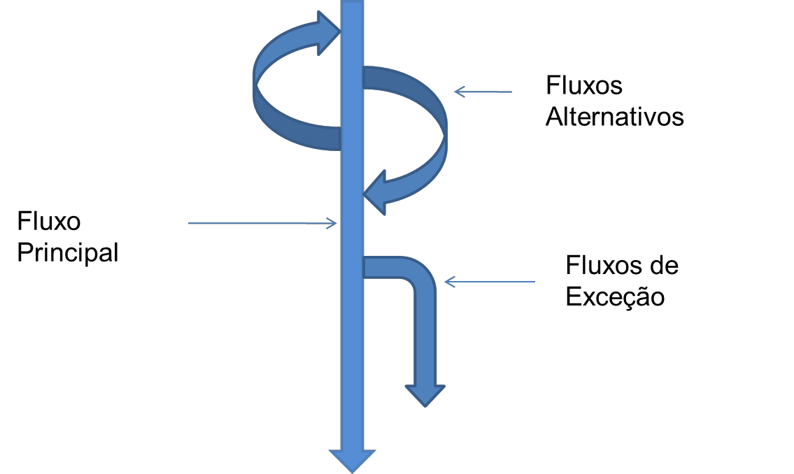

# Análise e Modelagem de Sistemas (937893)
## Aula 3 — Engenharia de Requisitos e Casos de Uso

> Texto integral da apostila oficial da Uninter (sem resumo). PDF original: [Aula_03.pdf](../_apostilas_pdf/03_Analise_Modelagem/Aula_03.pdf)

ANÁLISE DE SISTEMAS AULA 3

Profª Adriana Bastos da Costa

### CONVERSA INICIAL

A cada aula, fica mais claro que nossos estudos sobre análise de sistemas são fundamentais para todo profissional que deseja desenvolver softwares, pois é a disciplina que permite ao aluno traduzir, por meio de modelos e documentação específica, as necessidades de negócio do cliente em um projeto técnico de software. É a disciplina que apresenta a necessidade de planejar tecnicamente um software antes de ele ser codificado, para que os objetivos de negócio do cliente sejam atendidos. A base para todo software bem construído está no levantamento adequado e completo dos requisitos.

Nesta aula, vamos conversar sobre a engenharia de requisitos, detalhando o que é essa área e como podemos levantar e gerenciar os requisitos do software. O detalhamento claro e direto dos requisitos facilita o entendimento do que o software deve fazer.

Projetar e construir um programa de computador não é uma tarefa trivial, pois requer que se conheça bem o problema que se quer resolver e que se traduza a solução ideal para o problema em linhas de código, portanto, entender bem os requisitos ou o que o software precisa fazer para atender às necessidades do cliente é base de tudo. Se os requisitos não forem bem entendidos, corre-se o risco de o software não atender às necessidades do cliente.

Esta aula está organizada em cinco grandes temas, sendo eles: engenharia de requisitos; requisitos funcionais e requisitos não funcionais; documentando requisitos funcionais por meio de casos de uso; estórias de usuário; analisando um exemplo de descrição de caso de uso.

### TEMA 1 – ENGENHARIA DE REQUISITOS

Segundo Pressman (2016), “entender os requisitos de um problema está entre as tarefas mais difíceis enfrentadas por um engenheiro de software”. Os requisitos são as bases para todo projeto de software, definindo o que as partes interessadas de um novo sistema necessitam, e, também, o que o sistema deve fazer para satisfazer às suas necessidades.

Os requisitos guiam as atividades do projeto e normalmente são expressos em linguagem natural para que todos possam obter o entendimento de como o software deve funcionar. Os requisitos devem ser obtidos com os

usuários que conhecem o negócio e vão utilizar o software, além de ser necessário que tais requisitos sejam entendidos pela equipe técnica, que vai construir o software.

A coleta de requisitos é um processo normalmente organizado em quatro passos, que inclui o estudo de viabilidade da construção do software, a coleta dos requisitos, a especificação de requisitos e a validação de requisitos de software. Vamos entender cada um desses passos:

• Estudo de viabilidade da construção do software: é o primeiro passo do processo de levantamento de requisitos, que envolve entender a necessidade do cliente e fazer um estudo detalhado sobre o sistema desejado a fim de verificar se sua funcionalidade é viável para se codificar (Mall, 2014). O estudo de viabilidade está focado em analisar se o produto de software pode ser, na prática, materializado em termos de implementação, pensando em aspectos técnicos, de prazo e financeiros; • Coleta de requisitos: após a análise de viabilidade, a próxima fase é a coleta de requisitos junto aos usuários. Os analistas de requisitos entrevistam clientes e usuários finais para conhecer as suas ideias e necessidades sobre quais funcionalidades o software deve executar; • Especificação de requisitos: esta etapa ocorre após a coleta dos requisitos e envolve a documentação e o detalhamento de cada um dos requisitos necessários para o software; • Validação dos requisitos: a validação é a etapa final do processo de levantamento de requisitos e tem como objetivo garantir o entendimento sobre cada um dos requisitos coletados e especificados. Um requisito mal entendido ou documentado de forma errada gera um software inadequado.

Por ser uma atividade complexa, esses passos podem ainda ser divididos em mais etapas, de forma a organizar melhor todo o processo de engenharia de requisitos.

De acordo com Pressman (2016), as etapas da engenharia de requisitos podem ser organizadas em sete passos, dividindo ainda mais os passos apresentados anteriormente. Esse ciclo de vida proposto por Pressman foi uma evolução do ciclo anterior, composto de apenas quatro passos.

Essa evolução foi necessária para garantir um melhor controle e gerenciamento dos requisitos de um software.

É importante reforçar que alguns desses passos podem ser executados em paralelo, sendo sempre possível fazer adaptações em relação à duração e sequência dos passos, de acordo com a complexidade dos requisitos e necessidade do projeto.

Caso seja necessário alterar algum requisito, os passos também devem ser revisitados, de forma a esclarecer o funcionamento dos novos requisitos. É fundamental que, ao final da fase de engenharia de requisitos, todos os requisitos estejam levantados e descritos de forma detalhada para que a construção do software possa prosseguir de maneira segura.

1.1  Ciclo de vida da engenharia de requisitos O ciclo de vida da engenharia de requisitos é composto por sete passos, conforme já comentado anteriormente.

Os passos são evolutivos e complementares entre si, cada um possuindo uma meta a ser atingida. São eles: concepção, levantamento, elaboração, negociação, especificação, validação e gestão de requisitos. Perceba que alguns desses sete passos também existiam na proposta anterior de ciclo de vida, a versão com quatro etapas, apresentada anteriormente.

Vamos agora conhecer quais são esses sete passos e qual o objetivo de cada um deles:

• Concepção: o objetivo deste passo é compreender o problema a ser resolvido, entendendo o cenário de atuação do cliente. A intenção é estabelecer um entendimento do que o cliente espera com base na necessidade de negócio apresentada. Esse passo é o momento em que a equipe técnica e a equipe de negócio definem uma comunicação efetiva, comprometendo-se com o objetivo do projeto. É o pontapé inicial para estabelecer o entendimento macro sobre o que o cliente espera e qual o problema que se vai resolver; • Levantamento: este passo é o momento em que os analistas de requisitos começam a entrevistar os usuários e a compreender, em detalhes, como os requisitos deverão funcionar. Esse passo pode usar a modelagem de processo de negócio desenvolvida anteriormente como base para

identificar os requisitos do software. É uma continuação do passo anterior, o passo da concepção, evoluindo no entendimento e mergulhando nos detalhes dos requisitos que deverão fazer parte do software; • Elaboração: neste passo, as informações obtidas durante a concepção e levantamento são expandidas e refinadas. O objetivo principal desse passo é desenvolver um modelo técnico refinado das funcionalidades, características principais a serem atendidas e restrições do software. Nesse passo, são definidos cenários de uso, demonstrando como cada usuário vai interagir com o software; • Negociação: este passo é o momento em que os requisitos levantados e detalhados nos passos anteriores são validados pelos usuários. É bastante comum que os usuários peçam novos requisitos e alterações nos requisitos já existentes. É o momento no qual a negociação de custo, prazo e escopo ocorrem, pois é preciso atender aos usuários, mas também manter o prazo e o custo previstos para o projeto. Surge, então, a necessidade de gerenciar e conciliar conflitos e interesses entre os envolvidos no projeto, focando sempre no melhor resultado para o cliente final. A priorização dos requisitos mais importantes e que agregam mais valor para o negócio é sempre uma boa forma de conciliar diferentes interesses para o projeto; • Especificação: uma vez finalizado o passo da negociação e definidas as funcionalidades que serão construídas, agora é possível trabalhar nos modelos de implementação dos requisitos, ou seja, o projeto de construção de software já pode ser desenvolvido, baseado nos requisitos priorizados e detalhados. Neste passo, são definidas, de forma definitiva, as tecnologias que serão usadas e a arquitetura que será empregada na construção do software. Tanto a tecnologia quanto a arquitetura norteiam como os requisitos serão implementados. Saímos da fase de análise dos requisitos em si para a fase de projeto técnico da solução a ser construída, que vai implementar e transformar os requisitos em um software usual, que efetivamente poderá ser utilizado pelos usuários; • Validação: este passo examina a especificação que foi feita com objetivo de garantir que todos os requisitos necessários para o software foram identificados e especificados, que estão claros, coerentes entre si e descritos de modo a evitar ambiguidade. É um momento de validação em

que a revisão técnica e negocial formal devem ser aplicadas, garantindo que os requisitos estão corretos segundo os processos da empresa e, tecnicamente, garantindo que foram especificados e projetados de uma forma viável para implementação. As dependências técnicas e de negócio também devem ser validadas para garantir fluidez ao processo de construção; • Gestão de requisitos: a gestão de requisitos é necessária, pois os requisitos são voláteis e facilmente alteráveis por conta de necessidades do negócio, exigências do mercado ou outros fatores. Dessa forma, a gestão de requisitos é composta por um conjunto de atividades que ajudam na identificação, controle, rastreamento e modificação dos requisitos ao longo do tempo. A gestão de requisitos também se ocupa com a rastreabilidade entre os requisitos de um software. A rastreabilidade mantém o relacionamento entre os requisitos, apoiando o processo de gestão de mudança e identificando, mais facilmente, os requisitos que podem ter sido impactados no caso de mudança de algum requisito do software. A gestão de requisitos é uma atividade contínua, que deve ser executada enquanto o software estiver sendo construído, bem como após sua construção, no período em que se faz a manutenção do software. Manter os documentos de requisitos sempre atualizados garante uma boa manutenção no software, mesmo quando os profissionais que vão dar manutenção não são os mesmos que construíram o software.

Os requisitos são, portanto, o ponto de partida para a construção de qualquer software. Por isso, precisam estar completos e descritos de forma clara e coerente.

1.2 O analista de requisitos Na TI, os profissionais se especializam em diferentes áreas, podendo atuar em vários momentos do ciclo de vida do desenvolvimento de software. Existem analistas, programadores, testadores, arquitetos de software e muitos outros perfis que contribuem para a construção de um bom software. Quando falamos da fase de requisitos, o profissional especialista que atua fortemente é o analista de requisitos. Este profissional é muito requisitado porque

a fase de entendimento e levantamento de requisitos é a fase crucial para entender o que deve ser feito para construir um software adequado às necessidades do cliente.

O analista de requisitos, além de entender de engenharia de software, precisa ter algumas características que vão ajudá-lo no trabalho de identificar e documentar os requisitos de um software. Essas características são: • Capacidade de compreender conceitos abstratos, reorganizá-los em conceitos lógicos e sintetizar soluções que possam ser projetadas e implementadas; • Capacidade de absorver fatos relevantes, descartar situações que não agregam valor ao negócio e lidar com conflitos e interesses diferentes, focando no melhor para o software e na resolução efetiva do problema do cliente; • Capacidade de entender o contexto do negócio e se colocar no lugar do cliente/usuário. Ser sensível à experiência do usuário ao usar o software; • Capacidade de relacionar elementos técnicos com elementos de negócio, buscando a melhor solução de software possível e apoiando os analistas de sistemas e os arquitetos no entendimento das características e restrições do software; • Capacidade de se comunicar bem tanto na forma escrita quanto na forma verbal. O analista de requisitos traduz os requisitos de negócio conhecidos pelos usuários em requisitos de software, que serão automatizados e codificados em linguagem de programação; • Capacidade de “ver a floresta por entre as árvores”, ou seja, ter a capacidade de ver o todo sem deixar de ver as pequenas partes, assim como não se perder com as pequenas partes a fim de ver o mais importante, que é o todo funcionando de maneira sincronizada. Um bom analista de requisitos é também aquele que sabe ouvir seus usuários e os instiga a contar os detalhes que, muitas vezes, não são nem percebidos. É preciso entender as funcionalidades necessárias, mas também os comportamentos, que não chegam a ser funcionalidades em si, mas que ajudam a definir como a funcionalidade deve ser projetada. Por exemplo, não basta entender que o software precisa gerar um relatório de vendas, é preciso identificar que esse relatório deve ser gerado seguindo um padrão de quantidade

de colunas e linhas por página, devendo ter quebras de páginas por tipo de produto, ou seja, além do relatório listar as vendas do mês, ele deve atender outras características importantes para o negócio, como a forma de organizar essas informações.

Apenas ter um analista de requisitos detalhista e requisitos bem escritos e corretos de acordo com a necessidade do negócio não garante um software de sucesso, mas garante que o entendimento do problema e a função do software estejam completos. Portanto, podemos dizer que já é meio caminho garantido para o sucesso do software.

1.3 O documento de especificação de requisitos Por serem complexos e críticos para o sucesso de um projeto de software, os requisitos precisam ser documentados ao longo do ciclo de vida da engenharia de requisitos.

Uma especificação de requisitos de software (SRS – Software Requirements Specification) é uma descrição de um sistema de software a ser desenvolvido. Ele estabelece requisitos funcionais e não funcionais e pode incluir um conjunto de casos de uso que descrevem as interações do usuário que o software deve fornecer.

A especificação de requisitos de software estabelece a base de um acordo entre equipe de negócio e equipe técnica sobre o que o produto de software deve fazer, bem como o que não é esperado que faça. Tão importante quanto descrever o que fará, é fundamental deixar claro o que o software não fará, ou seja, descrever os itens fora de escopo. Esse cuidado minimiza o risco de mal entendidos e funcionalidades subentendidas no escopo do software. A especificação de requisitos de software permite uma avaliação rigorosa dos requisitos antes do início do projeto, reduzindo o risco de alterações posteriores por conta de entendimento errado do requisito. A especificação de requisitos também deve fornecer uma base realista para estimar os custos, os riscos e os prazos de entrega do software. Usado de forma adequada, as especificações de requisitos de software podem ajudar a evitar falhas no projeto (Pressmann, 2016).

O documento de especificação de requisitos do software lista os requisitos suficientes e necessários para o desenvolvimento do projeto. Para derivar os requisitos, o desenvolvedor precisa ter uma compreensão clara e completa dos

produtos a serem desenvolvidos ou em desenvolvimento. Isso é alcançado e refinado com o documento de detalhamento dos requisitos e com comunicações detalhadas e contínuas com a equipe do projeto e o cliente, o que deve acontecer até a conclusão do software.

### TEMA 2 – REQUISITOS FUNCIONAIS E REQUISITOS NÃO FUNCIONAIS

Estudamos em momento anterior de nossos estudos sobre os processos de negócio, como eles devem ser modelados e para que eles servem. Essa parte é o início da automatização de um software, pois um software deve ser o reflexo de um processo já existente em uma empresa, caso esse processo já esteja sendo realizado, ou seja, um bom software deve ser baseado em um bom processo de negócio. Um bom processo de negócio deve ser completo, claro, direto e atender às necessidades de todos os envolvidos. Se o processo for ruim, o software só irá automatizar algo ruim, sem trazer o benefício esperado para o negócio.

Após conhecer e modelar o processo de negócio do nosso cliente, é possível automatizá-lo por meio do desenvolvimento de um software, trazendo um melhor desempenho para o resultado dos negócios. Para isso, é preciso identificar quais são os requisitos que precisam ser atendidos pelo software. Já discutimos bastante este assunto no tema anterior.

Reforçando os conceitos já estudados, os requisitos são as necessidades do negócio, as particularidades que precisam ser atendidas para que o processo funcione de forma adequada. Quando falamos em requisitos, já estamos tratando da automatização de algum processo por meio de um software. Por exemplo, quais são os requisitos de um processo de Seleção de Fornecedores? Poderia ser selecionar e analisar no mínimo proposta de três ou mais fornecedores, escolher o fornecedor com mais tempo de experiência no mercado e com o menor preço, ou seja, três fornecedores, maior experiência e menor preço são requisitos do processo de seleção de fornecedores. Portanto, requisitos são características de um processo.

Vamos agora abstrair e pensar em um outro processo. Vamos imaginar que estamos identificando os requisitos de um processo de criação de um novo modelo de carro. A montadora passou algumas especificações para o novo carro, tais como: ele precisa ser esportivo, rápido, que comporte quatro pessoas e que tenha um porta-malas com capacidade para até quatro malas.

Se o produto final ou o novo modelo de carro não atender a esses requisitos, ele não terá utilidade ou não terá atingido o objetivo da montadora. O mesmo ocorre em produtos de software. Logo, o levantamento de requisitos precisa identificar todas as necessidades de negócio, para que o software atinja o resultado esperado.

Inicialmente, dizia-se que requisitos eram sinônimos de funções, ou seja, tudo que o software deveria fazer funcionalmente. No entanto, atualmente foi assumido que requisitos de software são muito mais do que apenas funções. Requisitos são, além de funções, objetivos, propriedades, restrições que o sistema deve possuir para satisfazer contratos, padrões ou especificações de acordo com as necessidades dos usuários. De forma mais geral, um requisito é uma condição necessária para satisfazer a um objetivo específico do negócio. Portanto, um requisito é um aspecto que o sistema proposto deve fazer ou uma restrição no desenvolvimento do sistema. Vale ressaltar que em ambos os casos, devemos sempre contribuir para resolver os problemas do cliente. E não podem apenas refletir o que o programador ou um arquiteto desejam, pois o foco é o cliente e a solução adequada dos problemas do negócio. O foco sempre deve ser atender às necessidades do cliente. Dessa forma, o conjunto dos requisitos como um todo representa um acordo negociado entre todas as partes interessadas no software. Isso também não significa que o programador, arquiteto ou um analista bem entendido no assunto do negócio final não possam contribuir com sugestões e propostas que levem em conta o desejo do cliente, buscando eficiência e agilidade no software. É fundamental que o desenvolvimento de um software seja feito buscando a parceria entre a equipe técnica e a equipe de negócio.

Os requisitos possuem alguns objetivos centrais, tais como estabelecer e manter uma concordância com os clientes e outros envolvidos sobre o que o sistema deve fazer. A descrição e o detalhamento dos requisitos devem oferecer aos desenvolvedores, projetistas e testadores do sistema uma compreensão melhor do funcionamento do sistema; definir as fronteiras do sistema, deixando claro o que deve ser incluído e o que não deve fazer parte do sistema. Devem fornecer uma base para estimar o custo e o tempo de desenvolvimento do sistema, e, por fim, devem definir uma interface de usuário para o sistema.

No levantamento dos requisitos de um software, os requisitos podem ser classificados em funcionais e não funcionais. Vamos entender a diferença entre eles.

2.1 Requisitos Funcionais (RF) Os requisitos que estão relacionados aos aspectos funcionais do software se enquadram nesta categoria chamada de requisitos funcionais. Eles definem funções e funcionalidades que o sistema de software deve executar. A correta compreensão dos requisitos funcionais é muito importante durante a modelagem de um produto de software, pois é com base nos requisitos funcionais que todo o projeto é desenvolvido. Se um requisito funcional não estiver correto, todo o funcionamento do software estará comprometido. Um requisito funcional define uma função particular de um sistema ou algum dos seus componentes; eles representam “o que o software faz”, em termos de tarefas e serviços (funcionalidades).

Os requisitos funcionais podem ser cálculos, detalhes técnicos, manipulação e processamento de dados, além de outras funcionalidades específicas que definem o que um sistema deve realizar.

Portanto, requisitos funcionais se preocupam com a funcionalidade e os serviços do sistema, ou seja, as funções que o sistema deve fornecer para o cliente e como o sistema se comportará em determinadas situações. A seguir, apresentamos alguns exemplos de requisitos funcionais:

• [RF001] O Sistema deve cadastrar médicos profissionais (entrada); • [RF002] O Sistema deve emitir um relatório de clientes (saída); • [RF003] O Sistema deve passar um cliente da situação "em consulta" para "consultado" quando o cliente terminar de ser atendido (mudança de estado); • [RF004] O cliente pode consultar seus dados no sistema.

2.2 Requisitos não funcionais Os requisitos não funcionais referem-se aos critérios que qualificam os requisitos funcionais. Esses critérios podem ser de qualidade para o software, ou seja, os requisitos de performance, usabilidade, confiabilidade, robustez etc.

Ou então, os critérios podem ser quanto à qualidade para o processo de software, ou seja, requisitos de entrega, implementação, entre outros. Os requisitos funcionais são suportados por requisitos não funcionais, que impõem restrições ao projeto ou implementação (como requisitos de desempenho, segurança ou confiabilidade).

O plano para implementar requisitos funcionais é detalhado no design do sistema. O plano de implementação de requisitos não funcionais é detalhado na arquitetura do sistema (Laplante, 2013).

Conforme definido na engenharia de requisitos, os requisitos funcionais especificam resultados de um sistema. Isso deve ser contrastado com requisitos não funcionais que especificam características gerais, como custo e confiabilidade. Os requisitos funcionais direcionam a arquitetura de aplicativos de um sistema, enquanto os requisitos não funcionais direcionam a arquitetura técnica de um sistema (Wiegers; Beatty, 2013).

A seguir, apresentamos alguns exemplos de requisitos não funcionais: • [RNF001] O sistema deve imprimir o relatório em até cinco segundos; • [RNF002] Todos os relatórios devem seguir o padrão de relatórios especificado pelo setor XYZ; • [RNF003] O sistema deve ser implementado em Java.

### TEMA 3 – DOCUMENTANDO REQUISITOS FUNCIONAIS POR MEIO DE

CASOS DE USO Os requisitos precisam ser entendidos e documentados, para que todos os envolvidos no software conheçam e possam opinar sobre o processo refletido no conjunto de requisitos, afinal de contas, os requisitos devem ser o detalhamento fiel do processo de negócio.

Quando são utilizadas metodologias tradicionais de desenvolvimento de software, os requisitos são descritos e detalhados em documentos chamados de casos de uso.

Dessa forma, um caso de uso procura documentar as ações necessárias, comportamentos e sequências para que o resultado esperado pelo usuário ocorra. Então, é possível dizer que o documento de casos de uso modela os requisitos funcionais do sistema.

3.1 Casos de uso É importante entender que documentar casos de uso significa descrever como o software deve se comportar, pois o caso de uso descreve os requisitos funcionais de um software. Logo, em última instância, documentar um caso de uso significa descrever fluxos de eventos, listando todos os passos seguidos para se chegar a um resultado.

Os fluxos de eventos em um caso de uso mostram o que deve ser executado em cada funcionalidade do software, sendo que existem três tipos de fluxos, conforme a Figura 1.

Figura 1 – Fluxos de eventos em um caso de uso

Fonte: Costa, 2021.

• Fluxo Principal (FP): também é conhecido como caminho feliz. É o fluxo no qual todas as informações estão corretas e o caso de uso faz o que deveria ser feito, conforme o requisito. É o caminho que documenta o passo a passo do que o caso de uso tem que fazer, de acordo com seu objetivo principal. Por exemplo, se o objetivo do caso de uso é “Cadastrar Cliente”, os passos devem ser seguidos até que todos os dados do cliente estejam salvos no banco de dados, da seguinte forma:

Quadro 1 – Cadastro de clientes Ator Descrição ou Passo Cliente  Informa seu nome Cliente Informa seu CPF Cliente  Informa seu número de celular Cliente Clica no botão de Fazer Cadastro Sistema  Grava dados informados na tabela ClientePF Sistema Retorna para tela de “Cadastrar Cliente” a mensagem: “Cadastro Efetuado com Sucesso” Fonte: Costa, 2021.

• Fluxo exceção (FE): é o tratamento de tudo o que não é o caminho normal ou esperado, ou seja, qualquer informação errada, qualquer ação que não foi executada conforme o previsto. O fluxo alternativo descreve qual o passo a passo para o tratamento de problemas ou situações fora do normal. Seguindo o mesmo caso de uso que usamos no caminho principal – “Cadastrar Cliente” –, podemos acrescentar alguns passos para verificar os dados informados, da seguinte forma:

Quadro 2 – Cadastro de clientes – mais passos Ator Descrição ou Passo Cliente  Informa seu nome Cliente Informa seu CPF Cliente  Informa seu número de celular Cliente Clica no botão de Fazer Cadastro Sistema  Se o nome informado possuir caracteres numéricos ou especiais, enviar a mensagem “Nome Inválido” Sistema Acessar a rotina ValidaCPF com o CPF informado. Se a rotina retornar ERROR, enviar a mensagem “CPF Inválido” Sistema Se o número de celular não possui código de área com dois dígitos ou não possui nove dígitos numéricos, enviar a mensagem “Número de Celular Inválido. Informe o código de área com 2 dígitos e o número do celular com 9 dígitos” Sistema Retorna para tela de “Cadastrar Cliente” Fonte: Costa, 2021.

• Fluxo Alternativo (FA):  são funções que não fazem parte do fluxo principal, mas estão disponíveis para o usuário executar, ou seja, sua execução não é obrigatória, por não ser o objetivo principal do caso de uso, mas fazem do processo e podem ser acionadas pelo usuário. Alguns fluxos de exceção muito comuns:

o Alterar senha: opção que permite ao cliente alterar sua senha quando ele está se logando no site, por exemplo; o Help on-line: opção que permite ao cliente obter mais informações sobre um produto, por exemplo; o Veja seu histórico de compras: permite ao cliente ver o seu histórico de compras, quando ele loga no site para realizar uma nova compra, por exemplo.

3.2 Regras de escrita de um caso de uso O caso de uso é um documento criado com o objetivo de descrever como os requisitos ou funcionalidades do software devem se comportar. Dessa forma, ele deve ser compreendido tanto pelo pessoal da área de negócio quanto pelo pessoal da área técnica.

É importante entender que os requisitos:

• Nem sempre são óbvios, pois eles podem ter um funcionamento diferente do normal encontrado em outros softwares. Por exemplo, vários sites de vendas podem ter como requisito “Calcular Comissão de Vendas”, porém, a fórmula de cálculo pode ser diferente de empresa para empresa. É preciso entender qual é a regra de negócio para o cálculo da comissão que nosso cliente quer que o software execute, para descrever o passo a passo correto; • Podem vir de muitas fontes, pois, algumas vezes, um requisito é executado por mais de um usuário. Para garantir o correto entendimento do funcionamento do requisito, é fundamental ouvir todos os usuários envolvidos. Nesse caso, o papel do analista de requisitos é entender o funcionamento do requisito, consolidar os diferentes usos, descrever de forma clara e lógica o funcionamento e, então, validar o caso de uso detalhado com os usuários, para garantir o correto entendimento e o funcionamento esperado;

• Não são claramente expressáveis, pois, algumas vezes, os usuários não conseguem expressar o funcionamento do requisito por meio de palavras. Quando isso ocorre, o melhor é ver o funcionamento do requisito no processo executado pelo usuário, mesmo que seja uma execução manual. Geralmente, essa dificuldade ocorre quando o requisito está relacionado com um comportamento de usabilidade que precisa ser repetido no software; • Podem ser constantemente modificados, pois as necessidades do cliente podem mudar ou evoluir. Logo, eles precisam ser mantidos atualizados constantemente, para garantir um bom gerenciamento dos requisitos e também para garantir que o código construído esteja de acordo com a nova necessidade do cliente. Erros no software causados por mal entendimento dos requisitos ou requisitos desatualizados são muito comuns e precisam ser evitados, pois geram um grande custo para o desenvolvimento do software.

O caso de uso pode descrever um ou mais requisitos. Por exemplo, o caso de uso Cadastrar Cliente pode refletir a funcionalidade de inserir um novo cliente, alterar os dados do cliente, consultar os dados do cliente ou até mesmo excluir os dados do cliente. A decisão de descrever mais de uma funcionalidade em um mesmo caso de uso depende da forma como esse caso de uso será implementado na construção do software.

É importante criar um padrão para documentação dos casos de uso, de forma que fique claro para todos que vão utilizar o documento o que está escrito. Algumas regras são bastante conhecidas pelos analistas de requisitos: • Todo caso de uso deve indicar uma ação, por ser uma funcionalidade. Dessa forma, é uma boa prática utilizar um verbo para indicar a funcionalidade e acrescentar o objeto a que se refere. Por exemplo, “Validar CPF”, “Cadastrar Cliente” e “Calcular Comissão de Vendas”. Dessa forma, o nome do caso de uso fica autoexplicativo; • Outra boa prática é utilizar uma numeração sequencial para se referenciar ao caso de uso, sem precisar ficar repetindo o nome completo do caso de uso, que pode ser bastante grande em algumas situações. A identificação de caso de uso seria então – UC, acrescentado por um sequencial. Por exemplo, UC001 – Validar CPF, UC002 – Cadastrar Cliente, UC003 –

Calcular Comissão de Vendas. Dessa forma, ao longo da descrição de um caso de uso, pode ser necessário se referenciar a um outro caso de uso, utilizando sua identificação. Como ocorre no caso de uso UC002, no qual é necessário chamar o caso de uso UC001 para garantir que o CPF informado pelo usuário é válido; • Dentro de um caso de uso, para descrever o passo a passo, podemos utilizar também uma identificação e um sequencial numérico para organizar os passos que devem ser seguidos para executar a funcionalidade. Por exemplo, podemos utilizar FP001 para identificar o passo 1 do Fluxo Principal. Podemos utilizar FA001 para identificar um Fluxo Alternativo específico, ou mesmo referenciar o passo do Fluxo Principal em que existe um processamento alternativo que precise ser tratado. Podemos utilizar FE001 para identificar um Fluxo de Exceção. Podemos ainda utilizar MSG para nos referenciar a mensagens enviadas pelo sistema, ao longo do processamento e como forma de comunicação com o usuário. E ainda, podemos utilizar RN para descrever as regras de negócio utilizadas nos casos de uso para detalhar alguma regra de funcionamento específica no negócio do cliente; • No caso de uso, para facilitar o entendimento do mesmo, é importante inserir as seguintes informações: Nome do caso de uso, Descrição breve do caso de uso, Pré-condições, Fluxo Principal, Fluxos Alternativos, Fluxos de Exceção, Regras de Negócios, Mensagens.

Existem várias formas de documentar um caso de uso. O importante é definir regras que serão utilizadas por todos os envolvidos ao longo da etapa de análise de sistema do ciclo de vida do desenvolvimento de software. 3.3 Exemplo de um caso de uso A escrita bem feita, completa e clara de um caso de uso é fundamental para garantir uma boa comunicação entre as áreas de negócio e equipe técnica, minimizando ruídos no entendimento do funcionamento dos requisitos e evitando problemas de requisitos no funcionamento do software.

Existem várias formas de documentar um caso de uso. Uma forma bastante completa e usual é a apresentada a seguir, para o exemplo de um caso de uso descrevendo o requisito de Comprar um Produto.

Neste exemplo, são utilizados os identificadores para UC, FP, FE, RN e MSG. Além disso, nos fluxos alternativos foram organizados de forma a fazer referência ao passo no FP que precisa ser tratado como uma opção alternativa, caso haja algum erro de processamento.

Ou seja, no passo 5 do fluxo Principal (FP) – Crédito liberado –, o sistema habilita campos para compra. A opção alternativa é o crédito do cliente não ser liberado. Caso isso ocorra, qual é o comportamento que o software deve ter? É exatamente esse o papel de um Fluxo Alternativo. Mostrar o funcionamento do software em situações fora do fluxo normal do caso de uso.

Outro ponto interessante para analisar é que as MSG foram todas agrupadas, o que facilita a escrita de qualquer caso de uso para o mesmo sistema, pois é possível apenas referenciar a MSG para que o leitor entenda como o caso de uso deve se comportar.

As regras de negócio refletem um processamento específico necessário ao software, que, muitas vezes, mostra uma estratégia de negócio do cliente. Dessa forma, a regra de negócio deve ser escrita da forma mais detalhada possível, para que o entendimento do que deve ser feito fique claro para o programador.

É preciso reforçar que o caso de uso é um documento escrito pelo analista de requisitos, baseado em entrevistas feitas com os usuários, sendo utilizado pelos programadores para construir o código que dará vida ao software. Portanto, a linguagem precisa ser acessível e fácil de ser entendida pela equipe técnica. Dessa forma, combinar termos e uma linguagem única entre os envolvidos é fundamental para que a comunicação seja clara para todos. Vamos ao exemplo de um caso de uso.

Quadro 3 – Exemplo de caso de uso Fonte: Costa, 2021.

Nome: UC01 – Comprar produto Descrição breve do caso de uso: o objetivo deste caso de uso é possibilitar ao cliente realizar compra de produtos.

Pré-condições: o cliente precisa ser um usuário válido e estar logado no sistema. Fluxo Principal:

1. Cliente seleciona itens para comprar 2. Cliente clica no botão de Mais Informações, chamar EXT01 3. Cliente clica no botão de Finalizar Compra 4. Sistema verifica se cliente pode efetuar compra, chamando UC03 5. Crédito liberado, sistema habilita campos para compra 6. Cliente informa CEP de entrega 7. Cliente escolhe a forma de entrega 8. Sistema apresenta o preço total, conforme RN01 9. Cliente seleciona a forma de pagamento, e sistema desvia para o UC02 10. Compra aprovada, sistema confirma compra enviando a MSG001 11. Sistema chama UC04 12. Sistema finaliza caso de uso.

Fluxos Alternativos:

2.a: Sistema apresenta informações adicionais sobre o produto, em uma guia separada (pop- up) 5.a: Crédito não liberado • Sistema mostra MSG002 • Retorna para o passo 12 do fluxo principal 6.a: CEP informado é inválido • Sistema apresenta a MSG003 • Retorna para o passo 6 do fluxo principal 10.a: Compra não aprovada • Sistema apresenta a MSG004 • Retorna para o passo 9 do fluxo principal Fluxo de Exceção:

FE01: Serviço de CEP indisponível. Exibe a mensagem MSG005 e desabilita a seleção de entrega, mantendo a opção de retirada.

Fluxo de Extensão:

EXT01: Ver detalhes do produto 1. Cliente clica “Mais Informações”.

2. Sistema apresenta informações adicionais (pop-up/guia).

3. Retorna ao passo 1.

Mensagens:

• MSG001 – Compra Finalizada com Sucesso • MSG002 – Identificamos em Problema, favor entrar em contato com a Central de • MSG003 – CEP informado não é válido • MSG004 – Compra não aprovada • MSG003 – O sistema de CEP se encontra temporariamente indisponível. Por favor, tente novamente em alguns instantes ou seleciona a opção de Retirada. Regra de Negócio:

RN01 – com o CEP utilizado, verificar a distância a partir da central de distribuição e calcular o custo, sendo R$ 0,65 por cada quilômetro rodado. Com o valor obtido, acrescentar mais R$ 7,00 se a opção escolhida for Entrega Normal ou acrescentar mais R$ 10,00 se a opção escolhida for Entrega Expressa.

### TEMA 4 – ESTÓRIAS DE USUÁRIO

No tema anterior, vimos como documentar os requisitos de um software utilizando uma metodologia tradicional de desenvolvimento de software. Agora, vamos conhecer um pouco sobre como descrevemos as estórias de usuário, que é a forma como descrevemos o funcionamento esperado para o software no conceito das metodologias ágeis.

Nas metodologias tradicionais, o foco da construção de um software está no entendimento das funcionalidades. Nas metodologias ágeis, o foco da construção de um software está na experiência do usuário, no comportamento do software e em como e para que os usuários vão utilizá-lo. Portanto, como o foco das metodologias ágeis está nos indivíduos, a escrita de uma estória de usuário utiliza a linguagem do negócio, pois o software é feito para um usuário. Mas a estória de usuário também é uma explicação informal escrita por meio da perspectiva do usuário final.

E o programador, que vai construir o software, terá como base não apenas a estória de usuário, mas um Product Owner (PO) o ajudando a entender os requisitos e tirando suas dúvidas sempre que surgirem, ou seja, a estória de usuário é uma parte da comunicação entre a área de negócio e a equipe técnica, comunicação essa evoluída e complementada com conversas e reuniões de planejamento realizadas em cada ciclo de desenvolvimento de parte do software. O PO para a metodologia ágil tem um papel muito parecido com o papel desempenhado pelo analista de requisitos na metodologia tradicional, pois ele é o responsável por conhecer os requisitos do negócio e documentar esses requisitos de forma que a equipe técnica consiga construir os requisitos utilizando uma linguagem de programação.

As metodologias ágeis descrevem seus requisitos em formato de épicos e de estórias de usuários. Vamos entender o que são esses conceitos. 4.1 Épicos e estórias de usuário Um épico é uma grande estória ou um conjunto de estórias. Quando uma funcionalidade é muito extensa, ela necessita ser quebrada em partes menores (estórias) para que seja mais bem compreendida. Isso ajuda a manter princípios ágeis, como entregar um software funcionando com frequência e minimizar as

constantes mudanças, uma vez que se constrói o software focando em pequenas partes por vez.

Uma estória de usuário pode ser caracterizada como uma curta e simples descrição de uma funcionalidade ou parte de uma funcionalidade. Ela pode ser contada por meio da perspectiva da pessoa que deseja a funcionalidade, usualmente de um usuário ou cliente do sistema. Para criar uma estória de usuário, pode-se seguir o seguinte formato: Como/Sendo <quem>, eu quero/gostaria/devo/posso <o que>, para que/de/para <porque/resultado>.

O conjunto de estórias de usuário definidas deve cobrir toda a visão do produto, ou seja, todas as necessidades do cliente. Pensando em estórias de usuários para vários tipos de software diferente, vamos analisar alguns exemplos:

1. Como Vendedor, gostaria de consultar a quantidade dos produtos disponíveis no estoque para oferecer aos meus clientes produtos do seu interesse; 2. Como Professor, preciso informar as notas bimestrais de um aluno para controle de sua aprovação na disciplina; 3. Como Aluno, preciso consultar minhas notas bimestrais para acompanhar meu desempenho acadêmico; 4. Como Diretor, quero ter um relatório diário com as vendas de cada departamento para acompanhar o atingimento da meta mensal.

Em todos os exemplos, é possível verificar que a descrição não é detalhada, mas diz quem vai usar a estória (quem é o usuário), o que o usuário quer fazer e para que ele quer aquela estória. Isso reforça o conceito de que a estória do usuário é focada no uso que cada usuário dará à estória. Para compor um requisito, é preciso descrever as estórias de todos os usuários que vão usar a funcionalidade, como ocorre com os exemplos 2 e 3, nos quais a mesma funcionalidade de nota bimestral é utilizada tanto pelo Professor quanto pelo Aluno, porém, de forma diferente. O Professor precisa inserir as notas no sistema, enquanto o Aluno precisa consultar suas notas no sistema.

4.2 Por que criar estórias de usuários?

As metodologias ágeis prezam por entregas pequenas e constantes de software de valor, por isso as histórias dão à equipe de desenvolvimento um contexto importante e associam as tarefas ao valor que elas agregam ao software como um todo. As estórias de usuário trazem vários benefícios para o desenvolvimento do software. Alguns desses benefícios podem ser entendidos como:

• As estórias mantêm o foco no usuário. Uma lista de afazeres mantém a equipe focada nas tarefas que precisam ser realizadas, mas uma coleção de estórias mantém a equipe focada em resolver problemas reais dos usuários e em entender como os usuários esperam que o software se comporte; • As estórias permitem a colaboração entre a equipe técnica e os usuários. Com a meta final definida, a equipe pode trabalhar em conjunto para decidir como atender melhor ao usuário e alcançar essa meta. Com isso, o usuário colabora tirando as dúvidas sobre o negócio no momento em que elas aparecem, trazendo agilidade para a equipe de desenvolvimento; • As estórias impulsionam soluções criativas. As estórias incentivam o pensamento crítico e criativo da equipe sobre a melhor maneira de resolver questões para se chegar à meta final. Com o incremento do conhecimento do time sobre o negócio, a visão sobre as melhores soluções para os problemas dos usuários também se torna mais clara; • As estórias criam ritmo. Com cada estória resolvida, a equipe de desenvolvimento experimenta pequenos desafios e pequenas vitórias, criando um ritmo, vendo o software sendo construído e gerando mais ideias e soluções inovadoras para os problemas.

Segundo Cohn (2004), uma boa estória de usuário deve seguir o princípio INVEST, que significa a junção das iniciais de Independente, Negociável, Valiosa, Estimável, Pequena (Small) e Testável. Vamos entender melhor o que significa cada um desses princípios:

• Independente: toda estória de usuário deve ser independente de outras estórias. Cada estória deve descrever seu objetivo de forma completa,

não dependendo de outra estória para explicar sua responsabilidade no software como um todo; • Negociável: ela é negociável porque toda estória de usuário é apenas um desejo do usuário, logo, ela pode ser considerada como sendo apenas um ponto de partida. Portanto, deve ser totalmente negociável em termos de características e restrições; • Valiosa: o foco está em atender ao cliente, logo, deve representar valor de negócio, sempre. Sem valor de negócio, não faz sentindo existir e não deve ser priorizada e muito menos desenvolvida; • Estimável: o time deve ser capaz de estimá-la, para isso, ela deve ser bem entendida por todos; • Pequena (Small): deve ser pequena, reduzindo as incertezas e as dificuldades no momento de estimar; • Testável: todas as estórias de usuário devem ser testáveis, ou seja, deve ser possível validar se elas atingem os critérios de aceitação. Para isso, os critérios precisam estar claramente definidos, para que possam ser verificados.

As estórias de usuários são um dos componentes principais de um desenvolvimento ágil. Elas possibilitam uma estrutura centrada no usuário para o trabalho diário, o que impulsiona a colaboração, a criatividade e um produto de software melhor em geral.

### TEMA 5 – ANALISANDO UM EXEMPLO DE DESCRIÇÃO DE CASO DE USO

Vamos agora voltar ao nosso estudo de caso, analisando como seria a descrição de casos de uso para documentar alguns requisitos. Vamos relembrar nosso estudo de caso.

O nosso estudo de caso é o seguinte: “fomos contratados pelo nosso cliente para modelar o processo de vendas on-line de livros. O nosso cliente tem uma livraria virtual, que vende produtos diretamente em um site próprio. O diferencial desta livraria é ter um estoque próprio, o que garante uma entrega mais rápida a seus clientes, e aceitar vários tipos de pagamento, como cartão de crédito, cartão de débito e boleto bancário. A livraria possui um programa de fidelidade, que permite desconto de 10% aos clientes que comprarem R$ 500,00 ou mais em 1 ano”.

O estudo de caso proposto pode ser detalhado em vários casos de uso, mas escolhemos os casos de uso “Utilizar Programa de Fidelidade” e “Atualizar Programa de Fidelidade” para analisar nesta aula.

Quadro 4 – Utilizar programa de fidelidade Fonte: Costa, 2021.

O UC01 – Utilizar Programa de Fidelidade é chamado após o cliente selecionar um ou mais produtos e clicar em Carrinho de Compras, na tela de compras de produto. Este caso de uso vai mostrar, na tela do Carrinho de Compras, o valor de desconto aplicado à compra, caso o cliente seja elegível ao desconto, por ter atingido R$ 500,00 em compras realizadas no último ano. Se o cliente não tiver atingido o valor de compras que o habilita para o desconto de fidelidade, o campo de desconto será apresentado na tela do Carrinho de Compras com R$ 0,00.

Nome: UC01 – Utilizar Programa de Fidelidade Descrição breve do caso de uso: o objetivo deste caso de uso é verificar quanto o cliente já comprou em um ano e se a sua compra é passível de receber o desconto do programa de fidelidade.

Pré-condições: o cliente precisa ser um usuário válido, estar logado no sistema e efetuar uma compra no site.

Fluxo Principal:

1. Sistema acessa tabela Cliente com CPF_Cliente e retorna campo Status_Fidelidade 2. Se campo Status_Fidelidade = “Elegível” a. Sistema calcula 10% do valor total da compra realizada b. Sistema apresenta valor calculado no campo Desconto de Fidelidade c. Sistema atualiza o campo Valor_Total_Compras_Fidelidade da tabela Cliente = R$ 0,00 d. Sistema chama UC03 – Apresentar Carrinho de Compras 3. Se campo Status_Fidelidade = “Não Elegível” a. Sistema mostra R$ 0,00 no campo Desconto de Fidelidade b. Sistema atualiza o campo Valor_Total_Compras_Fidelidade da tabela Cliente somando o valor da compra que está sendo realizada c. Sistema chama UC03 – Apresentar Carrinho de Compras Fluxos Alternativos:

1.a: Cliente novo no site 1. Sistema mostra R$ 0,00 no campo Desconto de Fidelidade 2. Sistema chama UC03 – Apresentar Carrinho de Compras

Quadro 5 – Atualizar programa de fidelidade Fonte: Costa, 2021.

O UC02 – Atualizar Programa de Fidelidade é um caso de uso interno do sistema, sem interação com o usuário, por isso é um caso de uso sem MSG. O objetivo do caso de uso é identificar se um cliente é elegível a ter o desconto por fidelidade na próxima compra que efetuar.

A compreensão dos casos de uso fica mais clara quando se conhece o processo de negócio modelado. A documentação em um projeto de software é complementar, em que um documento complementa o outro dando a visão completa de como o software vai funcionar.

Em ambos os casos de uso, a descrição apresentada depende da lógica de negócio e de implementação a ser utilizada na construção da funcionalidade refletida no caso de uso. Dessa forma, não existe apenas uma forma de descrever esses casos de uso, mas significa que o código deve refletir o que está descrito nos casos de uso.

Isso nos leva a confirmar que, quanto melhor a descrição do caso de uso, melhor será a lógica de programação do requisito funcional. Por isso, o levantamento e a especificação adequada dos casos de uso e a validação criteriosa da descrição das funcionalidades são fundamentais para o sucesso do software.

Quanto mais detalhado e claro estiver o caso de uso, menos dúvida vai gerar no momento da construção, facilitando o trabalho do programador e minimizando a ocorrência de defeitos no software.

Nome: UC02 – Atualizar Programa de Fidelidade Descrição breve do caso de uso: o objetivo deste caso de uso é atualizar o campo Status_Fidelidade para “Elegível” ou “Não Elegível”, dependendo do Valor_Total_Compras_Fidelidade. O desconto por fidelidade poderá ser utilizado na próxima compra do cliente.

Pré-condições: o cliente precisa ser um usuário válido, estar logado no sistema e ter efetuado com sucesso o pagamento da sua compra.

Fluxo Principal:

1. Sistema acessa tabela Cliente com CPF_cliente e retorna campo Valor_Total_Compras_Fidelidade 2. Se campo Valor_Total_Compras_Fidelidade >= R$ 500,00 a. Sistema atualiza campo Status_Fidelidade com o valor “Elegível” 3. Se campo Valor_Total_Compras_Fidelidade < R$ 500,00 a. Sistema atualiza campo Status_Fidelidade com o valor “Não Elegível” 4. Sistema finaliza caso de uso.

### FINALIZANDO

Chegamos ao final da nossa aula e esperamos que os conceitos vistos aqui tenham ficado claros. A engenharia de requisitos é responsável por identificar, detalhar e manter os requisitos de um software, garantindo o entendimento das necessidades do cliente e as funcionalidades que devem ser desenvolvidas.

Os requisitos podem ser classificados em requisitos funcionais, quando descrevem as funcionalidades que o software deve entregar, ou em requisitos não funcionais, que são características relacionadas aos requisitos funcionais. É importante lembrar que casos de uso são documentos utilizados para detalhar o funcionamento dos requisitos do software, quando o projeto utiliza uma metodologia tradicional de desenvolvimento de software. Quando o projeto utiliza uma metodologia ágil, as funcionalidades do software são descritas em formato de estórias de usuários, que têm foco no usuário e no uso que este faz do software.

O analista de requisitos é um profissional de TI muito requisitado, pois todo software de sucesso começa por um levantamento completo e claro dos requisitos que deve atender.

Depois de todo conteúdo discutido durante esta aula, vamos continuar navegando na análise de sistema de um projeto de software. Futuramente, vamos falar sobre como modelar os requisitos levantados e utilizá-los para projetar o melhor software para atender às necessidades e expectativas do nosso cliente.

### REFERÊNCIAS

COHN, M. User Stories Applied for Agile Software Development. Boston: Assison-Wesley Professional, 2004.

LAPLANTE, P. A. Requirements engineering for software and systems. Boca Raton: CRC Press, 2013.

MALL, R. Fundamentals of software engineering. New Delhi: PHI Learning, 2014.

PRESSMAN, R. S.; MAXIM, B. R. Engenharia de Software: Uma Abordagem Profissional. 8. ed. New York: Mc Graw Hill Educattion, 2016. WIEGERS, K.; BEATTY, J. Software requirements. 3. ed. London: Pearson Education, 2013.
