# Análise e Modelagem de Sistemas (937893)
## Aula 5 — Entendendo o Diagrama de Classes

> Texto integral da apostila oficial da Uninter (sem resumo). PDF original: [Aula_05.pdf](../_apostilas_pdf/03_Analise_Modelagem/Aula_05.pdf)

ANÁLISE DE SISTEMAS AULA 5

Profª Adriana Bastos da Costa

### CONVERSA INICIAL

Nas aulas anteriores, conversamos sobre modelagem de processos de negócios, análise de sistemas focando na análise estruturada, engenharia de requisitos e sua importância para a correta construção do software, e a modelagem de software baseado na UML.

Reforçando o que temos discutido constantemente, a cada aula que avançamos fica ainda mais claro que conhecer a análise de sistemas é fundamental para todo profissional que deseja desenvolver softwares, pois permite traduzir, por meio de modelos e documentação específica, as necessidades de negócio do cliente em um projeto técnico de software. Por meio desses estudos, apresenta-se a necessidade de planejar tecnicamente um software antes de ele ser codificado, para que os objetivos de negócio do cliente sejam atendidos. E a base para todo software bem construído está no levantamento e na análise adequada e completa dos requisitos. Após a análise dos requisitos levantados, é preciso definir o projeto de software que melhor atende às necessidades do cliente.

Portanto, antes de iniciar a programação propriamente dita, existe um longo caminho que precisa ser percorrido para garantir que o software seja o melhor possível para resolver o problema proposto.

Nesta aula, vamos conversar sobre um diagrama muito importante para o projeto de software: o diagrama de classes. Vamos também compreender como ele é estruturado e qual é seu objetivo.

Como já estudamos, projetar e construir um programa de computador não é uma tarefa trivial, pois envolve conhecer bem o problema que se quer resolver e traduzir a solução ideal para ele em linhas de código, portanto, entender bem os requisitos ou o que o software precisa fazer para atender às necessidades do cliente é a base de tudo.

Se os requisitos não forem bem analisados e o software não for projetado de maneira adequada, fica mais difícil projetar uma solução que realmente resolva o problema do cliente.

Esta aula estará organizada em cinco grandes temas, sendo eles: 1. Entendendo o diagrama de classe; 2. Classes, atributos e métodos; 3. Relacionamentos;

4. Técnicas de modelagem de diagrama de classe; 5. Analisando um exemplo de diagrama de classe.

### TEMA 1 – ENTENDENDO O DIAGRAMA DE CLASSE

Segundo a UML1, o diagrama de classe mostra todas as classes de um software e os relacionamentos entre elas. Mas o que é, afinal, uma classe? De acordo com a IBM2, os diagramas de classe são fundamentais para o processo de modelagem de objetos e modelam a estrutura estática de um sistema. Dependendo da complexidade de um sistema, é possível utilizar um único diagrama de classe para modelar um sistema inteiro ou vários diagramas de classe para modelar os componentes de um sistema.

Em UML, uma classe representa um objeto ou um conjunto de objetos que compartilham uma estrutura e comportamento comum. E um objeto é uma representação de um elemento do mundo real. CLIENTE, ALUNO, PRODUTO, entre outros, são exemplos de objetos ou classes.

A modelagem das classes está totalmente relacionada com os conceitos de orientação a objetos. Entre os principais conceitos da orientação a objetos, podemos listar:

• abstração – tem o foco em aspectos relevantes para um determinado propósito, abstraindo os demais elementos que não são importantes para a situação que se está modelando. Por exemplo, para verificar a situação de um ALUNO, se ele está APROVADO ou REPROVADO, é preciso consultar a matrícula dele. Nesse contexto, não preciso saber o endereço ou o telefone desse aluno. Dessa forma, foco em obter a matrícula dele, abstraindo outras informações sobre ele que não são relevantes para a ação que quero tomar; • encapsulamento – consiste na separação dos aspectos externos de um objeto, acessíveis por outros objetos, dos detalhes internos da implementação daquele objeto, que ficam ocultos dos demais objetos. Ou seja, isola a parte externa da parte interna, facilitando o acesso e o uso do objeto. Por exemplo, não preciso saber como o cálculo da média do

1 Disponível em: <https://www.uml.org/>. Acesso em: 9 set. 2021. 2 Disponível em: <https://www.ibm.com/docs/pt-br/rsas/7.5.0?topic=structure-class-diagrams>. Acesso em: 9 set. 2021.

ALUNO é feita, só preciso saber que, chamando o método CALCULAR MÉDIA ALUNO, informando a MATRÍCULA DO ALUNO, vou receber como retorno a MÉDIA DO ALUNO.

• Herança – é o compartilhamento de atributos e operações entre classes com base em um relacionamento hierárquico. Permite que uma classe herde características de outra classe, permitindo aproveitar essas características que sejam em comum. O conceito pode ser entendido também como classe mãe e classe-filha, em que as informações em comum são compartilhadas ou herdadas, e cada classe em si possui suas próprias características específicas. Imagine uma classe MEIO DE TRANSPORTE que possui características próprias, essa é a classe mãe. Herdando característica em comum, temos a classe-filha AUTOMÓVEL e CAMINHÃO, que possuem características próprias, como PLACA, por exemplo. PLACA é própria do AUTOMÓVEL ou CAMINHÃO, não estando na classe MEIO DE TRANSPORTE.

Figura 1 – Exemplo de diagrama de classe

Fonte: Costa, 2021.

Vamos discutir o diagrama apresentado para entendermos o que foi feito. Nesse exemplo, temos um sistema de uma escola na qual as três classes modeladas foram ALUNO, TURMA, em que o aluno está matriculado e PROFESSOR, que é o responsável pela turma.

É importante ressaltar que, como dito anteriormente, o objeto, ou a classe, é uma representação do mundo real, relacionado com o cenário que se está modelando, nesse caso, uma escola.

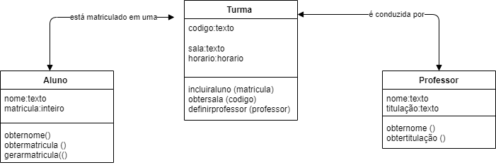

Continuando o entendimento do nosso exemplo de diagrama de classe: o ALUNO está matriculado em uma TURMA, e podemos dizer até que um aluno só possui uma única turma. A TURMA é formada por vários alunos. Um PROFESSOR ministra aulas em uma TURMA. O PROFESSOR, dependendo da sua disciplina, pode ministrar aulas em mais de uma TURMA. E uma TURMA pode ter mais de um PROFESSOR relacionado.

Todos esses relacionamentos são essenciais para entendermos como é a dinâmica da escola e, consequentemente, como o software deverá funcionar para atender a essa realidade.

Portanto, fica claro que dependendo da organização de cada escola, o software deve ser modelado e construído de acordo. Por isso, a importância de levantar e entender bem os requisitos, e, após isso, modelar as classes de forma que implementem da melhor forma possível a necessidade do cliente. Dessa forma, o Diagrama de Classes modela o entendimento sobre quais são as classes relacionadas com o escopo do software, assim como o relacionamento entre elas, mostrando como as informações se encaixam e se comunicam entre si para que o software faça tudo o que precisa ser feito para atender às necessidades do cliente.

Agora que entendemos o objetivo de um Diagrama de Classes, vamos entender um pouco mais sobre como ele é construído.

1.1 Diferença entre classe e objeto Apesar de entender uma classe como um conjunto de objetos, é importante esclarecer a diferença entre classe e objeto.

O objeto é uma instância da classe. Vamos a um exemplo para ficar mais claro o conceito.

Imagine que temos uma classe AUTOMÓVEL. Dentro dessa classe temos uma instância para cada automóvel, ou seja, o HONDA CIVIC de placa ABC9D99 é um objeto dentro da classe AUTOMÓVEL, assim como o Fiat Argo placa EFG8I88 é outro objeto dentro da classe AUTOMÓVEL.

Dessa forma, seguindo os conceitos da orientação a objetos, toda vez que crio um novo objeto dentro da classe dizemos que criamos uma nova instância da classe, ou a instanciamos.

Por último, para reforçar o conceito, vamos utilizar uma metáfora com a construção civil.

Digamos que classe seja a planta de uma casa, seja o planejamento, o modelo a ser seguido para que a casa seja construída dentro de certas características. É algo abstrato, é algo lógico. Nem sempre é possível compreender e visualizar toda a casa apenas olhando a planta, mas lá estão definidos todos os elementos que a casa terá e as características básicas que comporão cada um dos cômodos da casa. No caso de um software, a classe só existe na codificação. A classe tipifica o que será modelado por ela, apresenta as características e determina os estados possíveis e os comportamentos que os objetos podem ter.

Já o objeto é a casa em si. É algo concreto, algo físico. Em desenvolvimento de software, os elementos de um objeto estão, de fato, presentes ali, é algo palpável, é algo que pode ser manipulado. Ele existe na memória, durante a execução do programa. O objeto possui valores para os estados definidos e chamam os comportamentos definidos executando os algoritmos do código.

Então, o objeto é uma instância da classe. Na classe você pode dizer que aquele objeto terá uma cor, no objeto você diz qual é a cor, só pode dizer isso porque foi definido na classe que essa informação deve estar no objeto. Portanto, apesar de a classe ser um conjunto de objetos, eles não são sinônimos e cada um tem o seu objetivo de existir.

Em outras palavras, ou melhor, usando outro exemplo para explicar a diferença entre objeto e classe, podemos verificar que a classe AUTOMÓVEL é algo abstrato, mas o HONDA CIVIC placa ABC9D99 é um objeto por ser algo concreto, que possui características e ações a serem tomadas como requisitos para a manipulação e processamento da classe AUTOMÓVEL.

1.2 Elementos de um diagrama de classe Um diagrama de classe é formado por vários elementos que possuem objetivos próprios, e que juntos mostram as informações pertencentes a cada classe além das ações sob responsabilidade de cada classe.

Pensando sobre esse conceito de ações sob responsabilidade de cada classe, é importante perceber que uma classe de ALUNO não pode ter ações relacionadas com PROFESSOR, por exemplo. Quando as ações são organizadas corretamente na sua classe de origem, fica mais fácil entender o funcionamento do software.

Vamos a um exemplo desse conceito que acabamos de discutir. Imagine que uma das ações possíveis em um software de escola seja Matricular Aluno. Essa ação está relacionada a vincular um ALUNO novo a uma TURMA, portanto, o ideal é essa ação ficar na classe ALUNO, e a classe ALUNO ter um relacionamento com a classe TURMA, para informar a qual TURMA o ALUNO pertence. Não faz nenhum sentido a ação de Matricular Aluno estar, por exemplo, na classe PROFESSOR.

Dessa forma, o raciocínio utilizado para modelar um diagrama de classe é entender, logicamente, o funcionamento dos requisitos, pensando nas classes envolvidas e qual o papel de cada uma no software como um todo. Mas vamos voltar um pouco e entender os elementos que formam um diagrama de classes:

• classes – são os objetos do mundo real que estão relacionados com o escopo do software a ser construído; • relacionamentos – é como as classes trocam informações entre si. Os relacionamentos podem ser de mais de um tipo, o que veremos a seguir; • métodos relacionados com cada classe – os métodos são as ações que estão sob responsabilidade de cada classe, ou seja, são as ações que devem ser executadas por cada classe para implementar o escopo pertencente a cada classe, por exemplo, o “Matricular Aluno” que discutimos anteriormente.

As classes são ainda compostas por atributos, tipo de atributos e métodos. Vamos entender melhor todos esses conceitos.

### TEMA 2 – CLASSES, ATRIBUTOS E MÉTODOS

Já entendemos que um diagrama de classe é composto por um conjunto de classes e seus relacionamentos, modelando, assim, o mundo real que o software irá implementar.

E como as classes estão relacionadas com objetos do mundo real, o diagrama de classe está relacionado com a orientação a objetos, que é uma metodologia para analisar, projetar e construir projetos de software. Vamos agora entender em detalhes o que compõem uma classe e o objetivo de cada um desses elementos.

2.1 Classes Já discutimos que as classes podem ser entendidas como uma abstração de um conjunto de coisas que possuem características e operações em comum. Dessa forma, as classes surgem da união de vários objetos que possuem coisas em comum e são o conjunto de atributos de uma classe que darão ao programador a noção do domínio do problema. Portanto, o domínio do problema são as informações referentes à classe identificada para o escopo do software que está sendo modelado e será construído.

Para manter as boas práticas de organização de código, as classes devem receber nomes de acordo com o vocabulário do domínio do problema. Ou seja, deve-se padronizar os nomes que serão utilizados no software, desde os requisitos até as variáveis do código. Por exemplo, se uma empresa chama seus profissionais de COLABORADORES, este deve ser o nome utilizado em todo o software, desde o nome da classe, o nome do atributo e até mesmo o nome da variável dentro do programa. Dessa forma, fica mais fácil de entender o código e de organizá-lo.

Outra boa prática bastante comum é adotar um padrão para dar nome às classes, como todos os nomes de classes serão substantivos singulares com a primeira letra maiúscula (Colaborador, por exemplo, para se referir à classe que instancia o objeto colaborador no software a ser modelado).

O modelo de classes tem os atributos e o comportamento que as informações devem assumir ao longo do funcionamento do software. 2.2 Atributos Os atributos representam o conjunto de características ou estados dos objetos de uma determinada classe. Os atributos podem também ser entendidos como propriedades semelhantes que os objetos de uma classe possuem. Por exemplo, em uma classe ALUNO, o objeto ou instância “João da Silva”, além do nome é caracterizado por outros atributos, como endereço, número da matrícula, CPF, entre outros atributos ou características de ALUNO ou, mais especificamente, do “João da Silva”.

Cada atributo permite definir um intervalo de valores em que as instâncias dessa propriedade podem apresentar. Meu carro é branco, o seu é preto. Essas propriedades de carro são descritas pelo atributo cor, na classe AUTOMÓVEL.

O aluno se chama “João da Silva” e tem a matrícula “123456789”. Essas propriedades de aluno são descritas pelos atributos nome e matrícula, na classe ALUNO.

Dependendo do uso que será dado a cada atributo, a visibilidade que é o estado como o atributo se apresenta, pode ser classificado em público, protegido ou provado. Vamos entender a diferença entre os estados de visibilidade de um atributo.

• Um atributo definido como + público é visível em qualquer classe de qualquer pacote; • Um atributo definido como # protegido é visível para classes do mesmo pacote; • Um atributo definido como - privado é visível somente para a classe na qual foi definido.

Quando modelamos um diagrama de classe, podemos utilizar apenas os símbolos +, - ou # para demostrar a visibilidade do atributo, representando que o atributo é público, protegido ou privado, respectivamente. Um pacote é um conjunto de classes relacionadas entre si, por exemplo, em um software é possível criar um pacote relacionando uma classe-mãe chamada MEIO DE TRANSPORTE, e as classes-filho chamadas AUTOMÓVEL e CAMINHÃO.

O atributo possui ainda um tipo, que corresponde ao tipo de informação que ele pode assumir. Por exemplo, no caso de aluno, da classe ALUNO, o objeto poderá receber informações do tipo “texto” ou “text”, pois o nome de um aluno sempre será formado por texto. Enquanto a matrícula do aluno deverá ser definida com o tipo “inteiro” ou “integer”, pois receberá como conteúdo apenas números.

O tipo e a visibilidade do atributo devem ser definidos a partir do entendimento dos requisitos do software e, mais especificamente, das classes que vão modelar o mundo real relacionado com o escopo do software. Agora que já entendemos como funcionam os atributos, vamos discutir o que são os métodos e como podem ser representados em uma classe.

2.3 Métodos Os métodos representam o conjunto de operações ou comportamento que a classe fornece ao software ou que a classe é responsável por executar. Por exemplo, em uma classe ALUNO, é preciso executar ações como Consultar Aluno, Alterar Dados de Aluno, entre outras. Essas ações, no diagrama de classe, seguindo a UML, são chamadas de métodos. Os métodos possuem as seguintes características em relação ao seu funcionamento:

• um método pode ou não retornar um valor – pode ser um método para fazer um cálculo e armazenar o resultado no banco de dados, dessa forma, ele não retorna nenhum valor para quem o chamou; • um método pode ou não aceitar argumentos – pode ser um método que utiliza um parâmetro para fazer determinada execução ou não receber nenhum parâmetro, quando vai, por exemplo, listar todos os alunos matriculados em uma escola; • um método, após encerrar sua execução, retorna o fluxo de controle do programa para quem o chamou, para que o processamento do software siga seu fluxo natural.

Da mesma forma como funciona o atributo, dependendo do uso que será dado a cada método, a visibilidade que é o estado como o método se apresenta, pode ser classificado em público, protegido ou provado. Vamos entender a diferença entre os estados de visibilidade de um método.

• Um método definido como + público é visível em qualquer classe de qualquer pacote; • Um método definido como # protegido é visível para classes do mesmo pacote; • Um método definido como - privado é visível somente para a classe na qual foi definido.

Quando modelamos um diagrama de classe, podemos utilizar apenas os símbolos +, - ou # para demostrar a visibilidade do método, representando que o método é público, protegido ou privado, respectivamente.

Ou seja, o objetivo e a funcionalidade da visibilidade são um padrão no diagrama de classes, facilitando o entendimento e o uso, tanto quando tratamos de atributos como quando tratamos de métodos.

Assim como acontece com o atributo, o método também possui um tipo, que corresponde ao tipo de informação que ele pode receber para executar a ação correspondente com seu objetivo. Por exemplo, no caso da classe ALUNO, uma das ações possíveis será consultar os dados de um aluno pelo método Consultar CPF do Aluno, que receberá como informação a matrícula do aluno. Logo, esse método será do tipo “inteiro” ou “integer”, pois a informação CPF, que será retornada após consultar, foi definida como podendo receber apenas números em seu conteúdo. Em resumo, o método Consultar CPF do Aluno será chamado recebendo como parâmetro um número de matrícula e retornará o número do CPF do aluno que foi consultado.

O tipo e a visibilidade do método devem ser definidos a partir do entendimento dos requisitos do software e, mais especificamente, das classes que vão modelar o mundo real relacionado com o escopo do software. Vamos a um exemplo para esclarecer o que discutimos na teoria. Em uma classe ALUNO, podemos ter o método - getNome() : String. Este método é privado (sabemos disse por conta do símbolo – que foi usado antes do nome do método), ou seja, apenas na classe ALUNO poderá chamá-lo. E a responsabilidade do método, ou seja, o seu objetivo é retornar uma lista de nomes de alunos. Por isso, ele foi definido com o tipo String, que retorna uma lista de informações, nesse caso, uma lista de nomes de alunos. Agora que já entendemos como funcionam os atributos e os métodos de uma classe, vamos discutir como as classes se relacionam entre si e quais os tipos de relacionamentos possíveis entre elas.

### TEMA 3 – RELACIONAMENTOS

Como o objetivo de um diagrama de classes é mostrar visualmente as classes de um software e o relacionamento entre elas, é preciso entender o que exatamente são os relacionamentos.

O objetivo dos relacionamentos entre as classes é garantir a comunicação e o compartilhamento de informações entre elas, mostrando em detalhes como ocorre a colaboração de umas com as outras.

Os relacionamentos entre as classes podem ser complexos, dependendo da complexidade dos requisitos de um software. Para entender o comportamento de um relacionamento, existem características, como:

• nome – descrição dada ao relacionamento (faz, tem, possui, entre outros, dependendo do objetivo do relacionamento em questão); • sentido de leitura – mostrando qual classe é a origem e qual classe é o destino do relacionamento; • navegabilidade – indicada por uma seta no fim do relacionamento. A navegabilidade está relacionada com o sentido da leitura que será feito para compreender o relacionamento; • multiplicidade – indica como o relacionamento poderá ser verificado na classe. Por exemplo, a classe TURMA poderá ter de 0 até N alunos, portanto, ela possui a multiplicidade 0...*. Já um aluno poderá estar vinculado a apenas uma turma, porém, antes de a matrícula ser efetiva, esse aluno ainda não está em nenhuma turma, portanto, a multiplicidade dele será 0...1. Imagine que um professor, por uma regra da escola, só pode estar associado a no máximo três turmas, mas sempre terá que estar vinculado a pelo menos uma turma, logo, a multiplicidade dele será representada por 1...3. Dessa forma, a multiplicidade de um relacionamento é muito importante para entender as regras de um requisito do software; • tipo – representa o tipo do relacionamento modelado de uma classe com a outra; • papéis – desempenhados por classes em um relacionamento.

De acordo com a UML3, os principais tipos de relacionamentos encontrados em um diagrama de classe são:

• associação; • generalização; • dependência.

3 Disponível em: <https://www.uml.org/>. Acesso em: 9 set. 2021.

Figura 2 – Exemplo de características de um relacionamento

Fonte: Costa, 2021.

Nesse exemplo, podemos verificar que a classe Empresa pode ter uma ou mais pessoas como empregado. E que uma pessoa pode ser empregada em nenhuma ou em mais de uma empresa. Por conta da navegabilidade apresentada, a leitura do relacionamento é entendida como Pessoa trabalha para Empresa. E o papel da classe Pessoa é instanciar empregados e o papel da classe Empresa é instanciar empregadores. O relacionamento entre a classe Pessoa e a classe Empresa é do tipo associação, pois o relacionamento apenas associa as duas classes. Mas vamos entender melhor essa parte de tipo de relacionamentos a seguir.

Vamos detalhar cada um dos tipos de relacionamentos listados nas características do relacionamento.

3.1 Tipos de relacionamentos Reforçando o que vimos anteriormente, de acordo com a UML4, os principais tipos de relacionamentos encontrados em um diagrama de classe são: • associação; • generalização; • dependência.

4 Disponível em: <https://www.uml.org/>. Acesso em: 9 set. 2021.

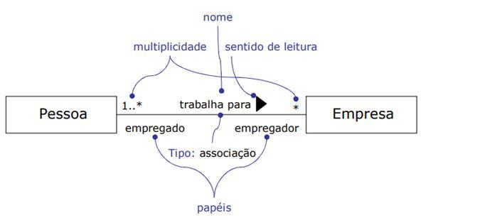

Vamos começar a entender o relacionamento mais comum encontrado nos diagramas de classe, que é o relacionamento de Associação. • Associação – é um relacionamento estrutural que indica que os objetos de uma classe estão vinculados a objetos de outra classe. Uma associação é representada por uma linha sólida entre duas classes, conforme o exemplo das classes PESSOA e EMPRESA, a seguir.

Figura 3 – Exemplo de relacionamento de associação

Fonte: Costa, 2021.

Um relacionamento de associações possui todas as características apresentadas anteriormente para um relacionamento, conforme pode ser analisado no exemplo a seguir.

Figura 4 – Exemplo de relacionamento com as principais características

Fonte: Costa, 2021.

No exemplo apresentado, um ESTUDANTE compete em uma EQUIPEFUTEBOL e esse mesmo ESTUDANTE participa de uma DISCIPLINA. Podemos entender esses nomes de relacionamento analisando a navegabilidade e direção do relacionamento.

No contexto do software que está sendo modelado nesse exemplo, o papel assumido pela classe EQUIPEFUTEBOL é ser um time. O papel assumido pela classe ESTUDANTE é ser um jogador, no relacionamento dessa com a classe EQUIPEFUTEBOL, é ser um aluno, no relacionamento com a classe DISCIPLINA. Portanto, podemos entender que uma classe pode assumir diferentes papéis dependendo de qual classe ela está se relacionando.

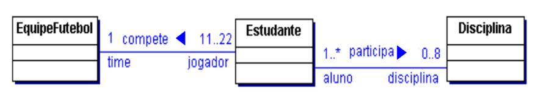

Em relação à multiplicidade, podemos entender que um ESTUDANTE pode competir por apenas uma EQUIPEFUTEBOL, mas que uma EQUIPEFUTEBOL é formada por 11 ou até 22 ESTUDANTES. Um ESTUDANTE pode participar ou estar matriculado em nenhuma ou em até oito disciplinas. O ALUNO pode não participar de nenhuma DISCIPLINA quando ainda não realizou sua matrícula em disciplinas. Já uma DISCIPLINA pode ter a participação de um ou de muito alunos (representado pelo n), ou seja, nesse exemplo, uma DISCIPLINA só passa a existir quando pelo menos um aluno se matricula nela.

• Generalização: é um relacionamento entre itens gerais, de uma superclasse ou classe-mãe e itens mais específicos, subclasse ou classe- filha. É um relacionamento que utiliza o conceito de herança, da orientação a objetos, permitindo que as subclasses herdem características da superclasse.

Figura 5 – Exemplo de relacionamento de generalização

Fonte: Costa, 2021.

As subclasses sempre serão entendidas como classes de um tipo da superclasse, ou seja, os objetos da subclasse são tipos possíveis da superclasse em questão, conforme pode ser verificar no exemplo em que a classe VEÍCULO pode ter duas subclasses, para representar os veículos TERRESTRE e os veículos AÉREO.

Com esse tipo de relacionamento, é possível entender que todas as características de VEÍCULO são compartilhadas também com as classes TERRESTRE e AÉREO. Além disso, as subclasses TERRESTRE e AÉREO podem ter características próprias, que só serão válidas para elas, tais como

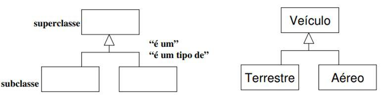

atributos específicos ou mesmo métodos que só fazem sentido a uma ou outra subclasse.

Dessa forma, é possível aproveitar características que sejam em comum para todas as classes, sejam elas a superclasse e as subclasses, sem precisar repetir essas características quando definirmos as subclasses. Dependência – é um relacionamento que representa a dependência entre classes quando estas sofrem mudanças de estado. Com esse relacionamento é possível entender o impacto e como uma classe é afetada quando a outa classe é modificada.

O relacionamento de dependência é um tipo menos comum de relacionamento em diagramas de classe. Ele identifica uma ligação fraca entre objetos de duas classes, pois mostra como uma classe é impactada quando outra classe é modificada.

Esse tipo de relacionamento é representado por uma reta tracejada entre as duas classes, em que a seta na extremidade da reta indica a classe dependente.

Vamos analisar um exemplo.

Figura 6 – Exemplo de relacionamento de dependência

Fonte: Costa, 2021.

Nesse exemplo, a classe DEPENDENTE, que contém os filhos e esposa/marido de um funcionário, só existe enquanto o profissional for um FUNCIONÁRIO de uma empresa. Ou seja, se o “João da Silva” deixar de ser um objeto da classe FUNCIONÁRIO, automaticamente os dependentes associados a ele na classe DEPENDENTE também deixarão de ser objetos válidos. Ou seja, os objetos da classe DEPENDENTE são impactados pela mudança de estado na classe FUNCIONÁRIO.

O uso de cada tipo de relacionamento apresentado nesta aula dependerá do software e dos relacionamentos entre as classes desse software.

Vamos agora analisar a construção de um exemplo de diagrama de classe, buscando entender a lógica utilizada nessa parte da análise de um software.

### TEMA 4 – TÉCNICAS DE MODELAGEM DE DIAGRAMA DE CLASSE

Existem várias ferramentas disponíveis no mercado para modelar os diagramas da UML.

Cada ferramenta terá características e funcionalidades mais ou menos evoluídas e em graus diferentes da facilidade de uso. O importante é entender os conceitos por trás de um diagrama de classe, e aprender a aplicar esses conceitos na ferramenta a qual será utilizada em seu projeto. Por isso, vamos exercitar a análise e a modelagem de um diagrama de classe passo a passo no exemplo a seguir, relacionado com um software de efetuar matrícula para uma escola.

4.1 Entendendo os requisitos do software O primeiro passo é entender a necessidade do cliente, que, neste exemplo, possui os seguintes requisitos:

Figura 7 – Descrição dos requisitos do exemplo analisado

Fonte: Costa, 2021.

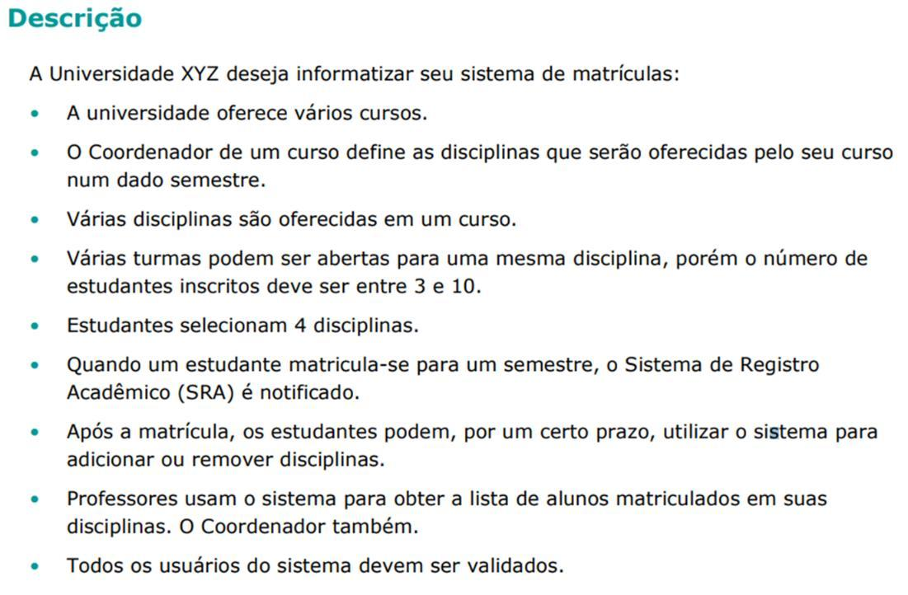

Após entender os requisitos, é importante modelar o diagrama de caso de uso, conforme estudado em outro momento.

Para esse exemplo, o diagrama de caso de uso pode ser modelado conforme o diagrama apresentado a seguir, lembrando que o diagrama de caso de uso depende da interpretação dos requisitos, portanto, pode ser modelado de outra forma além da apresentada no exemplo.

Figura 8 – Diagrama de caso de uso do exemplo analisado

Fonte: Costa, 2021.

Após modelar o diagrama de caso de uso, é preciso detalhar os casos de uso, com o entendimento dos requisitos funcionais levantados com os clientes. Nesse exemplo, vamos descrever o funcionamento do caso de uso “Matricular em Disciplina”, que é um dos casos de uso principais do nosso exemplo. O objetivo não é explicar como descrever um caso de uso, pois isso já foi estudado em aulas anteriores.

O objetivo nesse exemplo é mostrar o passo a passo e a lógica utilizada na análise de um software até a modelagem de um diagrama de classe.

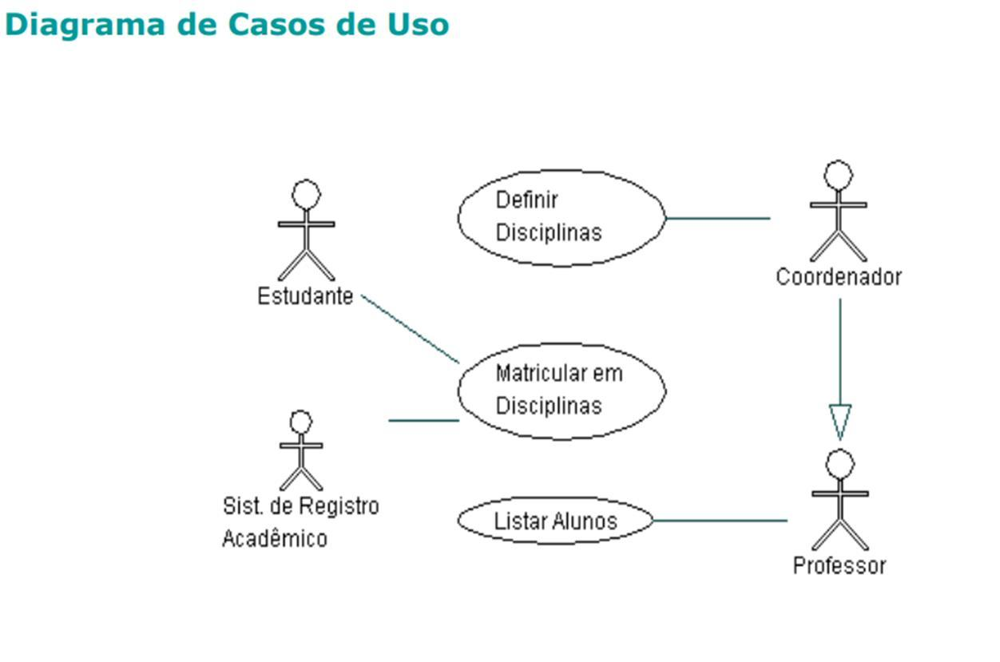

Figura 9 – Descrição de caso de uso

Fonte: Costa, 2021.

Nesse ponto do passo a passo, fizemos o levantamento dos requisitos, modelamos o diagrama de casos de uso e descrevemos os casos de uso do software.

Com esse entendimento sobre o escopo do software e o funcionamento dos requisitos, podemos passar a trabalhar no diagrama de classe. 4.2 Identificando as classes Nesse momento do processo de análise de um software já temos o entendimento necessário dos requisitos que deverão ser implementados para atender à necessidade do cliente, portanto, estamos prontos para começar a analisar e a projetar como os requisitos levantados poderão ser implementados. O próximo passo será identificar as classes que implementam o mundo real relacionado com o escopo do software a ser construído, vários objetos por estarem relacionados com o ambiente de um sistema escolar, mas, nesse momento, foque no que é essencial para o software em questão, de forma a identificar realmente as principais classes que implementarão os requisitos e apenas essas.

Não há aqui uma resposta única para a implementação desse software, outro conjunto de classe pode ser identificado a partir dos requisitos desse

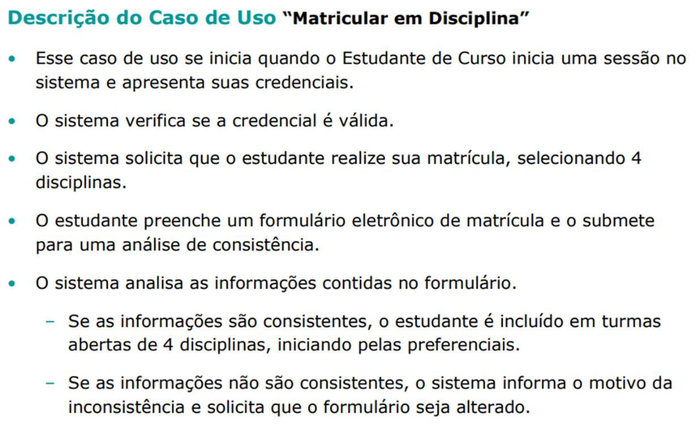

exemplo. A lista a seguir foi gerada a partir da interpretação dada por mim para a implementação do software em questão.

Figura 10 – Classes relacionadas com o exemplo analisado

Fonte: Costa, 2021.

As classes identificadas foram listadas pensando na implementação dos requisitos, listando, inclusive, classes de relacionamento entre as classes principais do software, de forma a facilitar e a otimizar a codificação do software. A identificação das classes também depende da lógica de funcionamento pensada para o software, além dos requisitos que precisam ser atendidos. 4.3 Identificando os relacionamentos Após identificar as classes que serão necessárias para implementar os requisitos é preciso analisar e modelar os relacionamentos entre elas, baseado nos atributos e métodos definidos para cada uma das classes. Nesse exemplo, foram listados os principais relacionamentos, como exemplo do passo a passo de análise de um software, conforme apresentado a seguir.

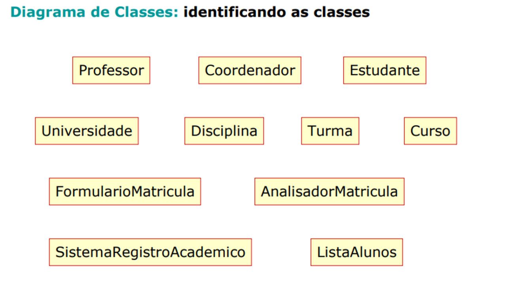

Figura 11 – Modelagem dos relacionamentos

Fonte: Costa, 2021.

Quando os relacionamentos são modelados, é possível compreender o comportamento entre as classes e como as informações fluem com a implementação dos requisitos. A lógica que será codificada para implementar os requisitos vai ficando explícita e o entendimento sobre o funcionamento do software como um todo vai ficando mais claro.

O entendimento pode ser construído por partes, de forma a modelar o relacionamento de todas as classes listadas.

Nesse passo do processo de modelagem de um diagrama de classe, os atributos e métodos já devem ter sido listados para cada uma das classes identificadas. Para listar os atributos, é preciso entender quais informações serão importantes em cada uma das classes.

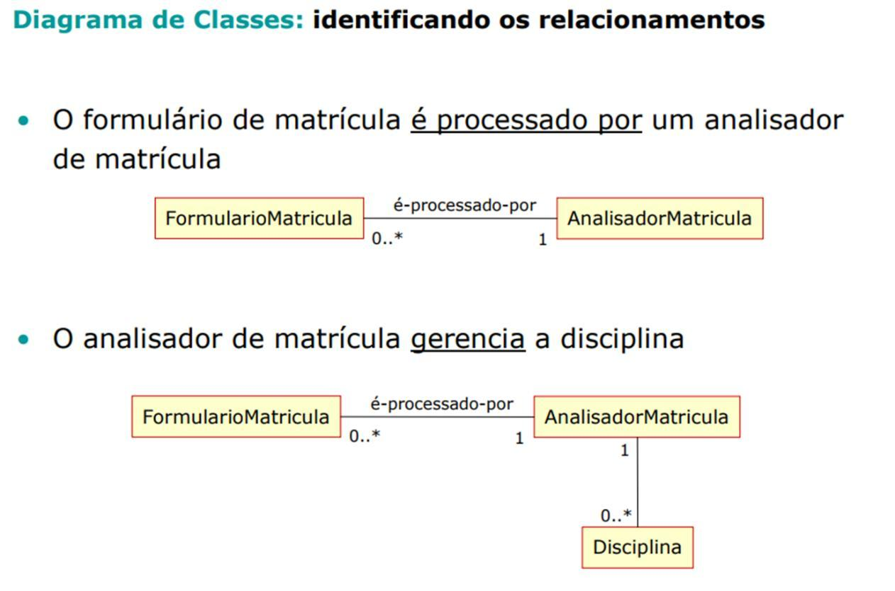

Figura 12 – Lógica para identificar atributos de uma classe

Fonte: Costa, 2021.

Nesse momento, também, os elementos das classes e as características dos relacionamentos entre elas estão modeladas e é possível analisar o funcionamento do software de forma mais completa, identificando a multiplicidade, navegabilidade e nome dos relacionamentos.

4.4 Completando o diagrama de classe Com os atributos e métodos listados, os relacionamentos vão deixando mais precisas as características necessárias para modelar e atender a cada uma das regras de negócio do software.

Esse é, portanto, o passo final para a modelagem completa do diagrama de classe de um software, sempre lembrando que o diagrama deve refletir a implementação que será dada aos requisitos do cliente pelo software em construção.

Logo, o diagrama de classe deve ser validado tanto pela equipe técnica que vai construir o projeto para garantir o entendimento do que deve ser feito quanto pelo cliente ou usuário, para garantir que todas as regras de negócio e requisitos funcionais foram corretamente entendidos e serão implementados.

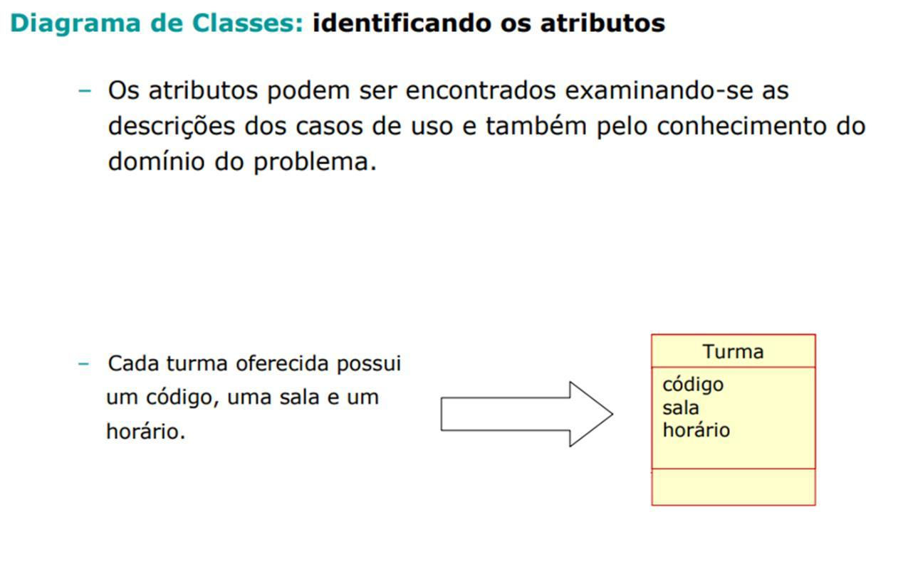

Figura 13 – Diagrama de classe proposto para o exemplo analisado

Fonte: Costa, 2021.

Fazer a análise de um software não é algo trivial e envolve uma lógica complexa para transformar as necessidades de um cliente, que é algo ainda intangível e abstrato, em algo mais objetivo, que ajude a compreender como o software deverá ser implementado para gerar uma solução eficiente para resolver da melhor forma possível o problema que o cliente precisa resolver pela automatização e construção de um software.

Portanto, procure estudar esse exemplo e busque exercitar o entendimento da lógica de análise de um software, desde o levantamento dos requisitos até a modelagem do diagrama de classe.

### TEMA 5 – ANALISANDO UM EXEMPLO DE DIAGRAMA DE CLASSE

Vamos agora voltar ao nosso estudo de caso, analisando como seria a descrição de casos de uso para documentar alguns requisitos. Vamos relembrar nosso estudo de caso.

O nosso estudo de caso é o seguinte: “fomos contratados pelo nosso cliente para modelar o processo de vendas on-line de livros. O nosso cliente tem uma livraria virtual, que vende produtos diretamente em um site próprio. O diferencial dessa livraria é ter um estoque próprio, o que garante uma entrega

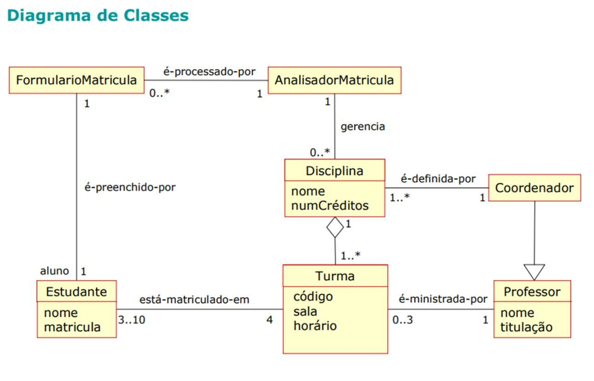

mais rápida a seus clientes, e aceitar vários tipos de pagamento, como cartão de crédito, cartão de débito e boleto bancário. A livraria possui um programa de fidelidade, que permite desconto de 10% aos clientes que comprarem R$ 500,00 ou mais em um ano”.

O estudo de caso proposto pode ser detalhado em várias classes e, como o diagrama de classe pode ser subdividido para representar partes do software, escolhemos modelar a parte do diagrama de classe que representa as classes e seus respectivos relacionamentos para os casos de uso “Utilizar Programa de Fidelidade” e “Atualizar Programa de Fidelidade”, para analisar nesta aula. Lembrando que o UC01 – Utilizar Programa de Fidelidade é chamado após o cliente selecionar um ou mais produtos e clicar em Carrinho de Compras, na tela de compras de produto. Esse caso de uso vai mostrar, na tela do Carrinho de Compras o valor de desconto aplicado à compra, caso o cliente seja elegível ao desconto, por ter atingido R$ 500,00 em compras realizadas no último ano. Se o cliente não tiver atingido o valor de compras que o habilita para o desconto de fidelidade, o campo de desconto será apresentado na tela do Carrinho de Compras com R$ 0,00.

E, lembrando que o UC02 – Atualizar Programa de Fidelidade é um caso de uso interno do sistema, sem interação com o usuário, por isso, é um caso de uso sem MSG. O objetivo do caso de uso é identificar se um cliente é elegível a ter o desconto por fidelidade na próxima compra que efetuar. Com base no entendimento sobre os casos de uso, é possível listar as seguintes classes principais: CLIENTE, FIDELIDADE, PEDIDO e PRODUTO DO PEDIDO.

Na classe CLIENTE, podemos listar os principais atributos, sendo: Nome (texto), CPF (inteiro), Telefone (inteiro) e Endereço (texto). Na classe FIDELIDADE, podemos listar os principais atributos, sendo: Status Fidelidade (boolean), que é um tipo que recebe apenas duas informações, neste caso: “Sim” ou “Não”, informando se o cliente é ou não elegível ao programa fidelidade, dependendo do valor gasto no último ano, conforme descrição do caso de uso. Outro atributo importante na classe FIDELIDADE é o CPF (inteiro), para identificar a qual cliente se refere.

Na classe PEDIDO, podemos listar os principais atributos sendo: NÚMERO (inteiro), para identificar o pedido em si. CPF (inteiro), para relacionar a qual cliente se refere. Data do Pedido (data), mostrando o dia, mês e ano da

realização do pedido. Valor do Pedido (real), mostrando o valor total gasto pelo cliente no pedido. O valor do pedido receberá o valor total da soma de todos os produtos comprados pelo cliente no pedido, o que vai facilitar a verificação de disponibilidade ou não do uso da Fidelidade em uma nova compra. A classe PRODUTO DO PEDIDO pode ser criada, pois um PEDIDO pode ser composto por um ou mais produtos. Dessa forma, para facilitar o entendimento e a codificação do software, pode ser necessário criar uma classe de PRODUTO DO PEDIDO, para evitar repetir os dados do cliente e do pedido em si, em cada instância de produto comprado pelo cliente no mesmo pedido. Dessa forma, podemos listar os principais atributos sendo: NÚMERO (inteiro), que é o atributo que identifica a qual pedido os produtos da classe estão relacionados. PRODUTO (inteiro), que é um atributo para identificar o produto adquirido no pedido em questão. QUANTIDADE PRODUTO (inteiro), que identifica qual a quantidade do produto em questão foi adquirida pelo cliente. VALOR UNITÁRIO (real), que é o valor unitário do produto adquirido. Os tipos de dados de um atributo podem variar de linguagem para linguagem, mas é importante entender que o tipo de dado mostra o conteúdo que o atributo poderá tratar, sendo ele texto ou números, por exemplo. Os relacionamentos e suas características devem ser definidos com base na interpretação dada aos casos de uso e ao funcionamento do software como um todo.

Reforçando que o exemplo proposto nesta aula se baseia no entendimento dado ao estudo de caso em questão e que não existe apenas uma forma de implementar os casos de uso.

Portanto, exercite seu entendimento sobre o diagrama de classe pensando em outras formas possíveis de relacionamento, além de exercitar outros atributos necessários e até mesmo, outras classes que ajudem a representar o muito real definido pelo escopo do nosso estudo de caso.

### FINALIZANDO

Chegamos ao final da nossa aula e esperamos que os conceitos vistos aqui tenham ficado claros.

A análise de sistemas é responsável por analisar os requisitos levantados para atender a necessidade do cliente e detalhar como será sua implementação e funcionamento no software que será construído.

Uma das formas de detalhar o funcionamento dos requisitos do software é pelo diagrama de classe que mostra, de maneira visual, quais são as classes que representam o mundo real relacionado com o escopo do software, os seus atributos e métodos, além do relacionamento de uma classe com a outras ou as outras.

O diagrama de classe, portanto, mostra uma visão lógica, detalhando como se dará a comunicação e quais serão as ações possíveis em cada classe do software.

O diagrama de classe é um diagrama completamente relacionado com a orientação a objetos, portanto, utiliza os principais conceitos dessa metodologia de análise, projeto e codificação de software, baseada em objetos para compreender o cenário no qual o software que será construído está inserido. Por ser um diagrama muito útil para ajudar a compreender o funcionamento dos requisitos e como estes requisitos serão implementados pelo software por meio de objetos, ele é o diagrama mais utilizado atualmente na engenharia de software, mesmo quando falamos em metodologias ágeis para desenvolvimento de software.

Depois de todo conteúdo discutido durante esta aula, vamos continuar navegando na análise de sistema de um projeto de software. Futuramente, falaremos sobre outros diagramas da UML, utilizados para modelar outras partes do software.

### REFERÊNCIAS

BECKER, J.; ROSEMANN, M.; VON UTHMANN, C. Guidelines of business process modeling. In: VAN DER, A., W.; DESEL, J.; OBERWEIS, A. (Ed.). Business Process Management. New York: Springer Berlin Heidelberg, 2000. p. 30-49.

COHN, M. User Stories Applied for Agile Software Development. Assison- Wesley Professional, 2004.

GANE, C.; SARSON, T. Análise estruturada de sistemas. LTC, 1983. IBM; https://www.ibm.com/docs/pt-br/rsas/7.5.0?topic=structure-class-diagrams YOURDON, E. Análise estruturada moderna. Editora Campus. Tradução da Terceira Edição Americana, 1992.

LAPLANTE, P. A. Requirements engineering for software and systems. Boca Raton: CRC Press, 2013.

MALL, R. Fundamentals of software engineering. New Delhi: PHI Learning, 2014.

OGUNNAIKE, B. A.; RAY, W. H. Process dynamics, modeling, and control. Oxford: Oxford University Press, 1994.

PAIM, R. et al. Gestão de Processos: pensar, agir e aprender. Porto Alegre: Bookman. 2009. 328 p.

PIZZA, W. R. A metodologia Business Process Management (BPM) e sua importância para as organizações. Monografia (Curso de Tecnologia em Processamento de Dados) – Faculdade de Tecnologia de São Paulo – FATEC- SP, São Paulo, 2012.

PRESSMAN, R. S.; MAXIM, B. R. Engenharia de Software: uma abordagem Profissional. Mc Graw Hill Educattion. 8. ed. 2016.

ROSEMANN, M.; BROCKE, J. V.; HONORATO, B. Manual de BPM: gestão de processos de negócio. Porto Alegre: Bookman, 2013.

SILVER, B.; RICHARD, B. BPMN method and style. v. 2. Aptos: Cody-Cassidy Press, 2009.

UML. UML. Disponível em: <https://www.uml.org/>. Acesso em: 6 set. 2021.

WIEGERS, K.; BEATTY, J. Software requirements. 3. ed. London: Pearson Education, 2013.
