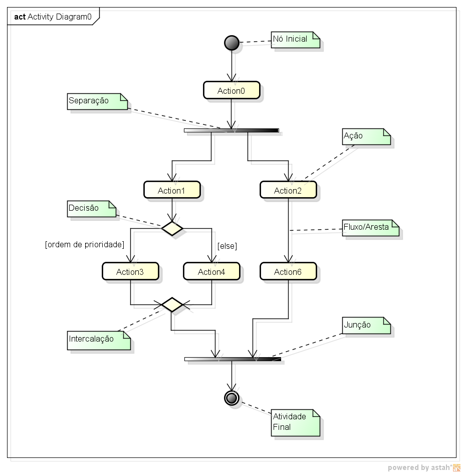
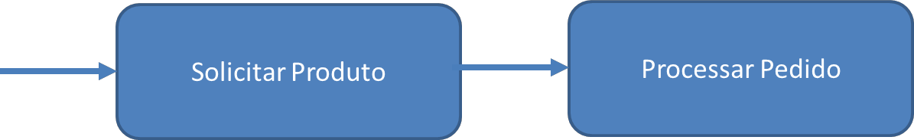
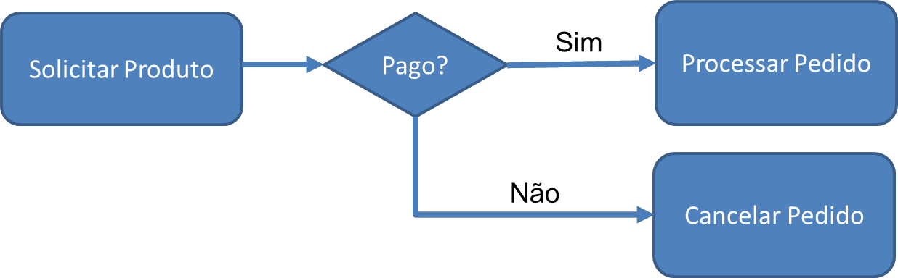
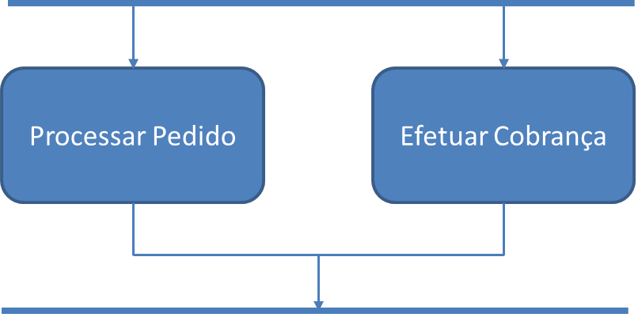
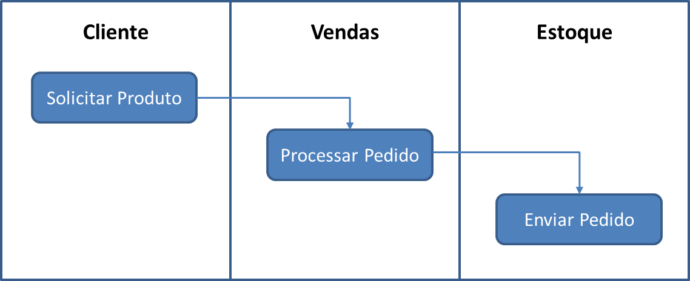
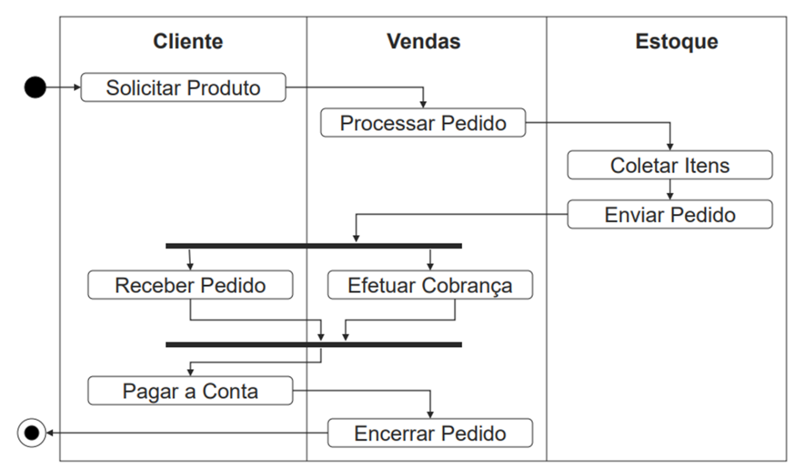
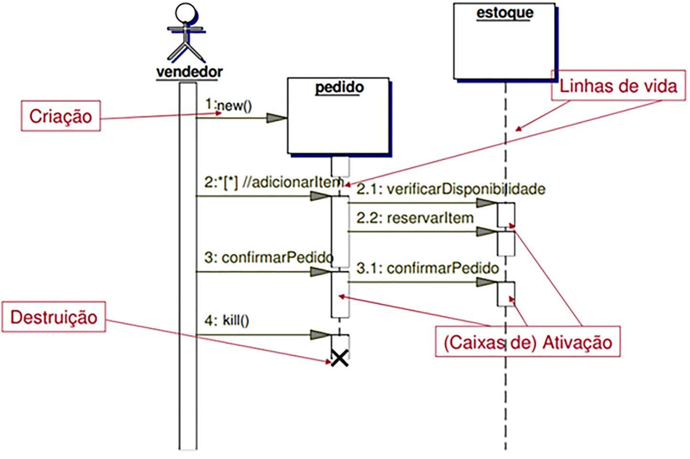
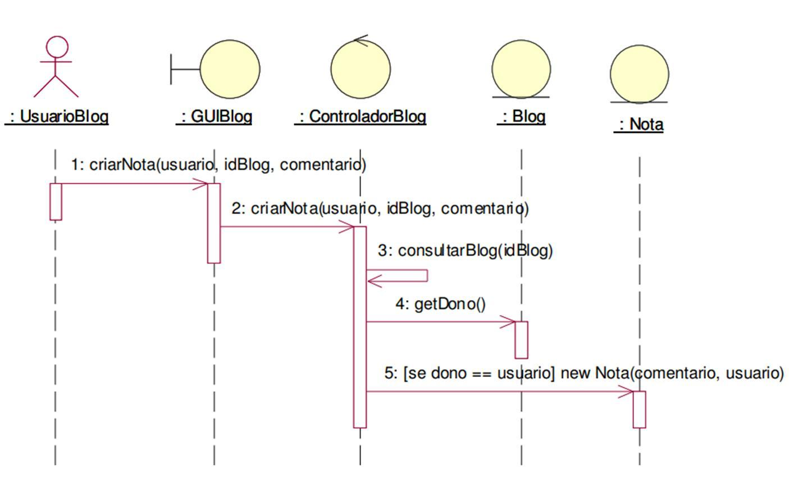
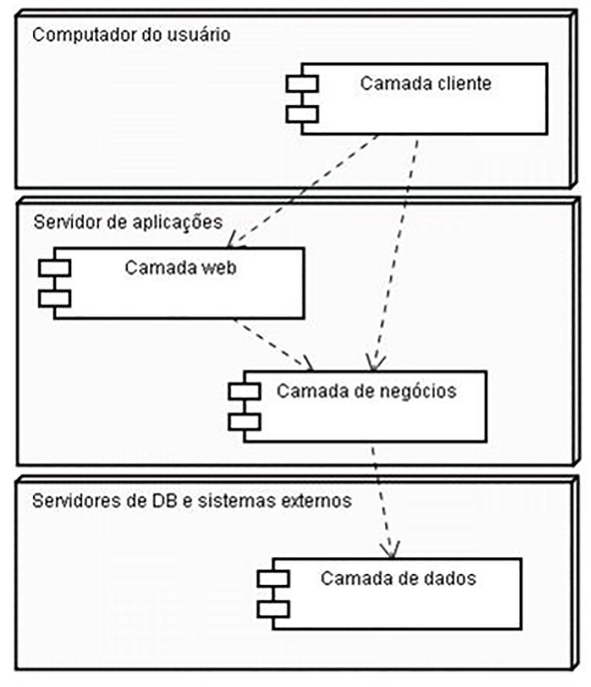
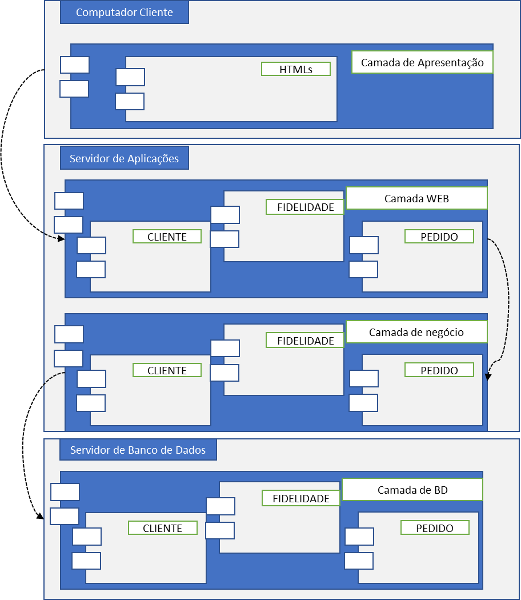

# Análise e Modelagem de Sistemas (937893)
## Aula 6 — Outros Diagramas Importantes

> Texto integral da apostila oficial da Uninter (sem resumo). PDF original: [Aula_06.pdf](../_apostilas_pdf/03_Analise_Modelagem/Aula_06.pdf)

ANÁLISE DE SISTEMAS AULA 6

Profª Adriana Bastos da Costa

### CONVERSA INICIAL

Nas aulas anteriores, já conversamos sobre modelagem de processos de negócios, análise de sistemas focando na análise estruturada, sobre engenharia de requisitos e sua importância para a correta construção do software e sobre como modelar os requisitos em diagramas de forma a construir uma solução para implementá-los.

A cada aula que avançamos, fica ainda mais claro que os estudos sobre Análise de Sistemas são fundamentais para todo profissional que deseja desenvolver softwares, pois é a disciplina que permite ao aluno traduzir, por meio de modelos e documentação específica, as necessidades de negócio do cliente em um projeto técnico de software.

É a disciplina que apresenta a necessidade de planejar tecnicamente um software antes de ele ser codificado, para que os objetivos de negócio do cliente sejam atendidos. E a base para todo software bem construído está no levantamento, na análise e no projeto adequado do software capaz de atender às necessidades do cliente.

Nesta aula, vamos conversar sobre vários diagramas da UML. Esses diagramas são utilizados em situações específicas de projeto, em que há valor agregado para o atendimento de partes do software. Essa visão é importante porque nos ajuda a perceber quando devemos ou não modelar um diagrama. Projetar e construir um programa de computador não é uma tarefa trivial, pois envolve conhecer bem o problema que se quer resolver e traduzir a solução ideal para o problema em linhas de código, portanto, entender bem os requisitos ou o que o software precisa fazer para atender às necessidades do cliente é a base de tudo. Se os requisitos não forem bem analisados, fica mais difícil projetar uma solução adequada e eficiente para resolver o problema do cliente. Esta aula estará organizada em cinco grandes temas, sendo eles: conhecendo o diagrama de estado; conhecendo o diagrama de atividades; conhecendo o diagrama de sequência; conhecendo o diagrama de componentes; analisando um exemplo de diagrama de componentes.

### TEMA 1 – CONHECENDO O DIAGRAMA DE ESTADO

De acordo com a UML (Unified Modeling Language)1, ela é composta por vários diagramas diferentes que representam as diversas partes de um sistema de software, ou ainda diferentes pontos de vista sobre o sistema. Já discutimos que fazer software não é algo trivial. É preciso entender a necessidade do cliente, transformar isso em requisitos e traduzir os requisitos em linguagem técnica, que será codificada em uma linguagem de programação, gerando um sistema que será usado pelos usuários.

Vamos analisar alguns dos principais diagramas da UML:

• Diagrama de Caso de Uso: mostra atores (pessoas ou outros usuários do sistema), casos de uso (os cenários onde esses usuários usam o sistema) e seus relacionamentos. Já estudamos este diagrama em outro momento de nossos estudos.

• Diagrama de Classe: mostra as classes que representam os objetos relacionados com o escopo do software e os relacionamentos entre elas. Já estudamos esse diagrama em outro momento de nossos estudos. • Diagrama de Sequência: mostra objetos e uma sequência de entradas e saídas de informações dentro deles, dando também ênfase à ordenação temporal em que essas mensagens são trocadas entre os objetos de um sistema. Entende-se por informações ou mensagens os serviços solicitados de um objeto a outro e as respostas devolvidas para cada solicitação.

• Diagrama de Comunicação ou Diagrama de Colaboração: mostra objetos e seus relacionamentos, colocando ênfase nos objetos que participam na troca de mensagens. Portanto, é um diagrama parecido com o diagrama de sequência, mas é modelado como um diagrama de objeto, onde os diversos objetos são mostrados juntamente com seus relacionamentos. Dando ênfase à ordenação estrutural em que as mensagens são trocadas entre os objetos de um sistema.

• Diagrama de Estado: é uma representação que mostra estados, mudanças de estado e eventos de um objeto ou de uma parte do sistema. Esse diagrama também pode ser chamado de Diagrama de Transição

1 Disponível em: <https://www.uml.org/>. Acesso em: 24 set. 2021.

de Estados ou Diagrama de Máquina de Estados. E é uma representação do estado ou do status em que um objeto pode se encontrar no decorrer da execução do sistema, mostrando que o objeto pode passar de um estado inicial para um estado final através de uma transição e como isso ocorre.

• Diagrama de Atividade: mostra atividades e as mudanças de uma atividade para outra com os eventos ocorridos em alguma parte do sistema, como esse fosse um fluxo de controle de uma atividade. Dá ênfase ao fluxo de controle de uma atividade para outra.

• Diagrama de Componente: mostra os componentes de programação de alto nível. Esse diagrama busca modelar como as classes deverão ser organizadas fisicamente no ambiente de desenvolvimento.

1.1 Detalhando o Diagrama de Estado O Diagrama de Estado, para a UML, é entendido como um diagrama dinâmico, pois mostra a evolução de estados em um objeto, ao longo da sua vida no software. Ou seja, mostra o comportamento de um objeto, partir de determinados eventos.

Esse diagrama pode ser desenvolvido em qualquer fase do projeto técnico do software, e qualquer elemento pode ter um diagrama de estado para melhor compreensão ou exibição de seu comportamento.

Ele se baseia na descrição de um Caso de Uso e apoia-se no Diagrama de Classes, seguindo fluxo de sequência para mostrar a mudança de comportamento ou estado.

Mas é importante ressaltar que sua construção é recomendada apenas quando existir um certo grau de complexidade na transição de um estado para outro de um ou mais objetos envolvidos no processo de negócio que está sendo modelado.

Vamos a um exemplo para compreender melhor o funcionamento e o objetivo de um Diagrama de Estado. Imagine um telefone analógico, como os de antigamente, conforme o aparelho apresentado na figura a seguir.

Figura 1 – Telefone analógico: ilustração para mostrar mudança de estado

Créditos: rawf8/Shutterstock.

Vamos representar os estados possíveis desse aparelho de telefone por meio de um Diagrama de Estado:

Figura 2 – Diagrama de Estado: objeto telefone analógico

Fonte: Costa, 2021.

As opções de estado possíveis para o objeto aparelho telefônico são: ocioso ou ocupado. E o que define o estado em que ele se encontra é se ele está ou não no ganho. Portanto, o fato ou o evento de tirar o telefone do gancho

muda o estado dele. Esse é exatamente o objetivo de um Diagrama de Estado, mostra os estados possíveis e quais os eventos geram mudança de estado. Vamos entender melhor cada um dos elementos que um Diagrama de Estado.

1.2 Elementos básicos de um Diagrama de Estado Os elementos básicos encontrados em um diagrama de Estado são o evento, o objeto, a transição e o estado em si. Esses elementos podem assumir algumas variações possíveis, conforme veremos nas explicações a seguir: • Evento: é uma ocorrência que gera uma mudança de estado. Exemplo: um aparelho telefônico é retirado do gancho, como no caso de exemplo discutido anteriormente.

O evento pode ainda ser dividido em:

• Evento externo: é causado por algo fora do limite do sistema (por exemplo, um usuário ou outro sistema).

• Evento interno: é causado por algo dentro do limite do sistema, por exemplo, uma mensagem de um objeto para outro.

• Evento temporal: causado pela ocorrência de uma data ou hora específica, ou pela passagem do tempo.

• Estado: é a condição de um objeto em determinado momento no tempo – o tempo entre os eventos. Exemplo: um telefone está no estado ocioso após o ter sido colocado no gancho e até que seja novamente retirado do gancho, ele permanece nesse estado.

• Transição: é um relacionamento entre dois estados, indicando que, quando um evento ocorre, o objeto muda do estado anterior para o estado seguinte. Exemplo: quando o evento “fora do gancho” ocorre, o telefone muda do estado “ocioso” para o estado “ativo”.

• Objeto: é o elemento que sofre a mudança de estado a partir de um evento. No nosso exemplo, o aparelho de telefone.

É importante ressaltar que nem todo software precisará ser modelado por um Diagrama de Estado, pois nem todo software possui objetos que mudam de estado de forma complexa ao longo da sua existência.

### TEMA 2 – CONHECENDO O DIAGRAMA DE ATIVIDADES

O Diagrama de Atividades mostra as atividades e as mudanças de uma atividade para outra com os eventos ocorridos em alguma parte do sistema e ajuda a compreender o fluxo de controle de uma atividade para outra. Esse diagrama tem como objetivo descrever a lógica de uma funcionalidade, de um processo de negócio e mesmo de um fluxo de trabalho.

Os Diagramas de Atividades mostram as atividades que compõem um processo do sistema e seu fluxo de controle. Para modelar o Diagrama de Atividades, é preciso decompor um processo em suas atividades, compreendendo quais atividades são sequenciais, quais são concorrentes e quais são executadas paralelamente em fluxo de negócio. Ou seja, é possível compreender que o Diagrama de Atividades é a forma de a UML representar os processos automatizados por um software.

Possui uma notação diferente, porém, o Diagrama de Atividades possui o mesmo objetivo da modelagem BPM, estudada em outro momento de nossos estudos. Visualmente, um Diagrama de Atividades possui a seguinte representação:

Figura 3 – Exemplo de Diagrama de Atividades

Crédito: Adriana Bastos da Costa.

Vamos compreender como o Diagrama de Atividades é composto e para que serve cada um de seus elementos.

2.1 Elementos de compõem um Diagrama de Atividades O Diagrama de Atividades, por representar uma sequência de ações, possui os seguintes elementos: estados iniciais e finais, atividades e transições, decisões, bifurcação e união, e raias. Vamos compreender o objetivo de cada um.

• Estado Inicial e Final: todos os diagramas de atividades possuem pelo menos um Estado Inicial e pelo menos um Estado Final, mas pode haver vários estados, dependendo do fluxo de processo que está sendo

modelado. Estado Inicial indica o início do processo, e o Estado Final indica o fim do processo e possuem as seguintes representações: Figura 4 – Representação do estado inicial e final, em um Diagrama de Atividades

• Atividades: são as ações que devem ser executadas. Quando uma atividade é finalizada, a execução do fluxo do processo é transferida para a próxima atividade. Essa transferência é chamada de transição. As atividades são representadas por retângulos com bordas arredondadas, no Diagrama de Atividades.

Figura 5 – Representação de uma atividade em um Diagrama de Atividades

• Transição: é o caminho a ser seguido ao longo de todo o fluxo do processo, até a sua conclusão do processo. A transição é representada, no Diagrama de Atividades, por setas contínuas que representam a mudança no fluxo de trabalho de uma atividade para outra ao longo do processo que está sendo modelado.

Figura 6 – Representação das transições em um Diagrama de Atividades

• Decisões: tem como objetivo controlar os desvios ao longo do fluxo do processo de negócio. Os desvios são descritos por meio de expressões lógicas e são representados, no Diagrama de Atividades, por um losango. Figura 7 – Representação de uma decisão em um Diagrama de Atividades

• Bifurcação e União: são a junção ou a separação de atividades executadas ao longo de um fluxo de negócio. A bifurcação é a divisão do fluxo de controle, enquanto a união é a sincronização ou junção das atividades realizadas paralelamente, em um único fluxo. Tanto a bifurcação quanto a união são representadas, no Diagrama de Atividades, com uma barra sólida.

Figura 8 – Representação da bifurcação e união em um Diagrama de Atividades

• Raias: são uma forma de organização lógica das atividades. Essa organização pode estar associada a objetos, a usuários ou atores ou a

outra organização lógica que agregue valor para compreender o fluxo das atividades em um Diagrama de Atividades.

Figura 9 – Representação de uma raia em um Diagrama de Atividades

Com esses elementos estudados até o momento, é possível verificar que o Diagrama de Atividades mostra, de maneira visual, como o fluxo de ações em um processo de negócio ocorre, mostrando as decisões que são tomadas ao longo do caminho entre o estado inicial e o estado final do processo. 2.2  Discutindo um exemplo de um Diagrama de Atividades Vamos discutir um exemplo simples de Diagrama de Atividades, para compreender, na prática, como os elementos estudados anteriormente se relacionam e mostram o fluxo do processo como um todo.

O exemplo que vamos explorar está relacionado com um cenário de venda de produtos, em que os atores são cliente, área de vendas e área de controle de estoque.

O fluxo de dados ou transição mostra como funcionam as ações ao longo do processo, desde o início da compra até o final, quando o pedido é encerrado pelo sistema. A transição é representada por setas, que mostram a direção de execução das ações.

Figura 10 – Exemplo de Diagrama de Atividades

Crédito: Adriana Bastos da Costa.

O Diagrama de Atividades desse exemplo está organizado em raias pelos atores ou usuários do sistema, mostrando quais as ações são executadas por cada ator.

O fluxo do processo inicia com o estado que ocorre quando o cliente solicita um produto específico – ação solicitar produto. Vejam que as ações são representadas por retângulos com bordas arredondadas e possuem nomes com verbos no infinitivo, para demonstrar uma ação.

As ações receber produto e efetuar cobrança ocorrem em paralelo, por isso possuem uma barra sólida, que representa a bifurcação e a união no fluxo, para continuar, após as ações em paralelo na sequência única, continuando para a ação pagar a conta.

Neste exemplo, não temos decisão, pois todas as ações ocorrem de forma fluida, sem a necessidade de verificação e tomada de decisão para seguir por um outro caminho. Mas lembrando o que já estudamos sobre os elementos do Diagrama de Atividades, uma decisão é representada por um losango, que define, dependendo da decisão, para onde segue o fluxo do processo.

O estado final do processo, mostra que o fluxo é encerrado após a ação encerrar pedido ter sido concluída.

### TEMA 3 – CONHECENDO O DIAGRAMA DE SEQUÊNCIA

De acordo com a IBM2, um diagrama de sequência é um diagrama que ilustra a sequência das mensagens trocadas entre objetos em uma interação. Um diagrama de sequência consiste em um grupo de objetos relacionados por linhas de vida e apresenta, de maneira visual, as mensagens que eles trocam durante uma transação.

Um diagrama de sequência mostra a sequência de mensagens trocadas entre objetos, além disso, um diagrama de sequência também mostra as estruturas de controle entre objetos do software.

Ou seja, um diagrama de sequência é representado por meio de duas dimensões: uma dimensão horizontal, que representa o conjunto de objetos e uma dimensão vertical, que representa o tempo de vida de um objeto, podendo representar também a criação e a destruição de objetos.

Por exemplo, linhas de vida em um diagrama de sequência para um cenário financeiro podem representar um cliente, um funcionário ou um gerente do banco, que são os objetos. A comunicação entre esses objetos é representada por mensagens transmitidas de um para o outro. Portanto, o diagrama de sequência mostra os objetos e as mensagens trocadas entre estes objetos.

3.1 Elementos do Diagrama de Sequência Um diagrama de sequência, como todo diagrama, é composto por elementos que organizam o que o diagrama quer representar dentro do software. Os elementos do diagrama de sequência são os descritos a seguir: • Ator: é o usuário que inicia a interação e a troca de mensagens. Um ator pode ser um usuário de sistema, uma funcionalidade ou um componente de um sistema externo.

2 Disponível em: <https://www.ibm.com/docs/pt-br/rsm/7.5.0?topic=uml-sequence-diagrams>. Acesso em: 24 set. 2021.

• Linha de Vida: é uma instância ou uma ocorrência de um componente, em que chegam mensagens, e de onde partem mensagens. E o tempo de vida de um componente desde o momento em que ele é chamado até quando ele é finalizado, concluindo seu objetivo.

• Fragmento: é onde tratamos as estruturas condicionais que fazem parte do fluxo de vida da mensagem em um objeto (os if/else, for/while e qualquer tratamento de exceção). O fragmento é representado pelo retângulo que se encontra no meio do fluxo de mensagem.

• Mensagem: é a mensagem “de fato” que trafega pela linha de vida. A mensagem é representada por uma seta, que segue a direção do fluxo das interações.

3.2 Exemplo de um Diagrama de Sequência A escrita bem feita, completa e clara de um caso de uso é fundamental para garantir uma boa comunicação entre as áreas de negócio e equipe técnica, e minimiza ruídos no entendimento do funcionamento dos requisitos, evitando problemas de requisitos no funcionamento do software.

Figura 11 – Exemplo de Diagrama de Sequência

Neste exemplo, podemos identificar a criação e a destruição do objeto pedido, além de mostrar caixas de ativação, que indicam a chamada de um método do próprio objeto. Esse conceito de método foi estudado quando discutimos sobre o Diagrama de Classe.

O ator Vendedor é quem inicia a sequência de trocas de mensagens, mostrando fisicamente os objetos envolvidos, neste caso, pedido e estoque e os métodos acionados para processar a mensagem recebida do ator. As linhas da vida de cada objeto são representadas pela linha pontilhada e mostram o ponto onde o objeto foi criado até o ponto quando ele é destruído, mostrando o final da instância do objeto utilizado na sequência do cenário modelado.

Vamos analisar outro exemplo, explorando agora os diversos tipos de objetos que podem ser inseridos em um Diagrama de Sequência de forma a mostrar o fluxo completo de uma mensagem trocada ao longo do processamento de uma funcionalidade. Lembre-se de que um Diagrama de Sequência representa uma funcionalidade descrita em um caso de uso.

Figura 12 – Exemplo de Diagrama de Sequência: criar nota no blog

Crédito: Adriana Bastos da Costa.

No exemplo da Figura 12, temos que o ator UsuarioBlog inicia o fluxo para criar uma nova nota em um blog (este é o caso de uso). Como objeto, temos a interface visual, :GUIBlog, que é onde o ator informa a nota que quer inserir no blog. Os objetos :Blog e :Nota presentam classes e entidades onde a nota em si será processada, tratada e armazenada.

Portanto, é possível perceber como a mensagem (neste exemplo, a nota de um blog) entra no sistema, é processada e armazenado, ou seja, o início e o fim do fluxo do caso de uso, mostrando fisicamente os objetos envolvidos na sequência.

Percebam que o Diagrama de Sequência utiliza a descrição do caso de uso, como forma de compreender o funcionamento da funcionalidade que se está modelando, e utiliza também o Diagrama de Classes, para relacionar as classes ou objetos que estão envolvidos na funcionalidade.

Esse entendimento reforça o conceito que, em análise e projeto de software, os modelos criados vão mostrando e esclarecendo partes importantes

do software, e o resultado de um diagrama ajuda a modelar e a compreender o próximo diagrama modelado, até que todos os aspectos do software estejam documentados e compreendidos.

Mas é bom relembrar que não devemos gerar documentação desnecessária, a documentação deve agregar valor no entendimento do funcionamento do software como um todo. Documentação excessiva e sem propósito é um desperdício, que é um conceito que vai contra os princípios ágeis. Vamos seguir no estudo dos diagramas de UML, discutindo sobre o Diagrama de Componentes.

### TEMA 4 – CONHECENDO O DIAGRAMA DE COMPONENTES

O Diagrama de Componentes tem como objetivo apresentar a visão dos pacotes que compõe o sistema e suas dependências. Apresenta a visão de camadas da forma como o software foi projetado, ou seja, é um diagrama relacionado com a arquitetura definida como solução técnica para o software. Quando falamos em componentes, é importante ressaltar que, apesar de componentes poder ser entendido com base em vários conceitos, no âmbito da UML, componente é um módulo do software com identidade e interface bem definida. É um pedaço do software. Um conjunto de componentes foram o software como um todo.

De acordo com a própria UML3, a UML 2.0 entende o termo componente como sendo um módulo de classes, que representa sistemas ou subsistemas independentes com capacidade de interagir com o restante do sistema. 4.1 Detalhando o Diagrama de Componentes O diagrama de componentes mostra o relacionamento entre diferentes componentes de um sistema. É um diagrama bastante técnico que modela a interação entre os componentes do sistema, baseado na arquitetura definida para a solução de software que será construída.

Como estamos falando de projeto técnico, o Diagrama de Componentes se baseia na abordagem de desenvolvimento em torno de componentes, também conhecido como desenvolvimento baseado em componentes. Que é um conceito atrelado com a análise e o desenvolvimento de software orientado a

3 Disponível em: <http://www.uml.org>. Acesso em: 24 set. 2021.

objetos. Dessa forma, o diagrama de componentes identifica os diferentes componentes para que todo o sistema funcione corretamente.

Na abordagem de programação orientada a objetos, o responsável pela análise do software pode usar o diagrama de componentes para agrupar classes com base em um objetivo comum, para que a equipe de desenvolvedores analise e compreenda o projeto de desenvolvimento de software de forma generalizada, com a visão de organização de seus componentes4.

Resumindo o Diagrama de Componentes, podemos entender que ele representa o modelo físico dos componentes de software. Um componente é composto por um conjunto de interfaces e classes.

Outro ponto interessante de se ressaltar é que, por ser um diagrama bastante físico e técnico composto por componentes, é preciso compreender que um componente pode conter um ou mais padrões de projeto, também chamado de design patterns.

Um padrão de projeto é utilizado para seguir boas práticas de desenvolvimento de software e por estar atrelado à arquitetura definida para o software poderá ser representada também no Diagrama de Componentes. O Diagrama de Componentes pode conter componentes próprios ou de terceiros, dependendo da solução definida para o software.

4.2 Benefícios do Diagrama de Componentes O Diagrama de Componentes traz uma visão física do sistema, baseados nas classes e na organização física delas e nas camadas de arquitetura definidas para a solução de software em questão.

Com a visão modelada pelo Diagrama de Componentes, a equipe de desenvolvedores consegue visualizar a estrutura física do sistema, além de conhecer os componentes do sistema e o relacionamento entre eles. Outro benefício importante obtido com a utilização do Diagrama de Componentes é mostrar visualmente o comportamento dos serviços criados para o software e suas interfaces.

4 Disponível em: <https://www.lucidchart.com/pages/pt/diagrama-de-componentes-uml>. Acesso em: 24 set. 2021.

4.3 Analisando um exemplo de Diagrama de Componentes Para compreender o Diagrama de Componentes, vamos analisar um exemplo bastante simples, como o exemplo a seguir, que mostra a visão das camadas arquiteturais de um software e os pacotes organizados por tipos de componentes:

Figura 13 – Exemplo de Diagrama de Componentes

Crédito: Adriana Bastos da Costa.

As camadas arquiteturais representadas nesse diagrama mostram uma arquitetura em três camadas, como o model-view0controller (MVC). Ele funciona como um padrão de arquitetura de software que melhora a conexão entre as camadas de dados, separando as camadas lógica de negócio da camada de interação com usuário. Essa arquitetura é uma boa prática, pois organiza a construção do software e agrega segurança ao código.

No exemplo apresentado, temos as seguintes camadas:

• O computador do usuário é a camada mais externa do software, de onde o usuário inicia a interação com o software e de onde partem as solicitações e para onde chegam as respostas. Nesta camada, ficam os componentes próprios de interface, da camada visual do software. São informações que não devem possuir dados sensível e que devem ser blindadas, por outros componentes de software para que não acessem as camadas de negócio do sistema.

• O servidor de aplicações é a camada que concentra o processamento do software, as regras de negócio em si. É onde está o “coração” do software e, por isso, só deve ser acessada por meio de componentes seguros e nunca diretamente da camada de apresentação. Nesta camada, estão as classes relacionadas com a camada web, ou seja, que falam com a camada externa do software e as classes relacionadas com o negócio. Por isso, no exemplo apresentado, existem dois pacotes de componentes na camada do servidor de aplicações, que são os pacotes que consolidam os componentes relacionados com a camada web e com a camada de negócios.

• A camada de servidores de banco de dados (BD) e de sistemas externos é a camada mais protegida do sistema, por isso, ela é a terceira camada, que só deve ser acessada por meio de componentes que se encontram na camada de negócio, dentro do servidor de aplicações. Os dados mais sensíveis da empresa, e consequentemente, do software, estão nessa camada da arquitetura. Nesses pacotes, vamos encontrar os métodos de acesso ao banco de dados e os métodos de interface com outros sistemas que fazem relacionamento com o sistema em questão.

Neste exemplo, a representação dos pacotes é genérica. Mas podemos representar os pacotes organizados por objetos do software. Por exemplo, se

estamos modelando um software educacional, para uma universidade, com certeza teremos objetos aluno e professores. Os componentes relacionados com alunos podem fazer parte do pacote de mesmo nome, na camada de aplicações. Assim como os componentes relacionados com professor podem fazer parte do pacote de mesmo nome. Dessa forma, o código fica organizado por domínio, o que facilita a construção e a manutenção do software.

### TEMA 5 – ANALISANDO UM EXEMPLO DE DIAGRAMA DE COMPONENTES

Vamos agora voltar ao nosso estudo de caso, analisando como seria a descrição de casos de uso para documentar alguns requisitos. Vamos relembrar nosso estudo de caso.

Nosso estudo de caso é o seguinte: fomos contratados pelo nosso cliente para modelar o processo de vendas on-line de livros. O nosso cliente tem uma livraria virtual, que vende produtos diretamente em um site próprio. O diferencial dessa livraria é ter um estoque próprio, o que garante uma entrega mais rápida a seus clientes, e aceitar vários tipos de pagamento, como cartão de crédito, cartão de débito e boleto bancário. A livraria possui um programa de fidelidade, que permite desconto de 10% aos clientes que comprarem R$ 500,00 ou mais em um ano.

O estudo de caso proposto pode ser projetado de várias formas, mas optamos em utilizar uma arquitetura em três camadas, como a explicada nesta aula e organizar os pacotes dentro dos domínios, seguindo os principais objetos identificados durante a modelagem do software proposto. Vamos analisar a modelagem do Diagrama de Componentes para o software do estudo de caso da disciplina.

Figura 14 – Diagrama de Componentes: estudo de caso

Crédito: Adriana Bastos da Costa.

O Diagrama de Componentes proposto está organizado em camadas, separando a camada de apresentação, que é a camada mais externa do software, da camada que fica no servidor de aplicações, e por último, a camada de bando de dados.

A camada de apresentação contém a chamada do software e todos os HTMLs que desenham e tratar as telas do nosso software. Essa camada é

responsável por chamar os métodos da camada WEB, onde estão os métodos que criam uma interface entre a camada externa com a camada de negócio. A camada intermediária deve ficar no servidor de aplicações, que é a segunda camada do exemplo apresentado. Essa camada é composta por pacotes que concentram os métodos que centralizam a responsabilidade de cuidar dos acessos externos, da camada de apresentação do software e por pacotes que concentram os métodos que centralizam a responsabilidade de acessar e interagir com os métodos de negócio do software.

E, por último, temos a camada de banco de dados, onde estão os métodos de acesso a banco de dados, que persiste as informações trocadas e processadas pelo software.

Dentro de cada uma das camadas, há os pacotes de concentram os métodos organizados por domínio, a partir dos principais objetos do software. Foram representados os pacotes de cliente, fidelidade e pedido. Mas poderiam e deveriam, para ter um diagrama completo, a representação de todas as classes definidas no Diagrama de Classe, discutida em outro momento de nossos estudos.

Dessa forma, analisando o Diagrama de Componentes, podemos compreender como a solução está estruturada, pensando fisicamente em servidores, camadas e pacotes de serviços definidos para implementar o software do estudo de caso proposto.

### FINALIZANDO

Chegamos ao final da nossa aula e esperamos que os conceitos vistos aqui tenham ficados claros e tenham contribuídos para sua formação em análise de sistemas de software.

A UML é responsável por fornecer uma notação clara e precisa e diagramas que ajudam a representar vários aspectos do software. Não importa se o software está sendo construído utilizando metodologias tradicionais ou ágeis, independente da metodologia, a UML é a linguagem universal utilizada para analisar e projetar softwares com qualidade e seguindo boas práticas. Mas, como estudamos, são muito diagramas e faz parte do papel do analista de sistemas definir quais diagramas agregam valor para o entendimento do software como um todo.

Sempre é bom lembrar que a documentação, seguindo os conceitos ágeis, devem ser as necessárias e fundamentais para compreender como o software deverá ser construído para atender às necessidades do cliente. Qualquer documentação que não tiver esse objetivo é entendida como desperdício, o que não é aceitável em um projeto de software. Quanto mais diagramas um analista de sistemas conhecer, melhor será sua visão de quais partes do software precisam ser modeladas para melhorar o entendimento do time de desenvolvimento sobre o que e como deverá ser construído. As necessidades de diagramação ou modelagem variam de acordo com a complexidade do software. As características específicas do software vão direcionar para as melhores escolhas a serem feitas para representar os aspectos que precisam ser detalhados e melhor compreendidos do software que será construído.

### REFERÊNCIAS

BECKER, J.; ROSEMANN, M.; VON UTHMANN, C. Guidelines of business process modeling. In: VAN DER AALST, W.; DESEL, J.; OBERWEIS, A. (Ed.). Business Process Management. New York: Springer Berlin Heidelberg, 2000.. COHN, M. User Stories Applied for Agile Software Development. Assison- Wesley Professional, 2004.

GANE, C.; SARSON, T. Análise Estruturada de Sistemas. LTC, 1983. YOURDON, E. Análise Estruturada Moderna. Tradução da Terceira Edição Americana. Editora Campus.

LAPLANTE, P. A. Requirements engineering for software and systems. Boca Raton: CRC Press, 2013.

MALL, R. Fundamentals of software engineering. New Delhi: PHI Learning, 2014.

OGUNNAIKE, B. A.; RAY, W. H. Process dynamics, modeling, and control. Oxford: Oxford University Press, 1994.

PAIM, R. et al. Gestão de Processos: pensar, agir e aprender. Porto Alegre: Bookman. 2009.

PIZZA, W. R. A metodologia Business Process Management (BPM) e sua importância para as organizações. Monografia (Curso de Tecnologia em Processamento de Dados) – Faculdade de Tecnologia de São Paulo – FATEC SP, São Paulo, 2012.

PRESSMAN, R. S.; MAXIM, B. R. Engenharia de Software: uma abordagem profissional. 8. ed. Mc Graw Hill Educattion, 2016.

ROSEMANN, M.; BROCKE, J. V.; HONORATO, B. Manual de BPM: gestão de processos de negócio. Porto Alegre: Bookman, 2013.

SILVER, B.; RICHARD, B. BPMN method and style. Aptos: Cody-Cassidy Press, 2009. v. 2.

WIEGERS, K.; BEATTY, J. Software requirements. 3. ed. London: Pearson Education, 2013.
