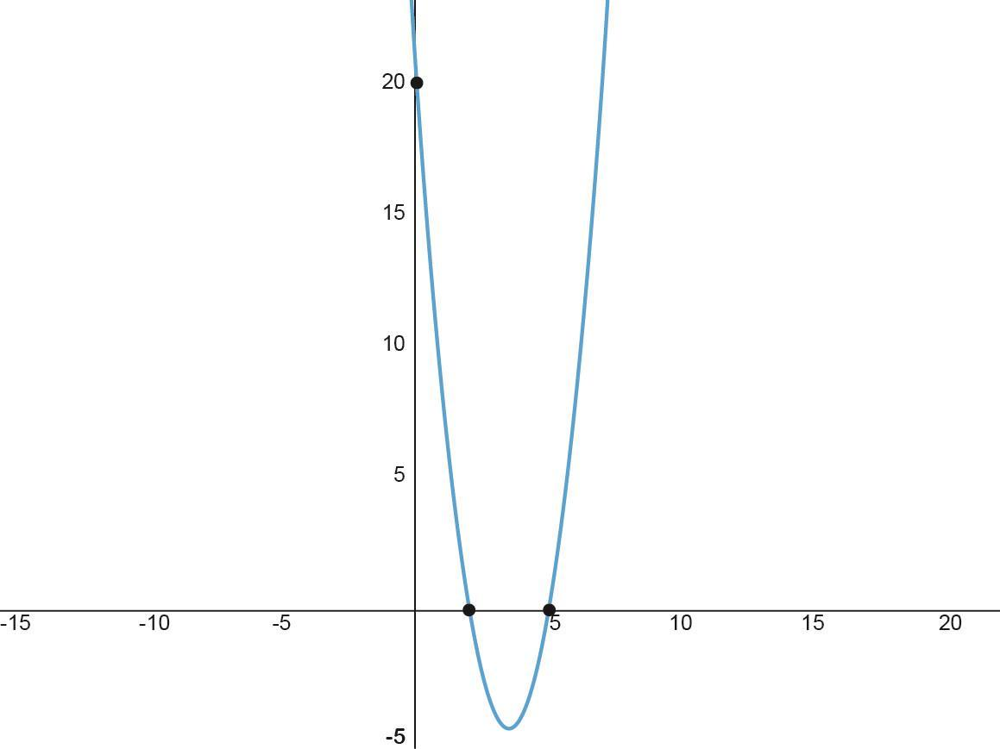
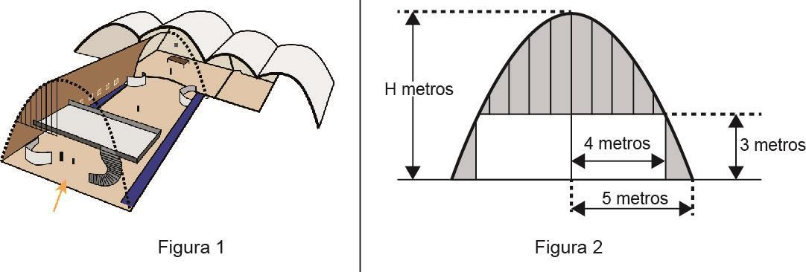
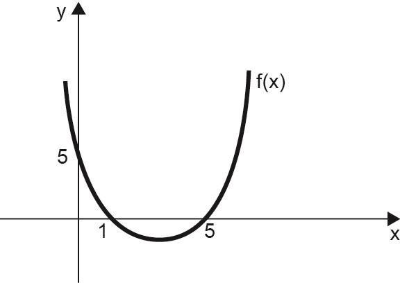
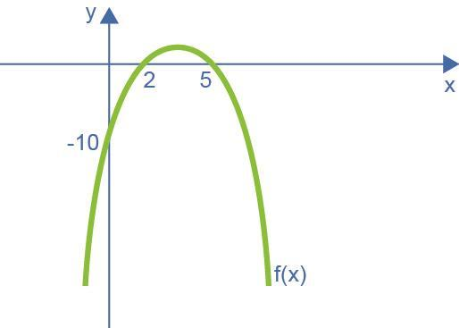

# Pré-Cálculo (937890)
## Aula 2 — Funções lineares, quadráticas e polinomiais

> Texto integral da apostila oficial da Uninter (sem resumo). PDF original: [Aula_02.pdf](../_apostilas_pdf/04_Pre_Calculo/Aula_02.pdf)

PRÉ-CÁLCULO AULA 2

Prof. Guilherme Lemermeier Rodrigues

### CONVERSA INICIAL

Nesta abordagem, serão trazidos de forma simples e direta os conceitos iniciais de funções lineares, quadráticas e polinomiais. A ideia central é relembrar os elementos principais de cada um desses tipos de funções. Para isso, o conteúdo lhe será apresentado de forma progressiva.

### TEMA 1 – DEFINIÇÃO DE FUNÇÃO LINEAR

Uma função linear tem com representação gráfica uma reta. Sendo assim, ela é regida por uma razão de proporcionalidade simples, muitas vezes usando um raciocínio envolvendo regra de três diretamente. Contudo, alguns elementos essenciais precisam ser revisados, principalmente calculados para trazer uma vivência matemática que será muito útil no decorrer evolutivo de um estudo da área exata.

Exemplo 1 – Suponha um reservatório de água residencial com 2.000 litros. O consumo diário de água nessa residência é de 120 litros por morador. Sabendo que essa residência tem 2 moradores, estabeleça a função que representa o consumo de água em decorrência da utilização plena do reservatório sem reabastecimento.

Vídeo Aula 2 – Exemplo 1 – 4 min.

Exemplo 2 – Formalmente escrevemos que uma função f: R→R é uma função afim quando existem dois números reais a e b tais que satisfaçam a seguinte condição, ∀ x∈R e b ≠ 0 temos:

y = f(x) = ax +b Dessa forma, seguindo a definição acima, calcule a função afim (polinomial de primeiro grau) que satisfaça a condição:

f(1) = 4 e f(2) = 6.

Vídeo Aula 2 – Exemplo 2 – 5 min.

Exemplo 3 – Calcule a função afim (polinomial de primeiro grau) que satisfaça a condição:

f(0) = 4 e f(2) = 2.

Vídeo Aula 2 – Exemplo 3 – 5 min.

### TEMA 2 – GRÁFICOS DE FUNÇÕES LINEARES

Como vimos, os elementos estruturais de uma função afim (linear) seguem o modelo f(x) = ax +b, sendo que a é o coeficiente angular e b o coeficiente linear. No próximo exemplo, esses elementos serão definidos. Exemplo 4 – Construa o gráfico da função afim (polinomial de primeiro grau) que satisfaça a condição:

f(0) = 3 e f(3) = 6.

Vídeo Aula 2 – Exemplo 4 – 5 min.

Exemplo 5 – Construa o gráfico da função afim (polinomial de primeiro grau) que satisfaça a condição:

f(1) = 4 e f(2) = 5.

Vídeo Aula 2 – Exemplo 5 – 5 min.

Exemplo 6 – Construa o gráfico da função afim (polinomial de primeiro grau) que satisfaça a condição:

f(3) = -2 e f(-1) = 2.

Vídeo Aula 2 – Exemplo 6 – 5 min.

Nesses exemplos vimos, além da construção de uma função linear, elementos-chaves para o estudo das funções lineares.

### TEMA 3 – DEFINIÇÃO DE FUNÇÃO QUADRÁTICA

Uma função quadrática é representada por uma função quadrática no formato:

𝑓(𝑥) = 𝑎𝑥2 + 𝑏𝑥 + 𝑐.

Outra forma de representar uma função quadrática é na forma fatorada: 𝑓(𝑥) = 𝑎(𝑥 − 𝑥1)(𝑥 − 𝑥2), onde 𝑥1 e 𝑥2 são as raízes.

Exemplo 7 – Dada a função quadrática 𝑓(𝑥) = 𝑥2 − 5𝑥 + 6, calcule as raízes da função.

Vídeo Aula 2 – Exemplo 7 – 5 min.

Exemplo 8 – Sabendo que as raízes de uma função quadrática são: 𝑥1 = 2 e 𝑥2 = 5. Calcule essa função que está representada no gráfico a seguir.

Vídeo Aula 2 – Exemplo 8 – 5 min.

Exemplo 9 – (ENEM – 2013) Uma pequena fábrica vende seus bonés em pacotes com quantidades de unidades variáveis. O lucro obtido é dado pela expressão L(x) = – x² + 12x – 20, onde x representa a quantidade de bonés contidos no pacote. A empresa pretende fazer um único tipo de empacotamento, obtendo um lucro máximo.

Para obter o lucro máximo nas vendas, os pacotes devem conter uma quantidade de bonés igual a:

a) 4 b) 6 c) 9 d) 10 e) 14 Vídeo Aula 2 – Exemplo 9 – 5 min.

### TEMA 4 – GRÁFICOS DE FUNÇÕES QUADRÁTICAS

Uma função quadrática é representada por uma parábola. Com essa simples definição, damos início ao conteúdo trazendo o exemplo 10. Exemplo 10 – Calcule a área máxima de um terreno retangular cujo perímetro é de 100 metros.

Vídeo Aula 2 – Exemplo 10 – 7 min.

Exemplo 11 – (ENEM – 2017) A Igreja de São Francisco de Assis, obra arquitetônica modernista de Oscar Niemeyer, localizada na Lagoa da Pampulha, em Belo Horizonte, possui abóbadas parabólica. A seta na Figura 1 ilustra uma das abóbadas na entrada principal da capela. A Figura 2 fornece uma vista frontal desta abóbada, com medidas hipotéticas para simplificar os cálculos.

Qual a medida da altura H, em metro, indicada na Figura 2?

A) 16/3 B) 31/5 C) 24/4 D) 25/3 E) 75/2

Vídeo Aula 2 – Exemplo 11 – 7 min.

### TEMA 5 – DEFINIÇÃO DE FUNÇÕES POLINOMIAIS E GRÁFICOS

Antes de partirmos para a definição de funções polinomiais propriamente dita, vamos dar uma olhada na ideia de produtos notáveis, pois esses três elementos que serão demonstrados no próximo exemplo são muito importantes para estudos futuros.

Lembrando dos produtos notáveis:

a. (𝑎 + 𝑏)2 = (𝑎 + 𝑏)(𝑎 + 𝑏) = 𝑎2 + 𝑎𝑏 + 𝑎𝑏 + 𝑏2 = 𝑎2 + 2𝑎𝑏 + 𝑏2= b. (𝑎 − 𝑏)2 = (𝑎 − 𝑏)(𝑎 − 𝑏) = 𝑎2 − 𝑎𝑏 − 𝑎𝑏 + (−𝑏)2 = 𝑎2 − 2𝑎𝑏 + 𝑏2 c. (𝑎 − 𝑏)(𝑎 + 𝑏) = 𝑎2 + 𝑎𝑏 − 𝑎𝑏 − 𝑏2 = 𝑎2 − 𝑏2 Um polinômio é uma função p tal que p(x) = a0 + a1x + a2x2 +· · · + anxn, em que n é um inteiro não negativo e a0, a1, a2, ..., an são números (Axler, 2016, p. 188).

Exemplo 12 – Calcule as raízes e construa o gráfico da função polinomial: 𝑓(𝑥) = 𝑥3 − 𝑥 Vídeo Aula 2 – Exemplo 12 – 5 min.

Exemplo 13 – Calcule as raízes da função polinomial:

𝑓(𝑥) = 𝑥3 − 6𝑥2 + 11𝑥 − 6 Vídeo Aula 2 – Exemplo 13 – 6 min.

### FINALIZANDO

01. Calcule a função afim (polinomial de primeiro grau) que satisfaça a condição: f(1) = 3 e f(2) = 5.

02. Calcule a função afim (polinomial de primeiro grau) que satisfaça a condição: f(-1) = 0 e f(2) = 2.

03. Calcule a função afim (polinomial de primeiro grau) que satisfaça a condição: f(0) = 3 e f(2) = -3.

04. (IFSC – 2017) Pedro é pecuarista e, com o aumento da criação, ele terá que fazer um novo cercado para acomodar seus animais. Sabendo-se que ele terá que utilizar 5 voltas de arame farpado e que o cercado tem forma retangular cujas dimensões são as raízes da equação x² − 45x + 500 = 0, qual a quantidade mínima de arame que Pedro terá que comprar para fazer esse cercado.

A) 545 m.

B) 225 m.

C) 200 m.

D) 500 m.

E) 450 m.

05. Dada a função quadrática 𝑓(𝑥) = −𝑥2 + 7𝑥 − 10, construa o gráfico que representa a função f(x).

06. Dada a função quadrática 𝑓(𝑥) = 𝑥2 − 8𝑥, construa o gráfico que representa a função f(x).

07. (ENEM – 2013) A temperatura T de um forno (em graus centígrados) é reduzida por um sistema a partir do instante de seu desligamento (t = 0) e varia de acordo com a expressão:

com t em minutos. Por motivos de segurança, a trava do forno só é liberada para abertura quando o forno atinge a temperatura de 39 ºC. Qual o tempo mínimo de espera, em minutos, após se desligar o forno, para que a porta possa ser aberta?

A)19,0 B)19,8 C) 20,0 D) 38,0 E) 39,0

y 08. Dado o gráfico parabólico, estabeleça a função quadrática original f(x).

09. Calcule as raízes da função polinomial:

𝑓(𝑥) = 𝑥3 − 2𝑥2 − 𝑥 + 2

10. Calcule as raízes da função polinomial:

𝑓(𝑥) = 𝑥3 − 3𝑥2 + 2𝑥 GABARITO DOS EXERCÍCIOS RESOLVIDOS PASSO A PASSO:

01. Calcule a função afim (polinomial de primeiro grau) que satisfaça a condição: f(1) = 3 e f(2) = 5.

Resolução:

Sendo y = f(x) = ax +b Substituindo os valores, temos o seguinte sistema:

{1𝑎 + 𝑏 = 3 2𝑎 + 𝑏 = 5 Multiplicando a 1ª linha por (-1), {−1𝑎 − 𝑏 = −3 2𝑎 + 𝑏 = 5 Somando as duas linhas do sistema, {−1𝑎 − 𝑏 = −3 2𝑎 + 𝑏 = 5 + 𝑎 = 2 Substituindo o valor de a = 2, na 1ª linha do sistema original, 1 ∙ 2 + 𝑏 = 3 2 + 𝑏 = 3

𝑏 = 3 − 2 𝑏 = 1 Portanto, Substituindo os valores de a=2 e b=1 na forma genérica f(x) = ax +b. Temos a resposta final: f(x) = 2x +1.

02. Calcule a função afim (polinomial de primeiro grau) que satisfaça a condição: f(-1) = 0 e f(2) = 2.

Resolução:

Sendo y = f(x) = ax +b Substituindo os valores, temos o seguinte sistema:

{−1𝑎 + 𝑏 = 0 2𝑎 + 𝑏 = 2 Multiplicando a 1ª linha por (-1), {1𝑎 − 𝑏 = 0 2𝑎 + 𝑏 = 2 Somando as duas linhas do sistema, { 1𝑎 − 𝑏 = 0 2𝑎 + 𝑏 = 2+ 3 𝑎 = 2, logo 𝑎 = Substituindo o valor de a = 2/3, na 1ª linha do sistema original, −1 ∙ 2 3 + 𝑏 = 0 − 2 3 + 𝑏 = 0 𝑏 = 2 3 Portanto, Substituindo os valores de a=2/3 e b=2/3 na forma genérica f(x) = ax +b. Temos a resposta final: f(x)= 3 𝑥 + 3.

03. Calcule a função afim (polinomial de primeiro grau) que satisfaça a condição:

f(0) = 3 e f(2) = -3.

Resolução:

Sendo y = f(x) = ax +b Substituindo os valores, temos o seguinte sistema:

{ 0𝑎 + 𝑏 = 3 2𝑎 + 𝑏 = −3 Logo, { 𝑏 = 3 2𝑎 + 𝑏 = −3

Sendo assim, 𝑏 = 3 Substituindo o valor de b = 3, na 2ª linha do sistema original, 2𝑎 + 3 = −3 2𝑎 = −3 − 3 2𝑎 = −6 𝑎 = − 6 2 𝑎 = −3 Portanto, Substituindo os valores de a=-3 e b=3 na forma genérica f(x) = ax + b. Temos a resposta final: f(x) = (-3)x + 3, assim, f(x)= -3x + 3.

04. (IFSC – 2017) Pedro é pecuarista e, com o aumento da criação, ele terá que fazer um novo cercado para acomodar seus animais. Sabendo-se que ele terá que utilizar 5 voltas de arame farpado e que o cercado tem forma retangular cujas dimensões são as raízes da equação x² − 45x+500=0, qual a quantidade mínima de arame que Pedro terá que comprar para fazer esse cercado.

A) 545 m.

B) 225 m.

C) 200 m.

D) 500 m.

E) 450 m.

Resolução Para encontrar as raízes da equação. Aplicaremos a fórmula quadrática (Fórmula de Bhaskara):

x² − 45x+500=0 a= 1 b = – 45

c = 500 𝑥 = −(−45) ± √(−45)2 − 4 ∙ 1 ∙ 500 2 ∙ 1 𝑥 = 45 ± √25 2 𝑥 = 45 ± 5 2 Sendo assim, as raízes:

𝑥1 = 20 e 𝑥2 = 25 Sabendo que as dimensões são 20 m e 25 m, então o perímetro (uma volta do cercado) é de:

P = 2 ∙ 20 + 2 ∙ 25 = 40 + 50 = 90 Como serão 5 voltas, então a quantidade necessária será de:

5 ∙ 90 = 450 m. (Alternativa E)

05. Dada a função quadrática 𝑓(𝑥) = −𝑥2 + 7𝑥 − 10, construa o gráfico que representa a função f(x).

Resolução:

Seguindo o modelo 𝑓(𝑥) = 𝑎𝑥2 + 𝑏𝑥 + 𝑐 𝑓(𝑥) = −𝑥2 + 7𝑥 − 10, temos que a=-1, b=7, c=-10.

Sendo a<0 a concavidade da parábola será para baixo.

Usando a fórmula quadrática (Fórmula de Bhaskara), 𝑥 = −𝑏 ± √𝑏2 − 4𝑎𝑐 2𝑎 Desta forma:

𝑥 = −(7) ± √(7)2 − 4 ∙ (−1) ∙ (−10) 2 ∙ (−1) 𝑥 = −7 ± √49 − 40 −2 𝑥 = −7 ± √9 −2 𝑥 = −7±3 −2 , separando o numerador 𝑥1 = −7 − 3 −2 = −10 −2 = 5 𝑥2 = −7 + 3 −2 = −4 −2 = 2 Graficamente:

06. Dada a função quadrática 𝑓(𝑥) = 𝑥2 − 8𝑥, construa o gráfico que representa a função f(x).

Seguindo o modelo 𝑓(𝑥) = 𝑎𝑥2 + 𝑏𝑥 + 𝑐 𝑓(𝑥) = 𝑥2 − 8𝑥, temos que a=1, b=-8, c=0.

Sendo a>0 a concavidade da parábola será para cima.

Usando a fórmula quadrática (Fórmula de Bhaskara), 𝑥 = −𝑏±√𝑏2−4𝑎𝑐 2𝑎 .

Desta forma:

𝑥 = −(−8) ± √(−8)2 − 4 ∙ 1 ∙ 0 2 ∙ 1 𝑥 = 8 ± √64 2 𝑥 = 8 ± 8 2 separando o numerador 𝑥1 = 8 − 8 2 = 0 2 = 0 𝑥2 = 8 + 8 2 = 16 2 = 8

Graficamente:

07. (ENEM – 2013) A temperatura T de um forno (em graus centígrados) é reduzida por um sistema a partir do instante de seu desligamento (t = 0) e varia de acordo com a expressão:

com t em minutos. Por motivos de segurança, a trava do forno só é liberada para abertura quando o forno atinge a temperatura de 39 ºC. Qual o tempo mínimo de espera, em minutos, após se desligar o forno, para que a porta possa ser aberta?

A)19,0 B)19,8 C) 20,0 D) 38,0 E) 39,0 Resolução:

Como queremos T(t) = 39, logo:

− 𝑡2 4 + 400 = 39 − 𝑡2 4 = 39 − 400 − 𝑡2 4 = −361, sendo assim, 𝑡2 4 = 361 𝑡2 = 4 ∙ 361

𝑡2 = 1444 𝑡 = √1444 𝑡 = 38 (Alternativa D)

08. Dado o gráfico parabólico, estabeleça a função quadrática original.

Sendo as raízes 𝑥1 = 1 e 𝑥2 = 5, temos na forma reduzida:

𝑓(𝑥) = 𝑎(𝑥 − 𝑥1)(𝑥 − 𝑥2), desta forma, 𝑓(𝑥) = 𝑎(𝑥 − 1)(𝑥 − 5). Assim, desenvolvendo pela propriedade distributiva:

𝑓(𝑥) = 𝑎(𝑥 − 1)(𝑥 − 5) 𝑓(𝑥) = 𝑎 ∙ (𝑥2 − 5𝑥 − 1𝑥 + 5) 𝑓(𝑥) = 𝑎 ∙ (𝑥2 − 6𝑥 + 5) Note que o termo independente 5 já está igual ao valor que “corta” o eixo y, portanto, a=1.

Sendo assim, a função será: 𝑓(𝑥) = 𝑥2 − 6𝑥 + 5

09. Calcule as raízes da função polinomial:

𝑓(𝑥) = 𝑥3 − 2𝑥2 − 𝑥 + 2 Para calcular as raízes deve-se igualar a zero o polinômio. Assim temos que 𝑥3 − 2𝑥2 − 𝑥 + 2 = 0 Usando Briot-Ruffini:

P.R.R. = {±1, ±2}, lembrando que esses números são os divisores do termo independente (2). Esses valores são os valores que arbitramos no dispositivo de Briot-Ruffini em busca do resultado 0 (zero) no último elemento.

Desta forma, a primeira raiz é 𝑥1 = −1 Para calcular as outras raízes, usaremos a equação de segundo grau que resultou:

1x² - 3x + 2 = 0.

Usando a fórmula quadrática (Fórmula de Bhaskara), onde a= 1, b = -3, c = 2.

𝑥 = −𝑏±√𝑏2−4𝑎𝑐 2𝑎 .

Desta forma: 𝑥 = −(−3)±√(−3)2−4∙1∙(2) 2∙1 𝑥 = 3 ± √1 2 𝑥 = 3±1 2 , separando o numerador 𝑥2 = 3 − 1 2 = 2 2 = 1 𝑥3 = 3 + 1 2 = 4 2 = 2 Resposta: Raízes = {-1, 1, 2}

10. Calcule as raízes da função polinomial:

𝑓(𝑥) = 𝑥3 − 3𝑥2 + 2𝑥 Para calcular as raízes, deve-se igualar a zero o polinômio. Assim temos que 𝑥3 − 3𝑥2 + 2𝑥 = 0 Colocando o valor “x” em evidência, 𝑥(𝑥2 − 3𝑥 + 2) = 0 Desta forma, temos um produto de dois termos que resultariam em zero. 𝑥 = 0 𝑜𝑢 𝑥2 − 3𝑥 + 2 = 0 Logo, a primeira raiz é 𝑥1 = 0 Para calcular as outras raízes, usaremos a equação de segundo grau que resultou: x² - 3x + 2 = 0.

Usando a fórmula quadrática (Fórmula de Bhaskara), onde a= 1, b = -3, c = 2.

𝑥 = −𝑏±√𝑏2−4𝑎𝑐 2𝑎 .

Desta forma:

𝑥 = −(−3) ± √(−3)2 − 4 ∙ 1 ∙ (2) 2 ∙ 1 𝑥 = 3 ± √1 2

𝑥 = 3 ± 1 2 separando o numerador 𝑥2 = 3 − 1 2 = 2 2 = 1 𝑥3 = 3 + 1 2 = 4 2 = 2 Resposta: Raízes = {0, 1, 2}

### REFERÊNCIAS

AXLER, S. Pré-cálculo: uma preparação para o cálculo. 2. ed. São Paulo: LTC, 2016.

DEMANA, F. D.; WAITS, B. W.; FOLEY, G. D.; KENNEDY, D. Pré-cálculo. São Paulo: Pearson, 2009.
