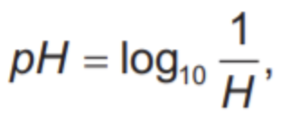
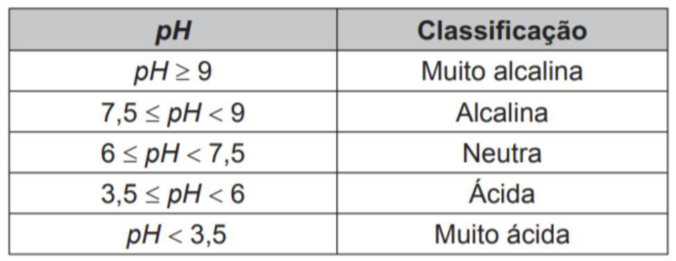
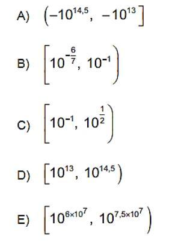
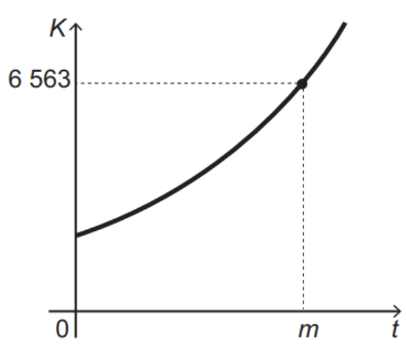

# Pré-Cálculo (937890)
## Aula 3 — Funções exponenciais e logarítmicas

> Texto integral da apostila oficial da Uninter (sem resumo). PDF original: [Aula_03.pdf](../_apostilas_pdf/04_Pre_Calculo/Aula_03.pdf)

PRÉ-CÁLCULO AULA 3

Prof. Guilherme Lemermeier Rodrigues

### CONVERSA INICIAL

As funções exponenciais e logarítmicas têm diversas aplicações no campo das engenharias, tecnologias e outras tantas em diferentes áreas como na matemática financeira com os juros compostos, nas ciências humanas nos estudos demográficos, nas ciências biológicas nos estudos de epidemias, e assim poderíamos ficar citando aplicações.

Portanto, devido ao seu alto grau de influência em diversas ciências, torna-se fundamental o conhecimento, mesmo que inicial, de seus conceitos e cálculos.

### TEMA 1 – FUNÇÃO EXPONENCIAL

Exemplo 1 Uma determinada substância tem uma concentração inicial de 1200mg. A cada hora a sua concentração é reduzida pela metade. Determine a concentração dessa substância após 6 horas.

Exemplo 2 Em um tipo de epidemia, cientistas afirmam que daqui a “t” dias a quantidade de bactérias (em milhões) no ar segue a seguinte função: 𝑓(𝑡) = 100 ∙ 𝑒0,02𝑡 Qual será o número de bactérias em 1 dia e em 10 dias?

### TEMA 2 – GRÁFICOS DE FUNÇÕES EXPONENCIAIS

Neste tópico, veremos o comportamento de dois tipos das funções exponenciais, o exemplo 3 trará o comportamento de uma função crescente e o exemplo 4 trará o comportamento de uma função decrescente.

Exemplo 3 Demonstre graficamente o comportamento da função exponencial 𝑓(𝑥) =  2𝑥 Exemplo 4 Demonstre graficamente o comportamento da função exponencial 𝑓(𝑥) =  ( 1 2) 𝑥

### TEMA 3 – FUNÇÃO LOGARÍTMICA

De forma direta e simplificada, podemos dizer que as funções logarítmicas são as funções inversas das funções exponenciais.

Logicamente, há um detalhamento diferenciado nesse tipo de função, porém muito do seu comportamento, como função numérica e graficamente, seguem os mesmos princípios das funções exponenciais.

Agora, para abordar esse conteúdo, vamos a um exemplo prático.

Exemplo 5 Escala de magnitude Richter

Um terremoto com ondas sísmicas de tamanho S tem magnitude Richter Magnitude = log ( S S0 ) em que S0 é o tamanho das ondas sísmicas que correspondem ao que tem sido declarado como um terremoto com magnitude Richter 0.

Fonte: Axler, 2016. p. 243.

Quantas vezes um terremoto com magnitude Richter 7 é mais intenso que um terremoto com magnitude Richter 5?

### TEMA 4 – FUNÇÕES LOGARÍTMICAS E GRÁFICOS I

Exemplo 6 (ENEM – 2018) A água comercializada em garrafões pode ser classificada como muito ácida, ácida, neutra, alcalina ou muito alcalina, dependendo do seu pH, dado pela expressão:

em que H é a concentração de íons de hidrogênio, em mol por decímetro cúbico. A classificação da água de acordo com seu pH é mostrada no quadro.

Para o cálculo da concentração H, uma distribuidora mede dois parâmetros A e B, em cada fonte, e adota H como sendo o quociente de A por B. Em análise realizada em uma fonte, obteve A=10-7 e a água dessa fonte foi classificada como neutra.

O parâmetro B, então, encontra-se no intervalo

### TEMA 5 – FUNÇÕES LOGARÍTMICAS E GRÁFICOS II

Exemplo 7 Um estudo de uma colônia de bactérias com 1.000 células inicialmente. Revelou que há um crescimento exponencial que faz dobrar sua colônia a cada duas horas. Qual quantidade de células dessa colônia após 10 horas do início do estudo?

Exemplo 8 Uma aplicação financeira que remunere à taxa de 1%a.m. em regime capitalização por juros compostos.

Supondo uma aplicação de um capital R$1.000,00, qual será o montante resgatado após 12 meses?

FINALIZANDO – EXERCÍCIOS PROPOSTOS 1. Sendo a função exponencial 𝑓(𝑥) =  2𝑥+2, com o auxílio de uma calculadora científica, calcule:

a) 𝑓(3) = b) 𝑓(−4) = c) 𝑓 ( 2) = 2. Sendo a função exponencial 𝑓(𝑥) =  ( 1 3) 𝑥+2 , com o auxílio de uma calculadora científica, calcule:

a) 𝑓(1) = b) 𝑓(−3) = c) 𝑓 ( 2) =

3. Um dos usos mais significativos das funções exponenciais é a ideia de notação científica.

A notação científica permite que os números sejam escritos usando potências de 10. Assim evidenciando a ordem de grandeza dos numerais. Veja os exemplos a seguir:

A velocidade da luz é de 300.000𝑘𝑚/ℎ, em notação científica: 3 ∙ 105𝑘𝑚/ℎ.

A massa de um elétron é de, aproximadamente, 0,000 000 000 000 000 000 000 000 000 911g, em notação científica: 9,11 ∙ 10−28𝑔 Escreva em notação científica as seguintes grandezas:

a. Raio da Terra: 6.371km b. Massa de um átomo de oxigênio: 0,000 000 000 000 000 000 000 027𝑔 4. Uma aplicação financeira que remunere à taxa de 0,99%a.m. em regime capitalização por juros compostos.

Supondo uma aplicação de um capital R$2.000,00, qual será o montante resgatado após 24 meses?

5. Dada a fórmula de regime de capitalização composta (juros compostos) 𝑀 = 𝐶 ∙ (1 + 𝑖)𝑛 onde:

𝑀 – Montante (valor futuro)

𝐶 – Capital (valor presente) 𝑖 – Taxa de juros (índice de %) 𝑛- Prazo (tempo) Calcule em quanto tempo um capital dobrará seu valor à taxa de 2%a.m. 6. Um problema ecológico que se tem apresentado em grandes escalas em lagos de parques urbanos é a proliferação de plantas aquáticas que cobrem a superfície dos lagos, baixando a oxigenação das águas.

Supondo que uma planta aquática tem potencial de dobrar sua cobertura (área) a cada dia, e que sua área de ocupação inicial é de 1 m², quanto tempo essa planta levará para cobrir um lago de 3.000 m²?

7. (ENEM – 2021) O crescimento de uma população de microrganismos é descrito pela expressão K(t) = 81 ∙ 3 3t + 2, em que K(t) indica a quantidade de microrganismos em um meio de cultura em função do tempo t. O gráfico representa a evolução de K em relação ao tempo t.

Com base nos dados, o valor de m é a) b) c) d) 12 e) 81 8. (Mackenzie-SP) O pH do sangue humano é calculado por 𝑝𝐻 = 𝑙𝑜𝑔 ( 𝑥), sendo 𝑥 a molaridade dos íons 𝐻3𝑂+. Se essa molaridade for dada por 4,0 ∙ 10−8 e, adotando-se 𝑙𝑜𝑔2 = 0,30, o valor desse 𝑝𝐻 será:

a) 7,20 b) 4,60

c) 6,80 d) 4,80 e) 7,40 9. Suponha um experimento laboratorial com bactérias, sendo número de bactérias, t horas após o início do experimento, representado pela função: 𝑁(𝑡) = 1.200 ∙ 20,4∙𝑡 Qual o total de bactérias após 10 horas e trinta minutos?

10. Suponha um experimento laboratorial com bactérias, sendo número de bactérias, t horas após o início do experimento, representado pela função: 𝑁(𝑡) = 1.200 ∙ 20,4∙𝑡 Em quanto tempo o número de bactérias atinge 76.800?

GABARITO DOS EXERCÍCIOS RESOLVIDOS PASSO A PASSO:

1. Sendo a função exponencial 𝑓(𝑥) = 2𝑥+2, com o auxílio de uma calculadora científica, calcule:

a) 𝑓(3) = b) 𝑓(−4) = c) 𝑓 ( 2) = Resolução:

a) 𝑓(𝑥) = 2𝑥+2 Substituindo x por 3, temos:

𝑓(3) = 23+2 𝑓(3) = 25 𝑓(3) = 32

b) 𝑓(𝑥) = 2𝑥+2 Substituindo x por -4, temos:

𝑓(−4) = 2−4+2 𝑓(−4) = 2−2 𝑓(−4) = 1 22 𝑓(−4) = 1 4

𝑓(−4) = 0,25

c) 𝑓(𝑥) = 2𝑥+2 Substituindo x por 2, temos:

𝑓 (1 2) = 2 1 2+2 𝑓 (1 2) = 2 1 2+4 2 𝑓 (1 2) = 2 5 2 𝑓 (1 2) = √252 𝑓 (1 2) = √32 𝑓(3) = 5,66

2. Sendo a função exponencial 𝑓(𝑥) =  ( 1 3) 𝑥+2 , com o auxílio de uma calculadora científica, calcule:

a) 𝑓(1) = b) 𝑓(−3) = c) 𝑓 ( 2) = Resolução:

a) 𝑓(𝑥) = ( 1 3) 𝑥+2 Substituindo x por 1, temos:

𝑓(1) = (1 3) 1+2 𝑓(1) = (1 3) 3 𝑓(1) = 13 𝑓(1) = 1 27 𝑓(1) = 0,037

b) 𝑓(𝑥) = ( 1 3) 𝑥+2 Substituindo x por -3, temos:

𝑓(−3) = (1 3) −3+2 𝑓(−3) = (1 3) −1 𝑓(−3) = (3 1) 1 𝑓(−3) = 31 𝑓(−3) = 3 1 𝑓(−3) = 3 c) 𝑓(𝑥) = ( 1 3) 𝑥+2 Substituindo x por 2, temos:

𝑓 (1 2) = (1 3) 2+2

𝑓 (1 2) = (1 3) 2+4 2

𝑓 (1 2) = (1 3)

𝑓 (1 2) = √(1 3) 52 𝑓 (1 2) = √(1 3) 5 𝑓 (1 2) = √(15 35) 𝑓 (1 2) = √( 1 243) 𝑓 (1 2) = √0,004115 𝑓 (1 2) = 0,06415

3. Um dos usos mais significativos das funções exponenciais é a ideia de notação científica.

A notação científica permite que os números sejam escritos usando potências de 10. Assim evidenciando a ordem de grandeza dos numerais. Veja os exemplos a seguir:

A velocidade da luz é de 300.000𝑘𝑚/ℎ, em notação científica: 3 ∙ 105𝑘𝑚/ℎ.

A massa de um elétron é de, aproximadamente, 0,000 000 000 000 000 000 000 000 000 911g, em notação científica: 9,11 ∙ 10−28𝑔 Escreva em notação científica as seguintes grandezas:

a) Raio da Terra: 6.371km b) Massa de um átomo de oxigênio: 0,000 000 000 000 000 000 000 027𝑔 Resolução:

a) 6,371 ∙ 103𝑘𝑚 b) 2,7 ∙ 1023𝑔

4. Uma aplicação financeira que remunere à taxa de 0,99%a.m. em regime capitalização por juros compostos.

Supondo uma aplicação de um capital R$2.000,00, qual será o montante resgatado após 24 meses?

Resolução:

C = 2000 n = 24 i = 0,99% = 0,99/100 = 0,0099 𝑀 = 𝐶 ∙ (1 + 𝑖)𝑛 𝑀 = 2000 ∙ (1 + 0,0099)24 𝑀 = 2000 ∙ (1,0099)24 𝑀 = 2000 ∙ 1,26672089 𝑀 = 2533,44

5. Dada a fórmula de regime de capitalização composta (juros compostos) 𝑀 = 𝐶 ∙ (1 + 𝑖)𝑛 Onde:

𝑀 – Montante (valor futuro) 𝐶 – Capital (valor presente)

𝑖 – Taxa de juros (índice de %) 𝑛- Prazo (tempo) Calcule em quanto tempo um capital dobrará seu valor à taxa de 2%a.m. Resolução:

Como o montante é o dobro do capital, temos M = 2C i = 2% = 2/100 = 0,02 𝑀 = 𝐶 ∙ (1 + 𝑖)𝑛 2𝐶 = 𝐶 ∙ (1 + 0,02)𝑛 2𝐶 𝐶 = (1,02)𝑛 2 = (1,02)𝑛 Aplicando logaritmo natural nos dois membros, temos:

log 2 = log(1,02)𝑛 log 2 = 𝑛. log(1,02) log 2 log(1,02) = 𝑛 Usando a calculadora científica, temos os valores dos logaritmos 𝑛 = 0,3010299957 0,008600171762 𝑛 = 35,00278879, por questão de arredondamento, temos n = 35 meses

6. Um problema ecológico que se tem apresentado em grandes escalas em lagos de parques urbanos é a proliferação de plantas aquáticas que cobrem a superfície dos lagos e, assim, baixando a oxigenação das águas. Supondo que uma planta aquática tem potencial de dobrar sua cobertura (área) a cada dia, e que sua área de ocupação inicial é de 1m², quanto tempo essa planta levará para cobrir um lago de 3.000 m²?

Resolução:

Como a população inicial é igual a 1 m2 e dobra a cada dia, temos 1° dia = 1 m² 2° dia = 2 m² 3° dia = 4 m² 4° dia = 8 m² Desta foram Área coberta = (2)𝑝𝑒𝑟í𝑜𝑑𝑜 𝑑𝑒 𝑡𝑒𝑚𝑝𝑜

Formulando: 𝐴 = 2𝑥, onde: A = área coberta e x = período de tempo Área inicia =3000 3000 = 2𝑥 Aplicando logaritmo natural nos dois membros, temos:

log 3000 = log(2)𝑥 log 3000 = 𝑥. log(2) log 3000 log(2) = 𝑥 𝑥 = log 3000 log(2) 𝑥 = 3,477121255 0,3020299957 𝑥 = 11,55074679 Como a população dobra a cada dia, podemos concluir que foram 11 dias inteiros e uma fração de 0,55074679 do 12º dia. Logo podemos concluir que seriam necessários 12 dias

7. (ENEM – 2021) O crescimento de uma população de microrganismos é descrito pela expressão K(t) = 81 ∙ 3 3t + 2, em que K(t) indica a quantidade de microrganismos em um meio de cultura em função do tempo t. O gráfico representa a evolução de K em relação ao tempo t.

Com base nos dados, o valor de m é a) b) c) d) 12 e) 81 Resolução

6563 = 81 ∙ 3 3t + 2 6563 − 2 = 81 ∙ 3 3t 6561 = 81 ∙ 3 3t 6561 81 = 3 3t 81 = 3 3t Fatorando 81 = 34, 34 = 3 1 3t Sendo assim, 4 = 1 3 𝑡 4 ∙ 3 = 𝑡, logo 𝑡 = 12.    (𝐴𝑙𝑡𝑒𝑟𝑛𝑎𝑡𝑖𝑣𝑎 𝐷)

8. (MACKENZIE-SP) O pH do sangue humano é calculado por 𝑝𝐻 = 𝑙𝑜𝑔 ( 𝑥), sendo 𝑥 a molaridade dos íons 𝐻3𝑂+. Se essa molaridade for dada por 4,0 ∙ 10−8 e, adotando-se 𝑙𝑜𝑔2 = 0,30, o valor desse 𝑝𝐻 será: a) 7,20 b) 4,60 c) 6,80 d) 4,80 e) 7,40 Resolução:

Sendo 𝑥 = 4. 10−8, temos que 𝑃𝐻 = log ( 1 4. 10−8) Usando uma calculadora científica, 𝑃𝐻 = 7,397940009 Por questão de arredondamento, PH=7,4

9. Suponha um experimento laboratorial com bactérias, sendo número de bactérias, t horas após o início do experimento, representado pela função: 𝑁(𝑡) = 1.200 ∙ 20,4∙𝑡

Qual o total de bactérias após 10 horas e trinta minutos?

Resolução:

𝑁(𝑡) = 1.200 ∙ 20,4∙𝑡 𝑁(𝑡) = 1.200 ∙ 20,4∙10,5 𝑁(𝑡) = 1.200 ∙ 24,2 𝑁(𝑡) = 1.200 ∙ 18,37917368 𝑁(𝑡) = 22055

10. Suponha um experimento laboratorial com bactérias, sendo número de bactérias, t horas após o início do experimento, representado pela função: 𝑁(𝑡) = 1.200 ∙ 20,4∙𝑡 Em quanto tempo o número de bactérias atinge 76.800?

Resolução:

𝑁(𝑡) = 1.200 ∙ 20,4∙𝑡 76800 = 1.200 ∙ 20,4∙𝑡 76800 1200 = 20,4∙𝑡 64 = 20,4∙𝑡 Fatorando 64 = 26, então 26 = 20,4∙𝑡 6 = 0,4. 𝑡 0,4 = 𝑡 15 = 𝑡 𝑡 = 15

### REFERÊNCIAS

AXLER, S. Pré-cálculo: uma preparação para o cálculo. 2. ed. Rio de Janeiro: LTC, 2016.

DEMANA, F. D. et al. Pré-cálculo. São Paulo: Pearson, 2009.
