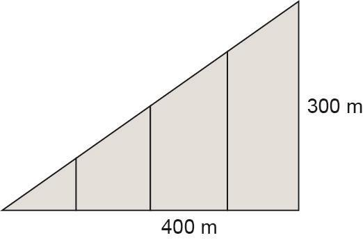
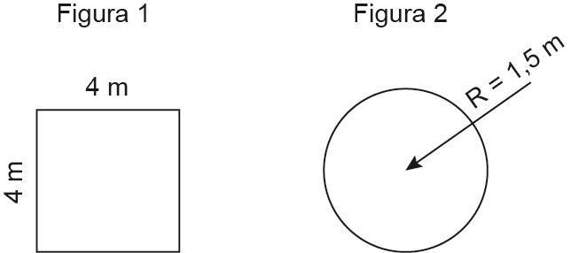
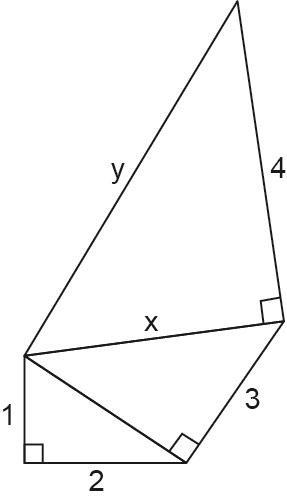
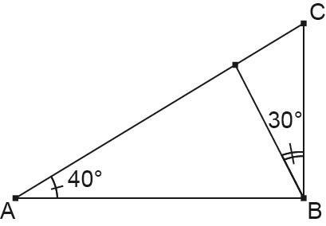
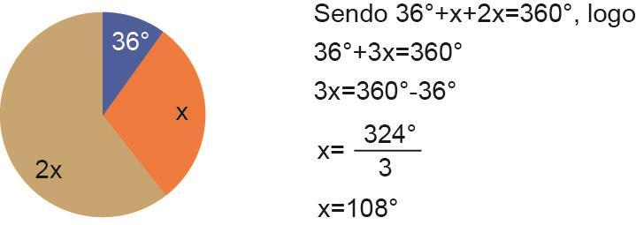
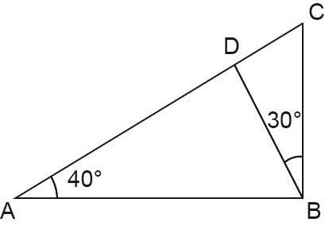
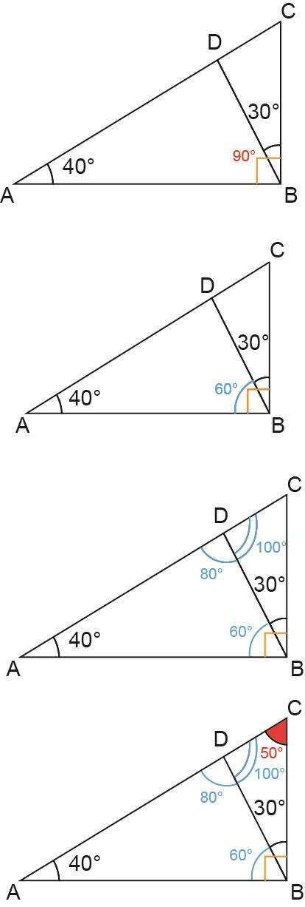

# Pré-Cálculo (937890)
## Aula 4 — Trigonometria e aplicação (Parte 1)

> Texto integral da apostila oficial da Uninter (sem resumo). PDF original: [Aula_04.pdf](../_apostilas_pdf/04_Pre_Calculo/Aula_04.pdf)

PRÉ-CÁLCULO AULA 4

Prof. Guilherme Lemermeier Rodrigues

### CONVERSA INICIAL

Nesta etapa, iniciaremos os estudos da trigonometria. Para isso, o primeiro tópico que será estudado é a ideia de ângulos. Veremos como é o comportamento da marcação dos ângulos em um círculo de raio unitário. Esse conhecimento é fundamental para o desenvolvimento dos estudos futuros que envolvam trigonometria.

### TEMA 1 – ÂNGULOS E MEDIDAS

Usualmente temos duas unidades de marcação de ângulos: graus e radianos.

Acompanhe no exemplo 1, no vídeo, a ideia das marcações dos ângulos nas duas unidades em um círculo trigonométrico (raio unitário), o que é um arco côngruo e a menor determinação positiva de um ângulo.

Vídeo: Aula 4 – Exemplo 1 – 4min.

### TEMA 2 – TRANSFORMAÇÕES ENTRE GRAUS E RADIANOS

Um dos pontos importantes desse tópico é a transformação entre a marcação de um ângulo em graus para radianos e vice-versa.

Acompanhe no vídeo do exemplo 2 a ideia central dessas transformações. Vídeo: Aula 4 – Exemplo 2 – 4min.

### TEMA 3 – TRIÂNGULO RETÂNGULO

Um triângulo que possui um ângulo reto (90°) é chamado triângulo retângulo.

Acompanhe no vídeo do exemplo 3 as ideias centrais das principais características do triângulo retângulo e do teorema de Pitágoras. Exemplo 3 (Fundação Carlos Chagas/SCE-BA 2022): Um terreno que tem a forma de um triângulo retângulo com os lados correspondentes aos catetos medindo 300 m e 400 m, foi dividido em quatro lotes de mesma largura por paralelas ao cateto menor, como representado na figura a seguir.

A metragem mínima de arame necessária para cercar e fazer as divisões demarcadas usando dois fios de arame é Alternativas a. 3300 m.

b. 2700 m.

c. 3000 m.

d. 2400 m.

e. 3600 m.

Vídeo: Aula 4 – Exemplo 3 – 4min.

### TEMA 4 – RAZÕES E RELAÇÕES NO TRIÂNGULO RETÂNGULO

Acompanhe no vídeo do exemplo 4 as demonstrações das principais razões e relações do triângulo retângulo.

Vídeo: Aula 4 – Exemplo 4 – 7min.

### TEMA 5 – EXERCÍCIOS PRÁTICOS

Exemplo 5. Suponha que uma pizza de tamanho grande tenha 40 cm de diâmetro e seja cortada em 12 pedaços iguais.

a. Calcule o ângulo de corte de cada pedaço.

b. Calcule a área da pizza.

c. Calcule a área de uma fatia.

Vídeo: Aula 4 – Exemplo 5 – 4min.

Exemplo 6. Uma roda de bicicleta modelo speed de tamanho 700 tem uma roda com aro de 290 mm de raio.

Créditos: Eshma/Shutterstock.

Sendo assim:

a. Qual é a distância percorrida por uma volta dessa roda?

b. Quantas voltas (aproximadamente) essa roda dá em um percurso de 5 km?

c. Qual é a área dessa roda?

Observação: considerar nos cálculos o valor π = 3,14.

Vídeo: Aula 4 – Exemplo 6 – 6min.

Exemplo 7. Assista ao vídeo sobre as classificações dos triângulos relativas aos seus lados e ângulos.

Vídeo: Aula 4 – Exemplo 7- 5min.

### FINALIZANDO

1. Transforme 36° em radianos:

2. Transforme 3𝜋 5  rad em graus:

3. Qual é a medida em graus do ângulo 7𝜋 3  na sua menor determinação de arco côngruo?

4. (UFMT/Prefeitura de Nobres (MT) – 2022): Um agricultor nobrense preparou uma área circular dividida em três setores circulares, conforme figura abaixo,

para plantar três culturas. O raio desse círculo é 1 km, o setor de menor área possui ângulo de 36º e o ângulo do setor de maior área é o dobro do ângulo do setor de área intermediária. Admitindo π = 3,14, qual o perímetro do setor de área intermediária?

a. 5.768 m.

b. 1.884 m.

c. 3.768 m.

d. 3.884 m.

5. (Avança/Prefeitura de Rio Claro (SP) - 2021) Qual é o valor da diferença entre o perímetro da figura 1 e a figura 2? Considere duas casas decimais para o valor de Pi. (Pi=3,14)

a. 6,58 m.

b. 7,58 m.

c. 8,58 m.

d. 9,58 m.

e. 10,58 m.

6. Classifique, em relação aos lados, o triângulo formado pelos lados de medidas 12cm, 15cm e 25cm.

7. Classifique, em relação ao ângulo, o triângulo formado pelos lados de medidas 12cm, 9cm e 17cm.

8. Na figura a seguir, calcule o valor de y:

9. O triângulo CBˆA abaixo é pitagórico. Calcule os valores dos outros ângulos:

10. (Unesc/Prefeitura de Maracajá (SC) – 2020): Ao realizar um trabalho de trigonometria, Mercedes encontrou um ângulo que mede 3780º. Para continuar seu trabalho essa medida deverá ser convertida para radianos. Qual o valor em radianos que Mercedes encontrou?

Alternativas a. 31π b. 27π c. 23π d. 21π Confira o gabarito após a seção Referências.

### REFERÊNCIAS

AXLER, S. Pré-cálculo: uma preparação para o cálculo. 2. ed. São Paulo: LTC, 2016.

DEMANA, F. D. et al. Pré-cálculo. São Paulo: Pearson, 2009.

GABARITO 1. Transforme 36° em radianos:

Resolução:

180° = 𝜋 𝑟𝑎𝑑 36° = 𝑥 180𝑥 = 36𝜋 𝑥 = 36𝜋 180 𝑥 = 𝜋 5  𝑟𝑎𝑑 2. Transforme 3𝜋 5  rad em graus:

Resolução:

180° = 𝜋 𝑟𝑎𝑑 𝑥 = 3𝜋 5  𝑟𝑎𝑑 𝑥𝜋 = 180.3𝜋 5 𝑥 = 180.3𝜋 5𝜋 𝑥 = 108° 3. Qual é a medida em graus do ângulo 7𝜋 3  na sua menor determinação de arco côngruo?

Resolução:

7𝜋 3 = 6𝜋 3 + 𝜋 3 = 2𝜋 + 𝜋 3

Logo:

180° = 𝜋 𝑟𝑎𝑑 𝑥 = 𝜋 3  𝑟𝑎𝑑 𝑥𝜋 = 180. 𝜋 3 𝑥 = 180. 𝜋 3𝜋 𝑥 = 60° 4. (UFMT/Prefeitura de Nobres (MT) – 2022): Um agricultor nobrense preparou uma área circular dividida em três setores circulares, conforme figura abaixo, Fatorando para obter múltiplos de 2𝜋 (1 volta completa) 𝜋 3  é 𝑜 𝑎𝑟𝑐𝑜 𝑐ô𝑛𝑔𝑟𝑢𝑜

para plantar três culturas. O raio desse círculo é 1 km, o setor de menor área possui ângulo de 36º e o ângulo do setor de maior área é o dobro do ângulo do setor de área intermediária. Admitindo π = 3,14, qual o perímetro do setor de área intermediária?

a. 5.768 m.

b. 1.884 m.

c. 3.768 m.

d. 3.884 m.

Resolução:

Calculando o perímetro (𝑈𝑚𝑎 𝑣𝑜𝑙𝑡𝑎, 𝐶 = 2𝜋𝑅), lembrando que R=1Km=1000m:

360° ⟶ 2 ∙ π ∙ 1000 108° → P

360° ∙ P = 108° ∙ 2 ∙ 3,14 ∙ 1000 360 ∙ P = 678240 P = 678240 360 P = 1884 m (Comprimento do arco do setor)

Note que o perímetro do setor é formado por todo o contorno da figura (em verde).

Sendo assim a soma do contorno da fatia é Raio + Raio + comprimento do arco do setor.

Logo: O perímetro do setor será: 1000 + 1000 + 1884 = 3884 m (Letra D)

5. (Avança/Prefeitura de Rio Claro (SP) - 2021): Qual o valor da diferença entre o perímetro da figura 1 e a figura 2? Considere duas casas decimais para o valor de Pi. (Pi=3,14)

a. 6,58 m.

b. 7,58 m.

c. 8,58 m.

d. 9,58 m.

e. 10,58 m.

Resolução:

Perímetro do quadrado (Figura 1):

𝐹1 = 4 ∙ 𝑙𝑎𝑑𝑜 𝐹1 = 4 ∙ 4𝑚 𝐹1 = 16𝑚 Perímetro do quadrado (Figura 2):

𝐹2 = 2 ∙ 𝜋 ∙ 1,5

𝐹2 = 2 ∙ 3,14 ∙ 1,5 𝐹2 = 9,42𝑚 Portanto, a diferença entre o perímetro da figura 1 e a figura 2: 16m - 9,42m = 6,58m (Alternativa a) 6. Classifique, em relação aos lados e ao ângulo, o triângulo formado pelos lados de medidas 12cm, 15cm e 25cm.

Resolução:

Tomando que:

a = 25 b = 12 c = 15.

Temos que todos os lados são diferentes, logo triângulo escaleno. Verificando no teorema de Pitágoras (a2 = b2 + c2), considerando o lado a como hipotenusa, pois tem a maior medida.

a2 = 252 = 625 b2 = 122 = 144 c2 = 152 = 225, logo, note que 625 > 144+225, então o triângulo é obtuso. Portanto, esse triângulo é escaleno e obtuso.

7. Classifique, em relação ao ângulo, o triângulo formado pelos lados de medidas 12cm, 9cm e 17cm.

Resolução:

Fazendo:

a = 17 (considerado como hipotenusa, pois tem a maior medida) b = 12 c = 9 Temos:

a2 = 172 = 289 b2 = 122 = 144 c2 = 92 = 81 Verificando no teorema de Pitágoras (a2 = b2 + c2), temos que: b2 + c2 = 144 + 81 = 225 Sendo assim, a conclusão é que:

289 > 144+81, logo 289 > 225, da teoria, a2 > b2 + c2, portanto, o triângulo é obtuso.

8. Na figura a seguir, calcule o valor de y:

Resolução:

Usando aplicações sucessivas do teorema de Pitágoras:

𝑎2 = 12 + 22 𝑎2 = 1 + 4 𝑎2 = 5 𝑎 = √5

𝑥2 = √5 2 + 32 𝑥2 = 5 + 9 𝑥2 = 14 𝑥 = √14

𝑦2 = √14 2 + 42 𝑥2 = 14 + 16 𝑥2 = 30 𝑥 = √30 𝑥 = 5,48 9. O triângulo CBˆA  é pitagórico. Calcule os valores dos outros ângulos:

Resolução:

Lembrando que a soma dos ângulos internos de um triângulo é 180º:

10. (Unesc/Prefeitura de Maracajá (SC) – 2020): Ao realizar um trabalho de trigonometria, Mercedes encontrou um ângulo que mede 3780º. Para continuar seu trabalho essa medida deverá ser convertida para radianos. Qual o valor em radianos que Mercedes encontrou?

Alternativas a. 31π.

b. 27π.

c. 23π.

d. 21π.

Resolução:

180° ⟷ 𝜋 𝑟𝑎𝑑 3780° ⟷ 𝑥 Logo:

180 ∙ 𝑥 = 3780 ∙ 𝜋 𝑥 = 3780 ∙ 𝜋 180 𝑥 = 21𝜋 𝑟𝑎𝑑 (Alternativa d
