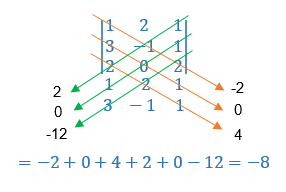

# Pré-Cálculo (937890)
## Aula 6 — Sistemas lineares e matrizes

> Texto integral da apostila oficial da Uninter (sem resumo). PDF original: [Aula_06.pdf](../_apostilas_pdf/04_Pre_Calculo/Aula_06.pdf)

PRÉ-CÁLCULO AULA 6

Prof. Guilherme Lemermeier Rodrigues

### CONVERSA INICIAL

Nesta etapa, trabalharemos com os conceitos de matrizes e sistemas lineares, conteúdo base na formação da área exata e cujas aplicações vão desde o controle de dados por meio de planilhas a contextos complexos de múltiplas variáveis que auxiliam tanto na aplicação, como nas tomadas de decisões estratégicas nos diversos campos das engenharias e tecnológicas.

### TEMA 1 – SISTEMAS LINEARES: DEFINIÇÃO

Usaremos um exemplo para definir um sistema linear e calcular sua solução por dois métodos.

Exemplo 1 Calcule os valores das incógnitas x e y.

� 𝑥𝑥 + 𝑦𝑦 = 3 2𝑥𝑥 + 𝑦𝑦 = 4

Vídeo: Aula 6 – Exemplo 1 – 5min.

### TEMA 2 – TIPOS DE SISTEMAS: SPD, SPI E SI

Dentro dos estudos de Sistemas Lineares temos três tipos, acompanhe nos próximos vídeos a definição e exemplificação geométrica de cada um. É denominado um Sistema Possível e Determinado (SPD) um sistema linear que possui apenas uma solução para cada variável.

Exemplo 2 Classifique o sistema a seguir:

�𝑥𝑥 + 2𝑦𝑦 = 4 𝑥𝑥 + 𝑦𝑦 = 3

Vídeo: Aula 6 – Exemplo 2 – 4min.

É denominado um Sistema Possível e Indeterminado (SPI) um sistema linear que possui mais de uma solução para cada variável.

Exemplo 3 Classifique o sistema a seguir:

� 𝑥𝑥 + 𝑦𝑦 = 4 2𝑥𝑥 + 2𝑦𝑦 = 8

Vídeo: Aula 6 – Exemplo 3 – 4min.

É denominado um Sistema Impossível (SI) um sistema linear que não possui solução.

Exemplo 4 Classifique o sistema a seguir:

�𝑥𝑥 + 𝑦𝑦 = 4 𝑥𝑥 + 𝑦𝑦 = 3 Vídeo: Aula 6 – Exemplo 4 – 4min.

### TEMA 3 – RESOLUÇÃO DE EXERCÍCIOS

Exemplo 5 Calcule os valores das incógnitas x e y.

� 𝑥𝑥 + 𝑦𝑦 + 𝑧𝑧 = 3 2𝑥𝑥 + 𝑦𝑦 + 𝑧𝑧 = 4 2𝑥𝑥 + 2𝑦𝑦 + 𝑧𝑧 = 5

Vídeo: Aula 6 – Exemplo 5 – 5min.

Exemplo 6 Classifique o sistema a seguir.

� 𝑥𝑥 + 𝑦𝑦 + 𝑧𝑧 = 3 𝑥𝑥 + 𝑦𝑦 + 2𝑧𝑧 = 4 2𝑥𝑥 + 𝑦𝑦 + 2𝑧𝑧 = 5

Vídeo: Aula 6 – Exemplo 6 – 5min.

### TEMA 4 – MATRIZES: DEFINIÇÃO

As matrizes são formas matemáticas usadas para organizar dados e deles retirar informações importantes.

Acompanhe no vídeo do exemplo 7 alguns tipos de matrizes e como são organizadas.

Vídeo: Aula 6 – Exemplo 7 – 3min.

No próximo vídeo, veremos as operações de soma, subtração e multiplicação.

Exemplo 8 Dadas as matrizes 𝐴𝐴 = �3 3 2 5� e 𝐵𝐵 = �4 −1 0 2 �, calcule a soma 𝐴𝐴 + 𝐵𝐵, a subtração 𝐴𝐴 − 𝐵𝐵 e a multiplicação 𝐴𝐴 × 𝐵𝐵.

Vídeo: Aula 6 – Exemplo 8 – 6min.

### TEMA 5 – DETERMINANTES

Determinantes são números ligados às matrizes que tem importância e uso em diversos mecanismos dentro dos cálculos na área exata. Acompanhe a definição de determinante de 1ª ordem no vídeo do exemplo 9.

Exemplo 9 Calcule os determinantes das matrizes 𝐴𝐴 = [2] e 𝐵𝐵 = [−3] Vídeo: Aula 6 – Exemplo 9 – 2min.

Acompanhe a definição de determinante de 2ª ordem no vídeo do exemplo 10.

Exemplo 10 Calcule os determinantes das matrizes 𝐴𝐴 = �3 3 2 5�, 𝐵𝐵 = �4 −1 0 2 � e 𝐶𝐶 = �3 −2 1 2 �.

Vídeo: Aula 6 – Exemplo 10 – 4min Acompanhe a definição de determinante de 3ª ordem no vídeo do exemplo 11.

Exemplo 11 Calcule o determinante da matriz de terceira ordem: 𝐴𝐴 = � 1 2 −1 3 2 1 1 0 2 �.

Vídeo: Aula 6 – Exemplo 11 – 4min

### FINALIZANDO

1. Dadas as matrizes 𝐴𝐴 = �1 3 2 4� e 𝐵𝐵 = �0 −1 3 2 �, calcule a soma 𝐴𝐴 + 𝐵𝐵.

2. Dadas as matrizes 𝐴𝐴 = �0 3 2 4� e 𝐵𝐵 = �3 −1 3 2 �, calcule subtração 𝐴𝐴 − 𝐵𝐵.

3.Dadas as matrizes 𝐴𝐴 = �1 −3 2 4 � e 𝐵𝐵 = �0 1 3 −2�, calcule a multiplicação 𝐴𝐴 × 𝐵𝐵.

4. Verifique se o sistema linear a seguir é um S.P.D.:

�2𝑎𝑎 + 3𝑏𝑏 = 5 3𝑎𝑎 − 𝑏𝑏 = 2 5. Verifique se o sistema linear a seguir é um S.P.I.:

� 2𝑎𝑎 + 3𝑏𝑏 = 5 −4𝑎𝑎 − 6𝑏𝑏 = −10 6. Verifique se o sistema linear a seguir é um S.I.:

�2𝑎𝑎 + 3𝑏𝑏 = 5 2𝑎𝑎 + 3𝑏𝑏 = 2 7. Calcule o determinante da matriz de segunda ordem: 𝐴𝐴 = �1 3 2 4�.

8. Calcule o determinante da matriz de terceira ordem: 𝐴𝐴 = � 1 2 1 3 −1 1 2 0 2 �

9. (Prefeitura de Cuiabá –  UFMT 2010) Em cada um dos quatro dias de desfile de carnaval, a temperatura foi medida em graus Celsius, no meio da multidão, em três momentos distintos. Cada elemento aij da matriz A abaixo corresponde à medida da temperatura no momento i do dia j.

𝐴𝐴 = � 37,2 38,7 37,7 38,1 40,3 39,8 36,5 38,2 38,5 38,9 40,1 39,2 � Qual foi, respectivamente, o momento e o dia em que se registrou a maior temperatura durante os desfiles?

a. 2º e 4º b. 2º e 2º c. 3º e 2º d. 3º e 4º 10. Um orçamento consta três produtos vendidos em forma combinada (combo).

Quantidade do produto A Quantidade do produto B Quantidade do produto C Valor final

Combo 1 2 3 2 R$ 1.050,00 Combo 2 3 1 1 R$ 650,00 Combo 3 0 2 3 R$ 900,00 Fonte: Rodrigues, 2023.

Calcule o valor unitário de cada produto.

EXERCÍCIOS RESOLVIDOS PASSO A PASSO:

1. Dadas as matrizes 𝐴𝐴 = �1 3 2 4� e 𝐵𝐵 = �0 −1 3 2 �, calcule a soma 𝐴𝐴 + 𝐵𝐵. Resolução:

�1 3 2 4� + �0 −1 3 2 � = �1 2 5 6�

2. Dadas as matrizes 𝐴𝐴 = �0 3 2 4� e 𝐵𝐵 = �3 −1 3 2 �, calcule subtração 𝐴𝐴 − 𝐵𝐵.

Resolução:

�0 3 2 4� − �3 −1 3 2 � = �−3 4 −1 2�

3.Dadas as matrizes 𝐴𝐴 = �1 −3 2 4 � e 𝐵𝐵 = �0 1 3 −2�, calcule a multiplicação 𝐴𝐴 × 𝐵𝐵.

Resolução:

�1 −3 2 4 � × �0 1 3 −2� = �1 ∙ 0 + (−3) ∙ 3 1 ∙ 1 + (−3)(−2) 2 ∙ 0 + 4 ∙ 3 2 ∙ 1 + 4 ∙ (−2) � = �−9 7 12 −6�

4. Verifique se o sistema linear a seguir é um S.P.D.:

�2𝑎𝑎 + 3𝑏𝑏 = 5 3𝑎𝑎 − 𝑏𝑏 = 2 Resolução:

Multiplicando a 2ª linha por (3), �2𝑎𝑎 + 3𝑏𝑏 = 5 9𝑎𝑎 − 3𝑏𝑏 = 6 Somando as duas linhas do sistema, �2𝑎𝑎 + 3𝑏𝑏 = 5 9𝑎𝑎 − 3𝑏𝑏 = 6    + 11𝑎𝑎       = 11 Assim o valor de 𝑎𝑎 = 1, na 1ª linha do sistema original,

2(1) + 3𝑏𝑏 = 5 2 + 3𝑏𝑏 = 5 3𝑏𝑏 = 5 − 2 3𝑏𝑏 = 3 𝑏𝑏 = 1 Resposta: S.P.D., onde 𝑎𝑎 = 1, 𝑏𝑏 = 1.

5. Verifique se o sistema linear a seguir é um S.P.I.:

� 2𝑎𝑎 + 3𝑏𝑏 = 5 −4𝑎𝑎 − 6𝑏𝑏 = −10 Resolução:

Multiplicando a 1ª linha por (2), � 2𝑎𝑎 + 3𝑏𝑏 = 5 −4𝑎𝑎 − 6𝑏𝑏 = −10 Somando as duas linhas do sistema, � 4𝑎𝑎 + 6𝑏𝑏 = 10 −4𝑎𝑎 − 6𝑏𝑏 = −10    + 0     =  0 Resposta: S.P.I., pois chega-se a uma igualdade plena, não há estabelecimento dos valores das incógnitas.

6. Verifique se o sistema linear a seguir é um S.I.:

�2𝑎𝑎 + 3𝑏𝑏 = 5 2𝑎𝑎 + 3𝑏𝑏 = 2 Resolução:

Multiplicando a 2ª linha por (-1), � 2𝑎𝑎 + 3𝑏𝑏 = 5 −2𝑎𝑎 − 3𝑏𝑏 = −2 Somando as duas linhas do sistema, � 2𝑎𝑎 + 3𝑏𝑏 = 5 −2𝑎𝑎 − 3𝑏𝑏 = −2    + 0     =   3 Resposta: S.I., pois chega-se a uma impossibilidade 0 = 3.

7. Calcule o determinante da matriz de segunda ordem: 𝐴𝐴 = �1 3 2 4�. Resolução:

8. Calcule o determinante da matriz de terceira ordem: 𝐴𝐴 = � 1 2 1 3 −1 1 2 0 2 �

Resolução:

9. (Prefeitura de Cuiabá – UFMT 2010) Em cada um dos quatro dias de desfile de carnaval, a temperatura foi medida em graus Celsius, no meio da multidão, em três momentos distintos. Cada elemento aij da matriz A abaixo corresponde à medida da temperatura no momento i do dia j.

𝐴𝐴 = � 37,2 38,7 37,7 38,1 40,3 39,8 36,5 38,2 38,5 38,9 40,1 39,2 � Qual foi, respectivamente, o momento e o dia em que se registrou a maior temperatura durante os desfiles?

a. 2º e 4º b. 2º e 2º c. 3º e 2º d. 3º e 4º Resolução:

𝐴𝐴 = � 37,2 38,7 37,7 38,1 40,3 39,8 36,5 38,2 38,5 38,9 40,1 39,2 � Alternativa correta b

10. Um orçamento consta três produtos vendidos em forma combinada (combo).

Quantidade do produto A Quantidade do produto B Quantidade do produto C Valor final Combo 1 2 3 2 R$ 1.050,00 Combo 2 3 1 1 R$ 650,00 Combo 3 0 2 3 R$ 900,00 Fonte: Rodrigues, 2023.

Calcule o valor unitário de cada produto:

Resolução:

� 2𝐴𝐴 + 3𝐵𝐵 + 2𝐶𝐶 = 1050 3𝐴𝐴 + 1𝐵𝐵 + 1𝐶𝐶 = 650 2𝐵𝐵 + 3𝐶𝐶 = 900

Olhando para a terceira linha e isolando o C:

2𝐵𝐵 + 3𝐶𝐶 = 900 3𝐶𝐶 = 900 − 2𝐵𝐵 Passando o 3 que está multiplicando o C na forma de divisão para o lado direita da igualdade, 𝐶𝐶 = 300 − 2 3 𝐵𝐵 Substituindo nas duas primeiras linhas do sistema, � 2𝐴𝐴 + 3𝐵𝐵 + 2 �300 − 2 3 𝐵𝐵� = 1050 3𝐴𝐴 + 1𝐵𝐵 + 1 �300 − 2 3 𝐵𝐵� = 650 � 2𝐴𝐴 + 3𝐵𝐵 + 600 − 4 3 𝐵𝐵 = 1050 3𝐴𝐴 + 𝐵𝐵 + 300 − 2 3 𝐵𝐵 = 650 Somando os valores da incógnita B em cada uma das linhas usando o MMC, � 2𝐴𝐴 + 𝟑𝟑𝟑𝟑 + 600 − 𝟒𝟒 𝟑𝟑 𝟑𝟑 = 1050 3𝐴𝐴 + 𝟑𝟑 + 300 − 𝟐𝟐 𝟑𝟑 𝟑𝟑 = 650 � 2𝐴𝐴 + 𝟓𝟓 𝟑𝟑 𝟑𝟑 = 450 3𝐴𝐴 + 𝟑𝟑 𝟑𝟑 = 350         ∙ (−5) � 2𝐴𝐴 + 5 3 𝐵𝐵 = 450 −15𝐴𝐴 − 5𝐵𝐵 3 = −1750 Somando as duas linhas, −13𝐴𝐴 = −1300 𝐴𝐴 = 100 Substituindo A = 100 na primeira linha, 2 ∙ 𝑨𝑨 + 5 3 𝐵𝐵 = 450 2 ∙ 𝟏𝟏𝟏𝟏𝟏𝟏 + 5 3 𝐵𝐵 = 450

200 + 5 3 𝐵𝐵 = 450 3 𝐵𝐵 = 250 5𝐵𝐵 = 3 ∙ 250 5𝐵𝐵 = 450 𝐵𝐵 = 450 5 𝐵𝐵 = 150 Para calcular C, substituindo B=150 terceira linha do sistema inicial, 2𝟑𝟑 + 3𝐶𝐶 = 900 2 ∙ 𝟏𝟏𝟓𝟓𝟏𝟏 + 3𝐶𝐶 = 900 300 + 3𝐶𝐶 = 900 3𝐶𝐶 = 900 − 300 3𝐶𝐶 = 600 𝐶𝐶 = 600 3 𝐶𝐶 = 200 Resposta: os valores unitários são: A = R$ 100,00: B = R$ 150 e C = R$ 200.

### REFERÊNCIAS

AXLER, S. Pré-Cálculo: uma preparação para o cálculo. 2. ed. São Paulo: LTC, 2016.

DEMANA, F. D. et al. Pré-cálculo. São Paulo: Pearson, 2009.
